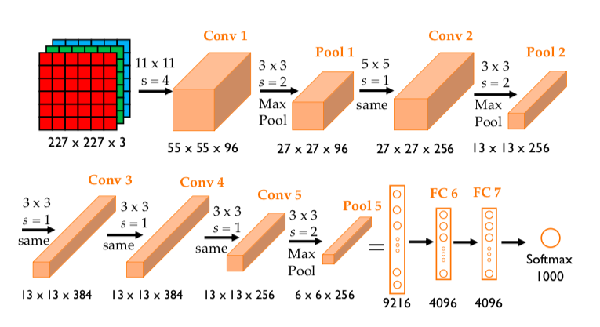
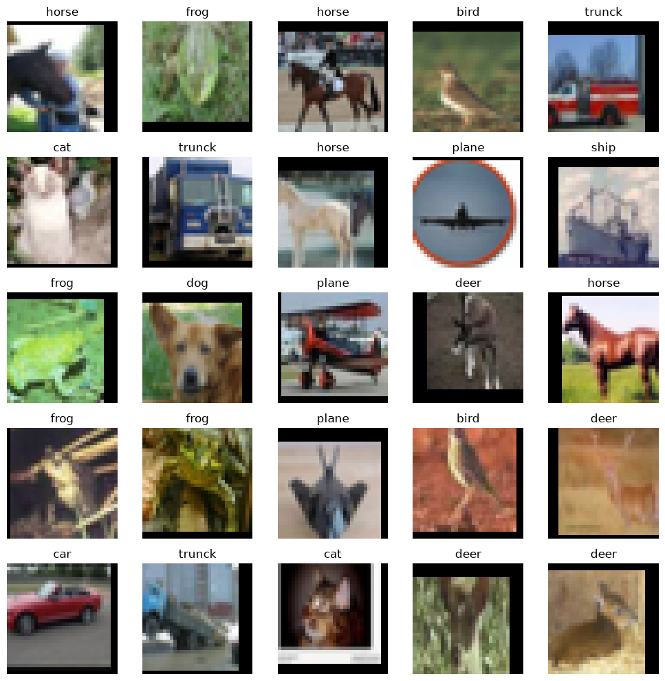

# [55일차] AlexNet과 CIFAR-10 컬러 이미지 분류

54일차에서는 작은 흑백 도형을 CNN으로 분류했다. 이번에는 RGB 컬러 이미지 데이터셋인 **CIFAR-10**을 사용해, 더 깊은 CNN 구조인 AlexNet 계열 모델을 구성한다.

핵심은 단순히 레이어를 많이 쌓는 데 있지 않다. 컬러 채널별 통계량으로 정규화하고, 학습 데이터에만 증강을 적용하며, 검증·테스트 데이터를 엄격히 분리해야 믿을 수 있는 분류 모델을 만들 수 있다.

---

## 1. AlexNet이 중요한 이유

AlexNet은 Alex Krizhevsky, Ilya Sutskever, Geoffrey Hinton이 발표한 합성곱 신경망이다. 5개의 합성곱 레이어와 3개의 완전 연결 레이어, 총 8개의 학습 레이어로 구성된다.

논문은 ImageNet의 대규모 이미지 분류 문제에서 ReLU, Dropout, 데이터 증강, GPU 병렬 연산을 활용했다. 논문에 따르면 ILSVRC-2012에 제출한 모델은 Top-5 오류율 15.3%를 기록했고, 당시 2위 결과는 26.2%였다. 이 결과는 이미지 인식에서 딥러닝의 가능성을 널리 알리는 계기가 됐다. [AlexNet 논문](https://papers.nips.cc/paper_files/paper/2012/file/c399862d3b9d6b76c8436e924a68c45b-Paper.pdf)



### 원본 AlexNet과 이번 모델의 차이

이번 코드는 원본 AlexNet을 그대로 복제한 모델이 아니라, `32 x 32` CIFAR-10 이미지에 맞게 작게 조정한 **AlexNetCIFAR10** 모델이다.

| 구분 | 원본 AlexNet | 이번 `AlexNetCIFAR10` |
|---|---|---|
| 입력 이미지 | 큰 RGB 이미지 | `32 x 32` RGB 이미지 |
| 합성곱 레이어 | 5개 | 5개 |
| 완전 연결 레이어 | 3개, 큰 레이어 크기 | 3개, `1024 -> 512 -> 10` |
| 첫 합성곱 | 큰 커널과 큰 stride | `3 x 3`, stride 1 |
| 출력 클래스 | ImageNet 1,000개 | CIFAR-10 10개 |
| 목적 | 대규모 ImageNet 분류 | 작은 컬러 이미지로 구조 이해 |

따라서 이번 모델은 AlexNet의 깊은 합성곱 구조, ReLU, Max Pooling, Dropout이라는 핵심 아이디어를 CIFAR-10에 맞춰 적용한 버전으로 이해하면 된다.

---

## 2. Top-1과 Top-5 오류율

다중 분류 모델은 클래스마다 점수(logit)를 출력한다. 이를 확률로 바꾸면 가장 가능성 높은 클래스뿐 아니라 상위 후보 목록도 볼 수 있다.

| 지표 | 정답으로 보는 조건 |
|---|---|
| Top-1 Accuracy | 확률이 가장 높은 클래스가 정답이다. |
| Top-5 Accuracy | 확률이 높은 상위 5개 클래스 안에 정답이 포함된다. |
| Top-1 Error | Top-1 Accuracy가 틀린 비율이다. |
| Top-5 Error | 상위 5개 안에 정답이 없는 비율이다. |

클래스가 1,000개인 ImageNet에서는 고양이 품종처럼 서로 비슷한 클래스를 구분해야 하므로 Top-5 지표가 특히 유용하다. 클래스가 10개인 CIFAR-10에서도 계산은 가능하지만, 보통 Top-1 정확도를 주로 확인한다.

```python
# logits: [배치 크기, 클래스 수]
top5_indices = logits.topk(k=5, dim=1).indices

# 각 샘플의 상위 5개 예측 안에 정답이 있는지 확인한다.
top5_correct = top5_indices.eq(labels.unsqueeze(1)).any(dim=1)
top5_accuracy = top5_correct.float().mean()
```

---

## 3. CIFAR-10 데이터셋

CIFAR-10은 10개 클래스로 구성된 대표적인 컬러 이미지 데이터셋이다. 각 이미지는 `32 x 32` 픽셀이고, RGB 채널 3개를 가진다.

| 항목 | 내용 |
|---|---|
| 전체 이미지 수 | 60,000장 |
| 학습 이미지 | 50,000장 |
| 공식 테스트 이미지 | 10,000장 |
| 이미지 형태 | `3 x 32 x 32` RGB |
| 클래스 수 | 10개 |

```python
class_names = [
    "plane", "car", "bird", "cat", "deer",
    "dog", "frog", "horse", "ship", "truck",
]
```

> 노트북의 클래스 이름 `trunck`는 `truck`의 오타다. 레이블 번호에는 영향을 주지 않지만, 시각화 제목이 잘못 표시되므로 수정해야 한다.

---

## 4. RGB 채널별 평균과 표준편차

흑백 이미지는 채널이 하나지만, 컬러 이미지는 R·G·B 세 채널을 가진다. 채널마다 밝기 분포가 다를 수 있으므로, 학습 데이터 전체에서 **채널별 평균과 표준편차**를 구해 정규화한다.

```python
from pathlib import Path
from torchvision import datasets, transforms

DATA_DIR = Path("data")

raw_train_dataset = datasets.CIFAR10(
    root=DATA_DIR,
    train=True,
    download=True,
    transform=transforms.ToTensor(),
)

# data의 형태는 [이미지 수, 높이, 너비, 채널]이다.
# 0, 1, 2축을 평균 내면 RGB 채널별 통계량만 남는다.
mean = raw_train_dataset.data.mean(axis=(0, 1, 2)) / 255.0
std = raw_train_dataset.data.std(axis=(0, 1, 2)) / 255.0

print("평균:", mean)
print("표준편차:", std)
```

`Normalize(mean=mean, std=std)`는 채널마다 다음 계산을 적용한다.

```text
정규화된 픽셀값 = (픽셀값 - 해당 채널의 평균) / 해당 채널의 표준편차
```

평균과 표준편차는 **학습 데이터에서만** 구해야 한다. 검증·테스트 데이터에서 새 통계량을 계산하면 평가 데이터의 정보가 전처리에 섞이는 데이터 누수(data leakage)가 생긴다.

---

## 5. CIFAR-10용 데이터 증강

학습 이미지는 약간 잘리거나 좌우로 뒤집혀도 원래 클래스가 바뀌지 않는다. 이를 이용해 학습 단계에서만 증강을 적용한다.

```python
train_transform = transforms.Compose([
    # 바깥에 4픽셀을 채운 뒤 32 x 32 영역을 무작위로 자른다.
    transforms.RandomCrop(32, padding=4),
    # 50% 확률로 좌우를 뒤집는다.
    transforms.RandomHorizontalFlip(),
    # PIL 이미지를 float32 텐서로 바꾸고 0~255를 0~1로 스케일한다.
    transforms.ToTensor(),
    # RGB 채널별 평균·표준편차로 정규화한다.
    transforms.Normalize(mean=mean, std=std),
])

eval_transform = transforms.Compose([
    transforms.ToTensor(),
    transforms.Normalize(mean=mean, std=std),
])
```

| 변환 | 효과 | 적용 대상 |
|---|---|---|
| `RandomCrop(32, padding=4)` | 위치가 조금 달라진 물체도 인식하도록 돕는다. | 학습 |
| `RandomHorizontalFlip()` | 좌우 방향 변화에 덜 민감하게 만든다. | 학습 |
| `ToTensor()` | 이미지를 텐서로 바꾸고 값 범위를 조정한다. | 모두 |
| `Normalize(mean, std)` | 채널별 값 분포를 조정해 최적화를 안정화한다. | 모두 |

자동차나 동물처럼 좌우가 바뀌어도 의미가 같은 데이터에는 좌우 반전이 유용하다. 그러나 글자처럼 좌우 반전하면 의미가 달라지는 데이터에는 무작정 적용하면 안 된다.

---

## 6. 학습·검증·테스트 데이터 분리

공식 학습 데이터 50,000장 중 10%를 검증 데이터로 분리한다. `stratify=all_targets`를 사용하면 클래스 비율을 유지한 채 나눌 수 있다.

```python
import numpy as np
from sklearn.model_selection import train_test_split
from torch.utils.data import Subset

all_indices = np.arange(len(raw_train_dataset))
all_targets = np.array(raw_train_dataset.targets)

train_indices, validation_indices = train_test_split(
    all_indices,
    test_size=0.1,
    random_state=SEED,
    stratify=all_targets,
)

train_full_dataset = datasets.CIFAR10(
    root=DATA_DIR,
    train=True,
    download=False,
    transform=train_transform,
)

validation_full_dataset = datasets.CIFAR10(
    root=DATA_DIR,
    train=True,
    download=False,
    transform=eval_transform,
)

# 공식 테스트셋은 반드시 train=False로 불러온다.
test_dataset = datasets.CIFAR10(
    root=DATA_DIR,
    train=False,
    download=True,
    transform=eval_transform,
)

train_dataset = Subset(train_full_dataset, train_indices)
validation_dataset = Subset(
    validation_full_dataset,
    validation_indices,
)

print("학습 데이터:", len(train_dataset))        # 45,000
print("검증 데이터:", len(validation_dataset))  # 5,000
print("테스트 데이터:", len(test_dataset))      # 10,000
```

### 노트북 코드에서 바로잡을 부분

노트북은 `test_dataset`을 만들 때 `train=True`로 작성되어 있다. 이 상태에서는 공식 테스트셋이 아니라 학습 데이터 전체를 다시 불러오게 된다. 반드시 `train=False`로 수정해야 한다.

```python
# 잘못된 코드
train=True

# 수정 코드
train=False
```

---

## 7. DataLoader와 CUDA용 `pin_memory`

```python
from torch.utils.data import DataLoader

BATCH_SIZE = 128
NUM_WORKERS = 0

train_loader = DataLoader(
    train_dataset,
    batch_size=BATCH_SIZE,
    shuffle=True,
    num_workers=NUM_WORKERS,
    pin_memory=(DEVICE.type == "cuda"),
)

validation_loader = DataLoader(
    validation_dataset,
    batch_size=BATCH_SIZE,
    shuffle=False,
    num_workers=NUM_WORKERS,
    pin_memory=(DEVICE.type == "cuda"),
)

test_loader = DataLoader(
    test_dataset,
    batch_size=BATCH_SIZE,
    shuffle=False,
    num_workers=NUM_WORKERS,
    pin_memory=(DEVICE.type == "cuda"),
)
```

- `NUM_WORKERS=0`은 별도의 데이터 로딩 프로세스를 만들지 않고 현재 프로세스에서 데이터를 읽는다. Jupyter 환경에서는 먼저 0으로 두고 확인하는 방법이 단순하다.
- `pin_memory=True`는 CPU 배치를 CUDA GPU 전송에 유리한 고정 메모리에 준비하는 옵션이다. 모델의 정확도를 바꾸지 않으며, MPS·CPU 환경에서는 이점이 제한적이다.
- 검증·테스트에서는 데이터 순서가 성능에 영향을 주지 않으므로 `shuffle=False`를 사용한다. 특히 테스트 로더는 재현 가능한 예측 확인을 위해 섞지 않는 편이 좋다.

> 노트북의 `test_loader`는 `shuffle=True`다. 정답률 자체는 달라지지 않지만, 평가 용도에는 `shuffle=False`가 더 자연스럽다.

---

## 8. 정규화된 컬러 이미지 다시 보기

정규화된 이미지는 바로 출력하면 색이 어색하게 보인다. 화면에 표시하기 전 채널별 역정규화를 적용한다.

```python
from torchvision.transforms.functional import to_pil_image


def denormalize(image, mean, std):
    # [3] -> [3, 1, 1]로 바꿔 RGB 채널 전체에 브로드캐스팅한다.
    mean_tensor = torch.tensor(mean, dtype=image.dtype).view(3, 1, 1)
    std_tensor = torch.tensor(std, dtype=image.dtype).view(3, 1, 1)

    # Normalize의 역연산: x * std + mean
    image = image.cpu() * std_tensor + mean_tensor
    return image.clamp(0, 1)
```

`clamp(0, 1)`은 계산 오차로 범위를 벗어난 픽셀값을 화면에 표시할 수 있는 범위로 제한한다.



---

## 9. CIFAR-10용 AlexNet 구조

```python
from torch import nn


class AlexNetCIFAR10(nn.Module):
    def __init__(self, num_classes=10):
        super().__init__()

        self.features = nn.Sequential(
            nn.Conv2d(3, 96, kernel_size=3, stride=1, padding=1),
            nn.ReLU(inplace=True),
            nn.MaxPool2d(kernel_size=2, stride=2),

            nn.Conv2d(96, 256, kernel_size=3, padding=1),
            nn.ReLU(inplace=True),
            nn.MaxPool2d(kernel_size=2, stride=2),

            nn.Conv2d(256, 384, kernel_size=3, padding=1),
            nn.ReLU(inplace=True),
            nn.Conv2d(384, 384, kernel_size=3, padding=1),
            nn.ReLU(inplace=True),
            nn.Conv2d(384, 256, kernel_size=3, padding=1),
            nn.ReLU(inplace=True),
            nn.MaxPool2d(kernel_size=2, stride=2),
        )

        self.avgpool = nn.AdaptiveAvgPool2d((4, 4))

        self.classifier = nn.Sequential(
            nn.Dropout(p=0.5),
            nn.Linear(256 * 4 * 4, 1024),
            nn.ReLU(inplace=True),
            nn.Dropout(p=0.5),
            nn.Linear(1024, 512),
            nn.ReLU(inplace=True),
            nn.Linear(512, num_classes),
        )

    def forward(self, x):
        x = self.features(x)
        x = self.avgpool(x)
        x = torch.flatten(x, start_dim=1)
        return self.classifier(x)
```

### 텐서 형태의 변화

| 단계 | 텐서 형태 | 설명 |
|---|---|---|
| 입력 | `[N, 3, 32, 32]` | RGB 이미지 N장 |
| 첫 합성곱 + 풀링 | `[N, 96, 16, 16]` | 특징 맵 96개, 크기 절반 |
| 두 번째 합성곱 + 풀링 | `[N, 256, 8, 8]` | 채널 증가, 크기 절반 |
| 3~5번째 합성곱 + 풀링 | `[N, 256, 4, 4]` | 복잡한 특징 추출 |
| `AdaptiveAvgPool2d((4, 4))` | `[N, 256, 4, 4]` | 현재 입력 크기에서는 형태를 유지한다. |
| `flatten(start_dim=1)` | `[N, 4096]` | 배치 축을 제외하고 평탄화 |
| 분류기 | `[N, 10]` | 10개 클래스의 logit |

`AdaptiveAvgPool2d((4, 4))`는 지금의 입력 크기에서는 결과를 바꾸지 않는다. 하지만 앞선 구조나 이미지 크기가 달라져도 분류기가 항상 `256 x 4 x 4 = 4096`개 입력을 받도록 보장한다.

### `Dropout(p=0.5)`를 두 번 사용하는 이유

완전 연결 레이어는 파라미터가 많아 과적합이 생기기 쉽다. AlexNet 계열 모델은 분류기 앞에 `Dropout(p=0.5)`를 두어 학습 중 일부 활성화를 무작위로 0으로 만든다.

```text
학습 모드: Dropout 작동 -> 일부 활성화 0 -> 과적합 완화
평가 모드: Dropout 비활성화 -> 모든 활성화 사용
```

---

## 10. 파라미터 수 확인하기

신경망의 가중치와 편향은 텐서로 저장된다. `numel()`은 텐서 안에 든 원소 수를 반환한다.

```python
model = AlexNetCIFAR10(num_classes=10).to(DEVICE)

total_parameters = sum(
    parameter.numel()
    for parameter in model.parameters()
)

trainable_parameters = sum(
    parameter.numel()
    for parameter in model.parameters()
    if parameter.requires_grad
)

print(f"전체 파라미터 수: {total_parameters}")
print(f"학습 가능한 파라미터 수: {trainable_parameters}")
```

```text
전체 파라미터 수: 8046986
학습 가능한 파라미터 수: 8046986
```

`requires_grad=True`인 파라미터만 역전파에서 기울기를 계산하고 업데이트한다. 전이 학습에서는 일부 레이어를 고정할 수 있는데, 그때 `requires_grad=False`로 바꾼 파라미터는 학습 가능한 파라미터 수에서 제외된다.

---

## 11. 핵심 정리

- AlexNet은 5개 합성곱 레이어와 3개 완전 연결 레이어를 사용한 대표적인 CNN이다.
- 이번 모델은 원본 AlexNet의 핵심 구조를 `32 x 32` CIFAR-10에 맞춰 축소한 변형이다.
- CIFAR-10은 RGB 3채널 데이터이므로 채널별 평균·표준편차로 정규화한다.
- 정규화 통계량은 학습 데이터로만 계산해 데이터 누수를 막는다.
- 학습 데이터에만 무작위 자르기·좌우 반전 증강을 적용한다.
- `stratify`를 사용하면 학습·검증 데이터에 클래스 비율을 유지할 수 있다.
- 공식 테스트셋은 `train=False`로 읽고, 테스트 `DataLoader`는 보통 `shuffle=False`로 둔다.
- `AdaptiveAvgPool2d((4, 4))`는 분류기 입력 크기를 고정한다.
- `numel()`과 `requires_grad`로 전체 파라미터 수와 학습 대상 파라미터 수를 확인할 수 있다.

