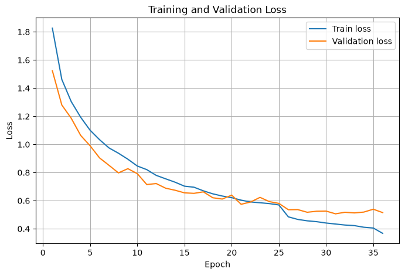
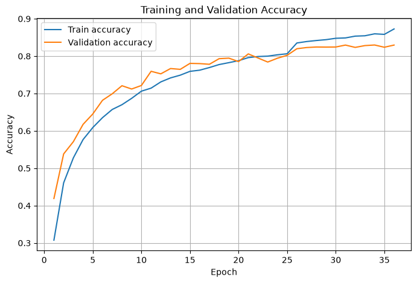
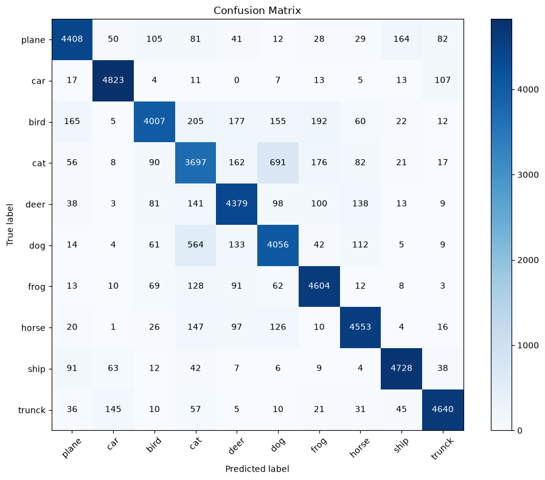
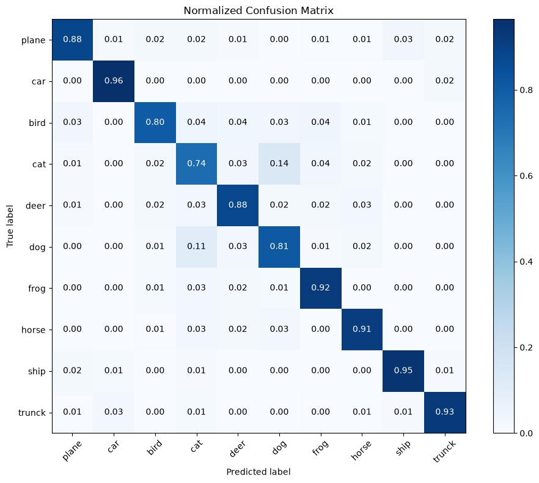

# [56일차] AlexNet 학습 루프와 모델 성능 평가

---

## 1. 학습 전 출력 형태 확인하기

학습을 시작하기 전에 임의의 입력을 모델에 넣어 특징 맵과 최종 출력 형태가 의도대로 나오는지 확인한다. 실제 학습을 돌린 뒤에 형태 오류를 찾는 것보다 훨씬 빠르고 안전하다.

```python
dummy_input = torch.randn(2, 3, 32, 32).to(DEVICE)

with torch.inference_mode():
    feature_output = model.features(dummy_input)
    pooled_output = model.avgpool(feature_output)
    logits = model(dummy_input)

print("합성곱 특징:", feature_output.shape)
print("AdaptiveAvgPool:", pooled_output.shape)
print("logits:", logits.shape)
```

```text
합성곱 특징:  torch.Size([2, 256, 4, 4])
AdaptiveAvgPool:  torch.Size([2, 256, 4, 4])
logits:          torch.Size([2, 10])
```

| 결과 | 의미 |
|---|---|
| `2` | 한 번에 넣은 이미지 수, 즉 배치 크기다. |
| `256` | 마지막 합성곱 블록이 만든 특징 채널 수다. |
| `4 x 4` | 공간 크기다. |
| `10` | CIFAR-10의 10개 클래스에 대한 점수다. |

마지막 `logits`는 확률이 아니라 클래스별 **원시 점수**다. `nn.CrossEntropyLoss()`가 내부적으로 필요한 계산을 수행하므로, 손실 함수에 전달하기 전에 `softmax()`를 따로 적용하지 않는다.

---

## 2. 학습 설정: 손실 함수, 옵티마이저, 학습률 스케줄러

```python
EPOCHS = 50
LEARNING_RATE = 1e-3
WEIGHT_DECAY = 1e-4

criterion = nn.CrossEntropyLoss()

optimizer = torch.optim.AdamW(
    model.parameters(),
    lr=LEARNING_RATE,
    weight_decay=WEIGHT_DECAY,
)

scheduler = torch.optim.lr_scheduler.ReduceLROnPlateau(
    optimizer,
    mode="min",
    factor=0.5,
    patience=3,
)
```

| 설정 | 역할 |
|---|---|
| `CrossEntropyLoss` | 다중 분류에서 예측 점수와 정답 레이블의 차이를 손실로 계산한다. |
| `AdamW` | 기울기를 이용해 가중치를 갱신한다. `weight_decay`를 분리해 적용하는 Adam 계열 옵티마이저다. |
| `weight_decay=1e-4` | 가중치가 과도하게 커지는 것을 완화해 과적합을 줄이는 데 도움을 준다. |
| `ReduceLROnPlateau` | 검증 손실이 개선되지 않는 기간이 이어지면 학습률을 줄인다. |
| `factor=0.5` | 학습률을 절반으로 줄인다. |
| `patience=3` | 3회 동안 검증 손실 개선이 없을 때 학습률 감소를 고려한다. |

학습률은 처음부터 계속 크게 유지하면 최적점 근처에서 손실이 흔들릴 수 있다. 검증 손실이 정체될 때 학습률을 낮추면 더 작은 폭으로 가중치를 조정할 수 있다.

---

## 3. 한 에포크 학습 함수

학습 단계에서는 순전파, 손실 계산, 역전파, 가중치 갱신이 모두 필요하다. `model.train()`은 Dropout 같은 학습 전용 동작을 활성화한다.

```python
def train_one_epoch(data_loader, model, criterion, optimizer, device):
    # Dropout 등 학습 모드가 필요한 레이어를 활성화한다.
    model.train()

    total_loss = 0.0
    total_correct = 0
    total_samples = 0

    for images, labels in data_loader:
        images = images.to(device)
        labels = labels.to(device)

        # 이전 배치에서 계산된 기울기를 비운다.
        optimizer.zero_grad()

        # 1. 순전파: 클래스별 logit을 얻는다.
        logits = model(images)

        # 2. 손실을 계산한다.
        loss = criterion(logits, labels)

        # 3. 역전파로 각 파라미터의 기울기를 계산한다.
        loss.backward()

        # 4. 계산된 기울기로 가중치를 갱신한다.
        optimizer.step()

        batch_size = labels.size(0)
        total_loss += loss.item() * batch_size
        total_correct += (logits.argmax(dim=1) == labels).sum().item()
        total_samples += batch_size

    average_loss = total_loss / total_samples
    accuracy = total_correct / total_samples
    return average_loss, accuracy
```

### 배치 손실에 `batch_size`를 곱하는 이유

`CrossEntropyLoss`의 기본값은 배치 손실의 평균을 반환한다. 마지막 배치는 다른 배치보다 작을 수 있으므로, 단순히 배치 평균들을 다시 평균 내면 모든 샘플이 같은 비중으로 반영되지 않는다.

```python
total_loss += loss.item() * batch_size
average_loss = total_loss / total_samples
```

위 계산은 각 배치의 평균 손실을 샘플 수만큼 되돌린 다음, 전체 샘플 수로 나눈다. 즉 모든 이미지가 동일한 비중을 가지는 정확한 에포크 평균 손실을 구한다.

---

## 4. 검증과 테스트: 가중치를 바꾸지 않는 평가 함수

검증과 테스트에서는 모델의 성능을 측정할 뿐, 가중치를 수정하면 안 된다.

```python
def evaluate(data_loader, model, criterion, device):
    # Dropout을 비활성화해 추론 동작으로 전환한다.
    model.eval()

    total_loss = 0.0
    total_correct = 0
    total_samples = 0

    # 기울기와 계산 그래프를 만들지 않아 메모리와 시간을 아낀다.
    with torch.inference_mode():
        for images, labels in data_loader:
            images = images.to(device)
            labels = labels.to(device)

            logits = model(images)
            loss = criterion(logits, labels)

            batch_size = labels.size(0)
            total_loss += loss.item() * batch_size
            total_correct += (logits.argmax(dim=1) == labels).sum().item()
            total_samples += batch_size

    average_loss = total_loss / total_samples
    accuracy = total_correct / total_samples
    return average_loss, accuracy
```

| 구분 | `train_one_epoch()` | `evaluate()` |
|---|---|---|
| 모드 | `model.train()` | `model.eval()` |
| Dropout | 활성화 | 비활성화 |
| 기울기 계산 | 수행 | 수행하지 않음 |
| `optimizer.step()` | 수행 | 수행하지 않음 |
| 목적 | 가중치 학습 | 현재 모델 성능 측정 |

`torch.inference_mode()`는 평가처럼 기울기가 전혀 필요 없는 경우에 사용한다. `torch.no_grad()`와 비슷하게 자동 미분을 끄지만, 추론 전용이라는 의도를 더 분명하게 나타내고 추가적인 오버헤드를 줄일 수 있다.

---

## 5. 검증 손실 기반 체크포인트와 조기 종료

학습 정확도가 가장 높은 시점의 모델이 일반화 성능도 가장 좋다는 보장은 없다. 학습에 사용하지 않은 검증 데이터의 손실이 가장 작을 때를 기준으로 최고 모델을 저장한다.

```python
from pathlib import Path

OUTPUT_DIR = Path("outputs")
OUTPUT_DIR.mkdir(exist_ok=True)

BEST_MODEL_PATH = OUTPUT_DIR / "alexnet_cifar10_best.pth"
EARLY_STOPPING_PATIENCE = 5

history = {
    "train_loss": [],
    "train_accuracy": [],
    "validation_loss": [],
    "validation_accuracy": [],
}

best_validation_loss = float("inf")
epochs_without_improvement = 0
```

```python
for epoch in range(1, EPOCHS + 1):
    train_loss, train_accuracy = train_one_epoch(
        train_loader, model, criterion, optimizer, DEVICE
    )
    validation_loss, validation_accuracy = evaluate(
        validation_loader, model, criterion, DEVICE
    )

    # 검증 손실을 기준으로 필요할 때 학습률을 줄인다.
    scheduler.step(validation_loss)

    history["train_loss"].append(train_loss)
    history["train_accuracy"].append(train_accuracy)
    history["validation_loss"].append(validation_loss)
    history["validation_accuracy"].append(validation_accuracy)

    if validation_loss < best_validation_loss:
        best_validation_loss = validation_loss
        epochs_without_improvement = 0

        # 모델의 학습 가능한 파라미터만 저장한다.
        torch.save(model.state_dict(), BEST_MODEL_PATH)
        print(f"최고 모델 저장: {BEST_MODEL_PATH}")
    else:
        epochs_without_improvement += 1

        if epochs_without_improvement >= EARLY_STOPPING_PATIENCE:
            print("조기 종료: 검증 손실이 더 이상 개선되지 않았습니다.")
            break
```

### 체크포인트와 조기 종료의 차이

| 기능 | 판단 기준 | 하는 일 |
|---|---|---|
| 체크포인트 | 검증 손실이 기존 최고 기록보다 작은가 | 현재 가중치를 파일에 저장한다. |
| 조기 종료 | 검증 손실 개선이 일정 횟수 동안 없는가 | 남은 에포크를 실행하지 않고 학습을 끝낸다. |

두 기능은 함께 쓰는 편이 좋다. 조기 종료 직전의 모델이 최고 모델이라는 보장은 없으므로, 학습이 끝난 뒤에는 저장해 둔 체크포인트를 다시 불러와 테스트한다.

---

## 6. 학습 곡선 읽기

노트북 실행에서는 50 에포크를 계획했지만, 검증 손실이 5번 연속 개선되지 않아 36 에포크에서 조기 종료됐다. 학습률은 25 에포크에 `0.001 -> 0.0005`, 35 에포크에 `0.0005 -> 0.00025`로 줄었다.





그래프는 다음 관점으로 읽는다.

| 관찰 | 해석 |
|---|---|
| 학습·검증 손실이 함께 감소 | 모델이 데이터의 규칙을 학습하고 있다. |
| 학습 손실은 감소하지만 검증 손실이 상승 | 학습 데이터에 과하게 맞춘 과적합 신호일 수 있다. |
| 두 정확도가 모두 낮고 비슷함 | 모델 용량, 학습 횟수, 데이터 표현 등이 부족한 과소적합일 수 있다. |
| 검증 손실이 흔들리거나 정체 | 학습률 감소, 규제, 데이터 증강, 조기 종료를 검토한다. |

정확도만 보면 어느 한두 개의 자신 없는 오답을 놓칠 수 있다. 따라서 체크포인트와 스케줄러는 정확도가 아니라 더 연속적인 값인 **검증 손실**을 기준으로 동작하게 했다.

---

## 7. 저장한 최고 모델 불러오기와 테스트 평가

`state_dict`는 모델 파라미터를 담은 딕셔너리다. 모델 구조를 먼저 만든 뒤 저장했던 가중치를 불러온다.

```python
try:
    # 최근 PyTorch에서는 가중치만 읽는 방식을 사용할 수 있다.
    best_state_dict = torch.load(
        BEST_MODEL_PATH,
        map_location=DEVICE,
        weights_only=True,
    )
except TypeError:
    # weights_only 인자를 지원하지 않는 이전 버전 호환 코드다.
    best_state_dict = torch.load(BEST_MODEL_PATH, map_location=DEVICE)

model.load_state_dict(best_state_dict)

test_loss, test_accuracy = evaluate(test_loader, model, criterion, DEVICE)
print(f"test loss: {test_loss:.4f}")
print(f"test accuracy: {test_accuracy:.2%}")
```

노트북 실행 결과는 다음과 같다.

```text
test loss: 0.3529
test accuracy: 87.79%
```

> 주의: 이 노트북의 분류 리포트는 클래스당 `5,000`개, 총 `50,000`개를 사용한다. 이는 `test_dataset`을 `train=True`로 만든 코드의 결과이므로 공식 CIFAR-10 테스트 성능으로 해석하면 안 된다. 55일차에서 정리한 대로 `train=False`로 수정한 뒤, 총 `10,000`개 공식 테스트셋으로 다시 평가해야 한다.

---

## 8. 예측 결과 수집하기

혼동 행렬과 분류 리포트를 만들려면 전체 테스트셋의 실제 레이블과 예측 레이블이 필요하다.

```python
def collect_predictions(data_loader, model, device):
    model.eval()
    true_labels = []
    predicted_labels = []

    with torch.inference_mode():
        for images, labels in data_loader:
            images = images.to(device)
            logits = model(images)

            # 가장 큰 logit의 위치가 최종 예측 클래스 번호다.
            predictions = logits.argmax(dim=1).cpu()

            # sklearn은 NumPy 배열을 사용하므로 CPU 메모리의 값으로 모은다.
            true_labels.extend(labels.numpy().tolist())
            predicted_labels.extend(predictions.numpy().tolist())

    return np.array(true_labels), np.array(predicted_labels)


true_labels, predicted_labels = collect_predictions(test_loader, model, DEVICE)
```

`argmax(dim=1)`에서 `dim=1`은 클래스 축이다. 예를 들어 출력 형태가 `[128, 10]`이면, 128개 이미지마다 10개 점수 중 가장 큰 값의 인덱스를 구한다.

---

## 9. 혼동 행렬로 오분류 살펴보기

혼동 행렬(confusion matrix)은 행에 실제 클래스, 열에 예측 클래스를 둔 표다. 대각선 값이 클수록 해당 클래스를 정확하게 맞춘 수가 많다. 대각선 밖의 값은 어떤 클래스를 다른 클래스로 헷갈렸는지 보여준다.

```python
from sklearn.metrics import confusion_matrix

confusion = confusion_matrix(true_labels, predicted_labels)
```



정규화하지 않은 행렬은 실제 개수다. 데이터 수가 클래스마다 다른 데이터셋에서는 단순 개수를 비교하기 어려울 수 있으므로, 각 행을 해당 행의 합으로 나눈 정규화 행렬도 함께 확인한다.



```python
row_sums = display_matrix.sum(axis=1, keepdims=True)

normalized_matrix = np.divide(
    display_matrix,
    row_sums,
    out=np.zeros_like(display_matrix),
    where=row_sums != 0,
)
```

행 기준 정규화에서 각 행의 합은 1이 된다. 따라서 대각선의 값은 해당 실제 클래스의 **재현율(recall)** 과 같다. 예를 들어 실제 `bird` 행의 대각선 값이 낮다면, 새 사진 속 새를 새라고 찾아내는 비율이 낮다는 뜻이다.

이번 결과에서는 `cat`과 `dog`, `bird`와 다른 동물 클래스처럼 모양과 배경이 비슷한 범주에서 상대적으로 많은 오분류가 나타난다. 반면 `car`, `ship`, `truck`은 비교적 높은 대각선 비율을 보인다.

> 노트북의 클래스 이름 `trunck`는 `truck`의 오타다. 레이블 번호에는 영향이 없지만 그래프와 리포트에는 `truck`으로 수정해 표시해야 한다.

---

## 10. 분류 리포트: Precision, Recall, F1-score

```python
from sklearn.metrics import classification_report

print(
    classification_report(
        true_labels,
        predicted_labels,
        target_names=class_names,
        digits=4,
        zero_division=0,
    )
)
```

| 지표 | 계산 | 의미 |
|---|---|---|
| Precision | `TP / (TP + FP)` | 해당 클래스로 예측한 것 중 실제로 맞은 비율이다. |
| Recall | `TP / (TP + FN)` | 실제 해당 클래스 중 모델이 찾아낸 비율이다. |
| F1-score | `2 * Precision * Recall / (Precision + Recall)` | Precision과 Recall의 균형을 나타낸다. |
| Support | - | 실제 해당 클래스 샘플 수다. |

노트북 결과에서는 전체 정확도가 `0.8779`이고, 클래스별 F1-score는 `cat`이 `0.7340`, `dog`가 `0.7935`, `car`가 `0.9539`, `ship`이 `0.9434`로 나타났다. 따라서 전체 정확도만으로는 고양이·개처럼 더 어려운 클래스의 성능 차이를 알기 어렵다.

`macro avg`는 각 클래스의 지표를 동일한 비중으로 평균 낸 값이다. `weighted avg`는 각 클래스의 샘플 수를 가중치로 사용한다. 현재처럼 클래스별 데이터 수가 같으면 두 값이 거의 같지만, 불균형 데이터에서는 둘의 차이가 커질 수 있다.

---

## 11. 전체 흐름 정리

```text
데이터 로더에서 배치 수집
        ↓
모델 학습: train → forward → loss → backward → optimizer.step
        ↓
검증: eval + inference_mode로 validation loss 측정
        ↓
검증 손실이 최저면 state_dict 저장
        ↓
검증 손실 정체 시 학습률 감소, 오래 지속되면 조기 종료
        ↓
저장한 최고 가중치 재로딩
        ↓
공식 테스트셋 평가
        ↓
정확도 + 혼동 행렬 + 분류 리포트로 클래스별 성능 해석
```

---

## 마무리

이번 과정에서 모델 학습은 단순히 `fit` 한 번을 실행하는 일이 아니라는 점을 확인했다. 학습 모드와 평가 모드를 구분하고, 검증 손실로 학습률과 종료 시점을 제어하며, 가장 좋은 가중치를 따로 저장해야 한다.

또한 최종 정확도만으로 모델을 판단하면 놓치는 정보가 많다. 혼동 행렬과 분류 리포트를 함께 확인하면 어떤 클래스를 잘 맞히고 어떤 클래스에서 헷갈리는지 구체적으로 파악할 수 있다.
