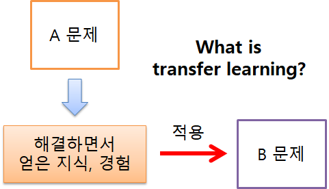
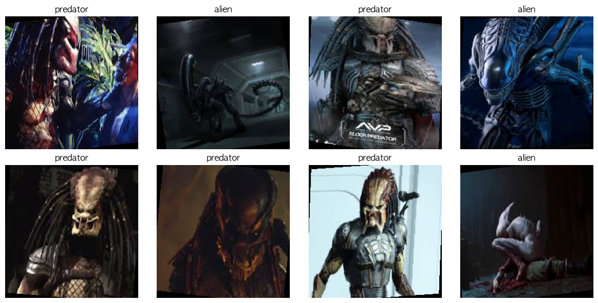
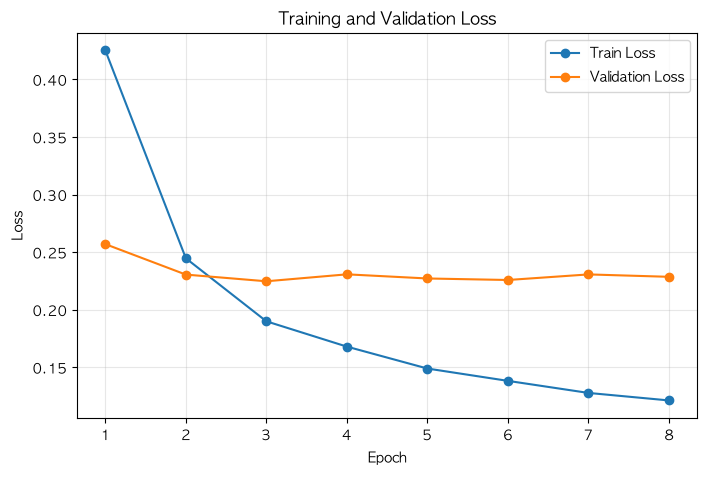
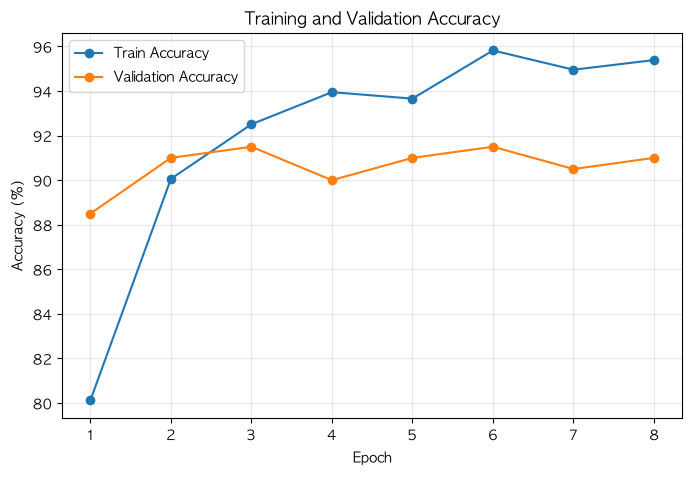
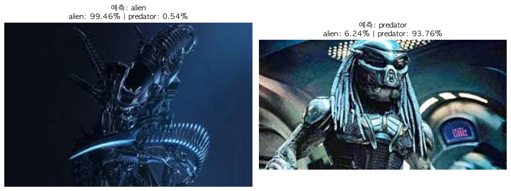
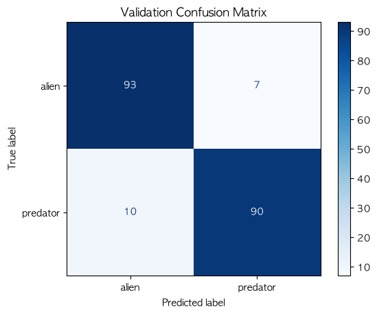

# [57일차] 전이 학습으로 에일리언과 프레데터 이진 분류

이번에는 `alien`과 `predator` 이미지를 구분하는 이진 이미지 분류 모델을 만든다. 데이터는 학습 이미지 694장, 검증 이미지 200장으로 많지 않다. 이런 상황에서 CNN을 처음부터 학습하면 데이터가 부족해 과적합되기 쉽고 학습 시간도 길어진다.

따라서 ImageNet으로 이미 학습된 AlexNet을 불러온 뒤, 기존 특징 추출기는 고정하고 마지막 분류기만 두 클래스 문제에 맞게 바꾸는 **전이 학습(Transfer Learning)** 을 적용한다.

---

## 1. 데이터셋 구조와 `ImageFolder`

`torchvision.datasets.ImageFolder`는 폴더 이름을 클래스 이름으로 사용한다. 따라서 다음처럼 폴더 구조를 맞춰야 한다.

```text
data/alien_vs_predator/
├── train/
│   ├── alien/
│   │   └── 이미지 파일들
│   └── predator/
│       └── 이미지 파일들
└── validation/
    ├── alien/
    │   └── 이미지 파일들
    └── predator/
        └── 이미지 파일들
```

```python
from pathlib import Path
from torchvision import datasets

PROJECT_DIR = Path.cwd()
DATA_DIR = PROJECT_DIR / "data" / "alien_vs_predator"

TRAIN_DIR = DATA_DIR / "train"
VALIDATION_DIR = DATA_DIR / "validation"

image_datasets = {
    "train": datasets.ImageFolder(TRAIN_DIR, transform=data_transforms["train"]),
    "validation": datasets.ImageFolder(
        VALIDATION_DIR,
        transform=data_transforms["validation"],
    ),
}
```

`ImageFolder`는 클래스 폴더를 알파벳순으로 정렬해 레이블 번호를 만든다. 이번 데이터셋의 매핑은 다음과 같다.

```python
class_names = image_datasets["train"].classes
class_to_idx = image_datasets["train"].class_to_idx
idx_to_class = {idx: name for name, idx in class_to_idx.items()}

print(class_names)     # ['alien', 'predator']
print(class_to_idx)    # {'alien': 0, 'predator': 1}
print(idx_to_class)    # {0: 'alien', 1: 'predator'}
```

| 구분 | alien | predator | 합계 |
|---|---:|---:|---:|
| 학습 데이터 | 347장 | 347장 | 694장 |
| 검증 데이터 | 100장 | 100장 | 200장 |

두 클래스의 수가 같으므로, 단순 정확도도 클래스별 성능을 어느 정도 공정하게 반영한다. 다만 실제 데이터가 불균형하다면 정확도만 보지 말고 Precision, Recall, F1-score도 함께 확인해야 한다.

---

## 2. 전이 학습이란

전이 학습은 한 문제에서 학습한 지식과 가중치를 다른 문제에 활용하는 방법이다. ImageNet 같은 대규모 데이터로 학습된 모델은 이미지의 가장자리, 색 변화, 질감, 부분 형태처럼 여러 이미지에 공통으로 나타나는 특징을 이미 배운 상태다.



```text
ImageNet 사전 학습 AlexNet
        ↓
일반적인 이미지 특징 추출 능력 활용
        ↓
마지막 분류기만 alien / predator 문제에 맞게 교체
        ↓
작은 데이터셋으로 빠르게 학습
```

### 처음부터 학습하는 방식과 비교

| 구분 | 처음부터 학습 | 전이 학습 |
|---|---|---|
| 시작 가중치 | 무작위 값 | ImageNet 사전 학습 가중치 |
| 필요한 데이터 양 | 비교적 많다 | 적은 데이터에서도 유리하다 |
| 학습 시간 | 길어질 수 있다 | 빠르게 수렴할 수 있다 |
| 과적합 위험 | 작은 데이터에서 크다 | 특징 추출기 고정 시 완화할 수 있다 |
| 이번 실습 | 적합하지 않다 | 적합하다 |

전이 학습이 항상 정답은 아니다. 의료 영상, 위성 사진처럼 ImageNet 사진과 이미지 성격이 크게 다르면 사전 학습 특징이 충분하지 않을 수 있다. 이 경우 더 많은 층을 미세 조정하거나 해당 분야의 사전 학습 모델을 고려해야 한다.

---

## 3. 사전 학습 모델에 맞춘 이미지 전처리

ImageNet 사전 학습 AlexNet은 `224 x 224` RGB 이미지와 특정 평균·표준편차 분포를 기준으로 학습됐다. 같은 모델을 활용할 때는 입력 크기와 정규화 기준도 맞추는 편이 좋다.

```python
from torchvision import transforms

IMAGE_SIZE = 224
IMAGENET_MEAN = [0.485, 0.456, 0.406]
IMAGENET_STD = [0.229, 0.224, 0.225]

data_transforms = {
    "train": transforms.Compose([
        # 이미지 일부를 무작위로 잘라 224 x 224로 만든다.
        transforms.RandomResizedCrop(IMAGE_SIZE, scale=(0.8, 1.0)),
        # 좌우 반전을 통해 방향 변화에 강하게 만든다.
        transforms.RandomHorizontalFlip(p=0.5),
        # 작은 회전과 shear만 적용해 실제 촬영 변화 범위에 맞춘다.
        transforms.RandomAffine(degrees=8, shear=8),
        transforms.ToTensor(),
        transforms.Normalize(IMAGENET_MEAN, IMAGENET_STD),
    ]),
    "validation": transforms.Compose([
        # 검증 데이터에는 무작위 변환을 적용하지 않는다.
        transforms.Resize(256),
        transforms.CenterCrop(IMAGE_SIZE),
        transforms.ToTensor(),
        transforms.Normalize(IMAGENET_MEAN, IMAGENET_STD),
    ]),
}
```

| 변환 | 학습 | 검증 | 이유 |
|---|---|---|---|
| `RandomResizedCrop` | 사용 | 사용하지 않음 | 객체의 위치와 크기 변화에 덜 민감하도록 만든다. |
| `RandomHorizontalFlip` | 사용 | 사용하지 않음 | 좌우 방향이 달라도 같은 클래스로 인식하도록 돕는다. |
| `RandomAffine` | 사용 | 사용하지 않음 | 가벼운 기울어짐·왜곡에 대응한다. |
| `Resize` + `CenterCrop` | 사용하지 않음 | 사용 | 항상 같은 기준으로 성능을 측정한다. |
| `Normalize` | 사용 | 사용 | 사전 학습 모델이 기대하는 입력 분포에 맞춘다. |

> 노트북의 `IMAGENET_STD` 세 번째 값은 `0.224`로 작성되어 있다. 일반적인 ImageNet 사전 학습 가중치의 RGB 표준편차는 `[0.229, 0.224, 0.225]`이므로 파란색 채널은 `0.225`로 맞추는 편이 자연스럽다. 학습·검증·단일 예측 모두 같은 값으로 일관되게 사용해야 한다.

증강은 무조건 강하게 적용할수록 좋은 것이 아니다. 예를 들어 객체가 위아래로 뒤집히거나 과도하게 잘린 이미지를 실제 서비스에서 만나지 않는다면, 그런 변환은 오히려 잘못된 규칙을 학습하게 만들 수 있다.

---

## 4. DataLoader와 재현성

```python
import torch
from torch.utils.data import DataLoader

BATCH_SIZE = 32
NUM_WORKERS = 0
PIN_MEMORY = DEVICE.type == "cuda"
SEED = 2026

generator = torch.Generator()
generator.manual_seed(SEED)

dataloaders = {
    "train": DataLoader(
        image_datasets["train"],
        batch_size=BATCH_SIZE,
        shuffle=True,
        num_workers=NUM_WORKERS,
        pin_memory=PIN_MEMORY,
        generator=generator,
        persistent_workers=NUM_WORKERS > 0,
    ),
    "validation": DataLoader(
        image_datasets["validation"],
        batch_size=BATCH_SIZE,
        shuffle=False,
        num_workers=NUM_WORKERS,
        pin_memory=PIN_MEMORY,
        persistent_workers=NUM_WORKERS > 0,
    ),
}
```

```python
images, labels = next(iter(dataloaders["train"]))

print(images.shape)  # torch.Size([32, 3, 224, 224])
print(labels.shape)  # torch.Size([32])
print(labels.dtype)  # torch.int64
```

- `shuffle=True`: 학습 데이터의 순서를 매 에포크마다 섞어 순서 편향을 줄인다.
- `generator.manual_seed(SEED)`: DataLoader가 섞는 순서를 재현 가능하게 만든다. 단, 데이터 증강까지 완전히 재현하려면 PyTorch·NumPy 등의 난수 시드도 함께 관리해야 한다.
- `persistent_workers=NUM_WORKERS > 0`: 워커를 사용하는 경우에만 에포크 사이 워커를 유지한다. `NUM_WORKERS=0`일 때는 반드시 `False`여야 한다.
- `pin_memory=True`: CUDA GPU를 사용할 때 CPU에서 GPU로 배치를 전달하는 속도에 도움을 줄 수 있다. 정확도에는 영향을 주지 않는다.



정규화된 텐서를 화면에 표시할 때는 평균과 표준편차를 다시 되돌려야 자연스러운 색으로 보인다.

```python
def denormalize_image(image_tensor):
    mean = torch.tensor(IMAGENET_MEAN).view(3, 1, 1)
    std = torch.tensor(IMAGENET_STD).view(3, 1, 1)

    image = image_tensor.cpu() * std + mean
    return image.clamp(0, 1)
```

---

## 5. 사전 학습 AlexNet 불러오기

```python
from torchvision import models
from torchvision.models import AlexNet_Weights

weights = AlexNet_Weights.IMAGENET1K_V1
model = models.alexnet(weights=weights)
```

`weights=...`를 전달하면 무작위 AlexNet이 아니라 ImageNet 1,000개 클래스로 학습된 가중치를 불러온다. 원래 AlexNet의 마지막 레이어는 1,000개 클래스 점수를 출력한다.

```text
기존 입력: 224 x 224 RGB 이미지
기존 출력: [배치 크기, 1000]
이번 출력: [배치 크기, 1]
```

### 모델 고정(Model Freezing)

```python
# 기존 AlexNet의 모든 가중치를 고정한다.
for parameter in model.parameters():
    parameter.requires_grad = False

# 마지막 분류기만 이진 분류용 출력 1개로 교체한다.
in_features = model.classifier[6].in_features
model.classifier[6] = nn.Linear(in_features, 1)

model = model.to(DEVICE)
```

`requires_grad=False`인 파라미터는 기울기를 계산하지 않으므로 갱신되지 않는다. 이후 새로 만든 `nn.Linear(..., 1)`은 기본값이 `requires_grad=True`이므로 이 레이어만 학습된다.

```python
total_params = sum(p.numel() for p in model.parameters())
trainable_params = sum(p.numel() for p in model.parameters() if p.requires_grad)

print(f"전체 파라미터 수: {total_params:,}")
print(f"학습 가능한 파라미터 수: {trainable_params:,}")
```

```text
전체 파라미터 수: 57,007,937
학습 가능한 파라미터 수: 4,097
```

새 분류기의 파라미터 수는 `4096 x 1`개의 가중치와 편향 1개를 합친 `4,097`개다. 5,700만 개가 넘는 전체 파라미터 중 극히 일부만 업데이트하므로, 작은 데이터셋에서도 학습 부담과 과적합 위험을 크게 줄일 수 있다.

---

## 6. 이진 분류 출력과 `BCEWithLogitsLoss`

두 클래스를 분류한다고 해서 출력 뉴런을 꼭 두 개 만들 필요는 없다. 이진 분류에서는 출력 하나를 사용해 클래스 1일 가능성을 나타낼 수 있다.

```text
모델 출력 logit z
       ↓ sigmoid
클래스 1일 확률 p = 1 / (1 + e^(-z))
       ↓ 임계값 0.5
p < 0.5 → 클래스 0 (alien)
p ≥ 0.5 → 클래스 1 (predator)
```

```python
criterion = nn.BCEWithLogitsLoss()

optimizer = optim.AdamW(
    filter(lambda parameter: parameter.requires_grad, model.parameters()),
    lr=1e-3,
    weight_decay=1e-4,
)
```

`BCEWithLogitsLoss`는 Sigmoid와 Binary Cross Entropy를 한 번에 안정적으로 계산한다. 따라서 학습 때는 `sigmoid()`를 먼저 적용하지 않고 logit을 그대로 전달한다.

```python
logits = model(images)                    # [배치 크기, 1]
labels = labels.float().unsqueeze(1)      # [배치 크기, 1]

loss = criterion(logits, labels)
```

| 값 | 이유 |
|---|---|
| `labels.float()` | BCE 계열 손실 함수는 정답을 `0.0`, `1.0` 형태의 실수 텐서로 받는다. |
| `unsqueeze(1)` | 레이블을 `[B]`에서 모델 출력과 같은 `[B, 1]` 형태로 바꾼다. |
| `torch.sigmoid(logits)` | 손실 계산이 아니라 사람이 읽을 확률과 최종 예측을 만들 때 사용한다. |

```python
probabilities = torch.sigmoid(logits)
predictions = (probabilities >= 0.5).long()
```

`0.5`는 기본 임계값일 뿐이다. 실제 서비스에서 프레데터를 놓치는 비용이 특히 크다면 검증 데이터로 임계값을 조정해 Recall을 높이는 방법도 고려할 수 있다.

---

## 7. 학습과 검증을 하나의 함수로 구성하기

`optimizer`가 전달되면 학습 모드, 전달되지 않으면 평가 모드로 동작하게 만들 수 있다.

```python
def run_epoch(model, loader, criterion, device, optimizer=None):
    is_training = optimizer is not None
    model.train() if is_training else model.eval()

    running_loss = 0.0
    running_correct = 0
    running_samples = 0

    # 학습에서만 기울기를 기록한다.
    grad_context = torch.enable_grad() if is_training else torch.inference_mode()

    with grad_context:
        for images, labels in loader:
            images = images.to(device, non_blocking=PIN_MEMORY)
            labels = labels.float().unsqueeze(1).to(device, non_blocking=PIN_MEMORY)

            if is_training:
                optimizer.zero_grad()

            logits = model(images)
            loss = criterion(logits, labels)

            if is_training:
                loss.backward()
                optimizer.step()

            predictions = (torch.sigmoid(logits) >= 0.5).float()
            batch_size = labels.size(0)

            running_loss += loss.item() * batch_size
            running_correct += (predictions == labels).sum().item()
            running_samples += batch_size

    return running_loss / running_samples, running_correct / running_samples
```

노트북에는 `torch.autocast()`와 `torch.amp.GradScaler()`를 이용한 자동 혼합 정밀도(AMP)도 포함돼 있다. AMP는 지원되는 가속기에서 일부 연산을 낮은 정밀도로 처리해 속도와 메모리 사용량을 개선할 수 있다.

다만 AMP 지원 범위는 장치와 PyTorch 버전에 따라 달라진다. 가장 단순하고 호환성 높은 CUDA 사용 예시는 다음과 같다.

```python
use_amp = DEVICE.type == "cuda"
scaler = torch.amp.GradScaler("cuda", enabled=use_amp)

with torch.autocast(
    device_type=DEVICE.type,
    dtype=torch.float16,
    enabled=use_amp,
):
    logits = model(images)
    loss = criterion(logits, labels)

scaler.scale(loss).backward()
scaler.step(optimizer)
scaler.update()
```

`GradScaler`는 매우 작은 FP16 기울기가 0이 되는 underflow를 줄이기 위해 손실을 임시로 키운다. CPU나 MPS에서 실행할 때는 무조건 같은 설정을 복사하기보다, 현재 장치에서 AMP를 지원하는지 먼저 확인해야 한다.

---

## 8. 검증 손실 기준 모델 저장과 학습 결과

```python
from torch.optim import lr_scheduler

EPOCHS = 10
EARLY_STOPPING_PATIENCE = 5
MODEL_PATH = PROJECT_DIR / "best_alien_predator_alexnet.pth"

scheduler = lr_scheduler.ReduceLROnPlateau(
    optimizer,
    mode="min",
    factor=0.5,
    patience=2,
)
```

검증 손실이 가장 작은 시점의 모델을 저장한다. 체크포인트에는 단순히 모델 가중치만 넣지 않고, 예측을 재현하는 데 필요한 클래스 매핑과 전처리 정보도 함께 저장한다.

```python
torch.save(
    {
        "model_state_dict": model.state_dict(),
        "class_to_idx": class_to_idx,
        "image_size": IMAGE_SIZE,
        "mean": IMAGENET_MEAN,
        "std": IMAGENET_STD,
        "best_val_loss": best_val_loss,
    },
    MODEL_PATH,
)
```

### 실행 결과

노트북에서는 10 에포크를 계획했지만, 검증 손실이 5회 연속 개선되지 않아 8 에포크에서 조기 종료됐다. 가장 작은 검증 손실은 3 에포크의 `0.2247`이며, 그때 검증 정확도는 `91.50%`다.

| 항목 | 결과 |
|---|---:|
| 최고 검증 손실 | 0.2247 |
| 최고 시점 검증 정확도 | 91.50% |
| 마지막 학습 정확도 | 95.39% |
| 검증 데이터 수 | 200장 |
| 실제 실행 에포크 수 | 8 |





3 에포크 이후 학습 손실은 계속 감소하지만 검증 손실은 `0.22` 부근에서 거의 개선되지 않는다. 학습 정확도와 검증 정확도의 간격도 조금씩 커진다. 이는 작은 데이터셋에서 나타나는 가벼운 과적합 신호로 볼 수 있으며, 학습률 감소와 조기 종료가 필요한 이유가 된다.

`ReduceLROnPlateau`는 검증 손실이 개선되지 않자 6 에포크부터 학습률을 `0.001`에서 `0.0005`로 낮췄다. 그래도 검증 손실이 최고 기록보다 좋아지지 않아 조기 종료가 실행됐다.

저장한 체크포인트는 다음처럼 불러온다.

```python
checkpoint = torch.load(MODEL_PATH, map_location=DEVICE, weights_only=True)
model.load_state_dict(checkpoint["model_state_dict"])
model.eval()

print(f"최고 검증 손실: {checkpoint['best_val_loss']:.4f}")
print(f"저장된 클래스 정보: {checkpoint['class_to_idx']}")
```

---

## 9. 단일 이미지 예측

단일 이미지는 학습·검증 때와 **동일한 검증용 변환**을 적용해야 한다. 특히 ImageNet 평균·표준편차가 달라지면 모델이 예상하지 못한 입력 분포를 받게 된다.

```python
from PIL import Image

def predict_image(image_path, model, transform, device, idx_to_class):
    image_path = Path(image_path)
    if not image_path.exists():
        raise FileNotFoundError(f"이미지 파일을 찾을 수 없습니다: {image_path}")

    image = Image.open(image_path).convert("RGB")
    input_tensor = transform(image).unsqueeze(0).to(device)

    model.eval()
    with torch.inference_mode():
        logit = model(input_tensor)
        class_1_probability = torch.sigmoid(logit).item()

    probabilities = {
        idx_to_class[0]: 1.0 - class_1_probability,
        idx_to_class[1]: class_1_probability,
    }
    predicted_class = max(probabilities, key=probabilities.get)

    return image, predicted_class, probabilities
```

```python
MY_IMAGE_PATH = DATA_DIR / "BJH.png"

image, predicted_class, probabilities = predict_image(
    image_path=MY_IMAGE_PATH,
    model=model,
    transform=data_transforms["validation"],
    device=DEVICE,
    idx_to_class=idx_to_class,
)

for class_name, probability in probabilities.items():
    print(f"{class_name}: {probability * 100:.2f}%")

print(f"결과: {predicted_class} 쪽에 가깝습니다.")
```



### 노트북 코드에서 바로잡을 부분

노트북의 마지막 예측 셀은 `MY_IMAGE_PATH`를 만들었지만, 실제 호출에는 이전 반복문에서 사용한 `sample_path`를 전달한다. 사용자 이미지를 예측하려면 `image_path=MY_IMAGE_PATH`로 전달해야 한다.

또한 확률 출력 반복문에서 `class_names` 전체 리스트를 출력하는 대신, 현재 반복 중인 `class_name`을 출력해야 한다.

```python
# 잘못된 출력: ['alien', 'predator']가 두 번 출력된다.
print(f"{class_names}: {probability * 100:.2f}%")

# 수정: 현재 클래스 이름과 확률을 출력한다.
print(f"{class_name}: {probability * 100:.2f}%")
```

---

## 10. 분류 리포트와 혼동 행렬

```python
from sklearn.metrics import classification_report, ConfusionMatrixDisplay

print(
    classification_report(
        all_labels,
        all_predictions,
        target_names=class_names,
        digits=4,
        zero_division=0,
    )
)

ConfusionMatrixDisplay.from_predictions(
    all_labels,
    all_predictions,
    display_labels=class_names,
    cmap="Blues",
)
plt.title("Validation Confusion Matrix")
plt.show()
```



혼동 행렬의 행은 실제 레이블, 열은 모델의 예측 레이블이다.

| 실제 클래스 | alien 예측 | predator 예측 | 해석 |
|---|---:|---:|---|
| alien | 93 | 7 | 100장 중 93장을 alien으로 맞췄다. |
| predator | 10 | 90 | 100장 중 90장을 predator로 맞췄다. |

```text
accuracy:  0.9150
alien F1:  0.9163
predator F1: 0.9137
```

이 결과에서 alien의 Recall은 `0.9300`, predator의 Recall은 `0.9000`이다. 즉 실제 predator 100장 중 10장을 alien으로 예측했다. 전체 정확도는 높아도, 어떤 종류의 실수가 남아 있는지 혼동 행렬을 통해 구체적으로 확인할 수 있다.

---

## 11. 다음 단계: Fine-tuning

이번 실습은 마지막 분류기만 학습하는 **feature extraction 방식**이다. 성능을 더 높이고 싶다면, 먼저 분류기를 학습한 뒤 AlexNet의 뒤쪽 합성곱 블록 일부를 고정 해제하는 fine-tuning을 시도할 수 있다.

```python
# 예시: 마지막 합성곱 블록 일부만 고정 해제한다.
for parameter in model.features[10:].parameters():
    parameter.requires_grad = True

# 사전 학습 가중치가 크게 흔들리지 않도록 더 작은 학습률을 사용한다.
optimizer = optim.AdamW(
    filter(lambda parameter: parameter.requires_grad, model.parameters()),
    lr=1e-5,
    weight_decay=1e-4,
)
```

fine-tuning은 데이터셋에 더 잘 맞는 특징을 학습할 가능성이 있지만, 데이터가 694장으로 작으므로 과적합 위험도 커진다. 따라서 검증 손실을 기준으로 성능이 실제로 좋아지는지 반드시 확인해야 한다.

---

## 마무리

전이 학습은 대규모 데이터로 배운 특징을 작은 데이터셋 문제에 재사용하는 방법이다. 이번 실습에서는 ImageNet 사전 학습 AlexNet의 기존 가중치를 고정하고, 마지막 분류기만 `alien`과 `predator`를 구분하도록 바꿨다.

이진 분류에서는 출력 logit 하나와 `BCEWithLogitsLoss`를 사용하고, 예측 단계에서만 Sigmoid로 확률을 구한다. 마지막으로 검증 손실 기반 체크포인트, 학습 곡선, 혼동 행렬을 함께 확인하면 단순 정확도보다 훨씬 신뢰도 있게 모델을 평가할 수 있다.
