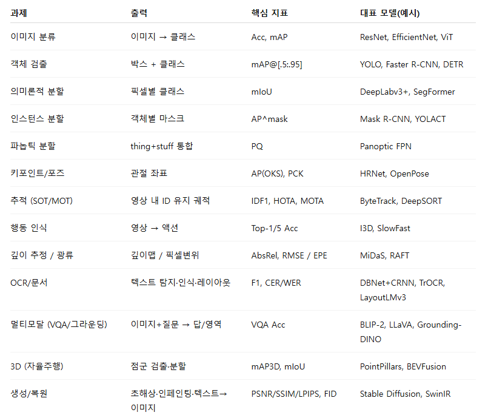
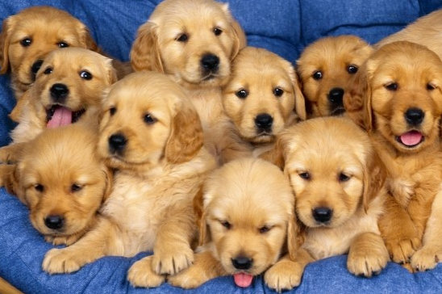

# [58일차] 컴퓨터 비전과 OpenCV 기초

컴퓨터 비전(Computer Vision)은 컴퓨터가 이미지와 영상에서 의미 있는 정보를 읽고 해석하도록 만드는 분야다. 사람에게는 자연스러운 사진 한 장도 컴퓨터 입장에서는 숫자로 이루어진 배열일 뿐이다. 컴퓨터 비전은 이 숫자 배열에서 물체, 위치, 윤곽, 움직임 같은 정보를 찾아내는 기술이다.

이번에는 컴퓨터 비전의 대표 과제와 어노테이션 방식을 살펴보고, OpenCV로 이미지·마우스 이벤트·동영상을 다루는 기본 흐름을 정리한다.

---

## 1. 컴퓨터 비전이란

컴퓨터 비전은 이미지나 영상 데이터를 분석해 분류, 검출, 분할, 추적, 인식 같은 작업을 수행하는 인공지능 분야다. 전통적인 영상 처리 기법과 머신러닝, 딥러닝 모델을 함께 사용한다.

| 활용 분야 | 컴퓨터 비전이 하는 일 |
|---|---|
| 자율주행 | 차선, 차량, 보행자, 신호등을 인식한다. |
| 의료 영상 | CT, MRI, X-ray에서 관심 영역이나 이상 소견을 찾는다. |
| 제조 | 제품의 불량, 누락, 표면 이상을 검사한다. |
| 보안 | 얼굴·행동을 인식하고 객체를 추적한다. |
| 문서 처리 | 문서 사진에서 글자와 레이아웃을 읽는다. |

컴퓨터 비전 모델의 성능은 알고리즘뿐 아니라 **데이터의 품질, 다양성, 라벨 정확성**에 크게 좌우된다. 조명, 배경, 촬영 거리, 물체 방향이 한쪽으로 치우친 데이터만 학습하면 실제 환경에서 성능이 떨어질 수 있다.

---

## 2. 대표 데이터셋

컴퓨터 비전에서는 목적에 맞는 데이터셋과 주석(annotation)을 선택해야 한다.

| 데이터셋·플랫폼 | 주 활용 분야 | 특징 |
|---|---|---|
| AI Hub | 국내 특화 AI 데이터 활용 | 이미지, 영상, 음성, 자연어 등 다양한 국내 데이터가 있다. |
| COCO | 검출, 분할, 키포인트, 캡셔닝 | 일상 장면 안에 여러 객체가 함께 있는 이미지와 풍부한 주석을 제공한다. |
| Open Images | 분류, 검출, 분할 | 웹 이미지 기반의 대규모 객체 주석을 제공한다. |
| KITTI | 자율주행, 깊이 추정, SLAM | 도로 영상과 LiDAR, GPS/IMU 등 센서 정보를 함께 다룬다. |
| MNIST, CIFAR-10 | 기초 이미지 분류 | 모델 구조와 학습 과정을 익히기 좋다. |

데이터셋을 고를 때는 이미지 수만 보지 말고, 해결하려는 문제와 비슷한 환경인지, 클래스가 균형적인지, 라벨 품질이 충분한지 확인해야 한다.

일반적으로 이미지 데이터셋은 학습용과 검증용으로 나누며, 클래스별 이미지와 그에 대응하는 정답 정보를 함께 관리한다.

```text
dataset/
├── train/        # 모델 파라미터를 학습하는 이미지와 라벨
└── validation/   # 학습 과정의 성능을 점검하는 이미지와 라벨
```

---

## 3. 어노테이션: 이미지에 정답을 붙이는 방법

어노테이션은 지도학습을 위해 이미지나 영상에 정답 정보를 부여하는 작업이다. 같은 이미지라도 어떤 문제를 풀지에 따라 필요한 정답 형식이 달라진다.

| 방식 | 정답 형태 | 활용 예시 |
|---|---|---|
| 분류(Classification) | 이미지 전체의 클래스 | 고양이/강아지 분류 |
| 바운딩 박스 | `(x, y, width, height)` 또는 두 꼭짓점 | 차량·보행자 검출 |
| 폴리곤 | 객체 윤곽을 잇는 여러 점 | 건물·도로 경계 |
| 의미론적 분할 | 모든 픽셀의 클래스 | 도로, 하늘, 보도 구분 |
| 인스턴스 분할 | 객체별 픽셀 마스크 | 사람 A와 사람 B를 각각 분리 |
| 키포인트 | 관절·얼굴 특징점 좌표 | 자세 추정, 얼굴 랜드마크 |
| 스켈레톤 | 키포인트와 연결 관계 | 동작 인식, 스포츠 분석 |
| 폴리라인 | 선 또는 연속 선분 | 차선, 도로 경계 |
| 3D 바운딩 박스 | 3차원 위치·크기·방향 | 자율주행 LiDAR 객체 검출 |

### 바운딩 박스와 세그멘테이션의 차이

```text
바운딩 박스:              세그멘테이션:
+----------------+         배경 배경 배경 배경
|                |         배경 객체 객체 배경
|     객체       |         배경 객체 객체 배경
|                |         배경 배경 배경 배경
+----------------+

객체 주변 배경도 포함한다.      객체 픽셀만 정확히 구분한다.
```

세그멘테이션은 더 정밀한 정보를 제공하지만, 픽셀 단위 라벨링이 필요하므로 데이터 제작 비용이 더 크다.

---

## 4. 컴퓨터 비전의 대표 과제



| 과제 | 출력 | 핵심 질문 |
|---|---|---|
| 이미지 분류 | 이미지 → 클래스 | 이 사진은 무엇인가? |
| 객체 검출 | 박스 + 클래스 | 무엇이 어디에 있는가? |
| 의미론적 분할 | 픽셀별 클래스 | 각 픽셀은 어떤 범주인가? |
| 인스턴스 분할 | 객체별 마스크 | 같은 범주의 개별 객체를 어떻게 나눌까? |
| 키포인트·포즈 | 관절 좌표 | 사람의 자세는 어떤가? |
| 추적 | 영상 속 ID 유지 | 같은 객체가 다음 프레임에서 어디로 갔는가? |
| 행동 인식 | 영상 → 행동 | 영상 속 사람이 무엇을 하는가? |
| 깊이 추정 | 픽셀별 거리 | 카메라에서 얼마나 떨어져 있는가? |
| OCR | 글자·단어·레이아웃 | 이미지 속 문자는 무엇인가? |

이미지 분류는 사진 전체에 하나의 클래스를 붙인다. 반면 객체 검출은 여러 객체의 위치까지 찾아야 하며, 세그멘테이션은 픽셀 단위 경계를 구분해야 한다. 따라서 문제마다 데이터 라벨과 평가 지표도 달라진다.

---

## 5. OpenCV란

OpenCV(Open Source Computer Vision Library)는 이미지와 영상을 처리하기 위한 대표적인 오픈소스 라이브러리다. OpenCV에서 읽은 이미지는 기본적으로 NumPy 배열이므로, NumPy의 인덱싱·슬라이싱·배열 연산을 그대로 활용할 수 있다.

```bash
python -m pip install opencv-python
```

```python
import cv2

print("현재 OpenCV 버전:", cv2.__version__)
```

OpenCV로 할 수 있는 대표 작업은 다음과 같다.

- 이미지·영상 읽기와 저장
- 색상 공간 변환
- 크기 변경, 회전, 자르기
- 블러, 이진화, 경계선 검출
- 도형과 글자 그리기
- 카메라·동영상 입력과 출력
- 특징점, 객체 검출, 딥러닝 모델 활용

`cv2.imshow()`는 데스크톱 환경에서 창을 띄우는 방식이다. Jupyter Notebook이나 GUI가 없는 서버 환경에서는 Matplotlib로 이미지를 표시하는 편이 더 안정적이다.

---

## 6. 이미지는 NumPy 배열이다

OpenCV는 `cv2.imread()`로 파일을 NumPy 배열로 읽는다.

```python
import cv2

img_gray = cv2.imread("./images/dog.bmp", cv2.IMREAD_GRAYSCALE)
img_color = cv2.imread("./images/dog.bmp", cv2.IMREAD_COLOR)
```



| 읽기 옵션 | 배열 형태 | 채널 |
|---|---|---|
| `cv2.IMREAD_GRAYSCALE` | `(높이, 너비)` | 밝기 1개 |
| `cv2.IMREAD_COLOR` | `(높이, 너비, 3)` | B, G, R 3개 |

예제 이미지의 크기는 가로 `548`, 세로 `364`이므로 OpenCV 배열 형태는 다음과 같다.

```python
print(img_gray.shape)   # (364, 548)
print(img_color.shape)  # (364, 548, 3)
print(img_color.dtype)  # uint8
```

`uint8`은 각 채널 값을 `0`부터 `255`까지 저장하는 8비트 부호 없는 정수 자료형이다.

```text
컬러 이미지 배열 모양: (높이, 너비, 채널)
                   (364, 548, 3)

픽셀 접근: image[y, x]
좌표 표현: (x, y)
```

화면 좌표는 보통 `(x, y)`로 표현하지만, NumPy 배열은 행(row)부터 접근하므로 `image[y, x]` 순서를 사용한다. 이 순서가 뒤바뀌기 쉬운 지점이다.

### 이미지 파일을 읽을 때 확인할 점

경로가 잘못됐거나 지원하지 않는 파일이면 `cv2.imread()`는 예외 대신 `None`을 반환할 수 있다. 이미지 속성에 접근하기 전에 확인하는 습관이 필요하다.

```python
image_path = "./images/dog.bmp"
image = cv2.imread(image_path, cv2.IMREAD_COLOR)

if image is None:
    raise FileNotFoundError(f"이미지를 읽을 수 없습니다: {image_path}")
```

---

## 7. OpenCV는 BGR, Matplotlib는 RGB

가장 자주 헷갈리는 부분은 색상 채널 순서다.

| 도구 | 기본 컬러 채널 순서 |
|---|---|
| OpenCV | **BGR** |
| Matplotlib | **RGB** |

OpenCV의 컬러 이미지를 변환 없이 `plt.imshow()`에 전달하면 빨간색과 파란색이 뒤바뀐 것처럼 보인다. Matplotlib에 표시하기 전에는 BGR을 RGB로 바꾼다.

```python
import cv2
import matplotlib.pyplot as plt

img_gray = cv2.imread("./images/dog.bmp", cv2.IMREAD_GRAYSCALE)
img_bgr = cv2.imread("./images/dog.bmp", cv2.IMREAD_COLOR)

# OpenCV BGR 배열을 Matplotlib RGB 배열로 변환한다.
img_rgb = cv2.cvtColor(img_bgr, cv2.COLOR_BGR2RGB)

plt.figure(figsize=(10, 4))

plt.subplot(1, 2, 1)
plt.imshow(img_gray, cmap="gray")
plt.title("Grayscale")
plt.axis("off")

plt.subplot(1, 2, 2)
plt.imshow(img_rgb)
plt.title("Color (RGB)")
plt.axis("off")

plt.tight_layout()
plt.show()
```

> 자료의 주석에 `OpenCV의 RGB 색상 채널 순서: BGR`이라고 적힌 부분은 표현이 섞였다. 정확히는 **OpenCV의 기본 컬러 채널 순서는 BGR**이다.

---

## 8. OpenCV 창 표시와 키 입력

OpenCV 창은 `cv2.imshow()`로 표시하고, `cv2.waitKey()`로 키 입력을 기다린다. 창과 관련된 자원은 마지막에 `cv2.destroyAllWindows()`로 정리한다.

```python
cv2.imshow("color", img_color)

# 0은 키 입력이 들어올 때까지 기다린다는 뜻이다.
cv2.waitKey(0)
cv2.destroyAllWindows()
```

여러 창을 차례로 띄울 때는 모든 `imshow()` 호출을 마친 뒤 `waitKey()`를 한 번 호출하는 흐름이 이해하기 쉽다.

```python
cv2.imshow("gray", img_gray)
cv2.imshow("color", img_color)

cv2.waitKey(0)
cv2.destroyAllWindows()
```

`cv2.waitKey()`는 눌린 키의 정수 코드를 반환한다. 일반적으로 `& 0xFF`를 적용해 하위 8비트 키 코드만 비교한다.

```python
while True:
    key = cv2.waitKey(0) & 0xFF

    if key in (ord("i"), ord("I")):
        print("이미지를 반전합니다.")
    elif key == 27:  # ESC 키
        break
```

---

## 9. 빈 이미지 만들기와 픽셀 연산

NumPy로 새 이미지를 만들 수 있다.

```python
import numpy as np

# 검은색 BGR 컬러 이미지: 높이 240, 너비 320, 채널 3개
img_black = np.zeros((240, 320, 3), dtype=np.uint8)

# 값이 초기화되지 않은 배열: 화면에 표시할 목적으로 사용하면 안 된다.
img_empty = np.empty((240, 320), dtype=np.uint8)

# 모든 픽셀을 밝기 120으로 채운 그레이스케일 이미지
img_gray_120 = np.full((240, 320), 120, dtype=np.uint8)

# BGR = (255, 102, 255)로 채운 컬러 이미지
img_purple = np.full((240, 320, 3), (255, 102, 255), dtype=np.uint8)
```

| 함수 | 초기값 | 주의점 |
|---|---|---|
| `np.zeros()` | 모두 0 | 검은 이미지나 초기 캔버스에 사용한다. |
| `np.full()` | 지정한 값 | 원하는 밝기·색으로 채운다. |
| `np.empty()` | 메모리에 남아 있던 값 | 값이 예측 불가능하므로 초기화 용도로 사용하지 않는다. |

반복문으로 모든 픽셀을 바꾸는 것보다 NumPy 배열 연산을 사용하는 편이 훨씬 간결하고 빠르다.

```python
# 반복문 없이 이미지 전체를 BGR 색상으로 채운다.
img_color[:, :] = (255, 102, 255)
```

### 비트 반전

`uint8` 이미지에서 `~image`는 각 픽셀 비트를 반전한다. `uint8`의 범위가 0~255이므로 결과적으로 `255 - 값`과 같은 효과가 난다.

```python
img_original = ~img_original
cv2.imshow("original", img_original)
```

예를 들어 밝기 `0`은 `255`가 되고, `255`는 `0`이 된다. 한 번 반전한 배열을 다시 반전하면 원래 값으로 돌아온다.

---

## 10. 도형과 텍스트 그리기

OpenCV는 이미지 배열 위에 사각형, 원, 선, 글자를 직접 그릴 수 있다. 색상 인자는 모두 BGR 순서다.

```python
canvas = np.full((500, 500, 3), 255, dtype=np.uint8)

# 테두리 두께가 3인 초록 사각형
cv2.rectangle(canvas, (50, 200), (200, 300), (0, 255, 0), 3)

# 두께 -1은 내부를 채운다는 뜻이다.
cv2.rectangle(canvas, (300, 200), (400, 300), (0, 255, 0), -1)

# 중심 (150, 400), 반지름 50인 파란 원
cv2.circle(canvas, (150, 400), 50, (255, 0, 0), 3)

cv2.putText(
    canvas,
    "Hello",
    (50, 100),
    cv2.FONT_HERSHEY_COMPLEX,
    0.8,
    (0, 0, 0),
    1,
)
```

| 함수 | 역할 |
|---|---|
| `cv2.line()` | 두 점 사이에 선을 그린다. |
| `cv2.rectangle()` | 사각형을 그린다. |
| `cv2.circle()` | 원을 그린다. |
| `cv2.putText()` | 문자열을 그린다. |

---

## 11. 마우스 이벤트로 그림판 만들기

`cv2.setMouseCallback()`을 사용하면 특정 창에서 발생하는 마우스 이벤트를 처리할 수 있다.

```python
import cv2
import numpy as np

old_x, old_y = 0, 0
canvas = np.full((500, 500, 3), 255, dtype=np.uint8)

def on_mouse(event, x, y, flags, param):
    global old_x, old_y

    if event == cv2.EVENT_LBUTTONDOWN:
        # 선을 시작할 좌표를 저장한다.
        old_x, old_y = x, y

    elif event == cv2.EVENT_MOUSEMOVE:
        # 왼쪽 버튼을 누른 채 움직일 때만 선을 그린다.
        if flags & cv2.EVENT_FLAG_LBUTTON:
            cv2.line(canvas, (old_x, old_y), (x, y), (255, 51, 255), 3)
            old_x, old_y = x, y
            cv2.imshow("canvas", canvas)

    elif event == cv2.EVENT_LBUTTONUP:
        print(f"그리기 종료: ({x}, {y})")

cv2.imshow("canvas", canvas)
cv2.setMouseCallback("canvas", on_mouse)

cv2.waitKey(0)
cv2.destroyAllWindows()
```

| 콜백 인자 | 의미 |
|---|---|
| `event` | 클릭, 버튼 해제, 이동 같은 이벤트 종류다. |
| `x`, `y` | 이벤트가 발생한 현재 마우스 좌표다. |
| `flags` | 마우스 버튼이나 키보드 상태 정보다. |
| `param` | `setMouseCallback()`에서 추가로 전달할 수 있는 값이다. |

드래그 중에는 이전 좌표와 현재 좌표 사이를 짧은 선으로 계속 연결한다. 그래서 마우스가 이동한 흔적이 끊기지 않고 선처럼 보인다.

---

## 12. 동영상 읽기

동영상은 시간 순서대로 이어진 프레임 이미지다. `cv2.VideoCapture`는 파일이나 카메라에서 프레임을 하나씩 읽는다.

```python
import cv2
import sys

cap = cv2.VideoCapture("./movies/232538_tiny.mp4")

if not cap.isOpened():
    print("동영상을 불러올 수 없습니다.")
    sys.exit()

width = int(cap.get(cv2.CAP_PROP_FRAME_WIDTH))
height = int(cap.get(cv2.CAP_PROP_FRAME_HEIGHT))
frame_count = int(cap.get(cv2.CAP_PROP_FRAME_COUNT))
fps = cap.get(cv2.CAP_PROP_FPS)

print(f"크기: {width} x {height}")
print(f"프레임 수: {frame_count}")
print(f"FPS: {fps}")
```

### 프레임 재생 루프

```python
# FPS에 맞춰 기다릴 시간을 밀리초 단위로 계산한다.
delay = max(1, round(1000 / fps)) if fps > 0 else 40

while True:
    # ret: 프레임을 정상적으로 읽었는지 여부
    # frame: 읽어 온 한 장의 BGR 이미지 배열
    ret, frame = cap.read()

    # 영상 끝에 도달하거나 읽기에 실패하면 종료한다.
    if not ret:
        break

    cv2.imshow("frame", frame)

    # ESC를 누르면 사용자가 재생을 중단한다.
    if cv2.waitKey(delay) & 0xFF == 27:
        break

# VideoCapture 자원과 OpenCV 창을 모두 정리한다.
cap.release()
cv2.destroyAllWindows()
```

| 함수·속성 | 역할 |
|---|---|
| `cap.isOpened()` | 파일 또는 카메라가 정상적으로 열렸는지 확인한다. |
| `cap.get(...)` | 너비, 높이, FPS, 프레임 수 같은 메타데이터를 읽는다. |
| `cap.read()` | 다음 프레임을 읽고 `(성공 여부, 프레임)`을 반환한다. |
| `cap.release()` | 영상 파일·카메라 연결을 해제한다. |
| `cv2.destroyAllWindows()` | OpenCV 창을 닫고 관련 자원을 정리한다. |

> 자료의 `cap.destroyAllWindows()`는 올바른 호출이 아니다. `destroyAllWindows()`는 `VideoCapture` 객체의 메서드가 아니라 OpenCV 모듈의 함수이므로 `cv2.destroyAllWindows()`로 호출해야 한다.

---

## 마무리

컴퓨터 비전은 이미지와 영상을 숫자 배열로 다루고, 그 배열에서 의미 있는 패턴을 찾는 분야다. 좋은 모델을 만들려면 해결하려는 과제에 맞는 데이터셋과 어노테이션을 준비해야 한다.

OpenCV에서는 이미지가 NumPy 배열이며, 컬러 채널의 기본 순서가 BGR이라는 점을 기억해야 한다. 이미지 표시, 픽셀 연산, 도형 그리기, 마우스 이벤트, 동영상 프레임 처리 같은 기초를 익히면 이후 필터링, 경계선 검출, 객체 검출과 같은 더 복잡한 영상 처리로 자연스럽게 확장할 수 있다.
