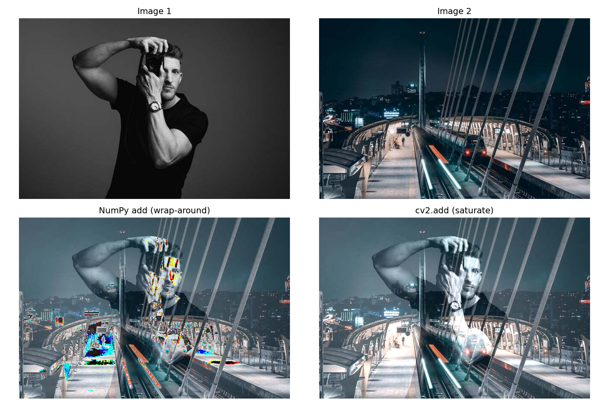
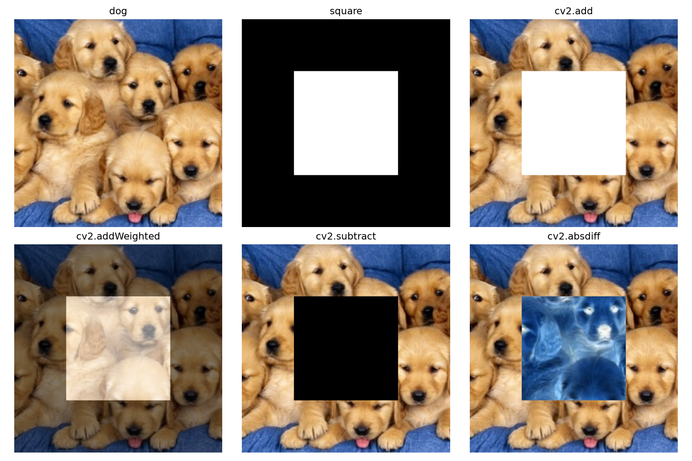
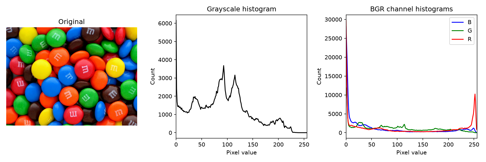

# [59일차] OpenCV 영상 입출력과 이미지 산술 연산

이번에는 OpenCV로 카메라와 동영상을 입력받고, 새로운 영상 파일로 저장하는 방법을 다룬다. 이어서 이미지의 픽셀 값을 더하고, 가중치를 적용해 합성하고, 히스토그램으로 밝기와 색상 분포를 분석한다.

이미지는 `uint8` NumPy 배열이므로 모든 연산은 결국 픽셀 단위 숫자 계산이다. 다만 OpenCV 연산과 NumPy 연산은 값이 `255`를 넘었을 때의 동작이 다르므로 차이를 정확히 이해해야 한다.

---

## 1. 영상과 카메라는 프레임의 연속이다

동영상은 시간 순서대로 이어진 이미지, 즉 **프레임(frame)** 의 집합이다. OpenCV의 `cv2.VideoCapture`는 동영상 파일이나 카메라에서 프레임을 하나씩 읽는다.

```text
VideoCapture
     ↓
cap.read()
     ↓
ret, frame
     ↓
frame 처리 또는 화면 표시
     ↓
다음 프레임 읽기
```

| 반환값 | 의미 |
|---|---|
| `ret` | 프레임을 정상적으로 읽었는지 나타내는 `True`/`False` 값이다. |
| `frame` | 읽은 한 장의 BGR 이미지다. NumPy 배열 형태다. |

`ret`이 `False`이면 영상 끝에 도달했거나 입력 장치를 읽는 데 실패한 것이므로 반복을 종료해야 한다.

---

## 2. 카메라 입력 받기

```python
import cv2
import sys

# 0은 보통 기본 카메라를 뜻한다.
cap = cv2.VideoCapture(0)

if not cap.isOpened():
    print("카메라를 열 수 없습니다.")
    sys.exit()

width = int(cap.get(cv2.CAP_PROP_FRAME_WIDTH))
height = int(cap.get(cv2.CAP_PROP_FRAME_HEIGHT))
fps = cap.get(cv2.CAP_PROP_FPS)

print(f"카메라 크기: {width} x {height}")
print(f"FPS: {fps}")

while True:
    ret, frame = cap.read()

    if not ret:
        print("카메라 프레임을 읽지 못했습니다.")
        break

    cv2.imshow("camera", frame)

    # 1ms 동안 키 입력을 확인한다. ESC를 누르면 종료한다.
    if cv2.waitKey(1) & 0xFF == 27:
        break

# 입력 장치와 OpenCV 창을 반드시 정리한다.
cap.release()
cv2.destroyAllWindows()
```

### 카메라 번호

`cv2.VideoCapture(0)`의 `0`은 일반적으로 기본 카메라다. 외장 카메라가 연결된 환경에서는 `1`, `2`처럼 다른 번호를 사용할 수 있지만, 번호는 운영체제와 연결 상태에 따라 달라질 수 있다.

카메라를 열지 못하면 다른 프로그램이 카메라를 사용 중이거나, 운영체제 카메라 권한이 없거나, 잘못된 장치 번호를 사용했을 가능성을 확인한다.

---

## 3. 동영상 파일을 읽어 새 파일로 저장하기

`cv2.VideoWriter`는 프레임을 차례로 받아 동영상 파일로 저장한다.

```text
입력 동영상 또는 카메라
        ↓
VideoCapture.read()
        ↓
프레임 처리
        ↓
VideoWriter.write()
        ↓
출력 동영상 파일
```

### 컨테이너와 코덱

동영상 파일의 확장자와 압축 방식은 다르다.

| 구분 | 예시 | 역할 |
|---|---|---|
| 컨테이너 | `.mp4`, `.avi`, `.mov`, `.mkv` | 영상, 오디오, 자막, 시간 정보 등을 담는 파일 형식이다. |
| 코덱 | H.264, H.265, XVID, MJPG, VP9, AV1 | 영상 프레임을 압축하고 복원하는 방식이다. |
| FourCC | `"XVID"`, `"MJPG"` 등 | OpenCV에 사용할 영상 코덱을 네 문자로 전달하는 코드다. |

압축되지 않은 BGR 프레임은 매우 크다. 예를 들어 `1920 x 1080` 크기의 3채널 `uint8` 프레임 하나는 약 `6MB`이고, 초당 30프레임을 저장하면 1초에 약 `186MB`가 필요하다. 코덱은 이 용량을 줄이기 위해 사용한다.

### 두 동영상을 이어 붙이기

```python
import cv2
import sys

cap1 = cv2.VideoCapture("./movies/232538_tiny.mp4")
cap2 = cv2.VideoCapture("./movies/276624_tiny.mp4")

# isOpened는 메서드이므로 반드시 ()를 붙여 호출한다.
if not cap1.isOpened() or not cap2.isOpened():
    cap1.release()
    cap2.release()
    print("입력 동영상 중 하나 이상을 열 수 없습니다.")
    sys.exit()

width = int(cap1.get(cv2.CAP_PROP_FRAME_WIDTH))
height = int(cap1.get(cv2.CAP_PROP_FRAME_HEIGHT))
fps = cap1.get(cv2.CAP_PROP_FPS)

# FPS를 읽지 못하는 경우를 대비한 기본값이다.
if fps <= 0:
    fps = 30.0

fourcc = cv2.VideoWriter_fourcc(*"XVID")
out = cv2.VideoWriter("mix.avi", fourcc, fps, (width, height))

if not out.isOpened():
    cap1.release()
    cap2.release()
    raise RuntimeError("출력 동영상 파일을 생성할 수 없습니다.")

delay = max(1, round(1000 / fps))
stop = False

for cap in (cap1, cap2):
    while True:
        ret, frame = cap.read()
        if not ret:
            break

        # 출력 VideoWriter와 프레임 크기는 반드시 같아야 한다.
        if frame.shape[1] != width or frame.shape[0] != height:
            frame = cv2.resize(frame, (width, height))

        out.write(frame)
        cv2.imshow("output", frame)

        if cv2.waitKey(delay) & 0xFF == 27:
            stop = True
            break

    if stop:
        break

cap1.release()
cap2.release()
out.release()
cv2.destroyAllWindows()
```

> 원본 코드의 `if not cap1.isOpened or not cap2.isOpened():`는 메서드 자체를 검사하는 형태다. 실제 열림 여부를 확인하려면 `isOpened()`처럼 괄호를 붙여 호출해야 한다.

---

## 4. 카메라 화면 녹화하기

카메라 프레임을 읽은 뒤 `out.write(frame)`으로 저장하면 웹캠 영상을 녹화할 수 있다.

```python
import cv2
import sys

cap = cv2.VideoCapture(0)

if not cap.isOpened():
    print("카메라를 열 수 없습니다.")
    sys.exit()

width = int(cap.get(cv2.CAP_PROP_FRAME_WIDTH))
height = int(cap.get(cv2.CAP_PROP_FRAME_HEIGHT))
fps = cap.get(cv2.CAP_PROP_FPS)

if fps <= 0:
    fps = 30.0

# "XIVD"가 아니라 "XVID"가 올바른 FourCC다.
fourcc = cv2.VideoWriter_fourcc(*"XVID")
out = cv2.VideoWriter("camera.avi", fourcc, fps, (width, height))

if not out.isOpened():
    cap.release()
    raise RuntimeError("출력 동영상 파일을 생성할 수 없습니다.")

print("ESC 키를 누르면 녹화를 종료합니다.")

while True:
    ret, frame = cap.read()
    if not ret:
        break

    out.write(frame)
    cv2.imshow("camera", frame)

    if cv2.waitKey(1) & 0xFF == 27:
        break

cap.release()
out.release()
cv2.destroyAllWindows()
```

`VideoWriter`를 만들 때 지정한 프레임 크기와 `out.write()`에 전달하는 프레임의 크기·채널 수가 일치해야 한다. 일치하지 않으면 저장 실패나 깨진 영상이 생길 수 있다.

---

## 5. 이미지 산술 연산과 포화 처리

이미지의 각 픽셀은 `uint8`, 즉 `0~255` 범위의 정수다. OpenCV의 산술 연산은 일반적으로 범위를 벗어난 값을 제한한다.

```python
import cv2

img_gray = cv2.imread("./images/dog.bmp", cv2.IMREAD_GRAYSCALE)
img_color = cv2.imread("./images/dog.bmp", cv2.IMREAD_COLOR)

# 밝아지게 한다. 255를 넘는 값은 255로 제한된다.
bright_gray = cv2.add(img_gray, 100)
bright_color = cv2.add(img_color, (100, 100, 100))

# 어두워지게 한다. 0보다 작은 값은 0으로 제한된다.
dark_gray = cv2.subtract(img_gray, 100)

multiply_gray = cv2.multiply(img_gray, 2)
divide_gray = cv2.divide(img_gray, 2)
```

| 연산 | 픽셀 값 변화 | 활용 예시 |
|---|---|---|
| `cv2.add()` | `min(255, a + b)` | 밝기 증가, 이미지 합성 |
| `cv2.subtract()` | `max(0, a - b)` | 밝기 감소, 배경 차분 |
| `cv2.multiply()` | `min(255, a * b)` | 대비·강도 변화 |
| `cv2.divide()` | `a / b` | 밝기 감소, 정규화 과정 |

예를 들어 픽셀 값이 `200`인 위치에 `100`을 더하면 OpenCV 결과는 `255`다. `300`을 표현할 수 없으므로 최대값으로 고정하는 방식을 **포화(saturation)** 라고 한다.

---

## 6. NumPy 덧셈과 `cv2.add()`의 차이

`uint8` 배열끼리 NumPy의 `+` 연산을 하면 값이 `255`를 넘을 때 256을 기준으로 되돌아가는 **wrap-around**가 발생한다. 반면 `cv2.add()`는 최대값 `255`에서 멈춘다.

```python
import numpy as np
import cv2

first = np.array([[200]], dtype=np.uint8)
second = np.array([[100]], dtype=np.uint8)

print(first + second)          # [[44]]  -> 300 % 256
print(cv2.add(first, second))  # [[255]] -> 포화 처리
```

```python
img1 = cv2.imread("./images/man.jpg")
img2 = cv2.imread("./images/turkey.jpg")

if img1.shape != img2.shape:
    raise ValueError("두 이미지의 크기와 채널 수가 같아야 합니다.")

numpy_sum = img1 + img2
opencv_sum = cv2.add(img1, img2)
```



실제 결과에서 NumPy 덧셈은 밝은 영역이 갑자기 어두워지거나 색이 깨질 수 있다. 이미지 밝기 조절이나 합성처럼 값의 범위를 유지해야 하는 작업에는 `cv2.add()`가 더 안전하다.

---

## 7. 가중치 합성, 뺄셈, 절대 차이

두 이미지가 같은 크기와 타입이라면 다양한 픽셀 연산을 적용할 수 있다.

```python
import cv2

img1 = cv2.imread("./images/dog.jpeg")
img2 = cv2.imread("./images/square.bmp")

# 단순 덧셈
dst_add = cv2.add(img1, img2)

# 가중치 합성: img1 * 0.5 + img2 * 0.5 + 0
dst_blend = cv2.addWeighted(img1, 0.5, img2, 0.5, 0)

# 포화 뺄셈
dst_subtract = cv2.subtract(img1, img2)

# 절대 차이: |img1 - img2|
dst_absdiff = cv2.absdiff(img1, img2)
```



| 함수 | 수식 | 특징과 활용 |
|---|---|---|
| `cv2.add()` | `a + b` | 두 이미지를 밝게 겹친다. 최대값은 255로 제한한다. |
| `cv2.addWeighted()` | `a * α + b * β + γ` | 두 장면을 자연스럽게 섞는다. 페이드 전환에 활용한다. |
| `cv2.subtract()` | `max(0, a - b)` | 한 이미지에서 다른 이미지를 뺀다. |
| `cv2.absdiff()` | `|a - b|` | 두 프레임의 변화량을 강조한다. 움직임·변화 감지의 기초다. |

### `addWeighted()`의 인자

```python
result = cv2.addWeighted(src1, alpha, src2, beta, gamma)
```

- `src1`, `src2`: 합성할 두 이미지다.
- `alpha`, `beta`: 각 이미지의 비중이다.
- `gamma`: 결과 전체에 더하는 보정값이다.

두 비중을 `0.5`, `0.5`로 주면 두 이미지가 절반씩 섞인다. 시간에 따라 `alpha`를 1에서 0으로, `beta`를 0에서 1로 조금씩 바꾸면 부드러운 페이드 전환을 만들 수 있다.

---

## 8. 히스토그램으로 픽셀 분포 보기

이미지 히스토그램은 각 픽셀 값이 이미지에 몇 번 나타나는지 보여주는 그래프다.

```text
가로축: 픽셀 값 0 ~ 255
세로축: 해당 픽셀 값의 개수

0에 가까움   → 어두운 픽셀
255에 가까움 → 밝은 픽셀
```

```python
import cv2
import matplotlib.pyplot as plt

img_gray = cv2.imread("./images/candies.png", cv2.IMREAD_GRAYSCALE)
img_color = cv2.imread("./images/candies.png")

# 그레이스케일 이미지의 밝기 분포를 계산한다.
hist_gray = cv2.calcHist([img_gray], [0], None, [256], [0, 256])

plt.plot(hist_gray, color="black")
plt.xlim([0, 256])
plt.xlabel("Pixel value")
plt.ylabel("Count")
plt.show()
```

### `cv2.calcHist()` 인자

```python
hist = cv2.calcHist(
    [img_gray],  # 분석할 이미지 목록
    [0],         # 분석할 채널 번호
    None,        # 마스크: None이면 전체 이미지
    [256],       # 구간(bin) 개수
    [0, 256],    # 분석할 픽셀 값 범위
)
```

컬러 이미지는 OpenCV의 B, G, R 채널을 각각 따로 계산한다.

```python
channel_names = ["B", "G", "R"]

for channel_index, channel_name in enumerate(channel_names):
    hist = cv2.calcHist([img_color], [channel_index], None, [256], [0, 256])
    plt.plot(hist, label=channel_name)

plt.xlim([0, 256])
plt.legend()
plt.show()
```



| 히스토그램 모양 | 해석 |
|---|---|
| 왼쪽에 많이 몰림 | 어두운 이미지일 가능성이 크다. |
| 오른쪽에 많이 몰림 | 밝은 이미지일 가능성이 크다. |
| 넓게 퍼짐 | 어두운 영역과 밝은 영역이 함께 있어 대비가 클 수 있다. |
| 특정 채널이 큼 | 해당 색상 성분이 많이 포함됐을 수 있다. |

### 채널 분리하기

```python
b, g, r = cv2.split(img_color)

cv2.imshow("B Channel", b)
cv2.imshow("G Channel", g)
cv2.imshow("R Channel", r)

cv2.waitKey(0)
cv2.destroyAllWindows()
```

각 채널을 그레이스케일로 표시하면, 해당 색상 성분이 강한 영역은 밝게 보이고 약한 영역은 어둡게 보인다.

---

## 9. 자주 발생하는 문제

| 문제 | 원인 | 해결 방법 |
|---|---|---|
| 영상이 열리지 않음 | 잘못된 파일 경로, 지원하지 않는 코덱 | `cap.isOpened()`를 호출해 확인하고 경로·코덱을 점검한다. |
| 출력 파일이 생성되지 않음 | 사용할 수 없는 FourCC, 잘못된 크기 | `out.isOpened()`를 확인하고 입력 프레임과 출력 크기를 맞춘다. |
| 창이 바로 닫힘 | `waitKey()` 호출이 없음 | `cv2.waitKey()`로 이벤트와 키 입력을 처리한다. |
| 색이 이상하게 보임 | BGR 이미지를 RGB로 표시함 | Matplotlib에서는 `cv2.cvtColor(..., cv2.COLOR_BGR2RGB)`를 사용한다. |
| 이미지 합성 색이 깨짐 | NumPy `uint8` 덧셈의 wrap-around | 포화 연산을 하는 `cv2.add()`를 사용한다. |
| 파일이 잠기거나 카메라가 계속 점유됨 | `release()` 누락 | `cap.release()`, `out.release()`를 반드시 호출한다. |

---

## 마무리

OpenCV의 영상 처리 흐름은 입력을 열고, 프레임을 반복해서 읽고, 필요한 처리를 적용한 뒤, 자원을 해제하는 구조로 정리할 수 있다. 이 흐름을 이해하면 카메라 녹화, 영상 편집, 프레임별 객체 검출 같은 기능으로 확장할 수 있다.

이미지 산술 연산에서는 자료형과 값 범위를 함께 고려해야 한다. 특히 `uint8` 배열의 NumPy 덧셈은 값이 넘칠 때 되돌아가지만, OpenCV의 `cv2.add()`는 255에서 포화된다. 히스토그램은 이런 이미지의 밝기와 색상 분포를 수치적으로 해석하는 출발점이 된다.
