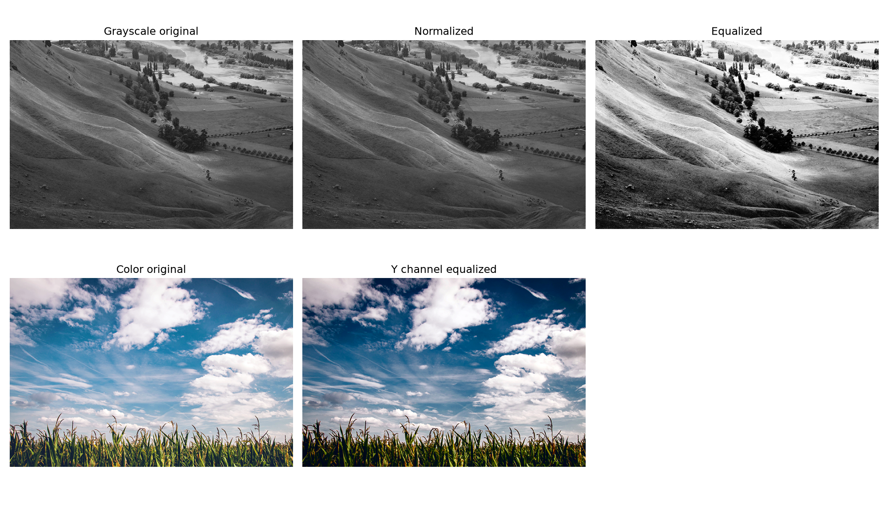
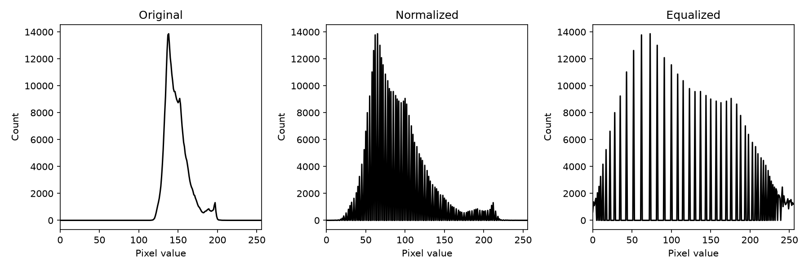
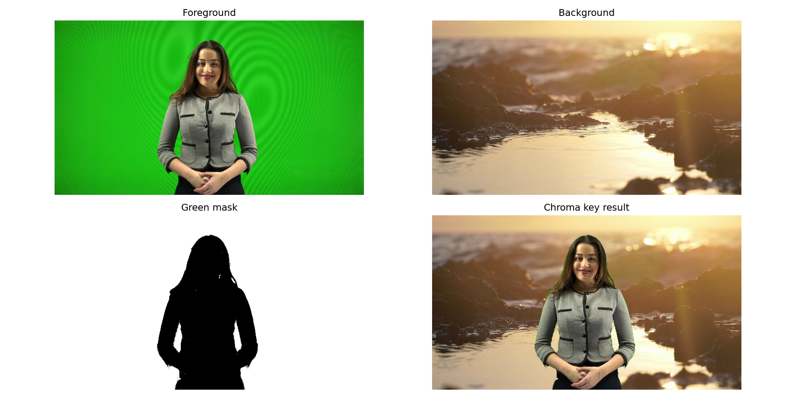

# [60일차] OpenCV 히스토그램 평활화와 HSV, 크로마키

이미지의 밝기와 색상은 단순한 장식이 아니라, 객체를 찾고 분리하는 데 사용하는 중요한 정보다. 이번에는 히스토그램으로 픽셀 분포를 읽고, 정규화와 히스토그램 평활화로 명암 대비를 보정한다. 이어서 HSV 색상 공간으로 특정 색을 마스크로 분리하고, 이를 활용해 크로마키 영상을 합성한다.

---

## 1. 히스토그램: 이미지의 밝기 분포

그레이스케일 이미지의 픽셀 값은 `0`부터 `255`까지다. `0`은 검정, `255`는 흰색에 가깝다. 히스토그램은 각 밝기 값이 이미지에 몇 번 나타나는지 보여준다.

```text
가로축: 픽셀 밝기 0 ~ 255
세로축: 해당 밝기 값을 가진 픽셀 수

왼쪽에 치우침  → 어두운 픽셀이 많다.
오른쪽에 치우침 → 밝은 픽셀이 많다.
좁은 구간에 몰림 → 명암 대비가 낮을 수 있다.
넓게 퍼짐      → 밝기 범위를 다양하게 사용한다.
```

```python
import cv2

img_gray = cv2.imread("./images/Hawkes.jpg", cv2.IMREAD_GRAYSCALE)

if img_gray is None:
    raise FileNotFoundError("그레이스케일 이미지를 읽을 수 없습니다.")

hist = cv2.calcHist(
    [img_gray],  # 분석할 이미지 목록
    [0],         # 분석할 채널 번호
    None,        # 마스크: None이면 전체 이미지
    [256],       # 구간(bin) 개수
    [0, 256],    # 픽셀 값 범위
)
```

`hist`의 형태는 보통 `(256, 1)`이다. `hist[0]`에는 밝기 0인 픽셀 수가, `hist[255]`에는 밝기 255인 픽셀 수가 담긴다.

컬러 이미지는 OpenCV의 B, G, R 채널을 각각 분석한다.

```python
img_color = cv2.imread("./images/candies.png")

for channel_index, channel_name in enumerate(["B", "G", "R"]):
    hist = cv2.calcHist([img_color], [channel_index], None, [256], [0, 256])
    plt.plot(hist, label=channel_name)

plt.xlim([0, 256])
plt.legend()
plt.show()
```

---

## 2. 정규화와 히스토그램 평활화

둘 다 픽셀 값 범위를 조정하지만, 목적과 계산 방식이 다르다.

| 구분 | `cv2.normalize()` | `cv2.equalizeHist()` |
|---|---|---|
| 핵심 목적 | 값의 최솟값과 최댓값을 원하는 범위로 맞춘다. | 밝기 분포를 재배치해 대비를 높인다. |
| 기준 | 최소값·최대값 | 히스토그램의 누적 분포(CDF) |
| 결과 | 전체 값의 상대 비율을 유지하며 선형 변환한다. | 자주 등장한 밝기 구간을 더 넓게 펼친다. |
| 대표 활용 | 값 범위 통일, 시각화, 전처리 | 흐릿하거나 저대비인 이미지의 명암 개선 |

### 2.1 정규화

`cv2.NORM_MINMAX`는 입력 이미지의 최소값을 `alpha`, 최대값을 `beta`에 맞춘다.

```python
normalized_gray = cv2.normalize(
    img_gray,
    None,
    0,
    255,
    cv2.NORM_MINMAX,
)
```

개념적으로는 다음과 같이 계산한다.

```text
새 픽셀값 = (원본값 - 최소값) / (최대값 - 최소값) * 255
```

이미지가 이미 0~255 범위를 충분히 사용하고 있다면, 정규화 결과는 원본과 거의 비슷할 수 있다.

### 2.2 히스토그램 평활화

히스토그램 평활화는 누적 분포 함수(CDF)를 이용해 특정 밝기 구간에 몰린 픽셀을 더 넓은 범위로 재배치한다.

```python
# equalizeHist는 8비트 단일 채널 이미지에 사용한다.
equalized_gray = cv2.equalizeHist(img_gray)
```

```python
hist_original = cv2.calcHist([img_gray], [0], None, [256], [0, 256])
hist_normalized = cv2.calcHist([normalized_gray], [0], None, [256], [0, 256])
hist_equalized = cv2.calcHist([equalized_gray], [0], None, [256], [0, 256])
```





예제 결과에서 평활화된 이미지는 원본보다 밝은 영역과 어두운 영역의 구분이 더 뚜렷해진다. 반면 평활화가 항상 좋은 것은 아니다. 노이즈가 있는 이미지에서는 노이즈까지 강조될 수 있고, 이미 대비가 높은 이미지에서는 자연스럽지 않은 결과가 나올 수 있다.

---

## 3. 컬러 이미지에서 밝기만 보정하기: YCrCb

컬러 이미지의 B, G, R 채널에 각각 히스토그램 평활화를 적용하면 색상 비율이 바뀌어 부자연스러운 색이 생길 수 있다. 색상과 밝기를 분리하는 색상 공간으로 변환한 뒤, 밝기 채널만 보정하는 편이 안전하다.

YCrCb는 밝기와 색차 정보를 분리하는 색상 공간이다.

| 채널 | 의미 |
|---|---|
| `Y` | 밝기(luminance) 정보 |
| `Cr` | 빨강 계열 색차 정보 |
| `Cb` | 파랑 계열 색차 정보 |

```python
img_color = cv2.imread("./images/field.bmp")

if img_color is None:
    raise FileNotFoundError("컬러 이미지를 읽을 수 없습니다.")

# BGR → YCrCb로 변환한다.
ycrcb = cv2.cvtColor(img_color, cv2.COLOR_BGR2YCrCb)

# 0번 채널인 Y, 즉 밝기 정보만 평활화한다.
ycrcb[:, :, 0] = cv2.equalizeHist(ycrcb[:, :, 0])

# 다시 BGR로 변환해 화면에 표시하거나 저장한다.
equalized_color = cv2.cvtColor(ycrcb, cv2.COLOR_YCrCb2BGR)
```

> 자료의 설명에서 `Bb`로 적힌 채널명은 `Cb`가 맞다. `YCrCb`에서 `Cb`는 파랑 계열 색차 성분을 뜻한다.

---

## 4. HSV 색상 공간

BGR은 카메라와 화면 처리에는 편하지만, 특정 색을 기준으로 객체를 찾기에는 직관적이지 않다. HSV는 사람이 색을 인식하는 방식에 가까운 기준으로 색상을 분리한다.

| 채널 | 의미 | OpenCV 범위 |
|---|---|---|
| `H` | Hue, 색상 종류 | `0 ~ 179` |
| `S` | Saturation, 색의 선명도 | `0 ~ 255` |
| `V` | Value, 밝기 | `0 ~ 255` |

OpenCV의 Hue 범위가 `0~179`인 이유는 일반적인 색상환의 `0~360`도를 절반 범위로 저장하기 때문이다.

```text
H가 작음        → 빨강 계열
H 약 30         → 노랑 계열
H 약 60         → 초록 계열
H 약 90         → 청록 계열
H 약 120        → 파랑 계열
H 약 150~179    → 보라·빨강 계열
```

HSV는 다음 상황에 특히 유용하다.

- 특정 색의 물체만 찾고 싶을 때
- 초록색·파란색 배경을 분리할 때
- 조명 변화가 있는 영상에서 색상 기준을 다루고 싶을 때
- 색상 기반 마스크를 만들 때

---

## 5. `cv2.inRange()`로 특정 색 마스크 만들기

`cv2.inRange()`는 각 픽셀이 지정한 하한값과 상한값 사이에 있는지 검사해 이진 마스크를 만든다.

```python
import cv2

img = cv2.imread("./images/candies.png")
hsv = cv2.cvtColor(img, cv2.COLOR_BGR2HSV)

# 파란색에 해당하는 HSV 범위다.
lower_blue = (90, 150, 0)
upper_blue = (150, 255, 255)

blue_mask = cv2.inRange(hsv, lower_blue, upper_blue)
```

```text
범위 안의 픽셀  → 255, 흰색
범위 밖의 픽셀  → 0, 검정
```

마스크를 사용해 범위 안의 원본 픽셀만 꺼낼 수 있다.

```python
blue_only = cv2.bitwise_and(img, img, mask=blue_mask)
```


같은 파란색이라도 조명, 카메라, 그림자, 반사에 따라 HSV 값이 달라진다. 따라서 `lower_blue`, `upper_blue`는 모든 이미지에 고정된 정답이 아니라, 실제 영상에 맞게 조정해야 하는 값이다.

---

## 6. 마스크를 이용한 이미지 합성

`cv2.copyTo()`는 마스크가 0이 아닌 위치에만 원본 픽셀을 복사한다.

```python
airplane = cv2.imread("./images/airplane.bmp")
field = cv2.imread("./images/field.bmp")
mask = cv2.imread("./images/mask_plane.bmp", cv2.IMREAD_GRAYSCALE)

# 마스크 영역만 남긴 비행기 이미지다.
airplane_only = cv2.copyTo(airplane, mask)

# 배경 이미지 위에 마스크 영역의 비행기를 복사한다.
composite = field.copy()
cv2.copyTo(airplane, mask, composite)
```

| 항목 | 역할 |
|---|---|
| `src` | 복사할 원본 이미지다. 여기서는 `airplane`이다. |
| `mask` | 복사할 위치를 지정하는 단일 채널 마스크다. 흰색 영역이 복사된다. |
| `dst` | 결과를 저장할 대상 이미지다. 여기서는 `composite`다. |

`airplane`, `field`, `mask`는 공간 크기가 맞아야 한다. 크기가 다르면 먼저 `cv2.resize()` 등으로 맞춰야 한다.

---

## 7. 크로마키(Chroma Key)란

크로마키는 일정한 배경색을 마스크로 검출해 다른 배경으로 바꾸는 합성 기법이다. 영화 촬영, 방송의 날씨 화면, 화상 회의 가상 배경 등에 활용된다.

```text
전경 영상(초록 배경)
        ↓ BGR → HSV 변환
초록색 범위 검출
        ↓
green_mask 생성
        ↓
마스크 위치에 배경 영상 프레임 복사
        ↓
합성 결과
```

### 전경과 배경 영상 합성

```python
import cv2
import sys

cap_foreground = cv2.VideoCapture("./movies/woman.mp4")
cap_background = cv2.VideoCapture("./movies/sea.mp4")

if not cap_foreground.isOpened() or not cap_background.isOpened():
    print("video open failed")
    sys.exit()

fps = cap_foreground.get(cv2.CAP_PROP_FPS)
delay = max(1, round(1000 / fps)) if fps > 0 else 30

while True:
    ret1, frame1 = cap_foreground.read()
    if not ret1:
        break

    ret2, frame2 = cap_background.read()

    # 배경 영상이 끝나면 첫 프레임부터 다시 재생한다.
    if not ret2:
        cap_background.set(cv2.CAP_PROP_POS_FRAMES, 0)
        ret2, frame2 = cap_background.read()
        if not ret2:
            break

    # 전경과 배경의 크기를 맞춘다.
    frame2 = cv2.resize(frame2, (frame1.shape[1], frame1.shape[0]))

    hsv = cv2.cvtColor(frame1, cv2.COLOR_BGR2HSV)

    # 초록색 배경 범위를 마스크로 만든다.
    lower_green = (50, 150, 0)
    upper_green = (90, 255, 255)
    green_mask = cv2.inRange(hsv, lower_green, upper_green)

    # 초록색으로 검출된 위치만 배경 프레임으로 교체한다.
    result = frame1.copy()
    cv2.copyTo(frame2, green_mask, result)

    cv2.imshow("chromakey", result)
    cv2.imshow("mask", green_mask)

    key = cv2.waitKey(delay) & 0xFF
    if key == ord(" "):
        # 공백을 누르면 다음 키 입력까지 일시 정지한다.
        cv2.waitKey(0)
    elif key == 27:
        break

cap_foreground.release()
cap_background.release()
cv2.destroyAllWindows()
```



그림의 마스크에서 흰색은 초록색 배경으로 검출된 영역이다. `cv2.copyTo(frame2, green_mask, result)`는 이 흰색 영역에만 바다 배경 프레임을 복사한다. 사람 영역은 검정이므로 원래 전경 프레임이 그대로 남는다.

### 크로마키 품질을 높이려면

머리카락, 옷 가장자리, 그림자에는 초록색이 일부 섞일 수 있다. 또 인물이 초록색 옷을 입으면 배경으로 잘못 검출된다. 이런 문제를 줄이려면 다음을 고려한다.

- 배경 조명을 균일하게 맞춘다.
- 인물과 배경의 거리를 충분히 둔다.
- HSV 하한·상한 범위를 영상에 맞춰 조정한다.
- 마스크에 블러나 모폴로지 연산을 적용해 작은 구멍과 노이즈를 줄인다.
- 경계 부근 색 번짐을 보정하는 alpha matting을 사용한다.

---

## 8. 색상 공간별 역할 정리

| 색상 공간 | 구성 | 주 사용 목적 |
|---|---|---|
| BGR | 파랑, 초록, 빨강 채널 | OpenCV 기본 이미지 입출력과 일반 처리 |
| Grayscale | 밝기 1개 채널 | 이진화, 에지, 히스토그램, 명암 처리 |
| HSV | 색상, 선명도, 밝기 | 특정 색 검출, 크로마키, 색상 마스크 |
| YCrCb | 밝기, 빨강 색차, 파랑 색차 | 색상 왜곡을 줄인 밝기·대비 보정 |

이미지 처리에서는 하나의 색상 공간만 고집하지 않는다. 목표가 밝기 보정인지, 색상 기반 객체 검출인지에 따라 더 적합한 표현으로 변환해 사용한다.

---

## 9. 자주 발생하는 문제

| 문제 | 원인 | 해결 방법 |
|---|---|---|
| 색상 평활화 후 색이 이상함 | BGR 채널을 각각 평활화함 | YCrCb·HSV처럼 밝기와 색상을 분리한 뒤 밝기 채널만 보정한다. |
| 마스크가 너무 넓거나 좁음 | HSV 범위가 현재 조명 환경과 맞지 않음 | 원본 HSV 값을 확인하고 하한·상한을 조정한다. |
| 크로마키 경계에 초록색이 남음 | 그림자·반사·머리카락 때문에 마스크가 불완전함 | 마스크 후처리와 범위 조정을 적용한다. |
| 배경 영상이 먼저 끝남 | 배경 프레임을 더 읽을 수 없음 | `CAP_PROP_POS_FRAMES`를 0으로 설정해 처음부터 다시 읽는다. |
| `equalizeHist()` 오류 | 컬러 BGR 이미지나 지원하지 않는 형식을 직접 전달함 | `uint8` 단일 채널 이미지 또는 Y 채널을 전달한다. |

---

## 마무리

히스토그램은 이미지의 밝기와 색상 분포를 수치로 보여주며, 정규화와 히스토그램 평활화는 이 분포를 조정하는 방법이다. 단순한 값 범위 통일에는 정규화가, 저대비 이미지의 명암 개선에는 히스토그램 평활화가 더 적합하다.

HSV는 사람이 인식하는 색상 기준에 가깝기 때문에 특정 색을 분리하는 작업에 유용하다. `inRange()`로 만든 마스크와 `copyTo()`를 조합하면 비행기 합성처럼 정적인 이미지 합성을 만들 수 있고, 같은 원리로 영상의 초록색 배경을 교체하는 크로마키까지 구현할 수 있다.
