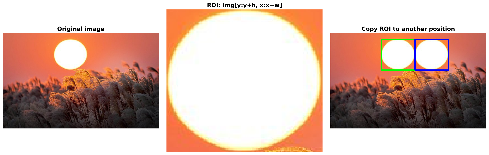
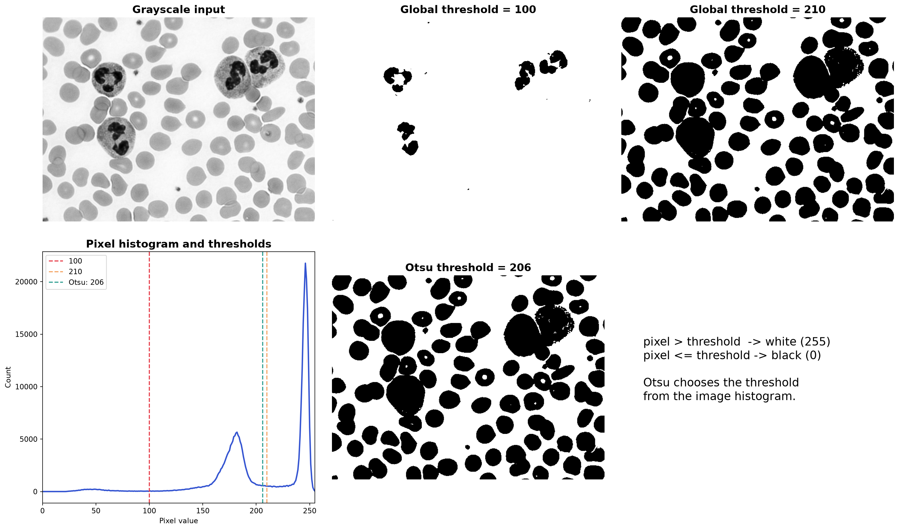
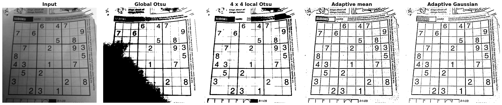
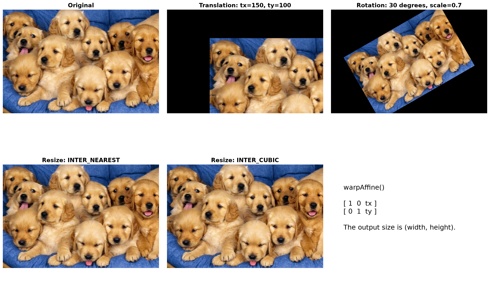
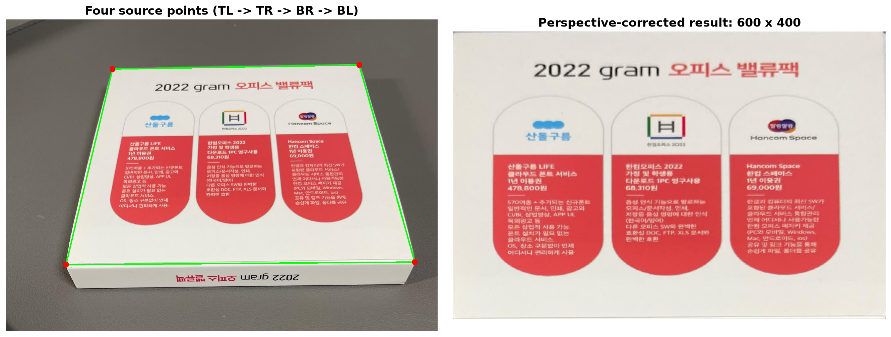

# [61일차] OpenCV ROI, 이진화와 기하 변환

이미지 전체를 그대로 처리할 필요는 없다. 필요한 부분만 잘라 분석하거나, 밝기 기준으로 대상을 분리하고, 기울어진 문서를 정면처럼 보정할 수 있다. 이번에는 **ROI(관심 영역)**, **이진화**, **이동·크기 변경·회전·투시 변환**을 다룬다.

---

## 1. ROI란 무엇인가

ROI(Region of Interest)는 이미지 전체 중에서 **의미 있는 일부 영역만 선택한 것**이다. 얼굴 인식에서는 얼굴 부분, 차량 번호판 인식에서는 번호판 부분처럼 관심 영역만 처리하면 불필요한 계산을 줄이고 결과에 집중할 수 있다.

OpenCV 이미지는 NumPy 배열이다. 따라서 이미지의 좌표를 자를 때는 다음 순서를 사용한다.

```python
roi = img[y:y + h, x:x + w]
```

`cv2.rectangle()`은 `(x, y)` 좌표를 사용하지만, NumPy 슬라이싱은 배열의 행과 열 순서인 `[y, x]`를 사용한다. 이 순서를 혼동하면 엉뚱한 영역을 자르게 된다.

| 항목 | 의미 |
| --- | --- |
| `x`, `y` | ROI의 왼쪽 위 시작 좌표 |
| `w`, `h` | ROI의 너비와 높이 |
| `img[y:y+h, x:x+w]` | 시작점부터 높이·너비만큼 잘라낸 영역 |

```python
import cv2

img = cv2.imread("./images/sun.jpg")

x, y, w, h = 183, 22, 120, 110
roi = img[y:y + h, x:x + w]
roi_copy = roi.copy()

# 원본 오른쪽에 ROI를 복사한다.
img[y:y + h, x + w:x + w + w] = roi_copy

cv2.rectangle(img, (x, y), (x + w, y + h), (0, 255, 0), 2)
cv2.rectangle(img, (x + w, y), (x + w + w, y + h), (255, 0, 0), 2)

cv2.imshow("ROI copy", img)
cv2.imshow("ROI", roi)
cv2.waitKey(0)
cv2.destroyAllWindows()
```



### `copy()`가 필요한 이유

`roi = img[...]`로 얻은 ROI는 기본적으로 원본 이미지의 일부를 바라보는 **뷰(view)** 다. 따라서 `roi` 내부를 수정하면 원본 `img`도 함께 바뀔 수 있다. 독립된 데이터를 만들어 다른 위치에 붙이거나 별도로 처리하려면 `roi.copy()`를 사용한다.

### 마우스로 ROI 선택하기

고정 좌표 대신 사용자가 마우스로 드래그해 영역을 선택할 수도 있다. 콜백 함수는 마우스 이벤트가 발생할 때마다 자동 호출된다.

```python
def on_mouse(event, x, y, flags, param):
    global start_x, start_y, is_dragging

    if event == cv2.EVENT_LBUTTONDOWN:
        is_dragging = True
        start_x, start_y = x, y

    elif event == cv2.EVENT_MOUSEMOVE and is_dragging:
        preview = img.copy()
        x1, x2 = min(start_x, x), max(start_x, x)
        y1, y2 = min(start_y, y), max(start_y, y)
        cv2.rectangle(preview, (x1, y1), (x2, y2), (255, 0, 0), 2)
        cv2.imshow("img", preview)

    elif event == cv2.EVENT_LBUTTONUP and is_dragging:
        is_dragging = False
        x1, x2 = min(start_x, x), max(start_x, x)
        y1, y2 = min(start_y, y), max(start_y, y)
        roi = img[y1:y2, x1:x2]
        cv2.imshow("roi", roi)


img = cv2.imread("./images/sun.jpg")
cv2.imshow("img", img)
cv2.setMouseCallback("img", on_mouse)
cv2.waitKey(0)
cv2.destroyAllWindows()
```

드래그를 어느 방향으로 하든 올바른 사각형을 만들기 위해 `min()`과 `max()`로 시작점과 끝점을 정리한다. 마우스 버튼을 놓았을 때 너비나 높이가 0이면 ROI를 만들지 않도록 검사하는 것도 필요하다.

---

## 2. 이진화: 픽셀을 검정과 흰색으로 나누기

이진화(Binarization 또는 Thresholding)는 픽셀 값을 두 그룹으로 나누는 전처리다. 일반적인 8비트 이진 영상에서는 검정을 `0`, 흰색을 `255`로 사용한다.

문서 스캔, OCR, 윤곽선 검출, 객체 분리처럼 대상과 배경을 구분해야 하는 작업에서 자주 사용한다.

### 전역 임계값 이진화

전역 이진화는 이미지 전체에 하나의 임계값을 적용한다.

```python
threshold, binary = cv2.threshold(
    img,
    100,
    255,
    cv2.THRESH_BINARY,
)
```

`cv2.THRESH_BINARY`의 동작은 다음과 같다.

```text
pixel > threshold  -> 255
pixel <= threshold -> 0
```

`cv2.threshold()`는 실제 사용한 임계값과 이진화 결과를 함께 반환한다. 사람이 임계값을 넣은 경우 첫 번째 반환값은 입력한 값과 같다.

```python
threshold_100, dst_100 = cv2.threshold(img, 100, 255, cv2.THRESH_BINARY)
threshold_210, dst_210 = cv2.threshold(img, 210, 255, cv2.THRESH_BINARY)
```

임계값이 낮으면 흰색으로 분류되는 영역이 넓어지고, 임계값이 높으면 더 밝은 픽셀만 흰색이 된다. 따라서 같은 이미지라도 어떤 값을 선택하느냐에 따라 분리 결과가 크게 달라진다.

### Otsu 자동 임계값

Otsu 방식은 히스토그램을 바탕으로 두 그룹을 가장 잘 나눌 수 있는 전역 임계값을 자동으로 찾는다. 각 그룹 내부의 분산은 작고, 두 그룹 사이의 차이는 크게 만드는 값을 고른다.

```python
otsu_threshold, dst_otsu = cv2.threshold(
    img,
    0,  # THRESH_OTSU를 쓸 때 직접 정한 값은 사용하지 않는다.
    255,
    cv2.THRESH_BINARY | cv2.THRESH_OTSU,
)

print("Otsu threshold:", otsu_threshold)
```



Otsu는 전경과 배경의 밝기 분포가 비교적 뚜렷한 이미지에서 효과적이다. 그러나 그림자나 조명처럼 위치마다 밝기가 크게 달라지는 경우에는 이미지 전체에 하나의 기준을 쓰기 때문에 한계가 있다.

---

## 3. 지역 이진화와 적응형 이진화

스캔한 문서나 그림자가 진 사진은 왼쪽과 오른쪽의 밝기가 다를 수 있다. 이때 하나의 전역 임계값을 적용하면 어떤 곳은 글자가 사라지고, 다른 곳은 배경 잡음이 남는다.

### 영역별 Otsu 이진화

이미지를 여러 블록으로 나눈 뒤 블록마다 Otsu 임계값을 계산하는 방식이다. 예제에서는 이미지를 `4 x 4` 블록으로 나눈다.

```python
import numpy as np

local_otsu = np.zeros_like(img)
rows, cols = 4, 4

y_edges = np.linspace(0, img.shape[0], rows + 1, dtype=int)
x_edges = np.linspace(0, img.shape[1], cols + 1, dtype=int)

for row in range(rows):
    for col in range(cols):
        y1, y2 = y_edges[row], y_edges[row + 1]
        x1, x2 = x_edges[col], x_edges[col + 1]

        block = img[y1:y2, x1:x2]
        _, block_binary = cv2.threshold(
            block,
            0,
            255,
            cv2.THRESH_BINARY | cv2.THRESH_OTSU,
        )
        local_otsu[y1:y2, x1:x2] = block_binary
```

`np.linspace(0, img.shape[0], rows + 1, dtype=int)`는 이미지의 시작부터 끝까지를 같은 간격으로 나누는 경계 좌표를 만든다. 블록 크기가 정확히 나누어떨어지지 않아도 마지막 경계까지 포함할 수 있다.

이 방식은 조명 변화에 전역 Otsu보다 강하지만, 블록 경계에서 결과가 갑자기 달라져 이음새가 보일 수 있다.

### 적응형 이진화

적응형 이진화(Adaptive Thresholding)는 각 픽셀 주변의 밝기를 기준으로 그 픽셀의 임계값을 계산한다. 블록 단위로 같은 임계값을 쓰는 지역 Otsu보다 더 세밀하게 조명 변화에 대응한다.

```python
adaptive_mean = cv2.adaptiveThreshold(
    img,
    255,
    cv2.ADAPTIVE_THRESH_MEAN_C,
    cv2.THRESH_BINARY,
    9,
    5,
)

adaptive_gaussian = cv2.adaptiveThreshold(
    img, 
    255,
    cv2.ADAPTIVE_THRESH_GAUSSIAN_C,
    cv2.THRESH_BINARY,
    9,
    5,
)
```

| 인자 | 의미 |
| --- | --- |
| `img` | 8비트 단일 채널(그레이스케일) 이미지 |
| `255` | 조건을 만족한 픽셀에 넣을 최대값 |
| `ADAPTIVE_THRESH_MEAN_C` | 주변 픽셀의 단순 평균을 사용 |
| `ADAPTIVE_THRESH_GAUSSIAN_C` | 가까운 픽셀에 더 큰 비중을 주는 가중 평균을 사용 |
| `9` | 주변 영역 크기인 `blockSize`, 3 이상의 홀수여야 함 |
| `5` | 주변 기준값에서 빼는 상수 `C` |

기본 원리는 다음과 같다.

```text
T = 주변 평균 또는 가중 평균 - C
```

`C`가 커지면 임계값 `T`가 낮아진다. `THRESH_BINARY`에서는 더 많은 픽셀이 흰색이 될 수 있다. 실제 데이터에서는 `blockSize`와 `C`를 바꿔 가며 글자와 배경이 가장 잘 분리되는 조합을 찾는다.



---

## 4. 아핀 변환: 이동, 크기 변경, 회전

기하 변환은 이미지 안의 픽셀 위치를 새 위치로 옮기는 작업이다. 이동, 회전, 크기 변경처럼 평행선 관계가 유지되는 변환은 아핀 변환(Affine Transform)으로 다룰 수 있다.

### 이동

`tx`, `ty`만큼 x축과 y축 방향으로 픽셀을 옮기려면 2 x 3 변환 행렬을 사용한다.

```python
import cv2
import numpy as np

img = cv2.imread("./images/dog.bmp")
h, w = img.shape[:2]

translation_matrix = np.array([
    [1, 0, 150],
    [0, 1, 100],
], dtype=np.float32)

translated = cv2.warpAffine(img, translation_matrix, (w, h))
```

```text
[ x' ]   [ 1  0  tx ] [ x ]
[ y' ] = [ 0  1  ty ] [ y ]
```

`warpAffine()`의 마지막 인자는 `(width, height)` 순서다. 행렬은 x를 150, y를 100만큼 옮기므로 빈 공간은 기본값으로 검정색이 된다.

### 크기 변경과 보간

이미지를 확대하거나 축소하면 원래 없던 위치의 픽셀값을 계산해야 한다. 이때 주변 픽셀을 참고해 값을 정하는 과정을 보간(Interpolation)이라 한다.

```python
nearest = cv2.resize(img, (1280, 1024), interpolation=cv2.INTER_NEAREST)
cubic = cv2.resize(img, (1280, 1024), interpolation=cv2.INTER_CUBIC)
```

| 방식 | 특징 | 주 사용 상황 |
| --- | --- | --- |
| `INTER_NEAREST` | 가장 가까운 픽셀 하나를 그대로 사용한다. 빠르지만 계단 현상이 생길 수 있다. | 마스크·라벨 이미지 확대 |
| `INTER_LINEAR` | 주변 픽셀을 선형으로 계산한다. OpenCV의 기본값이다. | 일반적인 확대·축소 |
| `INTER_CUBIC` | 더 넓은 주변 픽셀을 활용해 부드럽게 계산한다. | 확대 시 품질을 높이고 싶을 때 |
| `INTER_AREA` | 영역 정보를 이용한다. | 축소할 때 |

### 회전

회전 중심, 각도, 확대·축소 비율로 회전 행렬을 만들 수 있다.

```python
center = (w / 2, h / 2)
rotation_matrix = cv2.getRotationMatrix2D(center, 30, 0.7)
rotated = cv2.warpAffine(img, rotation_matrix, (w, h))
```

OpenCV에서 각도가 양수이면 화면 좌표 기준으로 반시계 방향 회전이다. 원본 크기 `(w, h)`를 그대로 출력 크기로 쓰면 모서리 일부가 잘릴 수 있다. 필요한 경우 더 큰 캔버스 크기를 지정하거나, 변환 행렬의 이동값을 추가해 전체 대상이 들어오게 조정한다.



---

## 5. 투시 변환: 기울어진 사각형을 정면으로 펴기

투시 변환(Perspective Transform)은 원근감으로 사다리꼴처럼 보이는 사각형을 정면에서 본 직사각형으로 보정하는 변환이다. 문서 스캔, 명함 보정, 책 페이지 보정에 활용한다.

아핀 변환과 달리 투시 변환은 평행선이 평행으로 유지되지 않아도 된다. 대신 원근감까지 반영하는 3 x 3 변환 행렬을 사용한다.

```python
import cv2
import numpy as np

img = cv2.imread("./images/pic.jpg")
dst_w, dst_h = 600, 400

# 왼쪽 위 -> 오른쪽 위 -> 오른쪽 아래 -> 왼쪽 아래 순서
src_quad = np.array([
    [371, 172],
    [1228, 158],
    [1421, 843],
    [209, 852],
], dtype=np.float32)

dst_quad = np.array([
    [0, 0],
    [dst_w - 1, 0],
    [dst_w - 1, dst_h - 1],
    [0, dst_h - 1],
], dtype=np.float32)

perspective_matrix = cv2.getPerspectiveTransform(src_quad, dst_quad)
dst = cv2.warpPerspective(img, perspective_matrix, (dst_w, dst_h))
```

### 네 점의 순서가 중요한 이유

`src_quad`와 `dst_quad`의 같은 인덱스끼리 대응한다. 예를 들어 `src_quad[0]`이 왼쪽 위라면 `dst_quad[0]`도 왼쪽 위여야 한다. 점의 순서가 섞이면 이미지가 뒤틀리거나 뒤집힌다.

```text
원본의 네 점                  결과의 네 점

왼쪽 위  ────────────────>   (0, 0)
오른쪽 위 ────────────────>   (dst_w - 1, 0)
오른쪽 아래 ──────────────>   (dst_w - 1, dst_h - 1)
왼쪽 아래 ────────────────>   (0, dst_h - 1)
```



---

## 6. `warpAffine()`와 `warpPerspective()` 비교

| 구분 | `cv2.warpAffine()` | `cv2.warpPerspective()` |
| --- | --- | --- |
| 행렬 크기 | 2 x 3 | 3 x 3 |
| 대표 변환 | 이동, 회전, 크기 변경, 기울이기 | 원근 보정, 사다리꼴 영역 펴기 |
| 점 대응 수 | 보통 3점 | 4점 |
| 예시 | 기울어진 사진 회전 | 비스듬히 찍은 문서 스캔 |

---

## 7. 정리

- ROI는 전체 이미지 대신 필요한 영역만 처리하는 방식이며, 슬라이싱 순서는 `[y, x]`다.
- `roi.copy()`는 원본과 독립된 ROI 데이터를 만들 때 사용한다.
- 전역 이진화는 하나의 임계값을 쓰고, Otsu는 히스토그램에서 그 값을 자동으로 찾는다.
- 조명이 고르지 않으면 지역 이진화나 적응형 이진화가 더 적합하다.
- 이동·회전·크기 변경은 `warpAffine()`, 원근 보정은 `warpPerspective()`를 사용한다.
- 투시 변환에서는 네 점의 대응 순서를 일관되게 유지하는 것이 가장 중요하다.
