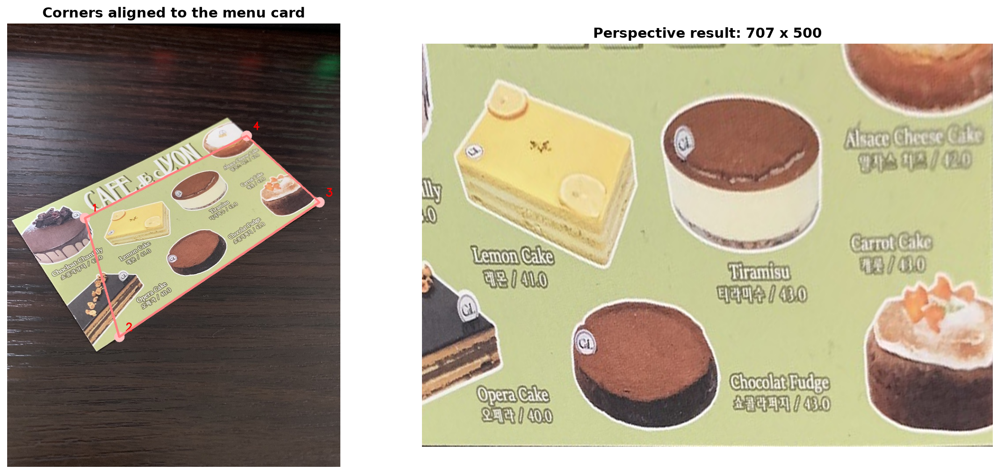
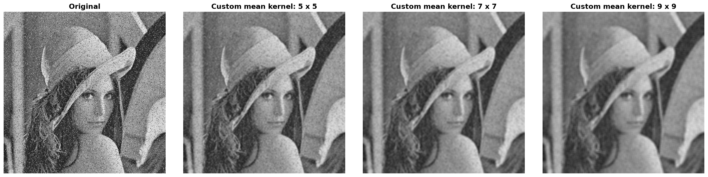
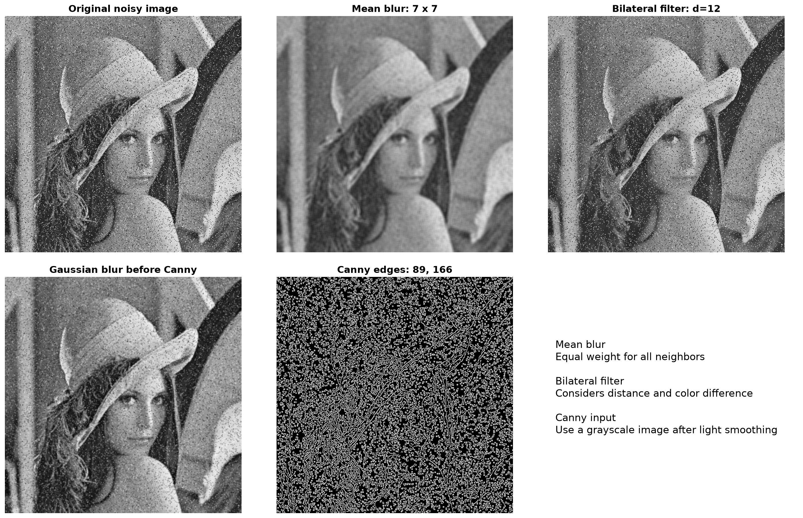
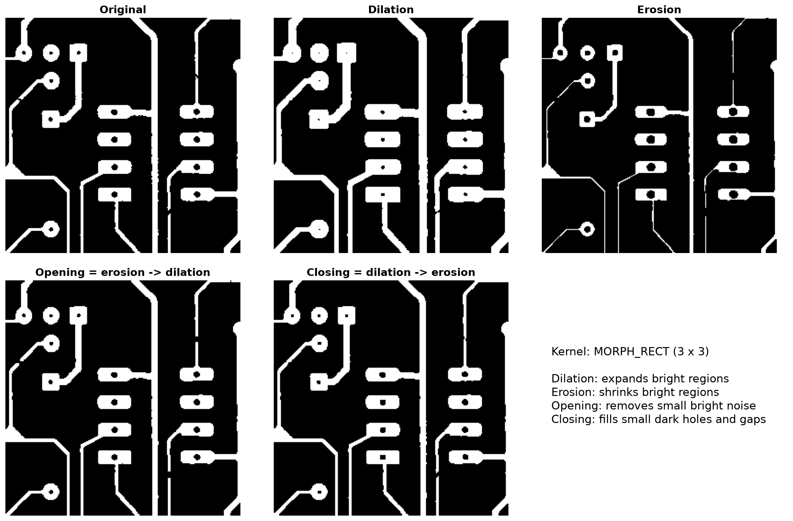
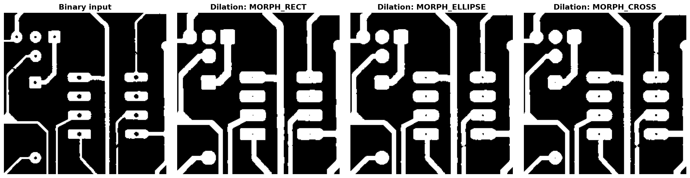

# [62일차] OpenCV 명함 보정, 블러링과 모폴로지

이미지 전처리는 뒤에 이어질 인식과 분석의 품질을 결정한다. 기울어진 카드나 문서를 정면으로 펴고, 노이즈를 줄이며, 끊어진 선이나 작은 구멍을 다듬는 과정이 대표적이다. 이번에는 **마우스로 꼭짓점을 선택하는 투시 보정**, **블러링과 Canny 에지 검출**, **모폴로지 연산**을 정리한다.

---

## 1. 마우스로 카드 영역 선택 후 투시 보정하기

비스듬히 촬영한 명함이나 메뉴판은 사다리꼴처럼 보인다. 이때 대상의 네 꼭짓점을 선택하고, 직사각형의 네 꼭짓점에 대응시키면 `cv2.warpPerspective()`로 정면에서 본 것처럼 보정할 수 있다.

### 전체 동작 흐름

```text
이미지 불러오기
    -> 네 꼭짓점의 초기 위치 표시
    -> 마우스로 꼭짓점 드래그
    -> Enter 입력
    -> getPerspectiveTransform()으로 변환 행렬 계산
    -> warpPerspective()로 직사각형 결과 생성
```

### 꼭짓점과 선 그리기

`draw_roi()` 함수는 원본을 훼손하지 않도록 `copy()`를 만든 뒤, 네 점과 외곽선을 그려 선택 상태를 보여 준다.

```python
def draw_roi(image, corners):
    preview = image.copy()

    for pt in corners:
        cv2.circle(preview, tuple(pt.astype(int)), 12, (192, 192, 255), -1)

    for i in range(4):
        pt1 = tuple(corners[i].astype(int))
        pt2 = tuple(corners[(i + 1) % 4].astype(int))
        cv2.line(preview, pt1, pt2, (128, 128, 255), 2)

    return preview
```

`(i + 1) % 4`는 마지막 점 다음에 다시 첫 번째 점을 선택한다. 따라서 `0 -> 1 -> 2 -> 3 -> 0` 순서의 닫힌 사각형이 만들어진다.

### 마우스 드래그 처리

마우스 왼쪽 버튼을 누르면 네 점 중 현재 마우스와 가장 가까운 점을 찾는다. 거리가 20픽셀보다 작을 때만 드래그 대상으로 선택한다.

```python
if event == cv2.EVENT_LBUTTONDOWN:
    for i in range(4):
        distance = cv2.norm(src_quad[i] - np.array([x, y], dtype=np.float32))

        if distance < 20:
            drag_src[i] = True
            break
```

드래그 중에는 `np.clip()`으로 좌표가 이미지 바깥으로 나가지 않게 제한한다.

```python
new_x = np.clip(x, 0, w - 1)
new_y = np.clip(y, 0, h - 1)
src_quad[i] = (new_x, new_y)
```

### 투시 변환 적용

제공된 코드의 점 순서는 **왼쪽 위 -> 왼쪽 아래 -> 오른쪽 아래 -> 오른쪽 위**다. 일반적으로 다른 순서를 사용할 수도 있지만, 핵심은 원본 `src_quad`와 목적지 `dst_quad`에서 같은 인덱스가 같은 위치를 의미하도록 일관되게 유지하는 것이다.

```python
dst_h = 500
dst_w = round(dst_h * 297 / 210)

src_quad = np.array([
    [30, 30],
    [30, h - 30],
    [w - 30, h - 30],
    [w - 30, 30],
], dtype=np.float32)

dst_quad = np.array([
    [0, 0],
    [0, dst_h - 1],
    [dst_w - 1, dst_h - 1],
    [dst_w - 1, 0],
], dtype=np.float32)

# src_quad의 점을 마우스로 카드 모서리에 맞춘 뒤 실행한다.
perspective_matrix = cv2.getPerspectiveTransform(src_quad, dst_quad)
dst = cv2.warpPerspective(
    img,
    perspective_matrix,
    (dst_w, dst_h),
    flags=cv2.INTER_CUBIC,
)
```

`dst_w = round(dst_h * 297 / 210)`은 출력 비율을 `297:210`으로 정한다. 실제 대상의 가로세로 비율을 알고 있다면 이처럼 출력 크기에 반영하면 찌그러짐을 줄일 수 있다.



### 키 입력 처리

```python
while True:
    key = cv2.waitKey(0)

    if key == 27:          # ESC
        cv2.destroyAllWindows()
        raise SystemExit
    elif key in (10, 13):  # Enter
        break
```

`cv2.waitKey(0)`은 키 입력이 들어올 때까지 기다린다. 운영체제에 따라 Enter 키 코드가 `10` 또는 `13`일 수 있어 둘 다 검사한다.

---

## 2. 블러링: 주변 픽셀을 이용해 노이즈 줄이기

블러링(Blurring)은 현재 픽셀 하나만 보지 않고 주변 픽셀을 함께 참고해 새 값을 정하는 필터링이다. 작은 점 노이즈를 줄이는 데 유용하지만, 강하게 적용하면 경계와 세부 정보도 흐려진다.

### 평균 블러

평균 블러(Mean Blur)는 커널 안의 모든 픽셀에 같은 가중치를 주고 평균을 계산한다.

```python
mean_blur = cv2.blur(img, (7, 7))
```

`(7, 7)`은 가로 7, 세로 7 크기의 커널을 뜻한다. 커널이 커질수록 노이즈 제거 효과는 커지지만 이미지도 더 뿌옇게 변한다.

직접 평균 커널을 만들면 같은 동작을 `filter2D()`로 표현할 수 있다.

```python
k = 7
kernel = np.ones((k, k), dtype=np.float32) / (k * k)
filtered = cv2.filter2D(img, -1, kernel)
```

커널의 모든 원소 합이 1이므로 전체 밝기가 과도하게 커지거나 작아지지 않는다. `ddepth=-1`은 결과 이미지의 자료형을 입력 이미지와 같게 유지한다.



### 양방향 필터

양방향 필터(Bilateral Filter)는 픽셀 사이의 거리뿐 아니라 **색상 또는 밝기 차이**도 함께 고려한다. 가까워도 색 차이가 매우 큰 픽셀은 적게 섞기 때문에, 평균 블러보다 경계를 보존하면서 노이즈를 줄일 수 있다.

```python
bilateral = cv2.bilateralFilter(
    img,
    12,   # 지름. 음수면 sigmaSpace를 바탕으로 계산한다.
    100,  # sigmaColor: 색상 차이를 얼마나 허용할지
    100,  # sigmaSpace: 얼마나 먼 이웃까지 고려할지
)
```

| 인자 | 역할 |
| --- | --- |
| `d` | 필터링에 사용할 이웃 영역의 지름 |
| `sigmaColor` | 값 차이가 큰 픽셀을 얼마나 섞을지 결정한다. 작을수록 경계를 더 보존한다. |
| `sigmaSpace` | 공간적으로 얼마나 먼 픽셀까지 고려할지 결정한다. |

양방향 필터는 결과가 좋을 수 있지만 평균·가우시안 블러보다 계산량이 크다. 실시간 처리에서는 이미지 크기와 파라미터를 조절해야 한다.

### 가우시안 블러와 Canny 에지 검출

에지(Edge)는 밝기가 급격히 변하는 위치다. Canny 에지 검출 전에 가벼운 가우시안 블러를 적용하면 노이즈가 에지로 잘못 검출되는 현상을 줄일 수 있다.

```python
# BGR2RGB는 채널 순서만 바꾸므로 그레이스케일 변환이 아니다.
gray = cv2.cvtColor(img, cv2.COLOR_BGR2GRAY)

median_value = np.median(gray)
lower = int(max(0, 0.7 * median_value))
upper = int(min(255, 1.3 * median_value))

edge_input = cv2.GaussianBlur(gray, (3, 3), 0)
canny_edge = cv2.Canny(edge_input, lower, upper, apertureSize=3)
```

제공된 코드에서는 변수명이 `gray`인데 `cv2.COLOR_BGR2RGB`를 사용한다. 이는 빨강·파랑 채널의 순서만 바꾸는 변환이며 그레이스케일이 아니다. Canny 전처리 의도에 맞게 `cv2.COLOR_BGR2GRAY`로 바꾸는 편이 명확하고 일반적이다.

중앙값을 기준으로 `0.7`, `1.3` 배 범위를 만드는 방식은 상황에 맞는 Canny 임계값을 빠르게 정하기 위한 휴리스틱이다. 모든 이미지에 최적이라는 뜻은 아니므로, 결과를 보고 값을 조정해야 한다.



---

## 3. 모폴로지: 이진 영상의 모양 다듬기

모폴로지(Morphology)는 작은 커널을 이미지 위에서 이동하며 객체의 모양을 바꾸는 연산이다. 보통 이진 영상에서 흰색 전경을 기준으로 설명하지만, 그레이스케일 이미지에도 적용할 수 있다.

```python
img = cv2.imread("./images/circuit.bmp", cv2.IMREAD_GRAYSCALE)

kernel = cv2.getStructuringElement(cv2.MORPH_RECT, (3, 3))
```

`kernel`은 구조 요소(Structuring Element)다. 어떤 모양과 범위의 주변 픽셀을 검사할지 정한다.

| 형태 | OpenCV 상수 | 특징 |
| --- | --- | --- |
| 사각형 | `cv2.MORPH_RECT` | 가로·세로 방향을 모두 넓게 검사한다. |
| 타원 | `cv2.MORPH_ELLIPSE` | 둥근 객체를 자연스럽게 다룰 때 사용한다. |
| 십자 | `cv2.MORPH_CROSS` | 상하좌우 방향을 중심으로 검사한다. |

> `MORPH_RLLIPSE`는 잘못된 이름이다. 타원 커널의 정확한 상수는 `MORPH_ELLIPSE`다.

### 팽창

팽창(Dilation)은 밝거나 흰색인 영역을 바깥으로 확장한다. 작은 틈을 연결하거나 끊어진 선을 붙일 때 쓴다.

```python
dilated = cv2.dilate(img, kernel, iterations=1)
```

그레이스케일 관점에서는 커널 영역의 최댓값을 사용하는 것과 비슷하게 동작한다. 그래서 밝은 영역이 넓어진다.

### 침식

침식(Erosion)은 밝거나 흰색인 영역을 안쪽으로 줄인다. 작은 흰색 노이즈를 제거하거나 붙은 객체를 분리할 때 사용할 수 있다.

```python
eroded = cv2.erode(img, kernel, iterations=1)
```

그레이스케일 관점에서는 주변의 최솟값을 사용하는 것과 비슷하게 동작한다. 따라서 밝은 영역은 줄어든다.

### 열림과 닫힘

열림(Opening)과 닫힘(Closing)은 팽창과 침식을 조합한 연산이다.

```python
opened = cv2.morphologyEx(img, cv2.MORPH_OPEN, kernel)
closed = cv2.morphologyEx(img, cv2.MORPH_CLOSE, kernel)
```

| 연산 | 순서 | 주된 목적 |
| --- | --- | --- |
| 열림 | 침식 -> 팽창 | 작은 흰색 노이즈를 제거한다. |
| 닫힘 | 팽창 -> 침식 | 작은 검은 구멍과 끊어진 틈을 메운다. |



커널 크기가 커지거나 `iterations` 값을 늘리면 효과도 강해진다. 다만 실제 객체의 얇은 선이나 작은 구멍까지 사라질 수 있으므로, 목표 객체의 크기를 기준으로 파라미터를 정해야 한다.



### 예제 코드에서 확인할 점

모폴로지 예제의 창 표시 함수는 `cv2.imsow()`가 아니라 `cv2.imshow()`다. 또한 모든 창을 정리할 때는 인자가 필요한 `cv2.destroyWindow("창 이름")` 대신 다음처럼 사용할 수 있다.

```python
cv2.waitKey(0)
cv2.destroyAllWindows()
```

---

## 4. 전처리 흐름으로 연결하기

세 연산은 보통 독립적으로 끝나지 않고 다음처럼 이어진다.

```text
기울어진 문서 또는 카드
    -> 네 꼭짓점 선택과 투시 보정
    -> 블러링으로 노이즈 완화
    -> 이진화로 전경과 배경 분리
    -> 모폴로지로 점 노이즈·작은 구멍·끊어진 선 보정
    -> OCR, 윤곽선 검출, 객체 분석
```

각 단계가 강할수록 항상 좋은 것은 아니다. 블러링이 강하면 글자 경계가 흐려지고, 모폴로지를 과하게 적용하면 작은 문자나 얇은 선이 사라진다. 따라서 최종 목적이 문자인식인지, 회로선 연결인지, 객체 분리인지에 따라 결과를 확인하며 파라미터를 조정해야 한다.

---

## 5. 정리

- 카드·문서의 네 꼭짓점을 마우스로 맞춘 뒤 `warpPerspective()`를 사용하면 원근을 보정할 수 있다.
- 평균 블러는 단순하고 빠르지만 경계도 함께 흐린다.
- 양방향 필터는 거리와 색 차이를 같이 고려해 경계를 비교적 유지한다.
- Canny 전에는 그레이스케일 변환과 가벼운 가우시안 블러를 적용하는 흐름이 일반적이다.
- 모폴로지는 팽창·침식·열림·닫힘으로 이진 영상의 노이즈와 틈을 다듬는다.
- 구조 요소의 크기와 모양은 결과에 큰 영향을 주므로 대상 이미지에 맞춰 조절해야 한다.
