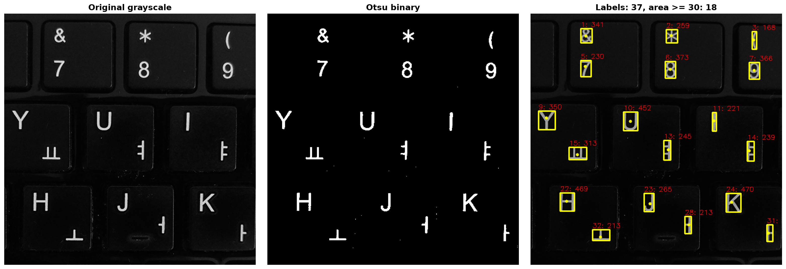
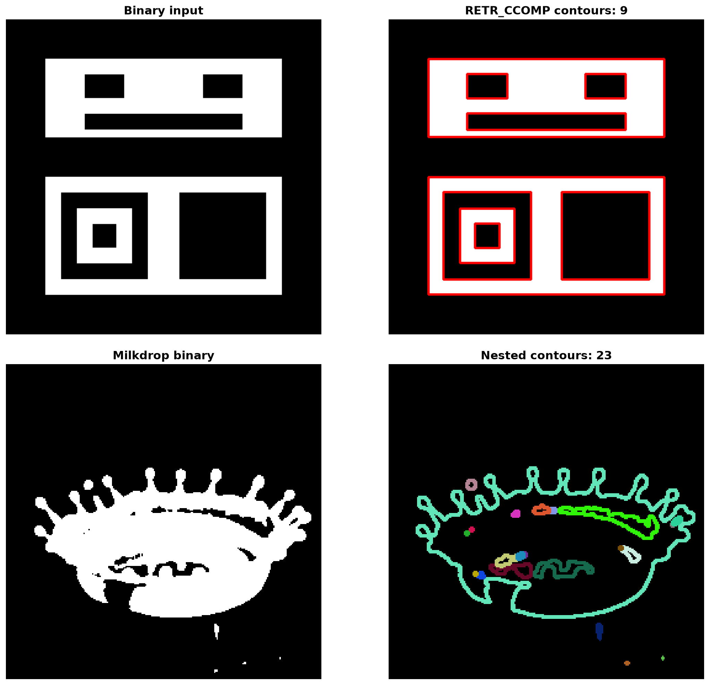
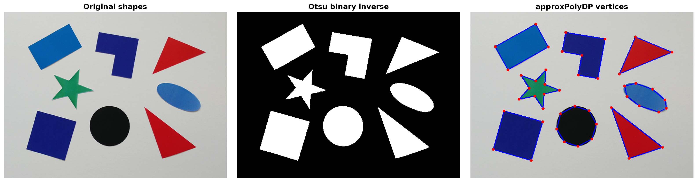
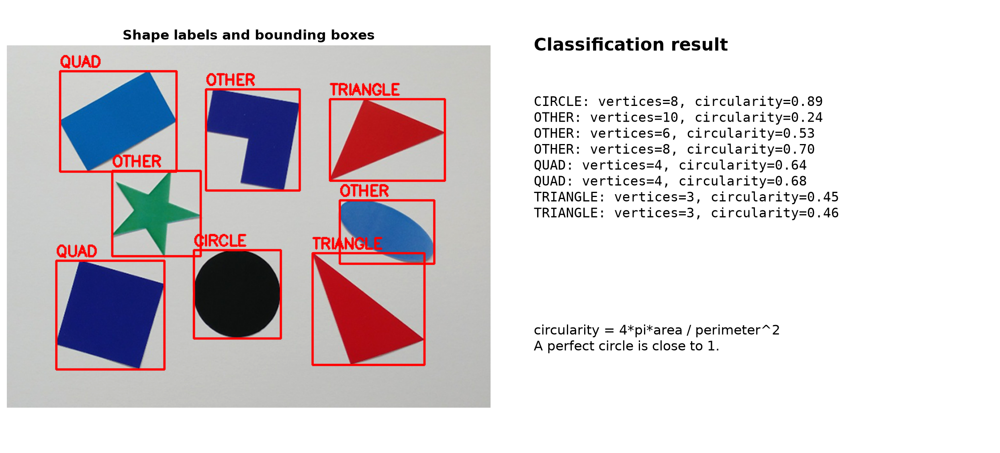

# [63일차] OpenCV 연결 요소, 윤곽선과 도형 분류

이진화가 픽셀을 전경과 배경으로 나누는 단계라면, 그다음에는 전경에서 **객체가 몇 개인지**, **어디에 있는지**, **어떤 모양인지**를 알아내야 한다. 이번에는 연결 요소 레이블링으로 객체 정보를 얻고, 윤곽선으로 경계를 추적하며, 다각형 근사와 원형도로 간단한 도형을 분류한다.

---

## 1. 객체 분석의 전체 흐름

```text
컬러 또는 그레이스케일 이미지
    -> 이진화
    -> 연결 요소 레이블링 또는 윤곽선 검출
    -> 위치·면적·중심점·둘레 계산
    -> 다각형 근사·원형도 계산
    -> 객체 수 세기, 바운딩 박스, 도형 분류
```

연결 요소 레이블링과 윤곽선 검출은 모두 객체를 찾지만 얻는 정보의 중심이 다르다.

| 구분 | 연결 요소 레이블링 | 윤곽선 검출 |
| --- | --- | --- |
| 핵심 | 연결된 픽셀 덩어리에 번호를 붙인다. | 객체의 경계 좌표를 찾는다. |
| 주된 결과 | 라벨, 면적, 바운딩 박스, 중심점 | 경계 점, 둘레, 계층 구조, 근사 다각형 |
| 활용 | 객체 개수 세기, 위치·크기 필터링 | 모양 분석, 구멍 구조, 도형 분류 |

---

## 2. 연결 요소 레이블링

연결 요소 레이블링(Connected Components Labeling)은 이진 영상에서 서로 붙어 있는 흰색 픽셀 덩어리를 하나의 객체로 보고 번호를 붙이는 작업이다. 객체 수를 세거나 각 객체의 위치와 면적을 구할 때 유용하다.

```python
img = cv2.imread("./images/keyboard.bmp", cv2.IMREAD_GRAYSCALE)

_, img_bin = cv2.threshold(
    img,
    0,
    255,
    cv2.THRESH_BINARY | cv2.THRESH_OTSU,
)

count, labels, stats, centroids = cv2.connectedComponentsWithStats(
    img_bin,
    connectivity=8,
)
```

### 반환값 이해하기

`cv2.connectedComponentsWithStats()`는 라벨링과 객체 통계 계산을 한 번에 수행한다.

| 반환값 | 의미 |
| --- | --- |
| `count` | 전체 라벨 수다. 배경도 라벨 `0`으로 포함한다. |
| `labels` | 원본과 같은 크기의 배열이다. 각 픽셀에 소속 객체 번호가 저장된다. |
| `stats` | 객체별 `[left, top, width, height, area]` 정보다. |
| `centroids` | 객체별 중심 좌표 `(cx, cy)`다. |

따라서 실제 전경 객체 수는 보통 `count - 1`이다.

```python
print("라벨 개수(배경 포함):", count)
print("라벨 개수(배경 제외):", count - 1)
```

### 4-연결과 8-연결

연결성(connectivity)은 어느 방향으로 닿은 픽셀을 같은 객체로 볼지 정한다.

```text
4-연결                  8-연결

    위                       왼쪽 위  위  오른쪽 위
왼쪽  중심  오른쪽             왼쪽  중심  오른쪽
    아래                     왼쪽 아래 아래 오른쪽 아래
```

- `connectivity=4`: 상하좌우로 닿은 픽셀만 같은 객체로 본다.
- `connectivity=8`: 대각선으로 닿은 픽셀도 같은 객체로 본다.

예제는 `connectivity=8`을 사용하므로 대각선으로 이어진 글자 획도 하나의 객체로 인식할 수 있다.

### 면적 필터링과 객체 표시

작은 점들은 노이즈일 가능성이 높다. `area` 기준을 두면 의미 있는 객체만 남길 수 있다.

```python
dst = cv2.cvtColor(img, cv2.COLOR_GRAY2BGR)

for i in range(1, count):  # 0번은 배경이므로 제외한다.
    x = stats[i, cv2.CC_STAT_LEFT]
    y = stats[i, cv2.CC_STAT_TOP]
    w = stats[i, cv2.CC_STAT_WIDTH]
    h = stats[i, cv2.CC_STAT_HEIGHT]
    area = stats[i, cv2.CC_STAT_AREA]

    if area < 30:
        continue

    cx, cy = centroids[i]
    cv2.rectangle(dst, (x, y), (x + w, y + h), (0, 255, 255), 2)
    cv2.circle(dst, (int(cx), int(cy)), 3, (0, 255, 255), -1)
```



면적 임계값 `30`은 이미지 크기와 노이즈 수준에 따라 달라진다. 값이 너무 작으면 잡음이 남고, 너무 크면 작은 실제 객체까지 사라질 수 있다.

---

## 3. 윤곽선 검출

윤곽선(Contour)은 객체의 바깥 경계를 이루는 좌표들의 집합이다. 레이블링이 객체의 위치와 크기를 빠르게 파악하는 데 적합하다면, 윤곽선은 둘레, 꼭짓점, 내부 구멍처럼 **모양 자체**를 분석할 때 적합하다.

```python
contours, hierarchy = cv2.findContours(
    img_bin,
    cv2.RETR_CCOMP,
    cv2.CHAIN_APPROX_SIMPLE,
)
```

### `findContours()`의 두 가지 주요 옵션

```python
cv2.findContours(image, mode, method)
```

| 옵션 | 역할 |
| --- | --- |
| `image` | 보통 전경이 흰색인 단일 채널 이진 이미지다. |
| `mode` | 어떤 윤곽선을 반환하고, 부모·자식 관계를 어떻게 보존할지 정한다. |
| `method` | 경계 점을 얼마나 압축해 저장할지 정한다. |

#### 윤곽선 검색 모드

| 모드 | 설명 |
| --- | --- |
| `RETR_EXTERNAL` | 가장 바깥 윤곽선만 반환한다. 내부 구멍은 무시한다. |
| `RETR_LIST` | 모든 윤곽선을 반환하지만 계층 관계는 만들지 않는다. |
| `RETR_CCOMP` | 바깥 윤곽선과 구멍 윤곽선을 2단계 계층으로 관리한다. |
| `RETR_TREE` | 모든 윤곽선의 부모·자식 관계를 전체 트리로 보존한다. |

#### 점 압축 방식

- `CHAIN_APPROX_NONE`: 경계 위의 모든 픽셀 좌표를 저장한다.
- `CHAIN_APPROX_SIMPLE`: 직선 중간의 불필요한 좌표를 줄여 꼭짓점 중심으로 저장한다.

사각형의 한 변은 많은 픽셀로 이루어져 있지만, 모양을 표현할 때는 네 모서리만으로 충분한 경우가 많다. 그래서 대부분의 도형 분석에는 `CHAIN_APPROX_SIMPLE`이 효율적이다.

### 계층 구조 `hierarchy`

`hierarchy`의 각 윤곽선 항목은 아래 순서로 관계를 저장한다.

```text
[next, previous, first_child, parent]
```

예를 들어 도넛처럼 바깥 테두리 안에 구멍이 있으면, 바깥 윤곽선은 자식으로 구멍 윤곽선을 가질 수 있다. 내부 구멍까지 분석해야 할 때 `RETR_CCOMP` 또는 `RETR_TREE`를 사용한다.

```python
dst = cv2.cvtColor(img_bin, cv2.COLOR_GRAY2BGR)
cv2.drawContours(dst, contours, -1, (0, 0, 255), 2)
```

`-1`은 모든 윤곽선을 그리라는 의미다. 특정 윤곽선 하나만 그리고 싶다면 해당 인덱스를 넣는다.



---

## 4. 다각형 근사로 도형 단순화하기

실제 윤곽선은 픽셀 단위의 많은 점으로 이루어져 있다. `cv2.approxPolyDP()`는 복잡한 경계를 더 적은 꼭짓점으로 근사한다.

```python
perimeter = cv2.arcLength(contour, True)
epsilon = 0.02 * perimeter
approx = cv2.approxPolyDP(contour, epsilon, True)
vertex_count = len(approx)
```

| 함수·값 | 의미 |
| --- | --- |
| `cv2.arcLength(contour, True)` | 닫힌 윤곽선의 둘레를 계산한다. |
| `epsilon` | 원본 윤곽선과 근사 윤곽선 사이에 허용할 최대 거리다. |
| `0.02 * perimeter` | 둘레의 2%를 허용 오차로 쓰는 예시다. |
| `len(approx)` | 근사 결과의 꼭짓점 수다. |

`epsilon`이 작으면 원래 모양을 촘촘히 따라가므로 꼭짓점 수가 많아진다. 반대로 너무 크면 실제 모서리까지 사라져 도형 분류가 부정확해질 수 있다.



---

## 5. 꼭짓점 수와 원형도로 도형 분류하기

예제는 먼저 꼭짓점 수로 삼각형과 사각형을 구분한다.

```python
if vertex_count == 3:
    label = "TRIANGLE"
elif vertex_count == 4:
    label = "QUAD"
else:
    label = "OTHER"
```

꼭짓점이 4개라고 해서 정사각형이나 직사각형이라고 단정할 수는 없다. 기울어진 사각형, 사다리꼴도 모두 `QUAD`가 될 수 있다. 더 세분화하려면 각도, 가로세로 비율, 볼록성 같은 추가 기준이 필요하다.

### 원형도

원형도(Circularity)는 면적과 둘레를 사용해 객체가 원에 얼마나 가까운지 나타내는 값이다.

```python
circularity = 4.0 * math.pi * area / (perimeter * perimeter)
```

완전한 원은 이론적으로 원형도가 1에 가깝다. 길쭉한 타원, 별, 복잡한 다각형은 값이 더 작아진다.

```python
if circularity > 0.8:
    label = "CIRCLE"
else:
    label = "OTHER"
```

분류 결과에 바운딩 박스와 텍스트를 표시하는 함수는 다음과 같다.

```python
def set_label(image, contour, label):
    x, y, w, h = cv2.boundingRect(contour)

    cv2.rectangle(image, (x, y), (x + w, y + h), (0, 0, 255), 2)
    text_y = max(y - 5, 20)
    cv2.putText(
        image,
        label,
        (x, text_y),
        cv2.FONT_HERSHEY_COMPLEX,
        0.7,
        (0, 0, 255),
        1,
    )
```



### 이진화 방향에 주의하기

도형 예제는 밝은 배경 위의 어두운 도형을 전경으로 삼아야 한다. 그래서 `THRESH_BINARY_INV`를 사용한다.

```python
_, img_bin = cv2.threshold(
    gray,
    0,
    255,
    cv2.THRESH_BINARY_INV | cv2.THRESH_OTSU,
)
```

일반 `THRESH_BINARY`를 사용하면 밝은 배경이 흰색 전경이 되어 큰 하나의 윤곽선으로 잡힐 수 있다. 전경으로 찾고 싶은 대상이 흰색이 되도록 이진화 방향을 선택해야 한다. 

---

## 6. 정리

- 연결 요소 레이블링은 연결된 전경 픽셀에 라벨을 붙이고, 면적·위치·중심점을 계산한다.
- 라벨 `0`은 배경이므로 전경 객체 수는 보통 `count - 1`이다.
- 윤곽선은 객체 경계의 좌표 집합이며, `RETR_CCOMP`와 `RETR_TREE`는 내부 구멍을 포함한 계층 구조를 다룬다.
- `approxPolyDP()`는 복잡한 윤곽선을 적은 꼭짓점으로 근사한다.
- 꼭짓점 수, 면적, 둘레, 원형도를 함께 사용하면 간단한 도형 분류를 만들 수 있다.
- 이진화에서는 대상이 흰색 전경이 되도록 `THRESH_BINARY`와 `THRESH_BINARY_INV`를 선택해야 한다.
