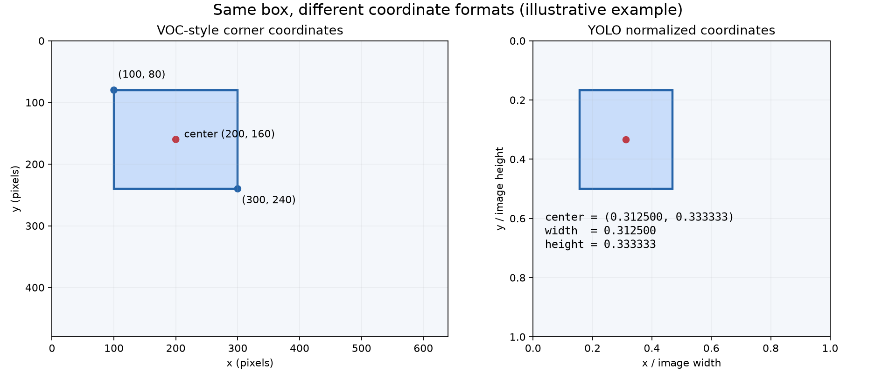

# [64일차] 객체 탐지와 YOLO, VOC 데이터셋 변환

이미지 속에 무엇이 있는지 아는 것에서 한 걸음 더 나아가, 그 대상이 **어디에 있는지**까지 알아내는 기술이 객체 탐지다. 객체 탐지 모델을 학습하려면 이미지뿐 아니라 각 객체의 종류와 위치를 기록한 정답 데이터도 필요하다.

이번 글에서는 객체 탐지와 YOLO의 기본 개념을 살펴보고, Pascal VOC의 XML 어노테이션을 YOLO가 읽을 수 있는 텍스트 라벨로 변환한다. 제공된 노트북은 학습 이미지와 라벨을 준비하는 과정까지 다루며, 모델 학습이나 추론 성능 측정은 포함하지 않는다.

---

## 1. 객체 탐지란

객체 탐지(Object Detection)는 이미지나 영상에 있는 객체를 찾아 **종류와 위치를 함께 예측하는 작업**이다. 사진에 사람 두 명과 자동차 한 대가 있다면, 각 대상에 클래스와 바운딩 박스를 붙인다.

| 출력 | 의미 | 설명용 예시 |
| --- | --- | --- |
| 클래스 | 탐지한 대상의 종류 | `person`, `car` |
| 바운딩 박스 | 대상을 감싸는 사각형의 위치와 크기 | `(xmin, ymin, xmax, ymax)` |
| Confidence score | 예측의 신뢰도를 나타내는 모델 점수 | `0.92` |

Confidence가 `0.92`라는 것은 해당 탐지에 높은 점수를 부여했다는 뜻이다. 이것을 실제 정답 확률이 정확히 92%라고 단정하지는 않는다. 점수 계산과 해석은 모델에 따라 달라질 수 있다.

### 이미지 분류와의 차이

| 작업 | 답하려는 질문 | 결과 |
| --- | --- | --- |
| 이미지 분류 | 이 이미지는 어떤 종류인가? | 이미지 단위 클래스 |
| 객체 탐지 | 어떤 객체가 어디에 있는가? | 객체별 클래스와 박스 |
| 인스턴스 분할 | 각 객체가 차지하는 정확한 영역은 어디인가? | 객체별 픽셀 마스크 |

63일차에는 연결된 픽셀과 윤곽선을 분석해 도형을 구분했다. 이번에는 이미지와 정답 박스를 이용해 모델이 객체의 특징을 학습하도록 준비한다. 박스를 그리는 결과는 비슷해 보여도, 분류 기준을 얻는 과정이 다르다.

### One-Stage와 Two-Stage

| 구분 | 처리 방식 | 대표 계열 |
| --- | --- | --- |
| One-Stage | 객체 후보를 따로 분류하는 두 번째 단계 없이 위치와 클래스를 직접 예측한다. | YOLO, SSD, RetinaNet |
| Two-Stage | 후보 영역을 먼저 만들고, 후보별 클래스를 판단하며 박스를 보정한다. | Faster R-CNN, Mask R-CNN |

One-Stage는 실시간 처리에 많이 활용된다. 다만 어느 쪽이 무조건 더 정확하거나 빠르다고 단정할 수는 없다. 모델 크기, 입력 해상도, 하드웨어, 데이터에 따라 결과가 달라진다. Mask R-CNN은 탐지에 더해 객체별 마스크도 예측한다.

---

## 2. YOLO 이해하기

YOLO는 **You Only Look Once**의 약자다. 한 번의 신경망 순전파에서 이미지 전체를 바탕으로 객체의 위치와 종류를 예측하는 객체 탐지 계열이다.

초기 YOLO는 이미지를 격자로 나누어 예측하는 방식으로 설명할 수 있다. 다만 YOLO의 세대별 구조가 모두 같지는 않으므로, 격자 설명을 모든 버전의 정확한 구현이라고 이해하지는 않는다.

### 모델 크기

노트북에서 소개하는 `n`, `s`, `m`, `l`, `x`는 여러 YOLO 제품군에서 사용하는 크기 구분이다.

| 표기 | 이름 | 이해할 점 |
| --- | --- | --- |
| `n` | Nano | 가벼운 구성이며 자원이 제한된 환경에서 검토한다. |
| `s` | Small | 비교적 작은 모델로 속도와 자원 사용을 고려한다. |
| `m` | Medium | 작은 모델보다 표현력을 늘린 중간 크기다. |
| `l` | Large | 더 큰 모델로 계산량과 메모리 요구도 커진다. |
| `x` | Extra-large | 같은 제품군에서 가장 큰 축에 속한다. |

크기가 커지면 정확도를 높일 여지가 있지만, 특정 데이터에서 항상 더 좋은 결과를 보장하지는 않는다. 실제 선택에는 처리 속도와 메모리 사용량도 함께 고려한다.

### 작업 유형

| 유형 | 주된 출력 |
| --- | --- |
| Detect | 객체별 클래스와 일반 바운딩 박스 |
| Segment | 객체별 픽셀 마스크 |
| Pose | 관절 등 키포인트의 위치 |
| Cls | 이미지 단위 클래스 |
| OBB | 객체 방향에 맞춘 회전 바운딩 박스 |

**OBB는 이미지 자체를 회전시키는 기능을 뜻하지 않는다.** 기울어진 물체에 맞춰 박스의 방향을 표현하는 작업이다. 이번에 만드는 라벨은 Detect용이며, Segment·Pose·OBB의 라벨 구조와는 구분해야 한다. [Ultralytics OBB 설명](https://docs.ultralytics.com/tasks/obb/)

---

## 3. Pascal VOC 2007의 구조

Pascal VOC 2007은 객체 탐지 등을 평가하는 데 사용되는 대표적인 컴퓨터 비전 벤치마크다. 여기서는 **이미지, 객체 클래스, 정답 바운딩 박스, 데이터 분할 목록**을 사용한다.

```text
VOCdevkit/
└── VOC2007/
    ├── JPEGImages/       # 입력 이미지
    │   └── 000001.jpg
    ├── Annotations/      # 객체 종류와 박스가 담긴 XML
    │   └── 000001.xml
    └── ImageSets/
        └── Main/
            ├── train.txt
            ├── val.txt
            └── test.txt
```

위 구조는 경로를 이해하기 위한 예시다. 내려받아 배치한 데이터 묶음에 따라 실제로 존재하는 분할 파일은 확인해야 한다.

| 분할 | 역할 |
| --- | --- |
| Train | 모델의 가중치를 학습한다. |
| Validation | 학습 중 설정과 모델을 비교·선택한다. |
| Test | 선택이 끝난 모델의 성능을 평가한다. |

공식 분할 목록을 따르면 이미지가 어느 용도로 지정되었는지 유지할 수 있다. 노트북에는 VOC 2007의 train 이미지 **2,501장**을 준비했다는 출력이 저장되어 있다. 공식 통계에서도 train 이미지 수는 2,501장이다. [VOC 2007 통계](https://www.robots.ox.ac.uk/~vgg/projects/pascal/VOC/voc2007/dbstats.html)

### 클래스 번호 만들기

```python
VOC_CLASSES = [
    'aeroplane', 'bicycle', 'bird', 'boat', 'bottle',
    'bus', 'car', 'cat', 'chair', 'cow',
    'diningtable', 'dog', 'horse', 'motorbike', 'person',
    'pottedplant', 'sheep', 'sofa', 'train', 'tvmonitor'
]

CLASS_TO_ID = {name: idx for idx, name in enumerate(VOC_CLASSES)}

print(CLASS_TO_ID['car'])
print(CLASS_TO_ID['dog'])
print(CLASS_TO_ID['person'])
```

출력:

```text
6
11
14
```

`enumerate()`는 순서대로 `(인덱스, 값)`을 반환한다. 딕셔너리 컴프리헨션으로 클래스 이름을 정수 번호에 연결한다.

이 번호는 보편적으로 고정된 번호가 아니라 **이 프로젝트의 클래스 목록 순서**로 결정된다. 라벨을 만든 뒤 클래스 목록 순서를 바꾸면 같은 번호가 다른 객체를 뜻하게 된다. 추후 학습 설정에서도 반드시 같은 순서를 사용해야 한다.

---

## 4. 실행 장치와 폴더 준비

### 사용할 연산 장치 선택

```python
import sys
import torch
from pathlib import Path

if torch.cuda.is_available():
    DEVICE = torch.device('cuda')
elif torch.backends.mps.is_available():
    DEVICE = torch.device('mps')
elif torch.xpu.is_available():
    DEVICE = torch.device('xpu')
else:
    DEVICE = torch.device('cpu')

print(DEVICE)
```

노트북에 저장된 출력:

```text
mps
```

CUDA는 NVIDIA GPU, MPS는 지원되는 Mac의 GPU, XPU는 지원되는 Intel GPU 실행 환경에 대응한다. 위 코드는 먼저 사용 가능한 장치를 골라 `DEVICE`에 기록한다.

장치를 변수에 저장했다고 모델이나 데이터가 자동으로 이동하지는 않는다. 이 노트북의 XML 읽기와 파일 복사는 CPU·파일 시스템 작업이며, GPU를 사용한 학습 코드는 아직 없다.

구형 PyTorch 등에서 `torch.xpu` 속성이 없다면 다음처럼 속성 존재 여부를 함께 검사할 수 있다.

```python
elif hasattr(torch, 'xpu') and torch.xpu.is_available():
    DEVICE = torch.device('xpu')
```

### 경로 구성

```python
PROJECT_ROOT = Path('/Users/songjeong-geun/Desktop/KDT/11_CV')

DATA_DIR = PROJECT_ROOT / 'data'
VOC_ROOT = DATA_DIR / 'VOCdevkit' / 'VOC2007'
YOLO_ROOT = DATA_DIR / 'Custom_YOLO'

ANNOTATION_DIR = VOC_ROOT / 'Annotations'
IMAGES_DIR = VOC_ROOT / 'JPEGImages'
```

`Path`의 `/` 연산자는 경로를 이어 붙인다. `VOC_ROOT / 'Annotations'`는 VOC 데이터 폴더 안의 어노테이션 폴더를 나타낸다. 다른 컴퓨터에서는 `PROJECT_ROOT`를 실제 경로로 바꾸어 사용한다.

```python
for sub in [
    'images/train2007', 'images/val2007', 'images/test2007',
    'labels/train2007', 'labels/val2007', 'labels/test2007'
]:
    (YOLO_ROOT / sub).mkdir(parents=True, exist_ok=True)
```

`parents=True`는 필요한 상위 폴더도 만들고, `exist_ok=True`는 같은 폴더가 이미 있어도 오류를 내지 않게 한다.

---

## 5. YOLO 정답 라벨의 형식

일반적인 YOLO Detect 라벨은 한 이미지에 대응하는 `.txt` 파일에 저장한다. **한 줄이 하나의 객체**를 나타낸다.

```text
<class_id> <x_center> <y_center> <width> <height>
```

| 항목 | 의미 |
| --- | --- |
| `class_id` | 0부터 시작하는 정수 클래스 번호 |
| `x_center` | 박스 중심의 x좌표를 이미지 너비로 나눈 값 |
| `y_center` | 박스 중심의 y좌표를 이미지 높이로 나눈 값 |
| `width` | 박스 너비를 이미지 너비로 나눈 값 |
| `height` | 박스 높이를 이미지 높이로 나눈 값 |

클래스 번호 뒤의 네 값은 이미지 크기를 기준으로 정규화한다. 이미지와 라벨은 `000001.jpg`, `000001.txt`처럼 기본 이름을 맞춘다. [Ultralytics 데이터셋 형식](https://docs.ultralytics.com/datasets/detect/)

```text
images/train2007/000001.jpg
labels/train2007/000001.txt
```

**정답 라벨에는 confidence가 없다.** confidence는 모델이 추론할 때 계산하는 점수이며, 여기서는 사람이 제공한 객체 종류와 위치를 기록한다.

### 실제 변환된 텍스트 읽어 보기

별도 예제로 저장된 `data/000001.txt`에는 다음 두 줄이 있다.

```text
11 0.344193 0.611000 0.416431 0.262000
14 0.509915 0.510000 0.974504 0.972000
```

첫 번째 줄은 `dog`, 두 번째 줄은 `person`의 정답 박스다. 한 이미지에 두 객체의 어노테이션이 있다는 뜻이며, 모델이 탐지한 결과는 아니다.

---

## 6. 모서리 좌표를 중심점과 크기로 변환하기

VOC XML은 박스를 `xmin`, `ymin`, `xmax`, `ymax`로 표현한다. 제공된 코드는 이 값을 중심점과 크기로 바꾼 후 정규화한다.

```python
def voc_box_to_yolo(xmin, ymin, xmax, ymax, image_w, image_h):
    x = (xmin + xmax) / (2 * image_w)
    y = (ymin + ymax) / (2 * image_h)
    w = (xmax - xmin) / image_w
    h = (ymax - ymin) / image_h
    return x, y, w, h
```

### 숫자로 계산해 보기

이미지 크기가 가로 640, 세로 480이고 박스가 `(100, 80, 300, 240)`이라고 가정한다. 다음은 위 함수의 계산 방식을 설명하기 위한 좌표 예제다.

| 값 | 계산 | 결과 |
| --- | --- | --- |
| 중심 x | `(100 + 300) / 2` | 200 |
| 중심 y | `(80 + 240) / 2` | 160 |
| 박스 너비 | `300 - 100` | 200 |
| 박스 높이 | `240 - 80` | 160 |
| 정규화된 중심 x | `200 / 640` | 0.312500 |
| 정규화된 중심 y | `160 / 480` | 약 0.333333 |
| 정규화된 너비 | `200 / 640` | 0.312500 |
| 정규화된 높이 | `160 / 480` | 약 0.333333 |

```python
x, y, w, h = voc_box_to_yolo(100, 80, 300, 240, 640, 480)
print(f'6 {x:.6f} {y:.6f} {w:.6f} {h:.6f}')
```

출력:

```text
6 0.312500 0.333333 0.312500 0.333333
```



*실제 탐지 결과가 아닌 좌표 계산 설명용 그림이다. 오른쪽은 x와 y를 각각 이미지 너비와 높이로 나눈 좌표계다.*

### 좌표를 해석할 때 주의할 점

`x_center`와 `width`는 이미지 너비로, `y_center`와 `height`는 이미지 높이로 나눈다. 박스 자체의 너비로 중심점을 나누는 것이 아니다.

또한 데이터셋·변환 도구마다 좌표가 0부터 시작하는지, 1부터 시작하는지, 끝 픽셀을 포함하는지의 규약이 다를 수 있다. 위 함수는 입력 좌표를 그대로 사용해 차이를 계산하는 노트북의 구현이다. 다른 도구의 변환 결과와 정확히 맞춰야 한다면 해당 규약을 확인하고, 변환한 박스를 원본 위에 다시 그려 검증한다.

---

## 7. XML 한 개를 YOLO 라벨로 바꾸기

XML은 태그로 데이터를 계층적으로 표현한다. 객체 이름은 `<name>`, 박스 좌표는 `<bndbox>`에 들어 있다.

다음은 구조 설명을 위해 간단하게 만든 예제다.

```xml
<annotation>
    <size>
        <width>640</width>
        <height>480</height>
    </size>
    <object>
        <name>car</name>
        <bndbox>
            <xmin>100</xmin>
            <ymin>80</ymin>
            <xmax>300</xmax>
            <ymax>240</ymax>
        </bndbox>
    </object>
</annotation>
```

### 변환 함수

```python
import xml.etree.ElementTree as ET

def convert_voc_xml(xml_path, label_path):
    root = ET.parse(xml_path).getroot()
    size = root.find('size')
    image_w = float(size.findtext('width'))
    image_h = float(size.findtext('height'))

    lines = []
    for obj in root.findall('object'):
        class_name = obj.findtext('name')
        if class_name not in CLASS_TO_ID:
            continue

        bnd = obj.find('bndbox')
        xmin = float(bnd.findtext('xmin'))
        ymin = float(bnd.findtext('ymin'))
        xmax = float(bnd.findtext('xmax'))
        ymax = float(bnd.findtext('ymax'))

        # 이미지 범위를 벗어난 좌표를 범위 안으로 제한한다.
        xmin = max(0.0, min(xmin, image_w))
        xmax = max(0.0, min(xmax, image_w))
        ymin = max(0.0, min(ymin, image_h))
        ymax = max(0.0, min(ymax, image_h))

        if xmax <= xmin or ymax <= ymin:
            continue

        x, y, w, h = voc_box_to_yolo(
            xmin, ymin, xmax, ymax, image_w, image_h
        )
        class_id = CLASS_TO_ID[class_name]
        lines.append(f'{class_id} {x:.6f} {y:.6f} {w:.6f} {h:.6f}')

    label_path.parent.mkdir(parents=True, exist_ok=True)
    label_path.write_text('\n'.join(lines), encoding='utf-8')
```

### 함수가 하는 일

1. `ET.parse()`로 XML 파일을 읽고 `getroot()`로 최상위 요소를 얻는다.
2. `size`에서 이미지 너비와 높이를 읽는다.
3. `findall('object')`로 이미지에 표시된 객체를 하나씩 순회한다.
4. 클래스 목록에 없는 객체는 `continue`로 건너뛴다.
5. 박스 좌표를 읽고 이미지 범위로 제한한다.
6. 너비나 높이가 0 이하인 잘못된 박스를 제외한다.
7. 좌표를 정규화하고 소수점 여섯 자리의 한 줄로 만든다.
8. 객체별 줄을 모아 텍스트 파일에 저장한다.

`find()`는 하위 요소를, `findtext()`는 요소 안의 문자열을 가져온다. 좌표 계산을 위해 문자열을 `float`로 바꾼다.

```python
xmin = max(0.0, min(xmin, image_w))
```

이미지 너비가 640일 때 `xmin=-10`이면 0, `xmin=700`이면 640으로 제한한다. 단, 잘못된 박스를 의미 있는 객체 위치로 복원하는 것은 아니므로 제한 후 크기 검사도 수행한다.

```python
label_path.write_text('\n'.join(lines), encoding='utf-8')
```

`'\n'.join(lines)`는 객체별 문자열 사이에 줄바꿈을 넣는다. 객체가 여러 개면 여러 줄이 저장되며, 저장할 객체가 없으면 빈 파일이 만들어진다. 같은 경로에 재실행하면 기존 파일 내용은 새 내용으로 덮어쓴다.

### 하나의 파일로 먼저 확인

```python
xml_path = ANNOTATION_DIR / '000001.xml'
label_path = DATA_DIR / '000001.txt'

convert_voc_xml(xml_path, label_path)
print(label_path.read_text(encoding='utf-8'))
```

이 단일 파일의 출력 위치는 `data/000001.txt`다. 이후 전체 변환 함수는 라벨을 `Custom_YOLO/labels/train2007/`에 저장한다.

---

## 8. 학습 데이터 준비하기

XML 하나의 변환이 확인되면 학습 분할 목록에 있는 이미지 ID를 순회하며 이미지 복사와 라벨 변환을 반복한다.

```python
import shutil

def prepare_split(voc_dir, split_name, output_name):
    split_file = voc_dir / 'ImageSets' / 'Main' / f'{split_name}.txt'
    image_dir = voc_dir / 'JPEGImages'
    annotation_dir = voc_dir / 'Annotations'

    out_image_dir = YOLO_ROOT / 'images' / output_name
    out_label_dir = YOLO_ROOT / 'labels' / output_name
    out_image_dir.mkdir(parents=True, exist_ok=True)
    out_label_dir.mkdir(parents=True, exist_ok=True)

    image_ids = [
        x.strip()
        for x in split_file.read_text(encoding='utf-8').splitlines()
        if x.strip()
    ]

    for image_id in image_ids:
        src_image = image_dir / f'{image_id}.jpg'
        src_xml = annotation_dir / f'{image_id}.xml'

        shutil.copy2(src_image, out_image_dir / src_image.name)
        convert_voc_xml(src_xml, out_label_dir / f'{image_id}.txt')

    print(f'{output_name}: {len(image_ids):,} images prepared')
```

| 코드 | 역할 |
| --- | --- |
| `split_name` | 읽을 목록 이름이다. `train`이면 `train.txt`를 읽는다. |
| `output_name` | 저장 폴더 이름이다. 여기서는 `train2007`을 사용한다. |
| `splitlines()` | 목록 파일을 줄 단위로 나눈다. |
| `strip()` | 줄 앞뒤의 공백을 제거한다. |
| `if x.strip()` | 빈 줄을 건너뛴다. |
| `shutil.copy2()` | 이미지를 복사하고 가능한 파일 메타데이터도 보존한다. |
| `src_image.name` | 경로에서 파일명만 얻는다. |
| `:,` | 이미지 수에 천 단위 쉼표를 표시한다. |

이미지 ID는 문자열로 유지한다. `000001`을 정수 `1`로 바꾸면 원본 파일명과 연결되지 않는다. 또한 이 함수는 **각 줄에 이미지 ID만 있는 분할 목록**을 전제로 한다.

### 노트북의 실행 코드와 저장된 출력

```python
prepare_split(VOC_ROOT, 'train', 'train2007')
```

노트북의 실행 결과는 다음과 같다.

```text
train2007: 2,501 images prepared
```

이 출력의 2,501은 처리한 이미지 수다. 객체 수나 라벨 텍스트의 총 줄 수가 아니다. 한 이미지에 여러 객체가 들어갈 수 있다.

이 함수는 이미지를 무작위로 나누지 않는다. `train.txt`에 적힌 구성을 그대로 유지하면서 파일을 복사하고 라벨 형식만 변환한다.

변환이 끝나면 저장 구조는 다음과 같다.

```text
Custom_YOLO/
├── images/
│   └── train2007/    # 학습 이미지
└── labels/
    └── train2007/    # 학습 이미지에 대응하는 YOLO 라벨
```

학습 데이터 변환에는 `train.txt`와 목록에 포함된 이미지·XML이 모두 필요하다. 하나라도 없으면 복사 또는 파싱 단계에서 중단된다.

---

## 9. 데이터를 준비할 때 확인할 점

| 확인할 부분 | 이유 |
| --- | --- |
| 이미지와 라벨의 기본 파일명 | 같은 이름으로 연결되어야 한다. |
| 클래스 번호와 목록 순서 | 잘못 연결되면 위치가 맞아도 다른 클래스의 정답이 된다. |
| 이미지 너비와 높이가 양수인지 | 좌표 정규화에 나눗셈을 사용한다. |
| XML 필수 태그 존재 여부 | 현재 함수는 정상 구조의 XML을 전제로 한다. |
| 변환된 좌표와 실제 객체의 일치 | 숫자가 0~1 사이여도 박스 위치가 잘못될 수 있다. |
| 빈 라벨의 원인 | 객체가 없어서인지, 클래스·박스 필터링으로 모두 제외됐는지 구분한다. |
| 원본 이미지와 XML의 존재 | 하나라도 없으면 복사 또는 파싱 단계에서 중단된다. |

현재 변환 함수는 VOC XML의 `difficult` 같은 부가 속성을 따로 처리하지 않는다. VOC의 평가 규칙을 그대로 재현하려면 이런 객체를 학습·평가에서 어떻게 취급할지 별도로 정해야 한다.

또한 `mkdir(exist_ok=True)`가 기존 폴더를 비우지는 않는다. 이전에 다른 목록을 변환한 폴더를 재사용하면 과거 파일이 남을 수 있다. 출력 목록과 실제 파일 구성이 맞는지 확인해야 한다.

이번 자료를 정리하면서 좌표 변환과 XML 변환 함수는 설명용 XML로 실행해 확인했다. 노트북에 지정된 원본 VOC 이미지·XML 경로는 현재 로컬에서 확인되지 않아 전체 데이터 변환을 다시 실행하지는 않았다. `2,501 images prepared`는 노트북에 저장된 실행 결과다.

YOLO 모델을 학습시키기 전에는 이처럼 이미지와 라벨을 정확히 연결하는 과정이 필요하다. 이번 단계에서 중요한 것은 모델 이름보다도 **클래스 번호, 박스 좌표, 파일 이름, 데이터 분할이 서로 일관되게 맞는지** 이해하는 것이다.
