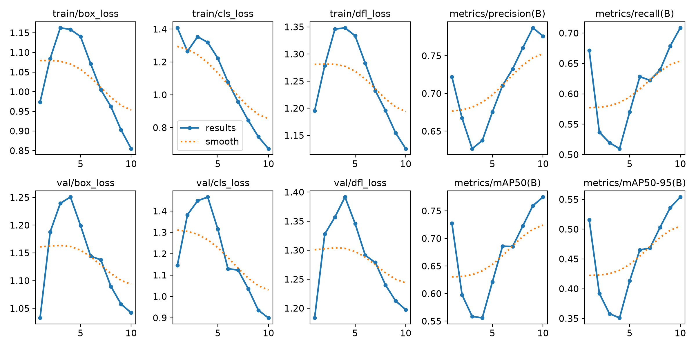
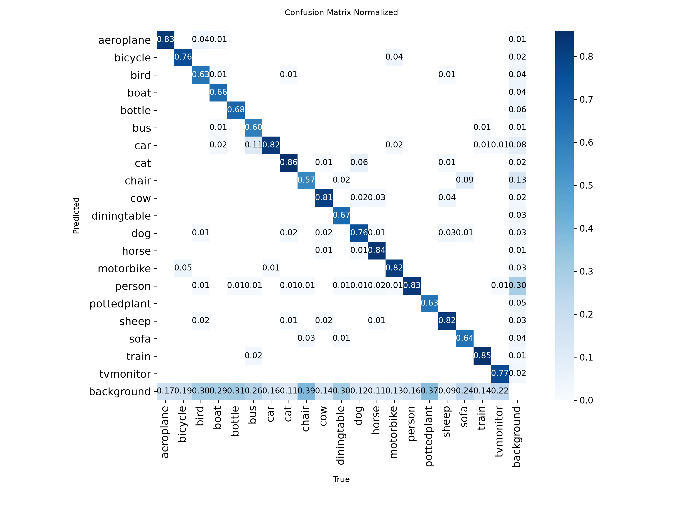
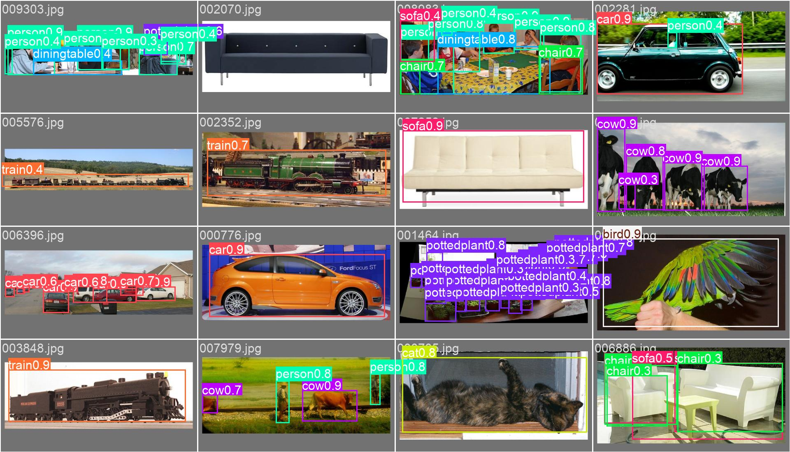
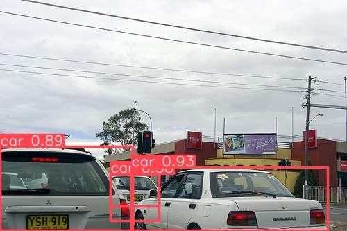

# [66일차] YOLO 데이터셋 설정, 학습과 성능 평가

64일차에서는 Pascal VOC XML을 YOLO 라벨로 변환하고 학습 이미지를 준비했다. 이번에는 이어서 검증·테스트 분할을 준비하고, Dataset YAML로 데이터셋을 연결한 뒤 사전 학습된 YOLO 모델을 학습·검증·테스트·추론하는 흐름을 정리한다.

---

## 1. 전체 흐름

```text
VOC XML과 이미지
        ↓
YOLO 라벨과 train/val/test 폴더 준비
        ↓
Dataset YAML 작성
        ↓
사전 학습 모델 불러오기
        ↓
학습(train) → 검증(val) → 최종 테스트(test)
        ↓
새 이미지 추론(predict)과 결과 확인
```

`train`은 가중치를 학습하는 용도, `val`은 학습 과정에서 모델을 비교하는 용도, `test`는 최종 선택 뒤 일반화 성능을 확인하는 용도다. 테스트 결과를 보고 모델 설정을 반복해서 바꾸면 테스트 데이터도 사실상 검증 데이터처럼 사용하게 된다.

---

## 2. 검증·테스트 분할 준비하기

64일차에서 만든 `prepare_split()` 함수는 분할 목록을 읽어 이미지를 복사하고, 대응하는 XML을 YOLO 라벨로 변환한다. 같은 함수를 `val`, `test`에도 적용한다.

```python
prepare_split(VOC_ROOT, 'val', 'val2007')
prepare_split(VOC_ROOT, 'test', 'test2007')
```

| 호출 | 읽는 목록 | 이미지 저장 위치 | 라벨 저장 위치 |
| --- | --- | --- | --- |
| `prepare_split(VOC_ROOT, 'val', 'val2007')` | `ImageSets/Main/val.txt` | `images/val2007/` | `labels/val2007/` |
| `prepare_split(VOC_ROOT, 'test', 'test2007')` | `ImageSets/Main/test.txt` | `images/test2007/` | `labels/test2007/` |

이 함수는 데이터를 무작위로 새로 나누지 않는다. VOC가 제공한 분할 목록을 그대로 유지하면서 이미지와 라벨을 YOLO 형식으로 준비한다.

```text
Custom_YOLO/
├── images/
│   ├── train2007/
│   ├── val2007/
│   └── test2007/
└── labels/
    ├── train2007/
    ├── val2007/
    └── test2007/
```

---

## 3. Dataset YAML 작성하기

Dataset YAML은 YOLO가 데이터셋의 루트 경로, 각 분할의 이미지 위치, 클래스 번호와 이름의 대응 관계를 알 수 있게 하는 설정 파일이다.

```python
import yaml

custom_voc_yaml = YOLO_ROOT / 'custom_voc.yaml'

data_config = {
    'path': str(YOLO_ROOT.resolve()),
    'train': 'images/train2007',
    'val': 'images/val2007',
    'test': 'images/test2007',
    'names': {i: name for i, name in enumerate(VOC_CLASSES)},
}

with open(custom_voc_yaml, 'w', encoding='utf-8') as file:
    yaml.safe_dump(data_config, file, allow_unicode=True, sort_keys=False)

print(custom_voc_yaml.read_text(encoding='utf-8'))
```

생성되는 핵심 구조는 다음과 같다.

```yaml
path: /Users/songjeong-geun/Desktop/KDT/11_CV/data/Custom_YOLO
train: images/train2007
val: images/val2007
test: images/test2007
names:
  0: aeroplane
  1: bicycle
  # ...
  19: tvmonitor
```

| 항목 | 역할 |
| --- | --- |
| `path` | 데이터셋의 루트 경로다. |
| `train` | 학습 이미지 폴더 또는 이미지 경로 목록 파일이다. |
| `val` | 검증 이미지 폴더 또는 이미지 경로 목록 파일이다. |
| `test` | 최종 테스트에 사용할 이미지 위치다. 선택 항목이지만 이 예제에서는 지정한다. |
| `names` | 클래스 번호를 클래스 이름으로 해석하는 사전이다. |

YOLO는 이미지 경로의 `images/` 부분을 `labels/`로 바꾸고 확장자를 `.txt`로 바꿔 대응 라벨을 찾는다. 따라서 `images/train2007/000001.jpg`에는 `labels/train2007/000001.txt`가 대응해야 한다. 클래스 번호와 `names`의 순서가 다르면 모델은 학습은 진행해도 클래스 이름을 잘못 해석할 수 있다. [Ultralytics 데이터셋 형식](https://docs.ultralytics.com/datasets/detect)

### Dataset YAML과 Model YAML의 차이

| 파일 | 담는 내용 |
| --- | --- |
| Dataset YAML | 데이터 경로, 분할, 클래스 이름 |
| Model YAML | 신경망 레이어 구성 등 모델 구조 |

사전 학습된 `.pt` 모델을 사용하는 전이 학습에서는 보통 Dataset YAML을 `data` 인자로 전달해 학습한다. 모델 구조를 처음부터 정의하려는 경우에 Model YAML을 별도로 사용한다.

---

## 4. 사전 학습 YOLO 모델로 학습하기

```python
from ultralytics import YOLO

model = YOLO('yolo11s.pt')

results = model.train(
    data=str(custom_voc_yaml),
    epochs=10,
    imgsz=640,
    batch=16,
    device=DEVICE,
    workers=2,
    name='voc2007_yolo11s',
    exist_ok=True,
    seed=2026,
)
```

| 인자 | 의미 |
| --- | --- |
| `data` | Dataset YAML 파일 경로다. |
| `epochs` | 전체 학습 데이터를 반복해 보는 횟수다. 여기서는 10회다. |
| `imgsz` | 모델 입력 이미지의 기준 크기다. |
| `batch` | 한 번의 학습 단계에서 처리하는 이미지 수다. |
| `device` | `mps`, `cuda`, `cpu` 같은 실행 장치다. |
| `workers` | 데이터 로딩에 사용할 워커 수다. 실행 환경에 따라 실제 값이 조정될 수 있다. |
| `name` | `runs/detect/` 아래에 생성할 실행 폴더 이름이다. |
| `exist_ok=True` | 같은 이름의 실행 폴더가 있어도 실행을 허용한다. 기존 결과를 덮어쓸 가능성이 있으므로 주의한다. |
| `seed` | 난수 시드를 고정해 실험 재현성을 높인다. |

노트북의 학습 로그에는 `yolo11s` 모델이 20개 VOC 클래스로 탐지 헤드를 조정하고, train 2,501장과 val 2,510장을 읽은 뒤 학습을 시작한 기록이 남아 있다. 다만 학습 셀에는 모든 epoch의 종료 로그가 저장되어 있지 않으므로, 이 문서에서는 학습 완료 시점의 손실 수치를 단정하지 않는다.

> 파일 확장자만으로 `.pt`는 모델 구조까지 있고 `.pth`는 가중치만 있다는 식으로 일반화하면 정확하지 않다. 체크포인트에 무엇이 저장되는지는 라이브러리와 저장 방식에 따라 다르다. Ultralytics에서는 `YOLO('yolo11s.pt')`처럼 공식 사전 학습 체크포인트를 불러와 사용한다. [Ultralytics Detect 학습 예시](https://docs.ultralytics.com/tasks/detect)

---

## 5. 객체 탐지 평가 지표

객체 탐지는 클래스가 맞는지뿐 아니라 박스 위치가 충분히 정확한지도 평가해야 한다. 그래서 분류 문제의 Accuracy 하나만으로 모델 성능을 판단하기 어렵다.

### 5.1 IoU

IoU(Intersection over Union)는 예측 박스와 정답 박스가 겹치는 정도다.

```text
IoU = 겹친 영역의 넓이 / 두 박스를 합친 전체 영역의 넓이
```

| IoU 값 | 의미 |
| --- | --- |
| `1` | 두 박스가 완전히 일치한다. |
| `0` | 두 박스가 전혀 겹치지 않는다. |
| `0.5` | 평가에서 자주 사용하는 기준 중 하나다. |

클래스가 `person`으로 맞아도 예측 박스가 사람과 거의 겹치지 않으면 올바른 탐지로 인정할 수 없다. 따라서 평가에서는 클래스가 같고 IoU가 기준 이상일 때 TP(True Positive)로 판정한다.

### 5.2 Confidence와 임계값

Confidence는 모델이 해당 탐지를 얼마나 강하게 믿는지를 나타내는 점수다.

```text
person  0.94
person  0.85
dog     0.08
```

`conf=0.30`처럼 임계값을 정하면 그 점수보다 낮은 예측은 결과에서 제외한다.

| 임계값 변화 | 일반적인 경향 |
| --- | --- |
| 낮춘다 | 더 많은 박스를 남겨 Recall은 높아질 수 있지만 오탐도 늘 수 있다. |
| 높인다 | 오탐은 줄 수 있지만 실제 객체를 놓쳐 Recall이 낮아질 수 있다. |

Confidence는 정답 라벨에 기록하는 값이 아니다. 라벨은 사람이 제공한 클래스와 박스이며, Confidence는 모델 추론 결과에 붙는 점수다.

### 5.3 Precision과 Recall

| 지표 | 질문 | 높은 값의 의미 |
| --- | --- | --- |
| Precision | 모델이 탐지했다고 한 것 중 실제 객체는 얼마나 많은가? | 오탐이 적다. |
| Recall | 실제 객체 중 모델이 찾아낸 것은 얼마나 많은가? | 놓친 객체가 적다. |

객체 탐지에서는 Confidence 임계값을 바꾸면 Precision과 Recall도 함께 바뀐다. 한 숫자만 최대화하기보다 서비스 목적에 맞는 균형을 찾아야 한다.

### 5.4 AP와 mAP

AP(Average Precision)는 **한 클래스**의 Precision-Recall 곡선을 하나의 값으로 요약한 지표다.

1. 같은 클래스의 예측을 Confidence가 높은 순서로 정렬한다.
2. 각 예측을 정답 박스와 비교한다.
3. 클래스와 IoU 기준을 만족하면 TP, 그렇지 않으면 FP로 처리한다.
4. 예측을 순서대로 포함하며 Precision과 Recall을 계산한다.
5. Precision-Recall 곡선을 요약해 AP를 구한다.

mAP(mean Average Precision)은 모든 클래스의 AP 평균이다.

| 지표 | 의미 |
| --- | --- |
| `mAP50` | IoU 0.50에서 계산한 AP의 클래스 평균이다. |
| `mAP75` | IoU 0.75에서 계산한 AP의 클래스 평균이다. 더 엄격한 위치 정확도를 요구한다. |
| `mAP50-95` | IoU 0.50부터 0.95까지 0.05 간격의 AP를 평균낸 값이다. |

`mAP50`은 높지만 `mAP50-95`가 상대적으로 낮다면 객체는 대략 찾지만 박스 경계의 정밀도가 부족할 가능성이 있다. 공식 Ultralytics 검증 출력도 `P`, `R`, `mAP50`, `mAP50-95`를 함께 제공한다. [Ultralytics 성능 지표 설명](https://docs.ultralytics.com/guides/yolo-performance-metrics)

### 5.5 평가 IoU와 NMS IoU 구분하기

IoU는 두 용도로 등장할 수 있으므로 구분해야 한다.

| 구분 | 비교 대상 | 목적 |
| --- | --- | --- |
| 평가 IoU | 예측 박스와 정답 박스 | TP·FP 판정과 AP 계산 |
| NMS IoU | 예측 박스와 예측 박스 | 같은 객체 주변의 중복 탐지 제거 |

NMS(Non-Maximum Suppression)는 겹치는 후보 박스 중 Confidence가 더 높은 박스를 남기는 후처리다. `predict(..., iou=...)`의 `iou`는 일반적으로 이 중복 제거 기준을 뜻하며, mAP를 계산할 때의 평가 IoU와 같은 의미로 사용하면 안 된다.

---

## 6. 저장된 검증·테스트 결과 읽기

### 검증 분할 결과

노트북에 저장된 `model.val(split='val')` 결과는 다음과 같다.

| 항목 | 값 |
| --- | ---: |
| Images | 2,510 |
| Instances | 7,818 |
| Precision | 0.777 |
| Recall | 0.709 |
| mAP50 | 0.775 |
| mAP50-95 | 0.553 |
| mAP75 | 0.607 |

```python
print('mAP50:', val_results.box.map50)
print('mAP50-95:', val_results.box.map)
print('mAP75:', val_results.box.map75)
```

`Images`는 평가에 사용한 이미지 수이고, `Instances`는 그 이미지에 들어 있는 정답 객체의 총개수다. 한 이미지에는 여러 객체가 있으므로 두 값은 다르다.

### 테스트 분할 결과

최종 테스트 분할은 다음처럼 별도로 지정한다.

```python
test_results = model.val(
    data=str(custom_voc_yaml),
    split='test',
    imgsz=640,
    batch=16,
    device=DEVICE,
    workers=2,
)
```

저장된 테스트 출력은 Images 4,952장, Instances 14,976개, Precision 0.784, Recall 0.694, mAP50 0.767, mAP50-95 0.548이다.

검증과 테스트의 mAP50-95가 각각 0.553, 0.548로 크게 차이 나지는 않는다. 다만 한 번의 분할 결과만으로 일반화 성능을 확정하지 말고, 클래스별 AP, 오류 사례, 다른 데이터 환경도 함께 확인해야 한다.

---

## 7. 저장된 결과 이미지로 확인하기

### 7.1 학습 곡선



`results.png`는 각 epoch의 학습 손실, 검증 손실, Precision, Recall, mAP 변화를 한눈에 보여준다. 저장된 `results.csv`의 마지막 epoch 결과는 다음과 같다.

| Epoch | train box loss | train cls loss | train dfl loss | Precision | Recall | mAP50 | mAP50-95 | val box loss | val cls loss | val dfl loss |
| ---: | ---: | ---: | ---: | ---: | ---: | ---: | ---: | ---: | ---: | ---: |
| 10 | 0.855 | 0.671 | 1.125 | 0.776 | 0.709 | 0.775 | 0.554 | 1.042 | 0.900 | 1.197 |

초기에는 지표와 손실이 다소 흔들리지만, 마지막 epoch까지 학습 손실과 검증 손실은 전반적으로 감소하고 mAP는 상승하는 흐름을 보인다. 다만 10 epoch의 짧은 학습 결과이므로, 그래프가 충분히 안정됐는지는 더 많은 epoch 학습과 과적합 여부를 함께 확인해야 한다.

### 7.2 정규화 혼동 행렬



정규화 혼동 행렬에서는 대각선에 가까울수록 실제 클래스와 예측 클래스가 일치한다. 이번 결과에서는 `cat`, `train`, `horse`, `person`처럼 대각선 값이 비교적 높은 클래스가 보이고, `chair`, `pottedplant` 등은 상대적으로 낮은 대각선 값을 보인다. 이는 해당 클래스가 배경으로 누락되거나 비슷한 물체와 혼동될 가능성을 뜻한다.

혼동 행렬은 전체 mAP 하나만으로는 보기 어려운 클래스별 약점을 찾는 데 유용하다. 성능이 낮은 클래스는 라벨 품질, 객체 크기, 학습 이미지 수, 유사 클래스와의 구분 기준을 우선 점검한다.

### 7.3 검증 이미지 예측 예시



검증 배치에 `person`, `chair`, `diningtable`, `pottedplant` 등 여러 클래스의 박스와 Confidence가 표시된 결과다. 수치 지표와 함께 예측 이미지를 보면, 작은 객체의 누락 여부, 겹친 객체의 중복 박스, 낮은 Confidence 탐지를 직접 점검할 수 있다.

---

## 8. 학습 중 Epoch 출력 읽기

| 항목 | 의미 |
| --- | --- |
| `Epoch` | 전체 학습 데이터를 한 번 처리한 횟수다. |
| `GPU_mem` | 학습 과정에서 사용 중인 가속기 메모리 관련 정보다. |
| `box_loss` | 예측 박스의 위치와 크기 오차에 관련된 손실이다. |
| `cls_loss` | 객체 클래스 예측 오차에 관련된 손실이다. |
| `dfl_loss` | 박스 경계를 더 정밀하게 예측하기 위한 Distribution Focal Loss다. |
| `Instances` | 해당 배치에 들어 있는 정답 객체 수다. 이미지 수가 아니다. |
| `Size` | 모델이 처리하는 입력 이미지 크기다. |

학습 손실이 낮아지는 것은 중요한 신호지만, 훈련 데이터만 잘 맞히는 과적합일 수도 있다. 모델 선택에는 검증 분할의 Precision, Recall, mAP와 손실 변화를 함께 사용한다.

---

## 9. `runs` 폴더와 실험 기록

학습을 실행하면 일반적으로 `runs/detect/voc2007_yolo11s/`처럼 실행별 폴더가 만들어진다.

```text
runs/detect/voc2007_yolo11s/
├── weights/
│   ├── best.pt
│   └── last.pt
├── args.yaml
├── results.csv
├── results.png
├── confusion_matrix.png
├── confusion_matrix_normalized.png
└── labels.jpg
```

| 파일 | 용도 |
| --- | --- |
| `weights/best.pt` | 검증 성능 기준으로 가장 좋은 시점의 체크포인트다. 보통 추론과 배포 후보로 사용한다. |
| `weights/last.pt` | 마지막 epoch 시점의 체크포인트다. 학습 재개에 활용할 수 있다. |
| `args.yaml` | 학습 인자와 설정 기록이다. 실험 재현에 필요하다. |
| `results.csv` | epoch별 손실과 지표를 표로 저장한다. |
| `results.png` | 학습·검증 손실과 성능 지표의 변화를 그래프로 보여준다. |
| `confusion_matrix.png` | 어떤 클래스를 다른 클래스로 혼동하는지 보여준다. |
| `confusion_matrix_normalized.png` | 클래스별 예측 비율을 정규화해 클래스 간 성능을 비교하기 쉽게 보여준다. |
| `labels.jpg` | 클래스 수, 박스 위치·크기 등 라벨 분포를 시각화한다. |

노트북의 `result.cvs` 표기는 `results.csv`의 오타다. 결과 파일을 확인할 때 확장자 순서에 주의해야 한다.

---

## 10. `best.pt`로 검증과 추론하기

### 가장 좋은 체크포인트 불러오기

```python
best_path = Path('runs/detect/voc2007_yolo11s/weights/best.pt')
model = YOLO(str(best_path))
```

`best.pt`는 현재 작업 폴더를 기준으로 한 상대 경로다. 노트북을 다른 위치에서 실행하면 경로가 달라질 수 있으므로, 필요하면 프로젝트 루트를 기준으로 절대 경로를 구성한다.

### 테스트 이미지 폴더 추론

```python
source_dir = YOLO_ROOT / 'images' / 'test2007'

pred_results = model.predict(
    source=str(source_dir),
    imgsz=640,
    conf=0.30,
    device=DEVICE,
    save=True,
    save_txt=True,
    save_conf=True,
    name='voc2007_predict',
    exist_ok=True,
)

print(f'예측 이미지 수: {len(pred_results)}')
```

| 인자 | 역할 |
| --- | --- |
| `source` | 이미지 파일, 이미지 폴더, 영상 등 추론 대상이다. |
| `conf` | 결과로 남길 Confidence 최소값이다. |
| `save=True` | 박스와 클래스 이름을 그린 결과 이미지를 저장한다. |
| `save_txt=True` | 예측한 박스 정보를 텍스트 파일로 저장한다. |
| `save_conf=True` | 텍스트 결과에 Confidence도 함께 저장한다. |
| `name` | `runs/detect/` 아래 저장 폴더 이름이다. |

노트북 로그에서는 테스트 이미지 4,952장을 추론했고, `voc2007_predict/labels`에 라벨 파일 4,847개를 저장했다. 모든 이미지에서 탐지가 일어나지 않을 수 있으므로, 이미지 수와 예측 라벨 파일 수가 반드시 같지는 않다.

### 별도 이미지 폴더 추론

```python
source_dir = DATA_DIR / 'custom_images'

pred_results = model.predict(
    source=str(source_dir),
    imgsz=640,
    conf=0.25,
    device=DEVICE,
    save=True,
    save_txt=True,
    save_conf=True,
    project=str(PROJECT_ROOT / 'runs' / 'detect'),
    name='custom_predict',
    exist_ok=True,
)
```

저장된 실행 결과에서는 사용자 이미지 5장을 추론했고, 5개 라벨 파일을 저장했다. 로그에 `NMS time limit ... exceeded` 경고도 남아 있다. 이는 NMS 후처리에 예상보다 시간이 걸렸다는 신호다. 경고가 났다고 결과가 자동으로 무효가 되는 것은 아니지만, 이미지 수가 많거나 객체 후보가 많을 때 처리 시간과 결과를 확인해야 한다.



위 예측 결과에서는 도로 이미지의 자동차 4개를 탐지했다. 로그 기준으로 이 이미지의 추론 결과는 `4 cars`이며, 출력 이미지에는 각 박스의 클래스와 Confidence가 표시된다. 실제 서비스에 적용할 때는 이처럼 결과 이미지를 확인해 오탐과 미탐을 점검하고, 목적에 맞게 `conf` 값을 조정한다.

### 속도 지표 해석

추론 로그에는 이미지 한 장 기준으로 다음 시간이 보인다.

| 항목 | 의미 |
| --- | --- |
| preprocess | 입력 이미지를 모델 입력 형식으로 바꾸는 시간 |
| inference | 모델이 순전파로 예측하는 시간 |
| postprocess | Confidence 필터링, NMS, 결과 변환·저장 등에 드는 시간 |

FPS는 1초에 처리하는 프레임 수이고, Latency는 입력 한 장의 결과가 나오기까지 걸리는 시간이다. 배포 환경에서는 mAP뿐 아니라 입력 크기, batch size, 장치 종류, 정밀도, 후처리 시간과 메모리 사용량을 함께 고려해야 한다.

---

## 11. 핵심 정리

- Dataset YAML은 데이터 경로와 분할, 클래스 번호·이름의 연결을 담당한다.
- `train`, `val`, `test`는 역할이 다르므로 같은 데이터를 섞어 쓰지 않는다.
- 객체 탐지는 IoU 조건까지 만족해야 올바른 탐지로 평가할 수 있다.
- `mAP50`은 비교적 느슨한 IoU 0.50 기준, `mAP50-95`는 박스 위치 정밀도까지 더 엄격히 반영하는 지표다.
- NMS IoU는 중복 예측을 정리하는 기준이고, 평가 IoU는 정답 박스와 예측 박스를 비교하는 기준이다.
- `best.pt`, `args.yaml`, `results.csv`를 함께 보관해야 결과를 재현하고 비교할 수 있다.
- 추론 결과는 이미지 수만 보지 말고 Confidence 임계값, 오탐·미탐 사례, 처리 시간까지 함께 확인해야 한다.
