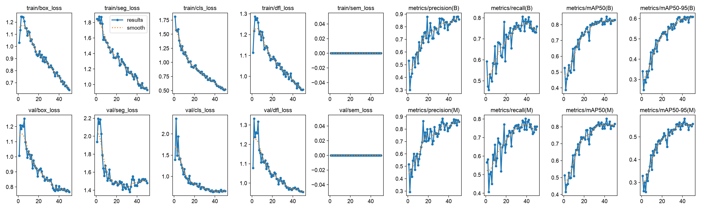
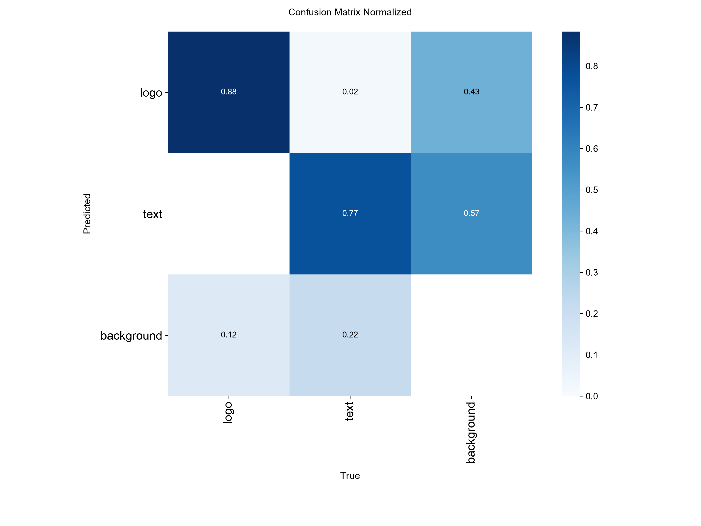
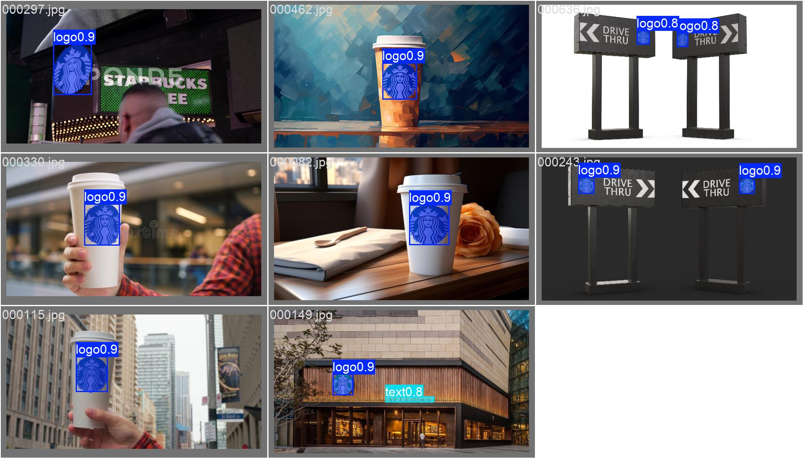

# [67일차] YOLO 인스턴스 세그멘테이션과 COCO 라벨 변환

객체 탐지가 물체의 위치를 사각형 박스로 찾는 기술이라면, 세그멘테이션은 물체의 실제 윤곽을 픽셀 단위로 구분하는 기술이다. 이번에는 Starbucks 이미지 데이터셋의 COCO Polygon 라벨을 YOLO 세그멘테이션 형식으로 변환하고, `YOLO11s-seg` 모델을 학습·검증·추론하는 과정을 정리한다.

---

## 1. 세그멘테이션이란

세그멘테이션(Segmentation)은 이미지의 각 픽셀이 어떤 대상에 속하는지 구분하는 컴퓨터 비전 기술이다. 객체 탐지의 Bounding Box는 객체를 포함하는 직사각형 영역만 알려주지만, 세그멘테이션은 객체의 외곽선에 맞춘 마스크(Mask)를 만든다.

```text
객체 탐지
┌─────────────┐
│             │
│  [ logo ]   │  → 객체를 감싸는 사각형 박스
│             │
└─────────────┘

인스턴스 세그멘테이션
   ███████
 ███ logo ███   → 로고의 실제 윤곽에 가까운 마스크
   ███████
```

### Semantic Segmentation과 Instance Segmentation

| 구분 | 설명 | 예시 |
| --- | --- | --- |
| Semantic Segmentation | 같은 클래스에 속하는 모든 픽셀을 같은 클래스로 분류한다. | 이미지 속 모든 자동차 픽셀을 `car`로 표시한다. |
| Instance Segmentation | 같은 클래스라도 객체 인스턴스를 각각 구분한다. | 자동차 3대를 서로 다른 마스크로 구분한다. |

이번 실습은 이미지 속 Starbucks `logo`와 `text` 영역을 개별 Polygon 마스크로 찾는 인스턴스 세그멘테이션 작업이다. U-Net, DeepLab, Mask R-CNN, YOLO Segmentation 계열 모델이 대표적으로 사용된다.

---

## 2. Starbucks COCO 데이터셋 확인

COCO(Common Objects in Context) 형식의 JSON은 이미지 정보, 객체 주석, 클래스 정보를 분리해 저장한다.

```text
instances_default.json
├── images       : 이미지 ID, 파일명, 너비, 높이
├── annotations  : 객체가 속한 이미지와 클래스, Polygon, Bounding Box 등
└── categories   : 클래스 ID와 클래스 이름
```

이번 데이터셋을 확인한 결과는 다음과 같다.

| 항목 | 값 |
| --- | ---: |
| 이미지 수 | 612장 |
| Annotation 수 | 1,296개 |
| 클래스 | `logo`, `text` |
| `logo` Annotation 수 | 933개 |
| `text` Annotation 수 | 363개 |
| 누락 이미지 수 | 0장 |

`logo`의 비중이 더 크므로, 전체 성능만 보기보다 클래스별 성능을 따로 확인해야 한다. 적은 클래스의 성능이 낮으면 이미지 수, 객체 크기, 라벨 품질을 먼저 점검한다.

### COCO 클래스 ID를 YOLO 클래스 ID로 다시 매핑하는 이유

COCO의 `category_id`는 반드시 `0, 1, 2 ...`처럼 연속적이지 않다. 반면 YOLO 라벨의 클래스 번호는 일반적으로 `0`부터 연속적이어야 한다. 따라서 COCO ID를 정렬한 뒤 YOLO ID를 새로 부여한다.

```python
categories = sorted(coco_data["categories"], key=lambda category: category["id"])

COCO_ID_TO_YOLO_ID = {
    category["id"]: yolo_id
    for yolo_id, category in enumerate(categories)
}

CLASS_NAMES = [category["name"] for category in categories]

print(CLASS_NAMES)
print(COCO_ID_TO_YOLO_ID)
```

```text
['logo', 'text']
{1: 0, 2: 1}
```

이 데이터셋은 우연히 COCO ID가 `1`, `2`로 연속되어 있지만, 항상 그렇다고 가정하면 다른 COCO 데이터셋에서 잘못된 라벨을 만들 수 있다.

---

## 3. COCO Polygon Annotation 이해하기

COCO의 `segmentation`에는 객체 외곽을 이루는 점의 좌표가 들어 있다.

```text
[x1, y1, x2, y2, x3, y3, ...]
```

최소 세 점, 즉 숫자 여섯 개가 있어야 닫힌 Polygon을 만들 수 있다. 코드에서는 좌표를 `(x, y)` 쌍으로 바꾼 뒤 `cv2.polylines()`로 외곽선을 확인한다.

```python
points = (
    np.array(polygon, dtype=np.float32)
    .reshape(-1, 2)
    .astype(np.int32)
)

cv2.polylines(image, [points], True, (0, 255, 0), 2)
```

`reshape(-1, 2)`는 일렬로 저장된 좌표를 다음처럼 점 목록으로 바꾼다.

```text
[100, 50, 180, 60, 160, 140]
        ↓
[[100,  50],
 [180,  60],
 [160, 140]]
```

### COCO Polygon을 YOLO Segmentation 라벨로 변환하기

YOLO 세그멘테이션 라벨 한 줄은 다음 형식이다.

```text
class_id x1_norm y1_norm x2_norm y2_norm x3_norm y3_norm ...
```

좌표는 원본 픽셀 값이 아니라 이미지 너비와 높이로 나눈 0~1 범위의 정규화 값이다.

```text
x_norm = x / image_width
y_norm = y / image_height
```

예를 들어 가로 1,000px 이미지에서 `x = 250`이면 `x_norm = 0.25`가 된다. 해상도가 달라져도 좌표의 상대 위치를 유지하기 위해 정규화한다.

```python
def coco_polygon_to_yolo_line(class_id, polygon, image_width, image_height):
    if not isinstance(polygon, list) or len(polygon) < 6:
        return None

    if len(polygon) % 2 != 0:
        return None

    normalized_values = []

    for index in range(0, len(polygon), 2):
        x = polygon[index]
        y = polygon[index + 1]

        x_norm = min(max(x / image_width, 0.0), 1.0)
        y_norm = min(max(y / image_height, 0.0), 1.0)

        normalized_values.extend([x_norm, y_norm])

    coordinates = " ".join(f"{value:.6f}" for value in normalized_values)
    return f"{class_id} {coordinates}"
```

이 변환기는 Polygon이 리스트로 저장된 COCO 주석을 대상으로 한다. COCO에는 RLE(Run-Length Encoding) 형태의 마스크도 있을 수 있는데, 이 코드에서는 `segmentation`이 리스트가 아니면 건너뛴다. 따라서 다른 COCO 데이터셋에 그대로 적용할 때는 Annotation 형식을 먼저 확인해야 한다.

---

## 4. 데이터셋 분할과 YOLO 폴더 구조

전체 612장을 시드 `2026`으로 섞은 뒤 60:20:20 비율로 나눴다.

| 분할 | 이미지 수 | 역할 |
| --- | ---: | --- |
| train | 367장 | 가중치를 학습한다. |
| val | 122장 | 학습 중 모델을 비교하고 `best.pt`를 선택하는 기준으로 사용한다. |
| test | 123장 | 최종 선택한 모델의 별도 추론 결과를 확인한다. |

```python
SEED = 2026
TRAIN_RATIO = 0.6
VAL_RATIO = 0.2

random.seed(SEED)
random.shuffle(all_images)

num_train = int(len(all_images) * TRAIN_RATIO)
num_val = int(len(all_images) * VAL_RATIO)

train_images = all_images[:num_train]
val_images = all_images[num_train:num_train + num_val]
test_images = all_images[num_train + num_val:]
```

시드를 고정하면 같은 입력 데이터에서 같은 분할 결과를 다시 만들 수 있다. 데이터나 시드를 바꾸지 않고 재실행했을 때 결과가 달라지는 문제를 줄이는 데 중요하다.

변환 후 폴더 구조는 다음과 같다.

```text
Starbucks_YOLO/
├── images/
│   ├── train/
│   ├── val/
│   └── test/
├── labels/
│   ├── train/
│   ├── val/
│   └── test/
└── starbucks.yaml
```

이미지는 `images/<split>/`, 그 이미지의 Polygon 라벨은 `labels/<split>/`에 같은 파일명 기반의 `.txt`로 저장한다.

```text
images/train/000001.jpg
labels/train/000001.txt
```

`prepare_yolo_split()`은 분할별 폴더를 만들고, 재실행 전에 이전 이미지와 라벨을 비운 뒤, 이미지 복사와 라벨 파일 생성을 수행한다. 과거 실행 파일이 새 분할 결과와 섞이지 않도록 하는 처리다.

```python
for image_info in split_images:
    image_id = image_info["id"]
    image_width = image_info["width"]
    image_height = image_info["height"]
    file_name = image_info["file_name"]

    shutil.copy2(SOURCE_DIR / file_name, image_output_dir / file_name)

    yolo_lines = []

    for ann in annotations_by_image.get(image_id, []):
        class_id = COCO_ID_TO_YOLO_ID[ann["category_id"]]

        for polygon in ann.get("segmentation", []):
            yolo_line = coco_polygon_to_yolo_line(
                class_id, polygon, image_width, image_height
            )
            if yolo_line is not None:
                yolo_lines.append(yolo_line)

    label_path = label_output_dir / f"{Path(file_name).stem}.txt"
    if yolo_lines:
        label_path.write_text("\n".join(yolo_lines), encoding="utf-8")
```

변환 직후에는 COCO JSON이 아니라 만들어진 YOLO `.txt` 라벨을 다시 읽어 Polygon을 그려 봐야 한다. 클래스 번호가 잘못 매핑됐는지, 정규화 과정에서 좌표가 뒤틀리지 않았는지 이 단계에서 확인할 수 있다.

---

## 5. Dataset YAML 작성하기

Dataset YAML은 YOLO가 데이터셋의 루트 경로, 분할별 이미지 경로, 클래스 이름을 알 수 있게 하는 설정 파일이다.

```python
yaml_data = {
    "path": str(YOLO_ROOT.resolve()),
    "train": "images/train",
    "val": "images/val",
    "test": "images/test",
    "names": {
        class_id: class_name
        for class_id, class_name in enumerate(CLASS_NAMES)
    },
}

YAML_PATH = YOLO_ROOT / "starbucks.yaml"

with YAML_PATH.open("w", encoding="utf-8") as file:
    yaml.safe_dump(yaml_data, file, allow_unicode=True, sort_keys=False)
```

생성되는 YAML의 핵심 내용은 다음과 같다.

```yaml
path: /.../Starbucks_YOLO
train: images/train
val: images/val
test: images/test
names:
  0: logo
  1: text
```

`path` 아래의 상대 경로를 사용하면 이미지와 라벨 구조를 한곳에서 관리할 수 있다. `names`의 번호는 YOLO 라벨 파일 첫 번째 값과 반드시 일치해야 한다.

---

## 6. YOLO11 Segmentation 모델 학습

세그멘테이션용 사전 학습 가중치 `yolo11s-seg.pt`를 불러와 fine-tuning한다. 일반 객체 탐지 모델 가중치가 아닌 `-seg` 가중치를 사용해야 마스크를 예측할 수 있다.

```python
from ultralytics import YOLO

model = YOLO("yolo11s-seg.pt")
print("Model task:", model.task)

train_results = model.train(
    data=str(YAML_PATH),
    epochs=50,
    imgsz=640,
    batch=4,
    device=DEVICE,
    workers=0,
    seed=SEED,
    patience=20,
    name="starbucks_yolo11s_seg",
    exist_ok=True,
)
```

| 인자 | 역할 |
| --- | --- |
| `data` | Dataset YAML 경로다. |
| `epochs=50` | 최대 50회 반복 학습한다. |
| `imgsz=640` | 모델 입력 이미지를 640 기준으로 처리한다. |
| `batch=4` | 한 번에 학습하는 이미지 수다. 메모리 상황에 맞춰 조절한다. |
| `device` | CUDA, MPS, XPU, CPU 중 사용할 장치다. |
| `patience=20` | 검증 성능이 개선되지 않는 상태가 길게 이어지면 조기 종료에 사용한다. |
| `seed=2026` | 데이터 순서와 일부 난수 요소를 재현하기 위한 기준값이다. |

학습이 끝나면 `weights/best.pt`와 `weights/last.pt`가 저장된다. `best.pt`는 검증 성능이 가장 좋았던 시점의 가중치이고, `last.pt`는 마지막 epoch의 가중치다. 추론과 최종 검증에는 보통 `best.pt`를 사용한다.

---

## 7. Box 성능과 Mask 성능은 따로 확인한다

세그멘테이션 모델은 객체를 찾는 박스와 실제 윤곽을 표현하는 마스크를 함께 예측한다. 따라서 두 종류의 지표를 분리해서 확인한다.

| 객체 | 확인 대상 | Ultralytics 속성 |
| --- | --- | --- |
| Bounding Box | 객체 위치를 사각형으로 찾는 성능 | `metrics.box` |
| Segmentation Mask | 객체 윤곽을 Polygon 또는 마스크로 찾는 성능 | `metrics.seg` |

```python
best_model = YOLO(str(BEST_MODEL_PATH))

metrics = best_model.val(
    data=str(YAML_PATH),
    split="val",
    imgsz=640,
    device=DEVICE,
)

print("Box mAP50:", metrics.box.map50)
print("Box mAP50-95:", metrics.box.map)
print("Mask mAP50:", metrics.seg.map50)
print("Mask mAP50-95:", metrics.seg.map)
```

### 검증 결과

`best.pt`를 검증 분할 122장, 객체 266개에 평가한 결과다.

| 평가 대상 | Precision | Recall | mAP50 | mAP50-95 |
| --- | ---: | ---: | ---: | ---: |
| Box 전체 | 0.845 | 0.804 | 0.851 | 0.609 |
| Mask 전체 | 0.836 | 0.795 | 0.846 | 0.580 |
| Box `logo` | 0.918 | 0.874 | 0.935 | 0.758 |
| Mask `logo` | 0.917 | 0.874 | 0.935 | 0.734 |
| Box `text` | 0.773 | 0.733 | 0.767 | 0.460 |
| Mask `text` | 0.754 | 0.717 | 0.756 | 0.427 |

`logo`는 `text`보다 데이터 수가 많고 시각적 형태가 비교적 뚜렷해 더 높은 성능을 보인다. `text`의 Mask mAP50-95가 0.427로 낮은 것은 글자 영역의 세밀한 윤곽을 맞히는 일이 더 어렵다는 뜻이다. 작은 글자, 배경과의 낮은 대비, 다양한 글꼴·방향, 적은 Annotation 수가 원인이 될 수 있다.

### mAP50과 mAP50-95의 차이

- `mAP50`: 예측과 정답의 IoU가 0.50 이상이면 비교적 관대한 기준으로 정답 후보가 된다.
- `mAP50-95`: IoU 0.50부터 0.95까지 여러 기준의 평균을 사용한다. 박스와 마스크의 경계가 더 정확해야 높은 값이 나온다.

따라서 `mAP50`만 높고 `mAP50-95`가 크게 낮다면 객체는 대체로 찾지만, 위치 또는 외곽선 정밀도에는 개선 여지가 있다는 의미다.

---

## 8. 학습 결과 시각화



학습 그래프에서는 `train/box_loss`, `train/seg_loss`, `train/cls_loss`가 전반적으로 감소하고 Box·Mask mAP가 상승하는 흐름을 확인할 수 있다. 마지막 50 epoch의 저장값은 다음과 같다.

| 항목 | 값 |
| --- | ---: |
| train box loss | 0.642 |
| train seg loss | 0.931 |
| train cls loss | 0.520 |
| Box mAP50 | 0.829 |
| Box mAP50-95 | 0.609 |
| Mask mAP50 | 0.817 |
| Mask mAP50-95 | 0.557 |

그래프의 마지막 epoch 수치와 `best.pt` 검증 수치가 완전히 같지 않을 수 있다. `best.pt`는 마지막 epoch가 아니라 검증 성능이 가장 좋았던 epoch를 저장한 모델이기 때문이다.

### 정규화 혼동 행렬



정규화 혼동 행렬의 대각선은 실제 클래스와 예측 클래스가 일치한 비율이다. 이번 결과에서는 `logo`가 0.88, `text`가 0.77로 나타났다. `text`는 `logo`보다 누락되어 배경으로 분류된 비율이 더 높아, 앞선 클래스별 Recall 및 mAP 결과와 같은 경향을 보인다.

### 검증 배치 예측 예시



예측 이미지에서는 파란 마스크와 Bounding Box, 클래스 이름, Confidence를 함께 확인할 수 있다. 로고처럼 분명한 형태뿐 아니라 간판 속 작은 로고, 컵 위 로고, 매장 외벽의 글자처럼 크기와 배경이 다른 대상에서도 마스크가 객체 윤곽을 따라가는지 확인하는 단계다.

수치가 높아도 실제 이미지에서 다음을 확인해야 한다.

- 작은 객체가 누락되지 않았는가
- 하나의 객체에 중복 마스크가 생기지 않았는가
- 글자 영역을 로고로, 또는 로고를 글자로 혼동하지 않았는가
- 마스크 경계가 객체를 너무 넓게 또는 좁게 포함하지 않았는가

---

## 9. 세그멘테이션 추론 결과 읽기

테스트 이미지 폴더 123장을 대상으로 Confidence 0.30 이상인 결과를 저장한다.

```python
TEST_IMAGE_DIR = YOLO_ROOT / "images" / "test"

predict_results = best_model.predict(
    source=str(TEST_IMAGE_DIR),
    imgsz=640,
    conf=0.30,
    device=DEVICE,
    retina_masks=True,
    save=True,
    name="starbucks_yolo11s_set_predict",
    exist_ok=True,
)
```

| 인자 | 역할 |
| --- | --- |
| `source` | 추론할 이미지 한 장, 폴더, 영상 등의 경로다. |
| `conf=0.30` | 이 값보다 Confidence가 낮은 예측은 결과에서 제외한다. |
| `retina_masks=True` | 입력 크기 기준이 아니라 원본 이미지 해상도에 맞는 마스크를 제공한다. 메모리와 처리 비용은 더 들 수 있다. |
| `save=True` | 박스와 마스크가 그려진 이미지를 저장한다. |

각 이미지의 `Results` 객체에서는 박스와 마스크 정보를 별도로 확인할 수 있다.

```python
result = predict_results[0]

print(result.boxes.xyxy)  # Bounding Box 좌표: x1, y1, x2, y2
print(result.boxes.cls)   # 클래스 ID
print(result.boxes.conf)  # Confidence

print(result.masks.xy)    # 객체별 Polygon 좌표
print(result.masks.data)  # 마스크 Tensor
```

노트북의 첫 세 이미지 추론 결과에서는 각각 `logo` 1개를 탐지했으며 Confidence는 약 0.857, 0.922, 0.930이었다. `result.masks.data.shape`은 이미지마다 `(객체 수, 이미지 높이, 이미지 너비)` 형태로 나타난다.

---

## 10. 핵심 정리

- 인스턴스 세그멘테이션은 객체의 존재와 위치뿐 아니라 개별 객체의 윤곽까지 예측한다.
- COCO의 `category_id`는 연속적이지 않을 수 있으므로 YOLO용 클래스 번호로 다시 매핑한다.
- YOLO 세그멘테이션 라벨은 클래스 번호 뒤에 정규화된 Polygon 좌표를 저장한다.
- 변환 후에는 이미지와 `.txt` 라벨을 다시 시각화해 좌표·클래스 오류를 먼저 확인한다.
- 세그멘테이션 모델은 `metrics.box`와 `metrics.seg`를 구분해 평가한다.
- 이번 데이터셋에서 `logo`는 `text`보다 높은 성능을 보였고, `text` 마스크의 정밀도를 높이려면 데이터 다양성과 라벨 품질을 보완할 필요가 있다.
- `best.pt`는 마지막 모델이 아니라 검증 성능이 좋았던 모델이므로, 최종 추론에는 보통 `best.pt`를 사용한다.
