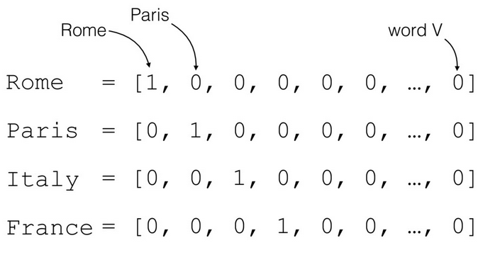
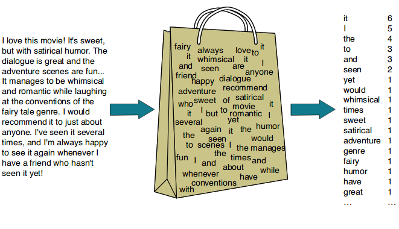
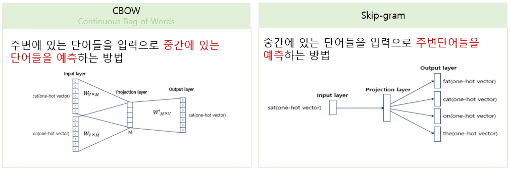
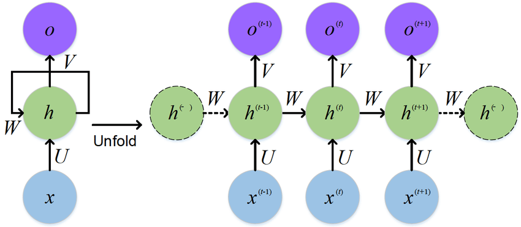
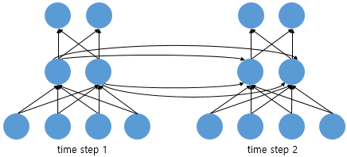

# [69일차] 텍스트 벡터화와 RNN 시계열 예측

**텍스트 벡터화와 워드 임베딩**을 살펴보고, 순서가 중요한 데이터를 처리하는 **RNN(Recurrent Neural Network)**으로 다음 거래일의 KOSPI 종가를 예측한다.

---

## 1. 텍스트 벡터화

벡터화(Vectorization)는 텍스트를 머신러닝과 딥러닝 모델이 계산할 수 있는 숫자 벡터로 바꾸는 과정이다.

텍스트를 숫자로 표현하는 대표적인 방법은 다음과 같다.

| 방법 | 핵심 기준 | 특징 |
| --- | --- | --- |
| 원-핫 인코딩 | 특정 Token의 위치 | 단순하지만 희소하고 의미 관계를 표현하지 못한다. |
| Bag of Words | 문서 안의 단어 빈도 | 구현이 쉽지만 단어 순서를 잃는다. |
| TF-IDF | 문서별 단어 중요도 | 여러 문서에 흔한 단어의 가중치를 낮춘다. |
| Word Embedding | 학습된 밀집 벡터 | 단어 사이의 의미적 관계를 벡터 공간에 표현한다. |

### 원-핫 인코딩

원-핫 인코딩(One-Hot Encoding)은 Vocabulary 크기만큼의 벡터를 만들고, 표현하려는 Token 위치만 `1`, 나머지는 모두 `0`으로 채운다.

```python
import torch
import torch.nn.functional as F

token_id = torch.tensor(2)
vocab_size = 5

one_hot = F.one_hot(token_id, num_classes=vocab_size)

print(one_hot)
print(one_hot.shape)
```

실행 결과:

```text
tensor([0, 0, 1, 0, 0])
torch.Size([5])
```

Vocabulary 크기가 10,000이면 Token 하나를 나타내기 위해 길이가 10,000인 벡터가 필요하다. 그중 대부분이 `0`이므로 이러한 벡터를 **희소 벡터(Sparse Vector)**라고 한다.



### Bag of Words

Bag of Words(BOW)는 문서에 각 단어가 몇 번 등장했는지를 벡터로 표현한다.

```text
Vocabulary: ["I", "love", "Python"]
문장: "I love Python Python"
BOW: [1, 1, 2]
```

단어 빈도를 간단하게 표현할 수 있지만 다음 두 문장을 구별하기 어렵다.

```text
나는 너를 좋아한다
너는 나를 좋아한다
```

두 문장에 등장하는 단어가 같다면 BOW 벡터도 비슷해진다. 즉, 단어의 **순서와 문맥을 반영하지 못한다.**



### TF-IDF

TF-IDF(Term Frequency-Inverse Document Frequency)는 단어가 한 문서에서 자주 나타날수록 가중치를 높이고, 전체 문서에서 흔하게 나타날수록 가중치를 낮춘다.

```text
TF-IDF = TF × IDF
```

- TF: 특정 문서에서 해당 단어가 등장한 빈도다.
- IDF: 전체 문서에서 드물게 등장할수록 커지는 값이다.

모든 문서에 자주 나타나는 단어보다 특정 문서의 내용을 잘 나타내는 단어에 높은 가중치를 줄 수 있다. 다만 BOW와 마찬가지로 단어 순서와 문맥을 직접 학습하지는 않는다.

---

## 2. Word Embedding

Word Embedding은 Token을 저차원의 **밀집 벡터(Dense Vector)**로 표현하는 방법이다.

```text
Token ID
   ↓
Embedding Layer
   ↓
[0.21, -0.72, 0.13, 0.84, ...]
```

원-핫 벡터는 각 단어가 서로 독립적이지만, Embedding은 학습을 통해 비슷한 문맥에서 사용되는 단어가 가까운 벡터를 갖도록 만들 수 있다.

### `nn.Embedding`

PyTorch의 `nn.Embedding`은 Token ID에 대응하는 벡터를 Embedding Table에서 가져오는 층이다.

```python
import torch.nn as nn

embedding = nn.Embedding(
    num_embeddings=10000,
    embedding_dim=128,
    padding_idx=0,
)

print(embedding)
print(embedding.weight.shape)
```

실행 결과:

```text
Embedding(10000, 128, padding_idx=0)
torch.Size([10000, 128])
```

| 인자 | 의미 |
| --- | --- |
| `num_embeddings` | Vocabulary에 포함된 Token 개수다. |
| `embedding_dim` | Token 하나를 나타낼 벡터 차원이다. |
| `padding_idx` | Padding Token의 ID다. 해당 행은 학습에서 갱신하지 않는다. |

입력과 출력 Shape는 다음처럼 변한다.

```python
input_ids = torch.tensor([
    [1, 2, 3],
    [4, 2, 5],
], dtype=torch.long)

embedding = nn.Embedding(
    num_embeddings=10,
    embedding_dim=4,
    padding_idx=0,
)

output = embedding(input_ids)

print("입력 Shape:", input_ids.shape)
print("출력 Shape:", output.shape)
print("학습 여부:", embedding.weight.requires_grad)
print("Parameter 수:", embedding.weight.numel())
```

실행 결과:

```text
입력 Shape: torch.Size([2, 3])
출력 Shape: torch.Size([2, 3, 4])
학습 여부: True
Parameter 수: 40
```

입력 Shape `[batch_size, sequence_length]`의 뒤에 `embedding_dim`이 추가된다.

```text
[2, 3] → [2, 3, 4]
```

Embedding 벡터의 의미를 사람이 직접 지정하는 것은 아니다. 처음에는 초기값으로 시작하고, 모델의 다른 가중치와 함께 학습된다.


---

## 3. Word2Vec

Word2Vec은 주변 문맥을 이용해 단어의 벡터를 학습한다. 비슷한 문맥에서 자주 사용되는 단어가 벡터 공간에서도 가까워지도록 만든다.

### CBOW와 Skip-gram

| 방식 | 입력 | 예측 대상 | 특징 |
| --- | --- | --- | --- |
| CBOW | 주변 단어 | 중심 단어 | 비교적 빠르고 자주 등장하는 단어 학습에 유리하다. |
| Skip-gram | 중심 단어 | 주변 단어 | 계산량은 많지만 드문 단어 학습에 유리하다. |

문장이 다음과 같다고 가정한다.

```text
나는 오늘 공원에서 귀여운 강아지를 산책시키며 행복한 시간을 보냈다.
```

중심 단어가 `강아지를`이고 Window 크기가 2라면 주변 문맥은 다음과 같다.

```text
["공원에서", "귀여운", "산책시키며", "행복한"]
```

- CBOW는 주변 네 단어로 `강아지를`을 예측한다.
- Skip-gram은 `강아지를`로 주변 네 단어를 예측한다.



### SGNS

SGNS(Skip-Gram with Negative Sampling)는 Skip-gram의 계산량을 줄이는 방법이다.

- 실제 중심 단어와 주변 단어의 조합은 관련이 있는 Positive Sample로 학습한다.
- 무작위로 선택한 단어 조합은 관련이 없는 Negative Sample로 학습한다.
- Vocabulary 전체에 대한 확률을 매번 계산하지 않고 일부 단어만 비교한다.

### NSMC 데이터 전처리

한국어 Word2Vec 학습을 위해 네이버 영화 리뷰 데이터(NSMC)를 사용한다.

노트북의 macOS 환경에서는 MeCab을 다음과 같이 연결했다.

```python
import os
from konlpy.tag import Mecab

os.environ["MECABRC"] = "/opt/homebrew/etc/mecabrc"

mecab = Mecab(
    dicpath="/opt/homebrew/lib/mecab/dic/mecab-ko-dic",
)
```

`MECABRC`와 사전 경로는 설치 방법과 운영체제에 따라 달라진다.

```python
import urllib.request
import pandas as pd

urllib.request.urlretrieve(
    "https://raw.githubusercontent.com/e9t/nsmc/master/ratings.txt",
    filename="ratings.txt",
)

train_data = pd.read_table("ratings.txt")
train_data = train_data[:20000]
```

한글과 공백을 제외한 문자를 제거한다.

```python
train_data["document"] = train_data["document"].str.replace(
    "[^ㄱ-ㅎㅏ-ㅣ가-힣 ]",
    "",
    regex=True,
)
```

MeCab으로 형태소를 분리하고 불용어를 제거한다.

```python
stopwords = [
    "도", "는", "다", "의", "가", "이", "은", "한", "에", "하",
    "고", "을", "를", "인", "듯", "과", "와", "네", "들", "지",
    "임", "게",
]

tokenized_data = []

for sentence in train_data["document"]:
    tokens = mecab.morphs(sentence)
    tokens = [word for word in tokens if word not in stopwords]
    tokenized_data.append(tokens)
```

MeCab은 붙어 있는 한국어 문장을 형태소 단위로 나눈다.

```python
mecab.morphs("아버지가방에들어가신다")
```

```text
['아버지', '가', '방', '에', '들어가', '신다']
```

### Gensim으로 Word2Vec 학습하기

```python
from gensim.models import Word2Vec

model = Word2Vec(
    sentences=tokenized_data,
    vector_size=100,
    window=5,
    min_count=5,
    workers=2,
    sg=1,
    negative=5,
)
```

| 인자 | 의미 |
| --- | --- |
| `vector_size` | 단어 벡터 차원이다. |
| `window` | 중심 단어 앞뒤로 확인할 단어 범위다. |
| `min_count` | 이 횟수 이상 등장한 단어만 학습한다. |
| `workers` | 학습에 사용할 CPU Worker 수다. |
| `sg` | `0`은 CBOW, `1`은 Skip-gram이다. |
| `negative` | Negative Sampling에 사용할 단어 수다. |

학습 결과는 3,990개 단어를 각각 100차원 벡터로 표현했다.

```python
print(model.wv.vectors.shape)
```

```text
(3990, 100)
```

`most_similar()`는 코사인 유사도를 기준으로 가까운 단어를 찾는다.

```python
model.wv.most_similar("블록버스터", topn=5)
```

데이터를 20,000개 리뷰로 제한했기 때문에 결과 품질은 전체 데이터와 학습 설정에 따라 달라질 수 있다.

---

## 4. FastText와 한글 자모 분해

Word2Vec은 Vocabulary에 없는 단어의 벡터를 바로 만들기 어렵다. FastText는 단어를 문자 n-gram 단위로 나누어 학습하므로, 처음 보는 단어나 오타도 이미 학습한 부분 문자열을 조합해 표현할 수 있다.

```text
playing
→ <pl, pla, lay, ayi, yin, ing, ng>
```

한국어는 조사와 어미가 붙어 단어 형태가 다양하다. 자모 단위로 분해하면 비슷한 철자를 가진 단어와 오타가 더 많은 부분을 공유한다.

### `hgtk`로 한글 분해와 조합하기

```python
import hgtk

print(hgtk.letter.decompose("김"))
print(hgtk.letter.compose("ㄱ", "ㅣ", "ㅁ"))
```

실행 결과:

```text
('ㄱ', 'ㅣ', 'ㅁ')
김
```

받침이 없는 글자는 빈 문자열 대신 `-`를 넣어 항상 세 글자 단위로 표현한다.

```python
def word_to_jamo(token):
    def to_special_token(jamo):
        return jamo if jamo else "-"

    decomposed_token = ""

    for char in token:
        try:
            cho, jung, jong = hgtk.letter.decompose(char)
            decomposed_token += (
                to_special_token(cho)
                + to_special_token(jung)
                + to_special_token(jong)
            )
        except Exception as error:
            if type(error).__name__ == "NotHangulException":
                decomposed_token += char

    return decomposed_token
```

```python
print(word_to_jamo("남동생"))
print(word_to_jamo("여동생"))
```

```text
ㄴㅏㅁㄷㅗㅇㅅㅐㅇ
ㅇㅕ-ㄷㅗㅇㅅㅐㅇ
```

MeCab 형태소 분석과 자모 분해를 연결한다.

```python
def tokenize_by_jamo(sentence):
    return [word_to_jamo(token) for token in mecab.morphs(sentence)]
```

FastText 실습에는 네이버 쇼핑 리뷰 20만 건을 사용했다.

```python
urllib.request.urlretrieve(
    "https://raw.githubusercontent.com/bab2min/corpus/master/sentiment/naver_shopping.txt",
    filename="ratings_total.txt",
)

total_data = pd.read_table(
    "ratings_total.txt",
    names=["ratings", "reviews"],
)
```

각 리뷰를 형태소로 나눈 뒤 자모 단위로 변환한다.

```python
from tqdm import tqdm

tokenized_data = []

for review in tqdm(total_data["reviews"].to_list()):
    tokenized_sample = tokenize_by_jamo(review)
    tokenized_data.append(tokenized_sample)
```

분해한 Token을 텍스트 파일로 저장하고 FastText를 학습한다.

```python
import fasttext

with open("tokenized_data.txt", "w", encoding="utf8") as output_file:
    for line in tokenized_data:
        output_file.write(" ".join(line) + "\n")

model = fasttext.train_unsupervised(
    "tokenized_data.txt",
    model="cbow",
)

model.save_model("fasttext.bin")
```

노트북에서는 `남동쉥`, `남동셍ㅋ`, `제품^^`처럼 변형되거나 오타가 있는 입력에서도 원래 단어와 관련된 결과가 나타나는지 확인했다.

```text
남동쉥 → 남동생, 남친, 남매, 남짓, 남녀 ...
제품^^ → 제품, 제풍, 반제품, 완제품, 상품 ...
```

이는 FastText가 단어 전체만 외우지 않고 문자 조각을 함께 학습하기 때문이다.

---

## 5. 시퀀스 데이터

시퀀스 데이터(Sequence Data)는 값의 **순서와 앞뒤 관계가 중요한 데이터**다.

| 데이터 | 순서가 중요한 이유 |
| --- | --- |
| 자연어 문장 | 단어 순서가 달라지면 문장의 의미가 달라진다. |
| 주가·날씨 | 이전 시점의 변화가 다음 시점과 연결된다. |
| 음성 | 시간에 따른 파형의 흐름이 의미를 만든다. |
| 영상 | 연속된 Frame의 변화가 움직임을 나타낸다. |

일반적인 MLP는 각 입력을 독립적으로 처리한다. 반면 RNN은 이전 시점의 정보를 Hidden State에 담아 다음 시점 계산에 전달한다.

---

## 6. RNN의 동작 원리

RNN(Recurrent Neural Network)은 현재 입력과 이전 Hidden State를 함께 사용해 새로운 Hidden State를 만든다.

```text
h_t = tanh(W_xh x_t + W_hh h_(t-1) + b)
```

| 기호 | 의미 |
| --- | --- |
| `x_t` | 현재 시점의 입력이다. |
| `h_(t-1)` | 이전 시점까지의 정보를 담은 Hidden State다. |
| `h_t` | 현재 입력까지 반영한 새로운 Hidden State다. |
| `W_xh`, `W_hh` | 학습되는 가중치다. |
| `tanh` | 값을 `-1~1` 범위로 변환하는 활성화 함수다. |

Hidden State는 가중치 자체가 아니라, 현재 시점까지 본 정보 중 다음 계산에 필요한 내용을 압축한 **작업 메모리**다.

RNN은 시점마다 새로운 Cell을 학습하는 것이 아니다. 같은 RNN Cell과 같은 가중치를 전체 시간축에서 반복해서 사용한다.





### 입력 Shape

`batch_first=True`인 RNN의 입력 Shape는 다음과 같다.

```text
[batch_size, sequence_length, input_size]
```

예를 들어 `[32, 20, 10]`은 다음을 의미한다.

- 한 번에 32개 시퀀스를 처리한다.
- 시퀀스 하나는 연속된 20개 시점으로 구성된다.
- 각 시점은 10개 Feature를 가진다.

### 장기 의존성 문제

기본 RNN은 가까운 과거의 패턴을 처리하는 데 유용하지만, 오래전 정보를 마지막까지 유지하기 어렵다. 같은 가중치를 시간축에서 반복 적용하며 역전파하기 때문에 긴 시퀀스에서는 기울기 소실 또는 기울기 폭주가 발생하기 쉽다.

이 문제를 완화하기 위해 LSTM과 GRU 같은 구조가 사용된다.

---

## 7. RNN으로 다음 KOSPI 종가 예측하기

최근 20거래일의 정보를 입력으로 사용해 다음 거래일의 종가를 예측한다.

```text
1일차 입력 + 초기 Hidden State → h1
2일차 입력 + h1                → h2
...
20일차 입력 + h19              → h20
h20 → Linear Layer → 21일차 종가 예측
```

### 데이터 확인과 정제

원본 데이터는 4,513행이며 다음 열을 가진다.

| 열 | 의미 |
| --- | --- |
| `Open` | 시가 |
| `High` | 고가 |
| `Low` | 저가 |
| `Close` | 종가 |
| `Adj Close` | 배당과 주식 분할 등을 반영한 수정 종가 |
| `Volume` | 거래량 |

날짜를 `datetime`으로 바꾸고 필수 열의 결측치를 제거한 뒤 날짜순으로 정렬한다.

```python
df["Date"] = pd.to_datetime(
    df["Date"],
    dayfirst=True,
    errors="coerce",
)

numeric_cols = ["Open", "High", "Low", "Close", "Adj Close", "Volume"]

for column in numeric_cols:
    df[column] = pd.to_numeric(df[column], errors="coerce")

required_cols = ["Date", "Open", "High", "Low", "Close"]
df_copy = df.dropna(subset=required_cols).copy()
df_copy = df_copy.sort_values("Date").reset_index(drop=True)
```

정제 후 2000년 1월 4일부터 2018년 1월 22일까지 총 4,452행이 남았다.

### Feature Engineering

당일 가격과 최근 가격 흐름을 함께 표현하도록 파생변수를 만든다.

```python
data = df_copy.copy()

data["Return_1d"] = data["Close"].pct_change()
data["Range_pct"] = (data["High"] - data["Low"]) / data["Close"]
data["OC_pct"] = (data["Close"] - data["Open"]) / data["Open"]

data["MA5"] = data["Close"].rolling(5).mean()
data["MA20"] = data["Close"].rolling(20).mean()

data["MA5_ratio"] = data["Close"] / data["MA5"]
data["MA20_ratio"] = data["Close"] / data["MA20"]
data["Volatility_10"] = data["Return_1d"].rolling(10).std()

data["Target_Close"] = data["Close"].shift(-1)
data["Target_Date"] = data["Date"].shift(-1)
```

사용하는 Feature는 총 10개다.

```python
FEATURES = [
    "Open",
    "High",
    "Low",
    "Close",
    "Return_1d",
    "Range_pct",
    "OC_pct",
    "MA5_ratio",
    "MA20_ratio",
    "Volatility_10",
]
```

`shift(-1)`을 사용하면 현재 행의 Target에 다음 거래일 종가가 들어간다. 이동평균과 다음 날 Target을 만드는 과정에서 생긴 결측치를 제거한 결과 학습에 사용할 데이터는 4,432행이다.

---

## 8. 시계열 데이터 분리와 Scaling

시계열 데이터를 무작위로 나누면 미래 데이터가 Train에 포함되고 과거 데이터가 Test에 포함될 수 있다. 따라서 날짜순으로 다음과 같이 분리한다.

```python
n = len(data)

train_end = int(n * 0.70)
val_end = int(n * 0.85)
```

| 분할 | 행 개수 | Target 기간 |
| --- | ---: | --- |
| Train | 3,102 | 2000-02-01 ~ 2012-08-20 |
| Validation | 665 | 2012-08-21 ~ 2015-05-04 |
| Test | 665 | 2015-05-06 ~ 2018-01-22 |

Feature마다 값의 크기가 다르므로 `StandardScaler`로 평균 0, 표준편차 1에 가깝게 변환한다.

```python
from sklearn.preprocessing import StandardScaler

scaler_x = StandardScaler()
scaler_y = StandardScaler()

scaler_x.fit(data.loc[:train_end - 1, FEATURES])
scaler_y.fit(data.loc[:train_end - 1, ["Target_Close"]])

X_all = scaler_x.transform(data[FEATURES]).astype(np.float32)
y_all = scaler_y.transform(data[["Target_Close"]]).astype(np.float32)
```

Scaler는 반드시 Train 데이터에만 `fit()`한다. Validation과 Test를 함께 사용하면 미래 데이터의 평균과 표준편차를 학습 단계에서 미리 알게 되는 데이터 누수가 발생한다.

```text
X_all Shape: (4432, 10)
y_all Shape: (4432, 1)
```

---

## 9. 연속된 20일을 하나의 시퀀스로 만들기

RNN은 한 행씩 독립적으로 보는 대신 연속된 여러 행을 하나의 입력으로 받는다.

```python
SEQUENCE_LENGTH = 20

def make_sequence(X, y, sequence_length):
    X_seq = []
    y_seq = []
    target_indices = []

    for index in range(sequence_length - 1, len(X)):
        start = index - sequence_length + 1
        X_seq.append(X[start:index + 1])
        y_seq.append(y[index])
        target_indices.append(index)

    return (
        np.asarray(X_seq, dtype=np.float32),
        np.asarray(y_seq, dtype=np.float32),
        np.asarray(target_indices, dtype=np.int64),
    )
```

Window는 하루씩 이동한다.

```text
첫 번째 입력: 0~19번 행 → 19번 행에 연결된 다음 날 종가
두 번째 입력: 1~20번 행 → 20번 행에 연결된 다음 날 종가
세 번째 입력: 2~21번 행 → 21번 행에 연결된 다음 날 종가
```

전체 데이터에서 먼저 Window를 만들고 Target 시점의 인덱스를 기준으로 Train, Validation, Test를 나눈다. 이렇게 하면 Validation과 Test의 첫 번째 예측에서도 그 이전 날짜를 입력 이력으로 사용할 수 있다.

```text
전체 Sequence Shape: (4413, 20, 10)
전체 Target Shape: (4413, 1)
```

분리 결과는 다음과 같다.

```text
Train: (3083, 20, 10), (3083, 1)
Validation: (665, 20, 10), (665, 1)
Test: (665, 20, 10), (665, 1)
```

---

## 10. Dataset과 DataLoader

```python
from torch.utils.data import Dataset, DataLoader

class SequenceDataset(Dataset):
    def __init__(self, X, y):
        self.X = torch.tensor(X, dtype=torch.float32)
        self.y = torch.tensor(y, dtype=torch.float32)

    def __len__(self):
        return len(self.X)

    def __getitem__(self, index):
        return self.X[index], self.y[index]
```

```python
BATCH_SIZE = 64

train_loader = DataLoader(
    SequenceDataset(X_train, y_train),
    batch_size=BATCH_SIZE,
    shuffle=True,
)

val_loader = DataLoader(
    SequenceDataset(X_val, y_val),
    batch_size=BATCH_SIZE,
    shuffle=False,
)

test_loader = DataLoader(
    SequenceDataset(X_test, y_test),
    batch_size=BATCH_SIZE,
    shuffle=False,
)
```

Train의 `shuffle=True`는 20일로 구성된 Window들의 배치 순서를 섞는다. 각 Window 내부의 날짜 순서는 바뀌지 않는다.

```text
입력 Batch Shape: torch.Size([64, 20, 10])
정답 Batch Shape: torch.Size([64, 1])
```

---

## 11. RNN 회귀 모델 만들기

```python
class RNNRegressor(nn.Module):
    def __init__(self, input_size, hidden_size=64, num_layers=2, dropout=0.10):
        super().__init__()

        self.rnn = nn.RNN(
            input_size=input_size,
            hidden_size=hidden_size,
            num_layers=num_layers,
            nonlinearity="tanh",
            batch_first=True,
            dropout=dropout if num_layers > 1 else 0.0,
        )

        self.fc = nn.Linear(hidden_size, 1)

    def forward(self, x):
        out, h_n = self.rnn(x)
        last_hidden = out[:, -1, :]
        prediction = self.fc(last_hidden)
        return prediction
```

```python
model = RNNRegressor(
    input_size=len(FEATURES),
    hidden_size=64,
    num_layers=2,
    dropout=0.10,
).to(DEVICE)
```

모델 구조는 다음과 같다.

```text
RNNRegressor(
  (rnn): RNN(10, 64, num_layers=2, batch_first=True, dropout=0.1)
  (fc): Linear(in_features=64, out_features=1, bias=True)
)
```

### `out`과 `h_n`

4개 샘플을 모델의 RNN 층에 전달한 결과는 다음과 같다.

```text
입력:          [4, 20, 10]
RNN out:       [4, 20, 64]
RNN h_n:       [2, 4, 64]
마지막 시점:   [4, 64]
```

- `out`은 마지막 RNN Layer가 모든 시점에서 만든 Hidden State다.
- `h_n`은 각 RNN Layer의 마지막 Hidden State다.
- 다음 날 종가 예측에는 `out[:, -1, :]`로 마지막 시점의 정보를 사용한다.
- `Linear(64, 1)`은 64개 Hidden 값을 종가 예측값 하나로 바꾼다.

---

## 12. 학습 설정

```python
criterion = nn.HuberLoss(delta=1.0)

optimizer = torch.optim.AdamW(
    model.parameters(),
    lr=1e-3,
    weight_decay=1e-4,
)

scheduler = torch.optim.lr_scheduler.ReduceLROnPlateau(
    optimizer=optimizer,
    mode="min",
    factor=0.5,
    patience=5,
)

MAX_EPOCHS = 200
PATIENCE = 15
CLIP_NORM = 1.0
```

| 설정 | 역할 |
| --- | --- |
| `HuberLoss` | 작은 오차에는 제곱 오차를, 큰 오차에는 선형 오차를 적용해 이상치의 영향을 완화한다. |
| `AdamW` | Parameter를 업데이트하고 Weight Decay를 적용한다. |
| `ReduceLROnPlateau` | Validation Loss가 개선되지 않으면 Learning Rate를 줄인다. |
| Early Stopping | Validation Loss가 일정 기간 개선되지 않으면 학습을 종료한다. |
| Gradient Clipping | 기울기 크기를 제한해 RNN의 기울기 폭주를 완화한다. |

```python
loss.backward()
torch.nn.utils.clip_grad_norm_(
    model.parameters(),
    max_norm=CLIP_NORM,
)
optimizer.step()
```

Validation Loss가 가장 작을 때 모델 상태를 저장한다.

```python
if val_loss < best_val_loss:
    best_val_loss = val_loss
    best_state = copy.deepcopy(model.state_dict())
    wait = 0
else:
    wait += 1
```

학습이 끝난 뒤에는 최적 상태를 다시 불러온 다음 Test 예측을 수행한다.

```python
model.load_state_dict(best_state)
```

---

## 13. 학습 결과와 예측값 복원

노트북에서는 36번째 Epoch에서 Early Stopping이 실행됐다.

```text
Epoch 001 | Train 0.046967 | Valid 0.001290 | LR 1.00e-03
Epoch 010 | Train 0.001861 | Valid 0.000449 | LR 1.00e-03
Epoch 020 | Train 0.001287 | Valid 0.000699 | LR 2.50e-04
Epoch 030 | Train 0.001110 | Valid 0.000472 | LR 1.25e-04
Early Stopping: epoch 36
```

모델은 표준화된 종가를 예측하므로 `inverse_transform()`으로 실제 종가 단위로 되돌린다.

```python
pred_scaled, true_scaled = predict(model, test_loader, DEVICE)

pred_close = scaler_y.inverse_transform(pred_scaled).ravel()
true_close = scaler_y.inverse_transform(true_scaled).ravel()
```

실행 결과:

```text
예측 개수: 665
예측값 앞 5개: [2130.90, 2109.48, 2097.60, 2090.25, 2100.17]
실제값 앞 5개: [2104.58, 2091.00, 2085.52, 2097.38, 2096.77]
```

앞의 몇 개 값이 비슷해 보인다는 것만으로 모델 성능을 판단할 수는 없다. 전체 Test 데이터에 대해 MAE와 RMSE를 계산하고, 실제값과 예측값의 시계열 그래프도 함께 확인해야 한다.

```python
from sklearn.metrics import mean_absolute_error, mean_squared_error

mae = mean_absolute_error(true_close, pred_close)
rmse = mean_squared_error(true_close, pred_close) ** 0.5

print("MAE:", mae)
print("RMSE:", rmse)
```

---

## 14. 전체 흐름 정리

```text
텍스트 데이터
  ↓
형태소 분석과 불용어 제거
  ↓
원-핫·BOW·TF-IDF 또는 Word Embedding
  ↓
Word2Vec / FastText로 단어 관계 학습

시계열 데이터
  ↓
Feature Engineering
  ↓
시간순 Train / Validation / Test 분리
  ↓
Train 기준 Scaling
  ↓
연속된 20일 Window 생성
  ↓
RNN → 마지막 Hidden State → Linear
  ↓
다음 거래일 종가 예측
```

- 원-핫 인코딩과 BOW는 단순하지만 고차원 희소 벡터가 되고 문맥을 충분히 반영하지 못한다.
- `nn.Embedding`은 Token ID를 학습 가능한 밀집 벡터로 바꾼다.
- Word2Vec은 주변 문맥으로 단어의 의미 관계를 학습한다.
- FastText는 문자 n-gram을 사용해 OOV와 오타에 비교적 강하다.
- RNN은 이전 Hidden State를 다음 시점 계산에 전달해 순서 정보를 처리한다.
- 시계열은 무작위 분할하지 않고 시간순으로 분리해야 한다.
- Scaling 기준은 Train 데이터에서만 계산해야 데이터 누수를 막을 수 있다.
- 기본 RNN은 장기 의존성과 기울기 문제를 가지며, LSTM과 GRU가 이를 보완한다.
