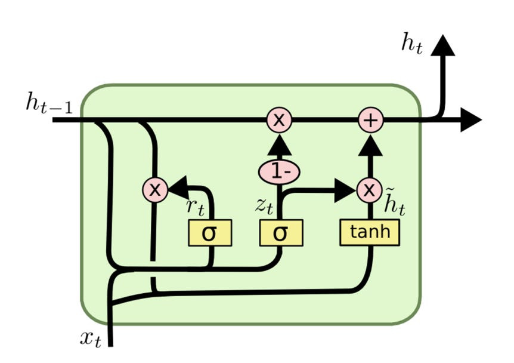
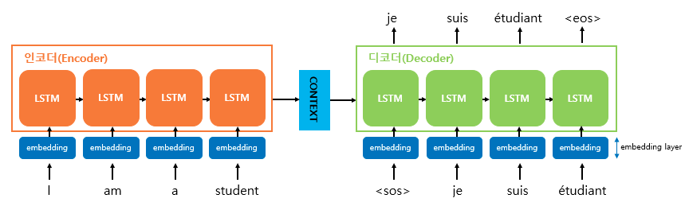

# [70일차] LSTM, GRU와 트랜스포머의 Attention

기본 RNN은 이전 시점의 정보를 `hidden state`에 담아 다음 시점으로 전달한다. 하지만 시퀀스가 길어지면 오래전 정보가 제대로 학습되지 않는 **장기 의존성 문제**가 발생할 수 있다.

이번에는 기본 RNN의 한계를 보완한 **LSTM**과 **GRU**를 살펴보고, 입력 시퀀스를 출력 시퀀스로 바꾸는 **Seq2Seq**, 필요한 정보에 직접 집중하는 **Attention**까지 이어서 정리한다.

> 기본 RNN의 구조, 시계열 데이터 분리, `Dataset`과 `DataLoader`, 일반적인 학습 루프는 69일차에서 정리했으므로 여기서는 새로 등장한 내용에 집중한다.

---

## 1. LSTM

LSTM(Long Short-Term Memory)은 기본 RNN의 장기 의존성 문제를 완화하기 위해 만든 순환 신경망이다.

기본 RNN은 주로 하나의 `hidden state`로 과거 정보를 전달하지만, LSTM은 다음 두 상태를 함께 사용한다.

| 상태 | 역할 |
| --- | --- |
| `hidden state(h_t)` | 현재 시점의 출력과 다음 시점의 계산에 직접 사용되는 단기 표현이다. |
| `cell state(C_t)` | 중요한 정보를 여러 시점 동안 비교적 안정적으로 전달하는 기억 통로다. |

LSTM은 세 개의 게이트로 정보의 흐름을 조절한다.

| 게이트 | 역할 |
| --- | --- |
| Forget Gate | 과거 기억을 얼마나 남길지 결정한다. |
| Input Gate | 현재 입력에서 새로운 정보를 얼마나 저장할지 결정한다. |
| Output Gate | 갱신한 기억 중 현재 출력으로 얼마나 보낼지 결정한다. |


### LSTM에 들어오는 값

시점 `t`의 LSTM은 다음 정보를 받는다.

```text
x_t       : 현재 시점의 입력
h_(t-1)   : 이전 시점의 hidden state
C_(t-1)   : 이전 시점의 cell state
```

게이트는 사람이 직접 정한 규칙이 아니다. 현재 입력과 이전 상태를 사용해 계산한 뒤, 학습 과정에서 가중치와 편향을 수정하면서 필요한 정보의 비율을 스스로 결정한다.

---

## 2. LSTM의 게이트 동작

### Forget Gate

Forget Gate는 이전 `cell state`에서 각 정보를 얼마나 유지할지 결정한다.

```text
f_t = sigmoid(W_f · [h_(t-1), x_t] + b_f)
```

`sigmoid`의 결과는 `0`과 `1` 사이의 값이다.

- `0`에 가까우면 해당 정보를 거의 전달하지 않는다.
- `1`에 가까우면 해당 정보를 대부분 유지한다.
- 중간값이면 그 비율만큼 정보를 전달한다.

따라서 Forget Gate는 단순히 기억과 삭제 중 하나만 고르는 스위치가 아니라, 정보를 **얼마나 남길지 조절하는 벡터**다.

### Input Gate

Input Gate는 현재 입력에서 어떤 정보를 새 기억으로 저장할지 결정한다.

```text
i_t       = sigmoid(W_i · [h_(t-1), x_t] + b_i)
C_tilde_t = tanh(W_c · [h_(t-1), x_t] + b_c)
```

- `i_t`는 새 정보를 얼마나 반영할지 나타낸다.
- `C_tilde_t`는 현재 입력으로 만든 새로운 기억의 후보값이다.

이전 기억과 새 기억을 합쳐 현재 `cell state`를 만든다.

```text
C_t = f_t ⊙ C_(t-1) + i_t ⊙ C_tilde_t
```

여기서 `⊙`는 같은 위치의 원소끼리 곱하는 연산을 의미한다.

### Output Gate

Output Gate는 갱신된 `cell state` 중 현재 `hidden state`로 전달할 정보를 선택한다.

```text
o_t = sigmoid(W_o · [h_(t-1), x_t] + b_o)
h_t = o_t ⊙ tanh(C_t)
```

전체 흐름은 다음과 같다.

```text
이전 기억 C_(t-1)
        │
        ├── Forget Gate ── 과거 기억 중 남길 부분
        │
현재 입력 x_t
        ├── Input Gate  ── 새로 저장할 부분
        │
        ▼
새 Cell State C_t
        │
        └── Output Gate ── 현재 Hidden State h_t
```

### 장기 기억과 단기 기억의 기준

LSTM 내부에 `6시간이 지나면 장기 기억`과 같은 고정 규칙은 없다. 정보가 얼마나 오래되었는지보다 **현재 예측에 얼마나 도움이 되는지**가 중요하다.

예를 들어 전력 사용량이 매일 저녁 비슷한 시간에 증가한다면 오래전 시점에서 만들어진 정보도 유용할 수 있다. 반대로 1시간 전 정보라도 잡음에 가깝다면 게이트가 영향력을 줄일 수 있다.

---

## 3. 가정 전력 사용량 예측

LSTM을 이용해 한 가정의 다음 1시간 전력 사용량을 예측한다.

- 원본 데이터는 약 4년 동안 1분 간격으로 측정한 전력 사용량이다.
- `Global_active_power` 한 개의 Feature를 사용한다.
- 1분 단위 데이터를 1시간 단위 평균으로 변환한다.
- 직전 24시간을 입력으로 사용해 다음 1시간을 예측한다.

```text
입력 X: t-24, t-23, ..., t-1 시점의 전력 사용량
정답 y: t 시점의 전력 사용량
```

### 데이터 불러오기

```python
import pandas as pd

DATA_PATH = "./data/household_power_consumption.txt"

df = pd.read_csv(
    DATA_PATH,
    sep=";",
    na_values="?",
    low_memory=False,
)

print(df.shape)
```

실행 결과:

```text
(2075259, 9)
```

주요 컬럼은 다음과 같다.

| 컬럼 | 의미 |
| --- | --- |
| `Date`, `Time` | 측정 날짜와 시간이다. |
| `Global_active_power` | 전체 유효전력(kW)이다. |
| `Global_reactive_power` | 무효전력이다. |
| `Voltage` | 평균 전압(V)이다. |
| `Global_intensity` | 평균 전류 세기(A)다. |
| `Sub_metering_1` | 주방 일부 기기의 사용량이다. |
| `Sub_metering_2` | 세탁실 관련 기기의 사용량이다. |
| `Sub_metering_3` | 전기 온수기와 에어컨 관련 사용량이다. |

### 날짜와 시간 전처리

`Date`와 `Time`을 하나의 `datetime`으로 합친 뒤 시간 순서로 정렬한다.

```python
df["datetime"] = pd.to_datetime(
    df["Date"] + " " + df["Time"],
    format="%d/%m/%Y %H:%M:%S",
    errors="coerce",
)

df = df.dropna(subset=["datetime"])
df = df.sort_values("datetime")
df = df.set_index("datetime")
```

예측에 사용할 `Global_active_power`만 남기고 숫자로 변환한다.

```python
power = df[["Global_active_power"]].copy()
power["Global_active_power"] = pd.to_numeric(
    power["Global_active_power"],
    errors="coerce",
)
power = power.dropna()

print(power.shape)
```

```text
(2049280, 1)
```

### 1시간 단위로 변환하기

```python
hourly = power.resample("1h").mean()

print(
    "시간 단위 결측 개수:",
    hourly["Global_active_power"].isna().sum(),
)

hourly = hourly.ffill().dropna()
print("hourly shape:", hourly.shape)
```

실행 결과:

```text
시간 단위 결측 개수: 421
hourly shape: (34589, 1)
```

`resample("1h").mean()`은 같은 시간에 속한 1분 단위 관측값의 평균을 계산한다. 시간 단위로 비어 있는 구간은 `ffill()`을 사용해 직전 관측값으로 채운다.


---

## 4. 전력 데이터를 시퀀스로 만들기

데이터는 시간 순서를 유지한 채 Train 70%, Validation 15%, Test 15%로 나눈다. `StandardScaler`는 미래 정보가 학습 데이터에 섞이지 않도록 Train 구간에만 `fit()`한다.

```python
import numpy as np
from sklearn.preprocessing import StandardScaler

values = hourly["Global_active_power"].values.reshape(-1, 1)

n = len(values)
train_end = int(n * 0.70)
val_end = int(n * 0.85)

scaler = StandardScaler()
scaler.fit(values[:train_end])
scaled_values = scaler.transform(values).astype(np.float32)
```

### 최근 24시간과 다음 1시간 묶기

```python
SEQ_LENGTH = 24

def make_sequence(data, seq_length):
    X = []
    y = []
    target_indices = []

    for i in range(seq_length, len(data)):
        X.append(data[i - seq_length:i])
        y.append(data[i])
        target_indices.append(i)

    return (
        np.array(X, dtype=np.float32),
        np.array(y, dtype=np.float32),
        np.array(target_indices),
    )

X, y, indices = make_sequence(scaled_values, SEQ_LENGTH)

print(X.shape)
print(y.shape)
```

실행 결과:

```text
(34565, 24, 1)
(34565, 1)
```

각 차원의 의미는 다음과 같다.

```text
X.shape = (샘플 수, 시퀀스 길이, Feature 수)
        = (34565, 24, 1)
```

첫 번째 샘플은 `2006-12-16 17:00`부터 `2006-12-17 16:00`까지의 24시간을 입력으로 사용하고, `2006-12-17 17:00`의 값을 정답으로 사용한다.

시퀀스의 정답 시점을 기준으로 데이터를 나눈 결과는 다음과 같다.

| 구간 | `X` Shape | `y` Shape |
| --- | --- | --- |
| Train | `(24188, 24, 1)` | `(24188, 1)` |
| Validation | `(5188, 24, 1)` | `(5188, 1)` |
| Test | `(5189, 24, 1)` | `(5189, 1)` |

---

## 5. PyTorch LSTM 모델

```python
import torch
import torch.nn as nn

class PowerLSTM(nn.Module):
    def __init__(
        self,
        input_size=1,
        hidden_size=64,
        num_layers=2,
        dropout=0.2,
    ):
        super().__init__()

        self.lstm = nn.LSTM(
            input_size=input_size,
            hidden_size=hidden_size,
            num_layers=num_layers,
            batch_first=True,
            dropout=dropout if num_layers > 1 else 0.0,
        )
        self.fc = nn.Linear(hidden_size, 1)

    def forward(self, x):
        out, (h_n, c_n) = self.lstm(x)
        last_hidden = out[:, -1, :]
        prediction = self.fc(last_hidden)
        return prediction
```

모델의 처리 과정은 다음과 같다.

```text
[batch, 24, 1]
        │
        ▼
2층 LSTM, hidden_size=64
        │
        ▼
마지막 시점의 hidden state: [batch, 64]
        │
        ▼
Linear(64, 1)
        │
        ▼
다음 1시간의 전력 사용량: [batch, 1]
```

### LSTM의 출력 Shape

`batch_first=True`일 때 입력은 `[batch, sequence, feature]` 순서다.

```python
out, (h_n, c_n) = model.lstm(sample_x)

print("입력:", sample_x.shape)
print("out:", out.shape)
print("h_n:", h_n.shape)
print("c_n:", c_n.shape)
```

실행 결과:

```text
입력: torch.Size([4, 24, 1])
out:  torch.Size([4, 24, 64])
h_n:  torch.Size([2, 4, 64])
c_n:  torch.Size([2, 4, 64])
```

| 출력 | Shape | 의미 |
| --- | --- | --- |
| `out` | `[batch, seq_length, hidden_size]` | 마지막 LSTM 층이 각 시점에서 만든 hidden state다. |
| `h_n` | `[num_layers, batch, hidden_size]` | 각 층의 마지막 hidden state다. |
| `c_n` | `[num_layers, batch, hidden_size]` | 각 층의 마지막 cell state다. |

단방향 LSTM의 마지막 층에서는 `out[:, -1, :]`와 `h_n[-1]`이 같은 마지막 시점의 hidden state를 나타낸다.

---

## 6. 학습과 평가 결과

학습에는 평균 제곱 오차와 AdamW Optimizer를 사용한다.

```python
criterion = nn.MSELoss()
optimizer = torch.optim.AdamW(
    model.parameters(),
    lr=1e-3,
    weight_decay=1e-4,
)

MAX_EPOCHS = 50
PATIENCE = 8
CLIP_NORM = 1.0
```

- Validation Loss가 좋아진 모델의 상태를 저장한다.
- 8번 연속 좋아지지 않으면 Early Stopping을 적용한다.
- `clip_grad_norm_()`으로 기울기 폭주를 완화한다.

노트북에서는 29 Epoch에 Early Stopping이 발생했고, 가장 좋은 가중치를 다시 불러와 Test 데이터를 평가했다.


### 원래 단위로 복원하기

모델의 출력은 표준화된 값이므로 `inverse_transform()`으로 원래 전력 단위로 복원한다.

```python
pred_scaled, true_scaled = predict(model, test_loader, DEVICE)

pred = scaler.inverse_transform(pred_scaled).ravel()
true = scaler.inverse_transform(true_scaled).ravel()
```

### Persistence Baseline과 비교하기

Persistence Baseline은 복잡한 모델 없이 **마지막 입력값이 다음 시점에도 그대로 이어진다**고 예측한다.

```python
last_input_scaled = X_test[:, -1, :]
baseline_pred = scaler.inverse_transform(last_input_scaled).ravel()
```

노트북의 실행 결과는 다음과 같다.

| 모델 | RMSE | MAE |
| --- | ---: | ---: |
| Persistence Baseline | 0.5759 | 0.3729 |
| LSTM | **0.4915** | **0.3423** |

RMSE와 MAE는 낮을수록 좋다. 이 실행에서는 LSTM이 단순 Baseline보다 두 지표 모두 낮았다. 특히 RMSE는 약 14.7%, MAE는 약 8.2% 감소했다.


그래프를 볼 때는 다음 내용을 함께 확인해야 한다.

1. 실제값의 상승과 하락 방향을 따라가는가?
2. 급격한 Peak를 지나치게 평평하게 예측하는가?
3. 예측이 실제값보다 한 시점 늦게 따라가는가?

위 결과에서는 전반적인 주기와 방향은 따라가지만, 일부 급격한 Peak를 실제보다 낮게 예측한다. 따라서 시계열 모델은 하나의 평가지표뿐 아니라 Baseline과 시각화 결과를 함께 확인해야 한다.

---

## 7. GRU

GRU(Gated Recurrent Unit)는 LSTM과 마찬가지로 장기 의존성 문제를 완화하기 위한 순환 신경망이다. LSTM보다 구조가 단순하며 별도의 `cell state`를 사용하지 않는다.



GRU는 두 게이트를 사용한다.

| 게이트 | 역할 |
| --- | --- |
| Update Gate | 이전 정보를 얼마나 유지하고 새 정보로 얼마나 갱신할지 결정한다. |
| Reset Gate | 새 후보 상태를 만들 때 과거 정보를 얼마나 참고할지 결정한다. |

### LSTM과 GRU 비교

| 항목 | LSTM | GRU |
| --- | --- | --- |
| 상태 | `hidden state`, `cell state` | `hidden state` |
| 게이트 | Input, Forget, Output | Update, Reset |
| 구조 | 비교적 복잡하다. | 비교적 단순하다. |
| 파라미터와 연산량 | 상대적으로 많다. | 상대적으로 적다. |
| 특징 | 긴 의존 관계를 세밀하게 제어한다. | 학습이 빠르고 적은 데이터에서도 효율적일 수 있다. |

어느 모델이 항상 더 좋다고 정할 수는 없다. 데이터 길이와 크기, 필요한 문맥 범위에 따라 Validation 성능과 학습 시간을 비교해 선택해야 한다.

### PyTorch에서 GRU 사용하기

LSTM과 생성 방식은 거의 같다.

```python
gru = nn.GRU(
    input_size=1,
    hidden_size=64,
    num_layers=2,
    batch_first=True,
    dropout=0.2,
)

out, h_n = gru(x)
```

LSTM은 다음처럼 두 상태를 반환한다.

```python
out, (h_n, c_n) = lstm(x)
```

GRU는 별도의 `cell state`가 없으므로 `out`과 `h_n`만 반환한다.

---

## 8. Seq2Seq

Seq2Seq(Sequence-to-Sequence)는 입력 시퀀스를 받아 다른 출력 시퀀스를 생성하는 구조다. 기계 번역, 문서 요약, 질의응답 등에 사용할 수 있다.

```text
I love coffee
      │
      ▼
   Encoder
      │
문장 정보 압축
      │
      ▼
   Decoder
      │
      ▼
<BOS> 나는 → 커피를 → 좋아해 <EOS>
```

- `<BOS>`는 문장 생성의 시작을 알리는 특별 Token이다.
- `<EOS>`는 문장의 끝을 알리는 특별 Token이다.
- Decoder는 이전에 생성한 Token을 이용해 다음 Token을 순서대로 예측한다.
- 이처럼 이전 출력을 다음 입력으로 사용하는 방식을 **자기회귀(Autoregressive)**라고 한다.



### Encoder와 Decoder

| 구성 요소 | 역할 |
| --- | --- |
| Encoder | 입력 Token을 순서대로 읽으며 문장 정보를 내부 상태에 누적한다. |
| Decoder | Encoder가 만든 정보를 바탕으로 출력 Token을 한 개씩 생성한다. |

고전적인 Seq2Seq의 Encoder와 Decoder에는 RNN, LSTM, GRU 등을 사용할 수 있다.

### Seq2Seq의 문제점

초기 Seq2Seq는 Encoder의 마지막 `hidden state` 하나를 Decoder에 전달하는 방식을 주로 사용했다.

문장이 길어질수록 앞부분부터 뒷부분까지의 모든 정보를 하나의 고정된 크기 벡터에 압축해야 한다. 이 과정에서 중요한 정보가 손실되는 현상을 **정보 병목(Bottleneck)**이라고 한다.

또한 RNN 계열은 이전 시점의 계산이 끝나야 다음 시점을 계산할 수 있다.

```text
t=1 계산 → t=2 계산 → t=3 계산 → ...
```

따라서 긴 시퀀스에서는 학습이 느리고 병렬 처리에도 불리하다.

---

## 9. Attention 메커니즘

Attention은 현재 처리하는 Token이 다른 Token을 얼마나 참고해야 하는지 점수로 계산하는 방법이다.

```text
"나는 오늘 학교에서 수학 시험을 봤다"
```

어떤 Token이 중요한지는 항상 같지 않다. 현재 어떤 Token을 처리하는지에 따라 참고해야 할 대상이 달라진다. Attention은 이러한 관계를 학습된 점수로 표현한다.

### Token을 Embedding Vector로 바꾸기

신경망은 문자열을 그대로 계산할 수 없으므로 Token을 ID로 바꾸고, `nn.Embedding`을 이용해 학습 가능한 실수 벡터로 변환한다.

```python
import torch
import torch.nn as nn

torch.manual_seed(2026)

tokens = ["커피", "한잔", "어때"]
token_ids = torch.tensor([0, 1, 2])

embedding = nn.Embedding(
    num_embeddings=3,
    embedding_dim=4,
)

X = embedding(token_ids)

print("Token ID Shape:", token_ids.shape)
print("Embedding Shape:", X.shape)
```

실행 결과:

```text
Token ID Shape: torch.Size([3])
Embedding Shape: torch.Size([3, 4])
```

Token ID `0`, `1`, `2`는 단어의 의미나 크기를 나타내는 숫자가 아니다. Embedding Table에서 각 Token의 벡터를 찾기 위한 행 번호다.

---

## 10. Self-Attention과 Q, K, V

Self-Attention은 같은 시퀀스 안의 모든 Token이 서로의 관계를 계산하는 Attention이다.

```text
커피 → 커피, 한잔, 어때를 참고
한잔 → 커피, 한잔, 어때를 참고
어때 → 커피, 한잔, 어때를 참고
```

Token이 3개라면 관계 점수표의 Shape은 `3 × 3`이 된다.

### Query, Key, Value

Embedding `X`를 서로 다른 세 개의 선형층에 통과시켜 Query, Key, Value를 만든다.

| 벡터 | 직관적인 의미 | 계산 |
| --- | --- | --- |
| Query(Q) | 현재 Token이 어떤 정보를 찾는가? | `XW_Q` |
| Key(K) | 각 Token이 어떤 특징을 가졌는가? | `XW_K` |
| Value(V) | 선택되었을 때 실제로 전달할 정보는 무엇인가? | `XW_V` |

```python
embed_dim = 4

W_Q = nn.Linear(embed_dim, embed_dim, bias=False)
W_K = nn.Linear(embed_dim, embed_dim, bias=False)
W_V = nn.Linear(embed_dim, embed_dim, bias=False)

Q = W_Q(X)
K = W_K(X)
V = W_V(X)

print("X:", X.shape)
print("Q:", Q.shape)
print("K:", K.shape)
print("V:", V.shape)
```

실행 결과:

```text
X: torch.Size([3, 4])
Q: torch.Size([3, 4])
K: torch.Size([3, 4])
V: torch.Size([3, 4])
```

### Q와 K로 관계 점수 계산하기

현재 Token의 Query와 모든 Token의 Key를 내적해 관련도 점수를 계산한다.

```python
scores = Q @ K.T
print(scores.shape)
```

Shape의 변화는 다음과 같다.

```text
Q:   (3, 4)
K.T: (4, 3)
----------------
결과: (3, 3)
```

- 행은 정보를 찾는 Query Token이다.
- 열은 참고 대상인 Key Token이다.
- `scores[0, 2]`는 `커피`의 Query와 `어때`의 Key를 비교한 점수다.

### Scaled Dot-Product Attention

Transformer에서는 점수가 지나치게 커지는 것을 줄이기 위해 Key 벡터의 차원 `d_k`의 제곱근으로 나눈다. 그다음 `softmax`로 각 행의 합이 `1`인 Attention Weight를 만든다.

```python
import math

d_k = Q.size(-1)

scores = (Q @ K.T) / math.sqrt(d_k)
attention_weights = torch.softmax(scores, dim=-1)
attention_output = attention_weights @ V

print("Score Shape:", scores.shape)
print("Weight Shape:", attention_weights.shape)
print("Output Shape:", attention_output.shape)
```

수식으로 표현하면 다음과 같다.

```text
Attention(Q, K, V)
    = softmax(QK^T / √d_k)V
```

처리 과정은 다음과 같이 정리할 수 있다.

```text
Token IDs
    │
    ▼
Embedding X
    │
    ├── Linear ── Q
    ├── Linear ── K
    └── Linear ── V

Q × K.T
    │
    ▼
관련도 점수
    │
√d_k로 나누기
    │
Softmax
    │
    ▼
Attention Weight
    │
Weight × V
    │
    ▼
문맥을 반영한 출력
```

---

## 11. Attention과 Transformer의 연결

Attention을 사용하면 각 Token이 다른 Token을 직접 참고할 수 있다. RNN처럼 정보를 시점별로 차례로 전달할 필요가 없으므로 학습할 때 여러 Token의 관계 계산을 병렬화하기 쉽다.

다만 Self-Attention만으로는 Token의 순서를 자동으로 알 수 없다. 실제 Transformer는 Token Embedding에 위치 정보를 더하고, Multi-Head Attention과 Feed Forward Network 등을 함께 사용한다.

```text
RNN 계열
앞 시점의 상태를 다음 시점으로 순차 전달

Transformer
각 Token이 다른 Token과의 관계를 직접 계산
```

이번 예제는 Transformer 전체 구조를 한 번에 구현하기보다, 그 핵심 연산인 **Embedding → Q·K·V → 관계 점수**가 어떻게 만들어지는지를 확인하는 단계다.

---

## 12. 모델별 핵심 비교

| 모델 | 정보 전달 방식 | 장점 | 주의할 점 |
| --- | --- | --- | --- |
| RNN | 하나의 hidden state를 순차적으로 전달한다. | 구조가 단순하다. | 긴 시퀀스에서 장기 의존성 학습이 어렵다. |
| LSTM | cell state와 세 게이트로 기억을 조절한다. | 오래된 정보를 비교적 안정적으로 유지한다. | 구조가 복잡하고 연산량이 많다. |
| GRU | hidden state와 두 게이트로 기억을 조절한다. | LSTM보다 단순하고 빠를 수 있다. | 데이터에 따라 LSTM보다 성능이 낮을 수 있다. |
| Seq2Seq | Encoder가 입력을 읽고 Decoder가 출력을 생성한다. | 서로 다른 길이의 시퀀스를 변환할 수 있다. | 하나의 Context Vector에 의존하면 병목이 생긴다. |
| Self-Attention | 모든 Token 사이의 관계를 직접 계산한다. | 긴 거리의 관계를 직접 반영하고 병렬화하기 쉽다. | 시퀀스가 길수록 관계 점수 행렬의 크기가 커진다. |

---

## 13. 핵심 정리

1. LSTM은 `hidden state`와 `cell state`를 사용한다.
2. Forget, Input, Output Gate가 과거 기억의 유지와 새 정보의 저장을 조절한다.
3. 전력 예측 예제는 최근 24시간을 이용해 다음 1시간을 예측한다.
4. LSTM의 출력은 `out`, `h_n`, `c_n`이며 각 Shape과 역할이 다르다.
5. 모델 성능은 RMSE와 MAE뿐 아니라 단순 Baseline, 예측 그래프와 함께 평가해야 한다.
6. GRU는 별도의 `cell state` 없이 Update Gate와 Reset Gate를 사용한다.
7. Seq2Seq는 Encoder와 Decoder로 구성되며, 긴 문장을 하나의 벡터로 압축할 때 정보 병목이 생길 수 있다.
8. Self-Attention은 Query와 Key로 관계 점수를 만들고, Value를 가중합해 문맥이 반영된 출력을 만든다.
9. Transformer의 핵심 Attention 연산은 `softmax(QK^T / √d_k)V`로 표현할 수 있다.

