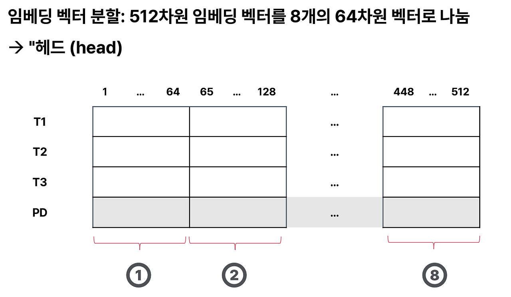
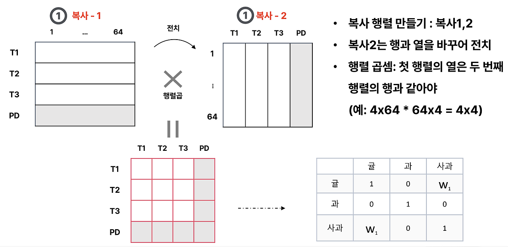
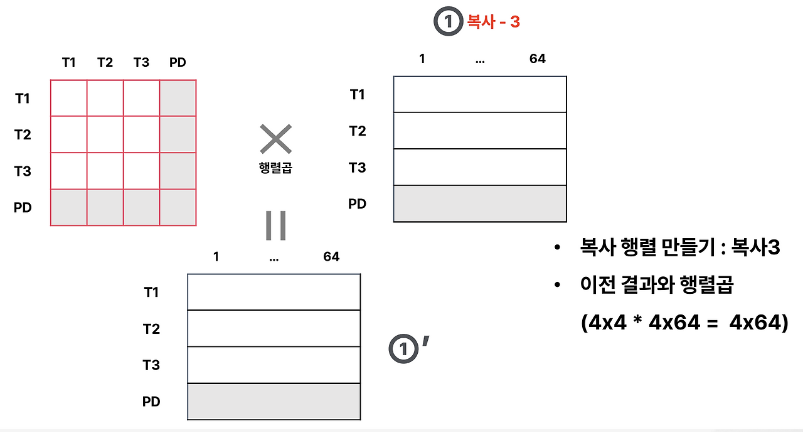
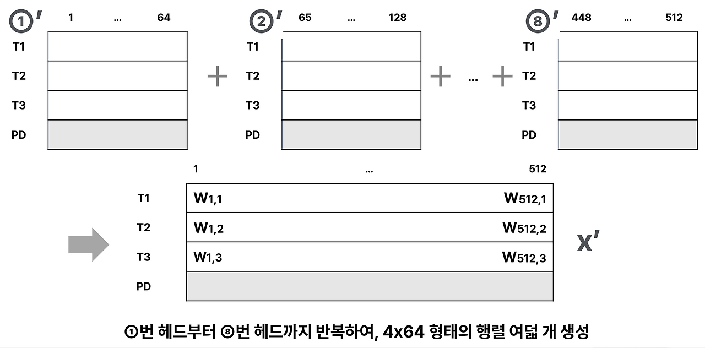
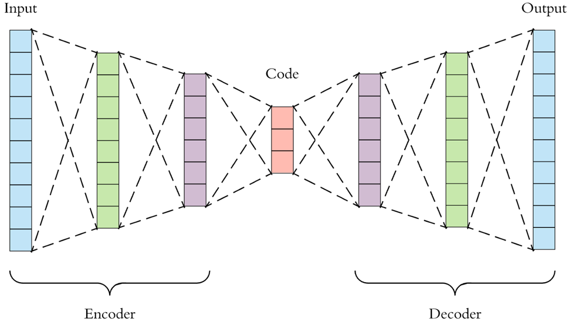

# [71일차] Transformer 구조와 AutoEncoder

Transformer는 RNN처럼 Token을 순서대로 처리하지 않고, **Attention**을 이용해 시퀀스 전체의 관계를 한 번에 계산한다. AutoEncoder는 입력 데이터를 압축한 뒤 다시 복원하면서 데이터의 핵심 특징을 학습한다.

이번에는 Transformer의 Multi-Head Attention, 위치 정보, Encoder와 Decoder 구조를 살펴본다. 이어서 MNIST 이미지에 합성곱 AutoEncoder를 적용해 원본 이미지를 복원하는 과정을 정리한다.

> Seq2Seq, Query·Key·Value, Self-Attention과 Scaled Dot-Product Attention의 기본 원리는 70일차에서 정리했으므로 중복 설명은 제외한다.

---

## 1. Padding Mask

배치 학습에서는 길이가 서로 다른 문장을 하나의 Tensor로 묶기 위해 짧은 문장 뒤에 `<PAD>` Token을 추가한다.

```text
커피 한잔 어때
안녕 <PAD> <PAD>
```

`<PAD>`는 길이를 맞추기 위한 자리일 뿐 실제 의미가 없다. Attention이 이 위치를 참고하면 의미 없는 정보가 문맥에 섞이므로 **Padding Mask**로 제외해야 한다.

```python
import torch

sample_scores = torch.tensor([[2.0, 1.0, 0.5, 3.0]])
padding_mask = torch.tensor([1, 1, 1, 0])

masked_scores = sample_scores.masked_fill(
    padding_mask == 0,
    float("-inf"),
)

weights_before = torch.softmax(sample_scores, dim=-1)
weights_after = torch.softmax(masked_scores, dim=-1)

print("Mask 전:", weights_before)
print("Mask 후:", weights_after)
```

실행 결과:

```text
Mask 전: tensor([[0.2321, 0.0854, 0.0518, 0.6308]])
Mask 후: tensor([[0.6285, 0.2312, 0.1402, 0.0000]])
```

Mask가 적용된 Score는 `-inf`가 된다. `softmax(-inf)`의 결과는 `0`이므로 해당 위치의 Value가 최종 출력에 반영되지 않는다.

```text
Score:  [2.0, 1.0, 0.5, -inf]
                         ↓ Softmax
Weight: [0.6285, 0.2312, 0.1402, 0.0000]
```

---

## 2. Transformer

Transformer는 2017년 논문 [Attention Is All You Need](https://arxiv.org/abs/1706.03762)에서 제안된 신경망 구조다.

RNN 계열 모델은 이전 시점의 계산이 끝나야 다음 시점을 처리할 수 있다. Transformer는 Self-Attention으로 모든 Token의 관계를 직접 계산하므로 병렬 연산에 유리하며, 멀리 떨어진 Token 사이의 관계도 직접 연결할 수 있다.

```text
RNN
x1 → h1 → x2 → h2 → x3 → h3

Transformer
x1 ─┬─ x1, x2, x3과 관계 계산
x2 ─┼─ x1, x2, x3과 관계 계산
x3 ─┴─ x1, x2, x3과 관계 계산
```

대표적인 Transformer 기반 모델에는 BERT, GPT, T5 등이 있다.

---

## 3. Multi-Head Attention

Self-Attention을 Q, K, V 한 세트로만 계산하면 하나의 표현 공간에서 관계를 학습한다. **Multi-Head Attention**은 여러 Head가 서로 다른 Q, K, V 투영을 학습해 다양한 관계를 동시에 포착하도록 만든다.

학습 결과에 따라 어떤 Head는 가까운 Token 관계에, 다른 Head는 문법적 관계나 의미적 관계에 반응할 수 있다. 각 Head의 역할을 사람이 미리 지정하는 것은 아니다.

```text
d_model = 512
num_heads = 8
head_dim = 512 / 8 = 64
```

`d_model`은 `num_heads`로 나누어떨어져야 한다.

### PyTorch로 확인하기

```python
import torch
import torch.nn as nn

embed_dim = 8
num_heads = 2
head_dim = embed_dim // num_heads

print("전체 Embedding 차원:", embed_dim)
print("Head 개수:", num_heads)
print("Head 하나의 차원:", head_dim)

# batch=1, token=3, embed_dim=8
x = torch.randn(1, 3, embed_dim)

mha = nn.MultiheadAttention(
    embed_dim=embed_dim,
    num_heads=num_heads,
    batch_first=True,
)

attn_output, attn_weights = mha(
    query=x,
    key=x,
    value=x,
    need_weights=True,
)

print("입력 Shape:", x.shape)
print("출력 Shape:", attn_output.shape)
print("Attention Weight Shape:", attn_weights.shape)
```

실행 결과:

```text
전체 Embedding 차원: 8
Head 개수: 2
Head 하나의 차원: 4
입력 Shape: torch.Size([1, 3, 8])
출력 Shape: torch.Size([1, 3, 8])
Attention Weight Shape: torch.Size([1, 3, 3])
```

입력과 출력의 마지막 차원은 모두 `8`이다. 내부에서는 두 Head가 각각 4차원 공간에서 Attention을 계산한 뒤, 결과를 합쳐 다시 8차원 표현을 만든다.









### Head별 Attention Weight 확인하기

`nn.MultiheadAttention`은 기본적으로 여러 Head의 Weight를 평균해 반환한다.

```text
[batch, target_length, source_length]
```

`average_attn_weights=False`를 지정하면 Head별 Weight를 따로 확인할 수 있다.

```python
attn_output, head_weights = mha(
    query=x,
    key=x,
    value=x,
    need_weights=True,
    average_attn_weights=False,
)

print(head_weights.shape)
print("Head 0:\n", head_weights[0, 0])
print("Head 1:\n", head_weights[0, 1])
```

실행 결과:

```text
torch.Size([1, 2, 3, 3])
```

차원의 의미는 다음과 같다.

```text
[batch, num_heads, target_length, source_length]
[1,     2,         3,             3]
```

Self-Attention에서는 Query와 Key가 같은 시퀀스에서 만들어지므로 보통 `target_length`와 `source_length`가 같다.

### Attention Weight 시각화


- 세로축은 정보를 찾는 Query Token이다.
- 가로축은 참고 대상인 Key Token이다.
- 색이 밝을수록 해당 Key를 더 많이 참고한다.
- Weight는 학습 과정에서 계속 달라지므로 한 번 출력한 값만으로 Head의 역할을 단정해서는 안 된다.

---

## 4. Transformer Encoder 전체 흐름

Transformer Encoder의 한 Block은 다음 순서로 동작한다.

```text
문장
  ↓
Tokenization
  ↓
Token ID
  ↓
Token Embedding + Positional Encoding
  ↓
Multi-Head Self-Attention
  ↓
Residual Connection + LayerNorm
  ↓
Feed Forward Network
  ↓
Residual Connection + LayerNorm
  ↓
Encoder 출력
```

각 단계는 입력과 출력의 Shape을 유지하면서 Token 표현을 점차 문맥에 맞게 바꾼다.

---

## 5. Token Embedding

먼저 Token을 정수 ID로 바꾼다.

```python
vocab = {
    "<PAD>": 0,
    "커피": 1,
    "한잔": 2,
    "어때": 3,
}

tokens = ["커피", "한잔", "어때"]
token_ids = torch.tensor([[1, 2, 3]])

print(token_ids)
print(token_ids.shape)
```

```text
tensor([[1, 2, 3]])
torch.Size([1, 3])
```

`nn.Embedding`은 각 Token ID를 `d_model`차원의 실수 벡터로 바꾼다.

```python
vocab_size = len(vocab)
d_model = 8

embedding = nn.Embedding(
    vocab_size,
    d_model,
    padding_idx=0,
)

X = embedding(token_ids)
print(X.shape)
```

```text
torch.Size([1, 3, 8])
```

Shape은 다음처럼 변한다.

```text
[batch, sequence_length]
[1, 3]
      ↓ Embedding
[batch, sequence_length, d_model]
[1, 3, 8]
```

---

## 6. Positional Encoding

Self-Attention은 모든 Token의 관계를 한 번에 계산하므로 RNN처럼 계산 순서에서 위치 정보를 얻지 못한다. 따라서 입력에 Token의 위치 정보를 별도로 넣어야 한다.

원래 Transformer 논문은 고정된 Sin과 Cos 함수를 이용한 Positional Encoding을 사용한다.

```text
최종 입력 = Token Embedding + Positional Encoding
```

예를 들어 다음처럼 같은 차원의 두 벡터를 더한다.

```text
Token Embedding:      [0.20, -0.40, 0.70, ...]
Position 0 Encoding:  [0.00,  1.00, 0.00, ...]
최종 입력:            [0.20,  0.60, 0.70, ...]
```

모델이 각 숫자를 Token 정보와 위치 정보로 따로 읽는 것은 아니다. 같은 `d_model` 공간에서 두 벡터를 더해 **의미와 위치가 함께 반영된 표현**을 만든다.

### Sin/Cos Positional Encoding 구현

```python
import math

class PositionalEncoding(nn.Module):
    def __init__(self, d_model, max_len=100):
        super().__init__()

        position = torch.arange(
            max_len,
            dtype=torch.float32,
        ).unsqueeze(1)

        div_term = torch.exp(
            torch.arange(
                0,
                d_model,
                2,
                dtype=torch.float32,
            )
            * (-math.log(10000.0) / d_model)
        )

        pe = torch.zeros(max_len, d_model)
        pe[:, 0::2] = torch.sin(position * div_term)
        pe[:, 1::2] = torch.cos(position * div_term)

        self.register_buffer("pe", pe.unsqueeze(0))

    def forward(self, x):
        seq_len = x.size(1)
        return x + self.pe[:, :seq_len]
```

`pe`는 학습으로 바뀌는 Parameter가 아니라 공식으로 계산한 고정값이다. `register_buffer()`로 등록하면 다음 특성을 얻는다.

- `model.to(device)`를 호출할 때 모델과 함께 GPU나 MPS로 이동한다.
- `state_dict()`에 포함되어 저장된다.
- Optimizer의 학습 대상 Parameter에는 포함되지 않는다.

```python
pos_encoding = PositionalEncoding(d_model)
X_pos = pos_encoding(X)

print("Embedding:", X.shape)
print("Position 추가:", X_pos.shape)
```

```text
Embedding: torch.Size([1, 3, 8])
Position 추가: torch.Size([1, 3, 8])
```

위치 정보를 더해도 Shape은 변하지 않는다.

### RoPE

RoPE(Rotary Positional Embedding)는 위치 벡터를 입력 Embedding에 단순히 더하지 않는다. Attention에 사용하는 Q와 K를 Token 위치에 따라 회전시켜 상대적인 위치 관계가 점수에 반영되도록 만든다.

```text
Sin/Cos Positional Encoding
Embedding에 위치 벡터를 더한다.

RoPE
Q와 K의 Attention 계산에 위치 관계를 반영한다.
```

---

## 7. Multi-Head Self-Attention 적용

위치 정보가 더해진 `X_pos`를 Query, Key, Value에 모두 사용하면 Self-Attention이 된다.

```python
num_heads = 2

mha = nn.MultiheadAttention(
    embed_dim=d_model,
    num_heads=num_heads,
    batch_first=True,
)

attn_out, attn_weights = mha(
    query=X_pos,
    key=X_pos,
    value=X_pos,
    need_weights=True,
    average_attn_weights=False,
)

print("입력:", X_pos.shape)
print("출력:", attn_out.shape)
print("Head별 Weight:", attn_weights.shape)
```

실행 결과:

```text
입력: torch.Size([1, 3, 8])
출력: torch.Size([1, 3, 8])
Head별 Weight: torch.Size([1, 2, 3, 3])
```

Attention은 Token 사이의 정보를 섞지만 `[batch, sequence_length, d_model]` Shape은 유지한다.

---

## 8. Residual Connection

Residual Connection은 Attention 결과만 다음 단계로 보내지 않고 원래 입력을 다시 더하는 구조다.

```text
y = x + F(x)
```

- `x`는 Attention에 들어가기 전의 원래 정보다.
- `F(x)`는 Attention이 계산한 변화 정보다.
- `x + F(x)`는 원래 정보를 유지하면서 새로운 문맥 정보를 추가한 결과다.

```python
residual = X_pos + attn_out
print(residual.shape)
```

```text
torch.Size([1, 3, 8])
```

원소별 덧셈을 수행하므로 `x`와 `F(x)`의 Shape이 같아야 한다. Residual Connection은 깊은 신경망에서 정보와 Gradient가 전달될 경로를 제공해 학습을 돕는다.

---

## 9. Layer Normalization

`nn.LayerNorm(d_model)`은 각 Token 벡터의 Feature 차원을 기준으로 값을 정규화한다.

입력 Shape이 `[batch, sequence_length, d_model]`이면 각 Token의 `(d_model,)` 벡터를 독립적으로 정규화한다.

```python
norm1 = nn.LayerNorm(d_model)
x1 = norm1(residual)

print("평균:", x1[0, 0].mean())
print("분산:", x1[0, 0].var(unbiased=False))
```

실행 결과:

```text
평균: tensor(0.)
분산: tensor(1.000)
```

LayerNorm은 각 샘플과 Token 안에서 정규화하므로 BatchNorm보다 배치 크기의 영향을 덜 받는다. 가변 길이 시퀀스를 다루는 Transformer에 잘 맞는다.

---

## 10. Feed Forward Network

Attention과 FFN은 서로 다른 역할을 한다.

| 구성 요소 | 역할 |
| --- | --- |
| Attention | 다른 Token에서 어떤 정보를 가져올지 계산한다. |
| FFN | 모은 정보를 각 Token 위치에서 독립적으로 비선형 변환한다. |

```python
ffn = nn.Sequential(
    nn.Linear(d_model, 32),
    nn.ReLU(),
    nn.Linear(32, d_model),
)

ffn_out = ffn(x1)

print("입력:", x1.shape)
print("출력:", ffn_out.shape)
```

```text
입력: torch.Size([1, 3, 8])
출력: torch.Size([1, 3, 8])
```

동일한 FFN이 모든 Token 위치에 적용되지만, 각 Token은 다른 Token과 섞이지 않고 자신의 Feature만 변환한다.

Encoder Block에는 두 개의 Sub-layer가 있으며 각각 Residual Connection과 LayerNorm이 붙는다.

```text
Self-Attention
  ↓
Residual + LayerNorm
  ↓
FFN
  ↓
Residual + LayerNorm
```

```python
norm2 = nn.LayerNorm(d_model)
encoder_output = norm2(x1 + ffn_out)

print(encoder_output.shape)
```

```text
torch.Size([1, 3, 8])
```

---

## 11. Encoder에서 Padding Mask 사용하기

PyTorch의 `nn.MultiheadAttention`은 `key_padding_mask`에서 다음 규칙을 사용한다.

```text
False: 참고할 수 있는 실제 Token
True:  참고 대상에서 제외할 PAD Token
```

```python
padded_ids = torch.tensor([
    [1, 2, 3],
    [1, 3, 0],
])

padding_mask = padded_ids.eq(0)

print(padded_ids)
print(padding_mask)
```

실행 결과:

```text
tensor([[1, 2, 3],
        [1, 3, 0]])

tensor([[False, False, False],
        [False, False,  True]])
```

Mask를 Multi-Head Attention에 전달한다.

```python
padded_x = pos_encoding(embedding(padded_ids))

masked_out, masked_weights = mha(
    padded_x,
    padded_x,
    padded_x,
    key_padding_mask=padding_mask,
    need_weights=True,
)

print(masked_weights[1])
```

두 번째 문장의 Attention Weight는 다음과 같다.

```text
tensor([[0.392, 0.608, 0.000],
        [0.372, 0.628, 0.000],
        [0.414, 0.586, 0.000]])
```

마지막 열은 `<PAD>`가 있는 Key 위치다. 모든 Query에서 가중치가 `0`이므로 참고 대상에서 제외된 것을 확인할 수 있다.

> `key_padding_mask`는 PAD를 Key와 Value의 참고 대상에서 제외한다. PAD 위치의 Query 출력까지 자동으로 삭제하는 것은 아니므로, 이후 Loss를 계산할 때도 PAD 위치를 제외해야 한다.

---

## 12. Causal Mask

Padding Mask와 Causal Mask는 목적이 다르다.

| Mask | 가리는 대상 | 사용 목적 |
| --- | --- | --- |
| Padding Mask | 의미 없는 `<PAD>` 위치 | 길이가 다른 문장을 배치로 처리한다. |
| Causal Mask | 현재보다 뒤에 있는 미래 Token | 다음 Token의 정답 누출을 막는다. |

문장 `나는 커피를 마신다`를 학습할 때 각 위치가 볼 수 있는 범위는 다음과 같다.

```text
Query  | 나는 | 커피를 | 마신다
-------|------|--------|-------
나는   |  O   |   X    |   X
커피를 |  O   |   O    |   X
마신다 |  O   |   O    |   O
```

추론할 때는 Token을 하나씩 생성하지만, 학습할 때는 정답 문장 전체를 알고 있다. Mask 없이 병렬 계산하면 앞쪽 위치가 미래의 정답 Token을 미리 볼 수 있으므로 Causal Mask가 필요하다.

```python
seq_len = 4

causal_mask = torch.triu(
    torch.ones(seq_len, seq_len, dtype=torch.bool),
    diagonal=1,
)

print(causal_mask)
```

```text
tensor([[False,  True,  True,  True],
        [False, False,  True,  True],
        [False, False, False,  True],
        [False, False, False, False]])
```

`True`인 오른쪽 위 영역이 미래 Token에 해당한다.

실제 Attention Weight는 다음처럼 미래 위치가 `0`이 된다.

```text
tensor([[1.000, 0.000, 0.000, 0.000],
        [0.640, 0.360, 0.000, 0.000],
        [0.315, 0.311, 0.374, 0.000],
        [0.166, 0.159, 0.303, 0.372]])
```

---

## 13. Transformer Encoder Block 구현

지금까지 확인한 구성 요소를 하나의 Encoder Block으로 묶는다.

```python
class SimpleTransformerEncoderBlock(nn.Module):
    def __init__(
        self,
        d_model=8,
        num_heads=2,
        d_ff=32,
        dropout=0.1,
    ):
        super().__init__()

        self.self_attention = nn.MultiheadAttention(
            d_model,
            num_heads,
            dropout=dropout,
            batch_first=True,
        )

        self.norm1 = nn.LayerNorm(d_model)
        self.norm2 = nn.LayerNorm(d_model)

        self.ffn = nn.Sequential(
            nn.Linear(d_model, d_ff),
            nn.ReLU(),
            nn.Dropout(dropout),
            nn.Linear(d_ff, d_model),
        )

        self.dropout1 = nn.Dropout(dropout)
        self.dropout2 = nn.Dropout(dropout)

    def forward(self, x, padding_mask=None):
        attn_out, weights = self.self_attention(
            x,
            x,
            x,
            key_padding_mask=padding_mask,
            need_weights=True,
        )

        x = self.norm1(
            x + self.dropout1(attn_out)
        )

        ffn_out = self.ffn(x)
        x = self.norm2(
            x + self.dropout2(ffn_out)
        )

        return x, weights
```

```python
block = SimpleTransformerEncoderBlock()
out, weights = block(X_pos)

print("입력:", X_pos.shape)
print("출력:", out.shape)
print("Weight:", weights.shape)
```

실행 결과:

```text
입력: torch.Size([1, 3, 8])
출력: torch.Size([1, 3, 8])
Weight: torch.Size([1, 3, 3])
```

이 구현은 Attention 뒤에 정규화하는 **Post-Norm** 구조다.

```text
x → Attention → Add → LayerNorm → FFN → Add → LayerNorm
```

---

## 14. Transformer Decoder

Encoder는 입력 Token 전체를 Self-Attention으로 처리해 문맥이 반영된 표현을 만든다. Decoder는 이 정보를 이용해 출력 문장을 생성한다.

Decoder의 주요 구성은 다음과 같다.

1. **Masked Self-Attention**: 미래 출력 Token을 미리 보지 못하게 한다.
2. **Cross-Attention**: Encoder 출력 중 현재 생성에 필요한 부분을 참고한다.
3. **FFN**: 각 Decoder Token 표현을 비선형 변환한다.

```text
입력 문장
   ↓
Encoder
   ↓
Encoder Memory ──────────────┐
                            │ K, V
출력 입력                    │
   ↓                        │
Masked Self-Attention        │
   ↓                        │
Cross-Attention ◀────────────┘
   ↓
FFN
   ↓
Decoder 출력
```

### Cross-Attention

Cross-Attention에서는 Q와 K, V의 출처가 다르다.

```text
Q = Decoder의 현재 표현
K = Encoder 출력
V = Encoder 출력
```

```python
cross_attention = nn.MultiheadAttention(
    embed_dim=8,
    num_heads=2,
    batch_first=True,
)

encoder_memory = torch.randn(1, 5, 8)
decoder_state = torch.randn(1, 3, 8)

cross_out, cross_weights = cross_attention(
    query=decoder_state,
    key=encoder_memory,
    value=encoder_memory,
)

print("Q(Decoder):", decoder_state.shape)
print("K/V(Encoder):", encoder_memory.shape)
print("출력:", cross_out.shape)
print("Weight:", cross_weights.shape)
```

실행 결과:

```text
Q(Decoder): torch.Size([1, 3, 8])
K/V(Encoder): torch.Size([1, 5, 8])
출력: torch.Size([1, 3, 8])
Weight: torch.Size([1, 3, 5])
```

`[1, 3, 5]`는 Decoder의 Token 3개가 Encoder Token 5개를 각각 얼마나 참고했는지 나타낸다.

GPT 같은 Decoder-only 모델은 별도의 Encoder와 Cross-Attention 없이 Causal Self-Attention을 중심으로 구성한다.

---

## 15. AutoEncoder

AutoEncoder는 입력을 작은 잠재 표현으로 바꾸고, 그 표현으로 원본을 다시 복원하는 신경망이다.

```text
입력 x
  ↓
Encoder
  ↓
Latent Representation z
  ↓
Decoder
  ↓
복원 결과 x_hat
```



입력과 복원 결과의 차이가 작아지도록 학습한다.

```text
입력:  숫자 7 이미지
정답:  같은 숫자 7 이미지
출력:  AutoEncoder가 복원한 숫자 7 이미지
```

### 비지도 학습과 자기지도 학습

이미지 분류 모델은 `강아지`, `고양이`와 같은 사람이 만든 클래스 라벨을 필요로 한다. AutoEncoder는 별도의 클래스 라벨 없이 입력 데이터 자체를 정답으로 사용한다.

```python
for x, _ in loader:
    _, x_hat = model(x)
    loss = criterion(x_hat, x)
```

DataLoader가 제공한 `label`을 `_`로 받아 사용하지 않고, 입력 `x`가 그대로 학습 Target이 된다. 전통적으로 비지도 학습으로 분류하며, 입력에서 정답을 자동으로 만드는 관점에서는 자기지도 학습의 한 형태로도 볼 수 있다.

---

## 16. Encoder, Latent Representation, Decoder

### Encoder

Encoder는 입력에서 복원에 필요한 특징을 추출한다.

```text
입력 이미지
[1, 28, 28]
      ↓ Encoder
잠재 표현
[32, 7, 7]
```

### Latent Representation

Latent Representation은 Encoder가 만든 내부 표현이다. 원본을 그대로 복사하는 대신 Decoder가 원본을 다시 만들 때 필요한 특징을 담는다.

이번 합성곱 모델은 공간 크기를 `28 × 28`에서 `7 × 7`로 줄이는 대신 Channel을 `1`에서 `32`로 늘린다.

```text
원본 원소 수:  1 × 28 × 28 = 784
Latent 원소 수: 32 × 7 × 7 = 1,568
```

따라서 이 예제는 **가로와 세로 크기는 압축하지만 전체 원소 수가 더 작은 엄격한 차원 축소 구조는 아니다.** 더 강한 Bottleneck이 필요하다면 Channel 수를 줄이거나 `Linear` 층으로 더 작은 Latent Vector를 만들 수 있다.

### Decoder

Decoder는 Latent Representation만 보고 원본과 비슷한 데이터를 복원한다.

```text
[32, 7, 7]
      ↓ Decoder
[1, 28, 28]
```

---

## 17. Reconstruction Loss

AutoEncoder는 원본과 복원본의 차이를 **Reconstruction Loss**로 계산한다.

예를 들어 한 픽셀의 원본값이 `0.8`, 복원값이 `0.6`이라면 제곱 오차는 다음과 같다.

```text
(0.8 - 0.6)² = 0.04
```

전체 픽셀의 평균 제곱 오차를 줄이도록 Encoder와 Decoder의 Parameter를 함께 업데이트한다.

```python
criterion = nn.MSELoss()
```

---

## 18. MNIST 데이터 준비

```python
import torch
import torch.nn as nn
import torch.optim as optim
import matplotlib.pyplot as plt

from torch.utils.data import DataLoader
from torchvision import datasets, transforms
from torchvision.utils import make_grid

torch.manual_seed(2026)
```

`ToTensor()`는 MNIST 이미지를 Tensor로 바꾸고 픽셀 범위를 `[0, 1]`로 변환한다.

```python
transform = transforms.ToTensor()

train_dataset = datasets.MNIST(
    root="./data",
    train=True,
    download=True,
    transform=transform,
)

test_dataset = datasets.MNIST(
    root="./data",
    train=False,
    download=True,
    transform=transform,
)

train_loader = DataLoader(
    train_dataset,
    batch_size=128,
    shuffle=True,
    num_workers=4,
)

test_loader = DataLoader(
    test_dataset,
    batch_size=128,
    shuffle=False,
    num_workers=4,
)
```

```python
images, labels = next(iter(train_loader))

print("images:", images.shape)
print("labels:", labels.shape)
```

실행 결과:

```text
images: torch.Size([128, 1, 28, 28])
labels: torch.Size([128])
```

`images`의 차원은 `[batch, channel, height, width]` 순서다.

---

## 19. 합성곱 AutoEncoder 구현

```python
class ConvAutoencoder(nn.Module):
    def __init__(self):
        super().__init__()

        self.encoder = nn.Sequential(
            # [B, 1, 28, 28] → [B, 16, 14, 14]
            nn.Conv2d(
                1,
                16,
                kernel_size=3,
                stride=2,
                padding=1,
            ),
            nn.ReLU(),

            # [B, 16, 14, 14] → [B, 32, 7, 7]
            nn.Conv2d(
                16,
                32,
                kernel_size=3,
                stride=2,
                padding=1,
            ),
            nn.ReLU(),
        )

        self.decoder = nn.Sequential(
            # [B, 32, 7, 7] → [B, 16, 14, 14]
            nn.ConvTranspose2d(
                32,
                16,
                kernel_size=3,
                stride=2,
                padding=1,
                output_padding=1,
            ),
            nn.ReLU(),

            # [B, 16, 14, 14] → [B, 1, 28, 28]
            nn.ConvTranspose2d(
                16,
                1,
                kernel_size=3,
                stride=2,
                padding=1,
                output_padding=1,
            ),
            nn.Sigmoid(),
        )

    def forward(self, x):
        z = self.encoder(x)
        x_hat = self.decoder(z)
        return z, x_hat
```

### Shape 변화

| 단계 | 연산 | 출력 Shape |
| --- | --- | --- |
| 입력 | MNIST 이미지 | `[B, 1, 28, 28]` |
| Encoder 1 | `Conv2d(1, 16)` | `[B, 16, 14, 14]` |
| Encoder 2 | `Conv2d(16, 32)` | `[B, 32, 7, 7]` |
| Decoder 1 | `ConvTranspose2d(32, 16)` | `[B, 16, 14, 14]` |
| Decoder 2 | `ConvTranspose2d(16, 1)` | `[B, 1, 28, 28]` |

`stride=2`인 `Conv2d`는 공간 크기를 절반으로 줄인다. `ConvTranspose2d`는 반대로 공간 크기를 키운다.

마지막 `Sigmoid`는 복원 픽셀값을 `0`과 `1` 사이로 만든다. 입력도 `ToTensor()`로 `[0, 1]` 범위이므로 출력 범위가 잘 맞는다.

---

## 20. AutoEncoder 학습

```python
model = ConvAutoencoder().to(DEVICE)

criterion = nn.MSELoss()
optimizer = optim.AdamW(
    model.parameters(),
    lr=1e-3,
)
```

학습 함수는 입력 `x`와 복원 결과 `x_hat`의 차이를 계산한다.

```python
def train_autoencoder(
    model,
    loader,
    criterion,
    optimizer,
    device,
    epochs=5,
):
    history = []

    for epoch in range(epochs):
        model.train()
        running_loss = 0.0

        for x, _ in loader:
            x = x.to(device)

            _, x_hat = model(x)
            loss = criterion(x_hat, x)

            optimizer.zero_grad()
            loss.backward()
            optimizer.step()

            running_loss += loss.item() * x.size(0)

        epoch_loss = running_loss / len(loader.dataset)
        history.append(epoch_loss)

        print(
            f"Epoch {epoch + 1:02d}/{epochs} | "
            f"Loss: {epoch_loss:.6f}"
        )

    return history
```

노트북의 실행 결과는 다음과 같다.

```text
Epoch 01/5 | Loss: 0.031372
Epoch 02/5 | Loss: 0.001786
Epoch 03/5 | Loss: 0.001211
Epoch 04/5 | Loss: 0.000970
Epoch 05/5 | Loss: 0.000810
```


Reconstruction Loss가 지속해서 감소하므로 원본을 더 비슷하게 복원하도록 학습되고 있음을 알 수 있다.

---

## 21. 복원 결과 확인

```python
@torch.no_grad()
def show_reconstructions(model, loader, device, n=8):
    model.eval()

    x, _ = next(iter(loader))
    x = x[:n].to(device)

    _, x_hat = model(x)

    comparison = torch.cat(
        [x.cpu(), x_hat.cpu()],
        dim=0,
    )

    grid = make_grid(
        comparison,
        nrow=n,
        padding=2,
    )

    plt.figure(figsize=(14, 4))
    plt.imshow(
        grid.permute(1, 2, 0).squeeze(),
        cmap="gray",
    )
    plt.axis("off")
    plt.title("Top: Original / Bottom: Reconstruction")
    plt.show()
```


- 위쪽 행은 원본 이미지다.
- 아래쪽 행은 AutoEncoder가 복원한 이미지다.
- 전체적인 숫자 모양은 잘 복원하지만 가장자리 일부가 부드럽거나 흐리게 표현될 수 있다.

학습 Loss가 낮아도 새로운 데이터의 복원 품질이 항상 좋다는 뜻은 아니다. Test 데이터의 Reconstruction Loss와 복원 이미지를 함께 확인해야 한다.

---

## 22. AutoEncoder 활용 분야

| 활용 분야 | 사용 방법 |
| --- | --- |
| 특징 추출 | Encoder가 만든 Latent Representation을 다른 모델의 입력으로 사용한다. |
| 차원 축소 | 원본보다 작은 Bottleneck을 만들어 핵심 정보를 압축한다. |
| 노이즈 제거 | 노이즈가 섞인 이미지를 입력하고 깨끗한 이미지를 Target으로 사용한다. |
| 이상 탐지 | 정상 데이터로 학습한 뒤 Reconstruction Error가 큰 데이터를 이상으로 판단한다. |
| 생성 모델 기초 | VAE처럼 Latent Space를 확률적으로 모델링하는 구조로 확장한다. |

일반 AutoEncoder는 입력을 복원하도록 학습하지만, 임의의 Latent Vector에서 항상 자연스러운 데이터를 생성할 수 있는 것은 아니다. 생성 목적이라면 Latent Space의 분포를 학습하는 VAE 같은 구조가 더 적합할 수 있다.

---

## 23. 핵심 정리

1. Padding Mask는 `<PAD>`의 Attention Weight를 `0`으로 만들어 의미 없는 위치를 참고하지 않게 한다.
2. Multi-Head Attention은 여러 표현 공간에서 Token 관계를 동시에 학습한다.
3. `average_attn_weights=False`를 사용하면 Head별 Attention Weight를 확인할 수 있다.
4. Self-Attention은 순서를 모르므로 Token Embedding에 Positional Encoding을 더한다.
5. Residual Connection은 원래 정보에 Attention이나 FFN의 변화 정보를 더한다.
6. LayerNorm은 각 Token의 Feature 차원을 기준으로 정규화한다.
7. FFN은 각 Token 위치에 독립적으로 같은 비선형 변환을 적용한다.
8. Causal Mask는 미래 Token을 가려 다음 Token 예측의 정답 누출을 방지한다.
9. Decoder의 Cross-Attention은 Decoder 표현을 Q로, Encoder 출력을 K와 V로 사용한다.
10. AutoEncoder는 입력 자체를 Target으로 사용해 Encoder와 Decoder를 함께 학습한다.
11. MNIST 합성곱 AutoEncoder는 `28 × 28 → 7 × 7 → 28 × 28`로 공간 크기를 줄였다가 복원한다.
12. AutoEncoder는 Reconstruction Loss뿐 아니라 실제 복원 결과도 함께 평가해야 한다.

