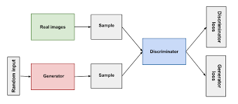

# [72일차] Denoising AutoEncoder, VAE와 GAN

기본 AutoEncoder는 입력을 잠재 표현으로 바꾼 뒤 원본과 비슷하게 복원한다. 여기서 입력에 노이즈를 추가하거나 잠재 공간에 제약을 주면 다른 목적의 모델로 확장할 수 있다.

이번에는 **Denoising AutoEncoder**, **Sparse AutoEncoder**, **VAE(Variational AutoEncoder)**를 살펴본다. 이어서 생성자와 판별자가 경쟁하며 새로운 데이터를 만드는 **GAN(Generative Adversarial Network)**을 구현한다.

> 기본 AutoEncoder의 Encoder·Decoder 구조, Reconstruction Loss와 MNIST 복원 실습은 71일차에서 정리했으므로 중복 내용은 제외한다.

---

## 1. Latent Representation 다시 확인하기

학습이 끝난 AutoEncoder에서는 Encoder만 따로 사용할 수 있다.

```python
x, _ = next(iter(test_loader))
x = x[:8].to(DEVICE)

with torch.no_grad():
    z = model.encoder(x)

print("입력 Shape:", x.shape)
print("Latent Shape:", z.shape)
print("원본 값 개수:", 1 * 28 * 28)
print("Latent 값 개수:", z[0].numel())
```

실행 결과:

```text
입력 Shape: torch.Size([8, 1, 28, 28])
Latent Shape: torch.Size([8, 32, 7, 7])
원본 값 개수: 784
Latent 값 개수: 1568
```

공간 해상도는 `28 × 28`에서 `7 × 7`로 줄었지만 Channel이 `1`에서 `32`로 늘어 전체 값의 개수는 더 많다.

AutoEncoder의 Latent Representation이 반드시 원본보다 적은 수의 값을 가져야 하는 것은 아니다. 합성곱 AutoEncoder는 공간 크기를 줄이는 대신 Channel을 늘려 원본 복원에 유용한 Feature Map으로 변환하기도 한다.

다만 **차원 축소**가 목적이라면 전체 원소 수가 실제로 작은 Bottleneck을 설계해야 한다.

---

## 2. Denoising AutoEncoder

Denoising AutoEncoder는 노이즈가 섞인 데이터를 입력으로 받고, 깨끗한 원본을 Target으로 사용한다.

```text
노이즈가 섞인 이미지
        ↓
      Encoder
        ↓
Latent Representation
        ↓
      Decoder
        ↓
깨끗하게 복원된 이미지
```

일반 AutoEncoder와 학습 목표를 비교하면 다음과 같다.

| 모델 | 입력 | Target |
| --- | --- | --- |
| 기본 AutoEncoder | 깨끗한 이미지 | 같은 깨끗한 이미지 |
| Denoising AutoEncoder | 노이즈 이미지 | 깨끗한 원본 이미지 |

### 노이즈 추가하기

```python
def add_noise(x, noise_factor=0.35):
    noisy = x + noise_factor * torch.randn_like(x)
    return torch.clamp(noisy, 0.0, 1.0)
```

- `torch.randn_like(x)`는 `x`와 같은 Shape의 표준정규분포 노이즈를 만든다.
- `noise_factor`는 노이즈의 강도를 조절한다.
- `torch.clamp()`는 픽셀값이 `[0, 1]` 범위를 벗어나지 않도록 제한한다.

```python
x, _ = next(iter(train_loader))
noisy_x = add_noise(x[:8])
```


위쪽은 원본, 아래쪽은 노이즈를 추가한 이미지다.

### 학습하기

```python
denoising_model = ConvAutoencoder().to(DEVICE)
criterion = nn.MSELoss()
optimizer = optim.AdamW(
    denoising_model.parameters(),
    lr=1e-3,
)

def train_denoising_autoencoder(
    model,
    loader,
    criterion,
    optimizer,
    device,
    epochs=5,
):
    for epoch in range(epochs):
        model.train()
        running_loss = 0.0

        for clean_x, _ in loader:
            clean_x = clean_x.to(device)
            noisy_x = add_noise(clean_x)

            _, restored_x = model(noisy_x)
            loss = criterion(restored_x, clean_x)

            optimizer.zero_grad()
            loss.backward()
            optimizer.step()

            running_loss += (
                loss.item() * clean_x.size(0)
            )

        epoch_loss = (
            running_loss / len(loader.dataset)
        )

        print(
            f"Epoch {epoch + 1:02d}/{epochs} | "
            f"Loss: {epoch_loss:.6f}"
        )
```

중요한 부분은 다음 한 줄이다.

```python
loss = criterion(restored_x, clean_x)
```

모델에는 `noisy_x`를 입력하지만 Loss는 복원 결과와 깨끗한 `clean_x` 사이에서 계산한다.

노트북의 실행 결과는 다음과 같다.

```text
Epoch 01/5 | Loss: 0.029357
Epoch 02/5 | Loss: 0.008080
Epoch 03/5 | Loss: 0.007619
Epoch 04/5 | Loss: 0.007417
Epoch 05/5 | Loss: 0.007292
```

### 복원 결과


```text
위쪽: 노이즈 이미지
가운데: 모델이 복원한 이미지
아래쪽: 깨끗한 원본 이미지
```

노이즈는 크게 줄었고 숫자 형태도 잘 복원했다. 다만 원본보다 획이 부드럽거나 일부 세부 정보가 손실될 수 있다.

---

## 3. Sparse AutoEncoder

일반 AutoEncoder는 Latent Representation의 많은 뉴런을 자유롭게 사용할 수 있다. Sparse AutoEncoder는 **가능하면 적은 수의 뉴런만 강하게 활성화**하도록 제약을 추가한다.

```text
일반 Latent
[0.7, 0.5, 0.9, 0.4, 0.6, 0.8]

Sparse Latent
[0.8, 0.0, 1.3, 0.0, 0.9, 0.0]
```

모든 뉴런을 조금씩 사용하는 대신 일부 뉴런이 특정 특징을 강하게 표현하도록 유도한다.

```text
전체 Loss = Reconstruction Loss + Sparsity Penalty
```

Latent 공간에 어떤 제약을 주느냐에 따라 학습되는 표현의 성질이 달라진다.

---

## 4. AutoEncoder를 이용한 이상 탐지

정상 데이터만 충분히 학습한 AutoEncoder는 정상 패턴을 잘 복원하도록 최적화된다.

```text
정상 데이터
→ 학습한 패턴과 비슷함
→ 잘 복원됨
→ Reconstruction Error가 작음

이상 데이터
→ 학습한 패턴과 다름
→ 잘 복원하지 못함
→ Reconstruction Error가 큼
```

Reconstruction Error를 기준으로 Threshold를 정하면 이상 여부를 판단할 수 있다.

```python
error = ((x - x_hat) ** 2).mean(dim=(1, 2, 3))
is_anomaly = error > threshold
```

하지만 AutoEncoder가 이상 데이터까지 잘 복원하는 경우도 있다. 따라서 실제 시스템에서는 다음 내용을 함께 고려해야 한다.

- 정상 데이터의 다양성을 충분히 포함했는가?
- Validation 데이터로 적절한 Threshold를 정했는가?
- 이상 유형별 Recall과 False Positive Rate는 어떤가?
- 다른 이상 탐지 방법과 비교했는가?

Reconstruction Error 하나만으로 모든 이상 탐지 문제를 해결할 수 있는 것은 아니다.

---

## 5. 일반 AutoEncoder의 생성 한계

일반 AutoEncoder는 입력을 복원하는 작업에는 적합하다.

```text
x → Encoder → z → Decoder → x_hat
```

새 이미지를 생성하려면 입력 이미지 없이 시작점 `z`를 정해야 한다.

```text
? → z → Decoder → 새로운 이미지
```

하지만 일반 AutoEncoder는 Latent Space가 규칙적인 확률분포가 되도록 학습하지 않는다.

- 학습 데이터가 존재하는 위치에서는 Decoder가 잘 동작할 수 있다.
- 학습된 위치 사이에는 Decoder가 충분히 학습하지 못한 빈 영역이 생길 수 있다.
- 임의의 `z`를 Decoder에 넣는다고 자연스러운 이미지가 보장되지는 않는다.

즉, **복원을 잘하는 것과 새로운 데이터를 잘 생성하는 것은 다른 문제**다.

---

## 6. VAE

VAE(Variational AutoEncoder)는 Latent Space를 확률분포로 표현하는 생성 모델이다.

일반 AutoEncoder는 이미지 하나를 정확한 좌표 하나로 바꾼다.

```text
이미지 → z = [2.0, 3.0]
```

VAE는 정확한 점 하나가 아니라 평균과 분산으로 범위를 표현한다.

```text
이미지
  ↓
Encoder
  ↓
평균 μ, 분산 σ²
  ↓
분포에서 z Sampling
  ↓
Decoder
  ↓
복원 이미지
```

지도에 비유하면 다음과 같다.

| 값 | 의미 | 지도 비유 |
| --- | --- | --- |
| `μ` | 분포의 중심 | 동네의 중심 위치 |
| `σ` | 분포의 퍼짐 정도 | 동네의 넓이 |
| `z` | 분포에서 뽑은 한 점 | 동네 안에서 선택한 한 지점 |

각 데이터를 주변 범위까지 포함해 표현하고, 분포들이 지나치게 흩어지지 않도록 제한한다. 이를 통해 임의의 `z`를 Sampling해도 의미 있는 결과가 나올 가능성을 높인다.

---

## 7. Reparameterization Trick

Encoder는 `μ`와 `logvar`를 출력한다.

```text
var = σ²
logvar = log(σ²)
```

표준편차는 다음처럼 계산한다.

```python
std = torch.exp(0.5 * logvar)
```

그다음 표준정규분포에서 `epsilon`을 뽑아 `z`를 만든다.

```python
eps = torch.randn_like(std)
z = mu + eps * std
```

> `eps`는 “아주 작은 값”을 의미하지 않는다. 그리스 문자 epsilon을 변수 이름으로 사용한 것이며, 여기서는 평균 0, 표준편차 1인 정규분포에서 뽑은 무작위 표본이다.

### 실행 예제

```python
mu = torch.tensor([[1.0, 2.0]])
logvar = torch.tensor([[0.0, 0.0]])

std = torch.exp(0.5 * logvar)
eps = torch.randn_like(std)
z = mu + eps * std

print("mu:", mu)
print("logvar:", logvar)
print("std:", std)
print("epsilon:", eps)
print("z:", z)
```

노트북의 실행 결과:

```text
mu:      tensor([[1., 2.]])
logvar:  tensor([[0., 0.]])
std:     tensor([[1., 1.]])
epsilon: tensor([[-1.1235, 1.1595]])
z:       tensor([[-0.1235, 3.1595]])
```

### 왜 이 방식이 필요한가?

단순히 분포에서 직접 Sampling하면 무작위 연산을 통과해 `μ`와 `σ`를 만든 Encoder까지 Gradient를 전달하기 어렵다.

```text
z = μ + ε × σ
```

처럼 표현하면 무작위성은 `ε`에 분리되고, `z`는 `μ`와 `σ`에 대한 미분 가능한 계산으로 만들어진다. 이를 **Reparameterization Trick**이라고 한다.

---

## 8. VAE Loss

VAE는 두 Loss를 함께 사용한다.

```text
VAE Loss = Reconstruction Loss + KL Loss
```

수식으로 표현하면 다음과 같다.

```text
L_VAE = L_reconstruction + L_KL
```

### Reconstruction Loss

원본과 복원 이미지의 차이를 줄인다.

```python
recon_loss = F.binary_cross_entropy(
    x_hat,
    x,
    reduction="sum",
)
```

### KL Divergence

Encoder가 만든 분포가 기준 분포인 표준정규분포 `N(0, I)`에서 지나치게 멀어지지 않도록 한다.

```python
kl_loss = -0.5 * torch.sum(
    1 + logvar - mu.pow(2) - logvar.exp()
)
```

KL Loss는 Latent Space가 무작위 Sampling에 적합한 규칙적인 형태를 갖도록 유도한다.

```python
def vae_loss_function(x_hat, x, mu, logvar):
    recon_loss = F.binary_cross_entropy(
        x_hat,
        x,
        reduction="sum",
    )

    kl_loss = -0.5 * torch.sum(
        1 + logvar - mu.pow(2) - logvar.exp()
    )

    batch_size = x.size(0)

    total_loss = (
        recon_loss + kl_loss
    ) / batch_size

    recon_loss = recon_loss / batch_size
    kl_loss = kl_loss / batch_size

    return total_loss, recon_loss, kl_loss
```

`reduction="sum"`으로 784개 픽셀의 BCE를 모두 더한 뒤 Batch 크기로 나누므로 Loss 값이 기본 AutoEncoder의 평균 MSE보다 크게 나타난다. 서로 다른 계산 방식의 Loss 숫자를 직접 비교하면 안 된다.

---

## 9. 합성곱 VAE 구현

이번 VAE는 2차원 Latent Space를 사용한다.

```python
LATENT_DIM = 2
```

### 전체 Shape 흐름

```text
x: [B, 1, 28, 28]
        ↓ Encoder
h: [B, 64, 7, 7]
        ↓ Flatten
h: [B, 3136]
        ├─ fc_mu     → μ:      [B, 2]
        └─ fc_logvar → logvar: [B, 2]
                           ↓ Sampling
                         z: [B, 2]
                           ↓ fc_decode
                       [B, 3136]
                           ↓ Reshape
                       [B, 64, 7, 7]
                           ↓ Decoder
x_hat: [B, 1, 28, 28]
```

### 모델 코드

```python
class ConvVAE(nn.Module):
    def __init__(self, latent_dim=2):
        super().__init__()

        self.encoder = nn.Sequential(
            nn.Conv2d(
                1, 32,
                kernel_size=3,
                stride=2,
                padding=1,
            ),
            nn.ReLU(),
            nn.Conv2d(
                32, 64,
                kernel_size=3,
                stride=2,
                padding=1,
            ),
            nn.ReLU(),
        )

        self.flatten_dim = 64 * 7 * 7

        self.fc_mu = nn.Linear(
            self.flatten_dim,
            latent_dim,
        )
        self.fc_logvar = nn.Linear(
            self.flatten_dim,
            latent_dim,
        )

        self.fc_decode = nn.Linear(
            latent_dim,
            self.flatten_dim,
        )

        self.decoder = nn.Sequential(
            nn.ConvTranspose2d(
                64, 32,
                kernel_size=4,
                stride=2,
                padding=1,
            ),
            nn.ReLU(),
            nn.ConvTranspose2d(
                32, 1,
                kernel_size=4,
                stride=2,
                padding=1,
            ),
            nn.Sigmoid(),
        )

    def encode(self, x):
        h = self.encoder(x)
        h = h.view(x.size(0), -1)

        mu = self.fc_mu(h)
        logvar = self.fc_logvar(h)

        return mu, logvar

    def reparameterize(self, mu, logvar):
        std = torch.exp(0.5 * logvar)
        eps = torch.randn_like(std)
        return mu + eps * std

    def decode(self, z):
        h = self.fc_decode(z)
        h = h.view(-1, 64, 7, 7)
        return self.decoder(h)

    def forward(self, x):
        mu, logvar = self.encode(x)
        z = self.reparameterize(mu, logvar)
        x_hat = self.decode(z)

        return x_hat, mu, logvar
```

---

## 10. VAE 학습 결과

```python
optimizer = optim.AdamW(
    vae.parameters(),
    lr=1e-3,
)
```

학습 중에는 Total, Reconstruction, KL Loss를 각각 기록한다.

노트북의 주요 결과는 다음과 같다.

| Epoch | Total | Reconstruction | KL |
| ---: | ---: | ---: | ---: |
| 1 | 194.5616 | 188.3023 | 6.2593 |
| 2 | 170.0631 | 165.0527 | 5.0104 |
| 5 | 160.4446 | 155.2527 | 5.1919 |
| 10 | 156.8558 | 151.3831 | 5.4727 |


- Total Loss와 Reconstruction Loss가 감소하며 복원 성능이 좋아졌다.
- KL Loss는 단조롭게 감소하지 않고 Reconstruction 목표와 균형을 이루며 변한다.
- KL Loss가 지나치게 빠르게 `0`에 가까워지면 Decoder가 Latent 정보를 거의 사용하지 않는 **Posterior Collapse**가 발생할 수 있다.

따라서 KL Loss는 무조건 작을수록 좋다고 해석하면 안 된다.

### VAE 복원 결과


위쪽은 원본, 아래쪽은 복원 이미지다. 숫자의 전체적인 형태는 복원하지만 기본 AutoEncoder보다 부드럽거나 흐리게 보이는 결과가 있다.

VAE는 Latent에서 확률적으로 `z`를 Sampling하며, 단순한 픽셀 단위 Loss와 Decoder 구조도 흐릿한 복원에 영향을 줄 수 있다.

---

## 11. 현대 생성 모델에서 VAE의 역할

고품질 이미지 생성은 단순 VAE만 사용하는 방식보다 Diffusion, Transformer, Flow 계열 모델과 결합하는 방향으로 발전했다.

Latent 기반 생성 모델은 고해상도 픽셀 공간을 직접 처리하는 대신 이미지를 작은 Latent Representation으로 압축한 뒤 그 공간에서 생성 작업을 수행할 수 있다.

```text
Image
  ↓
VAE Encoder
  ↓
Latent Representation
  ↓
Diffusion 또는 Transformer
  ↓
Generated Latent
  ↓
VAE Decoder
  ↓
Generated Image
```

VAE는 확률적인 Latent Space와 Sampling을 이해하는 기초가 된다.

---

## 12. GAN

GAN(Generative Adversarial Network)은 생성자와 판별자라는 두 신경망이 서로 경쟁하며 학습하는 생성 모델이다.



| 모델 | 역할 |
| --- | --- |
| Generator(G) | 무작위 Noise로 진짜처럼 보이는 가짜 데이터를 만든다. |
| Discriminator(D) | 입력 데이터가 실제 데이터인지 생성된 가짜인지 판별한다. |

```text
Noise z
   ↓
Generator
   ↓
Fake Image ──┐
             ├─ Discriminator → Real 또는 Fake 판단
Real Image ──┘
```

GAN은 특정 학습 이미지를 그대로 복사하는 것이 아니라 학습 데이터의 분포와 특징을 익혀 새로운 Sample을 생성하는 것을 목표로 한다.

---

## 13. GAN의 경쟁 학습

### 판별자 학습

판별자는 실제 이미지에는 `1`, 생성자가 만든 이미지에는 `0`을 출력하도록 학습한다.

```text
실제 이미지 x
→ D(x)
→ 1에 가깝게

가짜 이미지 G(z)
→ D(G(z))
→ 0에 가깝게
```

### 생성자 학습

생성자는 판별자가 가짜 이미지를 진짜라고 판단하도록 학습한다.

```text
z → G(z) → D(G(z)) → 1에 가깝게
```

여기서 Target `1`은 생성 이미지가 실제 정답 이미지라는 뜻이 아니다. 생성자가 판별자를 속이기 위해 원하는 목표값이다.

두 모델을 번갈아 학습하면서 생성자는 실제 데이터 분포와 비슷한 Sample을 만들고, 판별자는 진짜와 가짜를 더 잘 구별하도록 발전한다.

---

## 14. GAN 데이터 준비

```python
BATCH_SIZE = 128

transform = transforms.Compose([
    transforms.ToTensor(),
    transforms.Normalize((0.5,), (0.5,)),
])

train_dataset = datasets.MNIST(
    root="./data",
    train=True,
    download=True,
    transform=transform,
)

train_loader = DataLoader(
    train_dataset,
    batch_size=BATCH_SIZE,
    shuffle=True,
    num_workers=4,
)
```

`ToTensor()`가 만든 `[0, 1]` 범위의 픽셀을 `Normalize((0.5,), (0.5,))`로 변환한다.

```text
정규화 결과 = (x - 0.5) / 0.5

0 → -1
1 →  1
```

실행 결과:

```text
images: torch.Size([128, 1, 28, 28])
min/max: -1.0 1.0
```

Generator 마지막 층의 `Tanh`도 `[-1, 1]` 범위를 출력하므로 실제 이미지와 생성 이미지의 범위를 맞춘다.


---

## 15. Generator

Generator는 이미지가 아니라 `z`라는 무작위 벡터를 입력받는다.

```text
z [B, 100]
   ↓ Linear
[B, 256]
   ↓ Linear
[B, 512]
   ↓ Linear
[B, 784]
   ↓ Reshape
[B, 1, 28, 28]
```

```python
LATENT_DIM = 100

class Generator(nn.Module):
    def __init__(self, latent_dim=100):
        super().__init__()

        self.net = nn.Sequential(
            nn.Linear(latent_dim, 256),
            nn.LeakyReLU(0.2, inplace=True),

            nn.Linear(256, 512),
            nn.BatchNorm1d(512),
            nn.LeakyReLU(0.2, inplace=True),

            nn.Linear(512, 28 * 28),
            nn.Tanh(),
        )

    def forward(self, z):
        x = self.net(z)
        return x.view(-1, 1, 28, 28)

G = Generator(LATENT_DIM).to(DEVICE)
```

### `LeakyReLU`

일반 ReLU는 음수 입력을 모두 `0`으로 만든다. `LeakyReLU(0.2)`는 음수 영역에도 작은 기울기를 남겨 Gradient가 완전히 끊어지는 현상을 줄인다.

```text
x >= 0 → x
x < 0  → 0.2x
```

### 생성 결과 Shape

```python
z = torch.randn(
    8,
    LATENT_DIM,
    device=DEVICE,
)

fake = G(z)

print("Noise:", z.shape)
print("Fake:", fake.shape)
print("Range:", fake.min().item(), fake.max().item())
```

노트북 실행 결과:

```text
Noise: torch.Size([8, 100])
Fake: torch.Size([8, 1, 28, 28])
Range: -0.9718 0.9251
```

---

## 16. Discriminator

Discriminator는 이미지 한 장을 받아 진짜 여부를 나타내는 Logit 하나를 출력한다.

```text
[B, 1, 28, 28]
   ↓ Flatten
[B, 784]
   ↓ Linear
[B, 512]
   ↓ Linear
[B, 256]
   ↓ Linear
[B, 1] Logit
```

```python
class Discriminator(nn.Module):
    def __init__(self):
        super().__init__()

        self.net = nn.Sequential(
            nn.Flatten(),

            nn.Linear(28 * 28, 512),
            nn.LeakyReLU(0.2, inplace=True),
            nn.Dropout(0.3),

            nn.Linear(512, 256),
            nn.LeakyReLU(0.2, inplace=True),
            nn.Dropout(0.3),

            nn.Linear(256, 1),
        )

    def forward(self, x):
        return self.net(x)

D = Discriminator().to(DEVICE)
```

마지막에 `Sigmoid`를 넣지 않는다. `BCEWithLogitsLoss`가 내부에서 Sigmoid와 BCE를 수치적으로 안정적인 방식으로 함께 계산하기 때문이다.

```python
criterion = nn.BCEWithLogitsLoss()
```

확률이 필요할 때만 출력 Logit에 `torch.sigmoid()`를 적용한다.

```python
with torch.no_grad():
    logits = D(fake)
    probabilities = torch.sigmoid(logits)
```

---

## 17. Optimizer와 Fixed Noise

Generator와 Discriminator는 서로 다른 Optimizer를 사용한다.

```python
optimizer_D = torch.optim.Adam(
    D.parameters(),
    lr=2e-4,
    betas=(0.5, 0.999),
)

optimizer_G = torch.optim.Adam(
    G.parameters(),
    lr=2e-4,
    betas=(0.5, 0.999),
)
```

학습 변화를 비교할 고정 Noise도 만든다.

```python
fixed_noise = torch.randn(
    64,
    LATENT_DIM,
    device=DEVICE,
)
```

Epoch마다 새로운 Noise를 사용하면 이미지가 달라진 이유가 학습 때문인지 입력 Noise 때문인지 구분하기 어렵다. 같은 `fixed_noise`를 반복 사용하면 **같은 잠재 입력이 학습에 따라 어떻게 바뀌는지** 비교할 수 있다.

---

## 18. Discriminator 학습 과정

```python
optimizer_D.zero_grad()

# 실제 이미지의 Target은 1
real_logits = D(real)
real_targets = torch.ones_like(real_logits)
d_real_loss = criterion(
    real_logits,
    real_targets,
)

# 생성 이미지의 Target은 0
z = torch.randn(
    batch_size,
    LATENT_DIM,
    device=DEVICE,
)

fake = G(z)
fake_logits = D(fake.detach())
fake_targets = torch.zeros_like(fake_logits)
d_fake_loss = criterion(
    fake_logits,
    fake_targets,
)

d_loss = d_real_loss + d_fake_loss
d_loss.backward()
optimizer_D.step()
```

### `fake.detach()`가 필요한 이유

`fake`는 Generator의 연산 결과이므로 원래는 Generator의 계산 그래프와 연결되어 있다.

Discriminator를 학습하는 단계에서는 Generator를 업데이트하면 안 된다.

```python
fake.detach()
```

는 Tensor 값은 그대로 사용하면서 Generator 방향의 Gradient 연결을 끊는다.

```text
G(z) ──X── Gradient 차단
  ↓
D(fake) → D만 학습
```

---

## 19. Generator 학습 과정

Generator는 판별자가 가짜 이미지를 `1`, 즉 진짜로 판단하도록 학습한다.

```python
optimizer_G.zero_grad()

z = torch.randn(
    batch_size,
    LATENT_DIM,
    device=DEVICE,
)

fake = G(z)
fake_logits = D(fake)

g_targets = torch.ones_like(fake_logits)
g_loss = criterion(fake_logits, g_targets)

g_loss.backward()
optimizer_G.step()
```

이 단계에서는 `fake.detach()`를 사용하지 않는다. `D(fake)`에서 계산한 Gradient가 Discriminator 연산을 거쳐 Generator까지 전달되어야 하기 때문이다.

```text
G Parameter
   ↑ Gradient
G(z) → D(G(z)) → BCE Target 1
```

Generator와 Discriminator 학습을 한 Batch 안에서 차례로 반복한다.

---

## 20. GAN 생성 결과

### Epoch 1


숫자와 비슷한 형태가 나타나기 시작했지만 노이즈가 많고 경계가 불분명하다.

### Epoch 10


Epoch 1보다 숫자 형태가 선명해지고 배경 노이즈도 줄었다. 다만 일부 이미지는 어떤 숫자인지 불명확하며 획이 깨진 Sample도 남아 있다.

이 예제는 `Linear` 층으로 만든 간단한 GAN이므로 학습 시간이 짧고 생성 품질에도 한계가 있다.

---

## 21. GAN Loss 해석

노트북의 Epoch별 마지막 Batch Loss는 다음과 같다.

| Epoch | D Loss | G Loss |
| ---: | ---: | ---: |
| 1 | 1.1470 | 0.8597 |
| 2 | 1.0611 | 1.0561 |
| 4 | 1.0332 | 1.4288 |
| 7 | 1.0145 | 1.5309 |
| 10 | 0.9822 | 1.1602 |


일반적인 분류 모델은 Loss가 계속 낮아지면 학습이 잘된다고 해석하는 경우가 많다. GAN은 두 모델이 서로 경쟁하므로 G Loss와 D Loss가 단조롭게 감소하지 않아도 된다.

다음 내용을 함께 확인해야 한다.

1. 고정 Noise에서 생성 이미지가 점차 좋아지는가?
2. 여러 숫자가 생성되며 다양성이 유지되는가?
3. 거의 같은 이미지만 반복해서 생성하지 않는가?
4. Discriminator가 너무 강해 Generator의 학습이 멈추지 않는가?
5. 생성 이미지에 심한 Artifact가 남아 있지 않은가?

> 위 표의 값은 각 Epoch 전체 평균이 아니라 학습 코드가 출력한 마지막 Batch의 Loss다. 전체 경향을 비교하려면 Epoch 평균 Loss를 별도로 계산하는 편이 더 안정적이다.

---

## 22. Mode Collapse

Mode Collapse는 Generator가 다양한 Sample을 만들지 못하고 비슷한 결과만 반복해서 생성하는 현상이다.

예를 들어 MNIST에는 0부터 9까지 다양한 숫자가 있지만 Generator가 판별자를 잘 속이는 특정 모양의 `3`만 반복해서 만들 수 있다.

```text
서로 다른 Noise z
  ↓
Generator
  ↓
거의 동일한 이미지들
```

생성 이미지가 선명해 보여도 다양성이 부족하면 좋은 생성 모델이라고 보기 어렵다.

---

## 23. 생성 품질 평가

GAN의 Loss만으로 이미지 품질을 완전히 판단하기 어렵다. 실제 생성 결과를 시각화하고 필요하면 생성 품질 지표를 사용한다.

대표적인 지표로 FID(Fréchet Inception Distance)가 있다.

- 실제 이미지와 생성 이미지의 Feature 분포를 비교한다.
- 일반적으로 값이 낮을수록 두 분포가 비슷하다고 해석한다.
- 충분한 Sample 수와 일관된 평가 설정이 필요하다.

MNIST처럼 단순한 데이터에서는 숫자 분류 모델을 이용해 생성 이미지의 인식률과 클래스 다양성을 함께 확인할 수도 있다.

---

## 24. AutoEncoder, VAE, GAN 비교

| 항목 | AutoEncoder | VAE | GAN |
| --- | --- | --- | --- |
| 주요 목적 | 입력 복원과 특징 학습 | 규칙적인 Latent Space 학습과 생성 | 실제와 비슷한 Sample 생성 |
| 입력 | 실제 데이터 | 실제 데이터 | 무작위 Noise |
| Target | 입력 데이터 자체 | 입력 데이터 자체 | 판별자를 속이는 목표 |
| Latent 표현 | 결정적인 값 | `μ`, `logvar`로 표현한 확률분포 | 입력 Noise `z` |
| 핵심 Loss | Reconstruction Loss | Reconstruction + KL Loss | Generator와 Discriminator의 적대적 Loss |
| 생성 방식 | 임의 Sampling이 어려울 수 있음 | 분포에서 `z`를 Sampling | Noise를 Generator에 입력 |
| 대표적 특징 | 안정적으로 복원한다. | 연속적인 Latent Space를 학습한다. | 비교적 선명한 Sample을 만들 수 있다. |
| 주의점 | Latent 공간이 불규칙할 수 있다. | 복원 결과가 흐릴 수 있다. | 학습이 불안정하고 Mode Collapse가 생길 수 있다. |

VAE와 GAN은 모두 생성 모델이지만 학습 방식은 다르다.

```text
VAE
분포를 명시적으로 정리하며 Reconstruction과 KL Loss를 최소화

GAN
생성자와 판별자의 경쟁을 통해 실제 데이터 분포를 간접적으로 학습
```

---

## 25. 핵심 정리

1. Denoising AutoEncoder는 노이즈 이미지를 입력하고 깨끗한 원본을 Target으로 사용한다.
2. Sparse AutoEncoder는 적은 수의 Latent 뉴런만 강하게 사용하도록 제약한다.
3. 정상 데이터로 학습한 AutoEncoder의 Reconstruction Error를 이상 탐지에 활용할 수 있다.
4. 일반 AutoEncoder는 복원을 잘해도 임의의 Latent Vector에서 자연스러운 데이터를 생성한다고 보장할 수 없다.
5. VAE는 하나의 좌표 대신 `μ`와 `σ`로 Latent 분포를 표현한다.
6. Reparameterization Trick은 무작위성을 `epsilon`에 분리해 Encoder까지 Gradient가 흐르게 한다.
7. VAE Loss는 Reconstruction Loss와 KL Loss의 합이다.
8. KL Loss가 지나치게 `0`에 가까워지면 Latent를 사용하지 않는 Posterior Collapse가 생길 수 있다.
9. GAN의 Generator는 Noise로 가짜 이미지를 만들고, Discriminator는 진짜와 가짜를 구별한다.
10. `BCEWithLogitsLoss`를 사용하면 Discriminator 마지막 층에 Sigmoid를 따로 넣지 않는다.
11. Discriminator 학습에서 `fake.detach()`는 Generator 방향의 Gradient를 차단한다.
12. GAN Loss는 경쟁 관계 때문에 단조롭게 감소하지 않으며 생성 이미지와 다양성을 함께 평가해야 한다.
