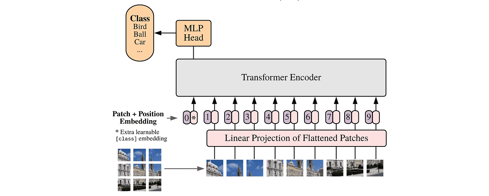

# [74일차] Vision Transformer와 번호판 숫자 분류 준비

## 1. Vision Transformer란?

Vision Transformer(ViT)는 자연어 처리에서 사용하던 Transformer 구조를 이미지 분류에 적용한 모델이다.

Transformer는 문장을 여러 개의 토큰으로 나누어 처리한다. ViT는 이 아이디어를 이미지에 적용하여, 이미지를 작은 패치(patch)로 나눈 뒤 각 패치를 하나의 토큰처럼 처리한다.

```text
문장
나는 / 오늘 / 공부를 / 한다
  ↓
단어 토큰의 연속

이미지
┌────┬────┐
│패치│패치│
├────┼────┤
│패치│패치│
└────┴────┘
  ↓
이미지 패치 토큰의 연속
```

ViT의 전체 흐름은 다음과 같다.

```text
입력 이미지
    ↓
이미지를 일정한 크기의 패치로 분할
    ↓
각 패치를 벡터로 변환
    ↓
분류용 [CLS] 토큰 추가
    ↓
위치 임베딩 추가
    ↓
Transformer Encoder 통과
    ↓
[CLS] 토큰의 출력 벡터 추출
    ↓
분류기에서 최종 클래스 예측
```



---

## 2. CNN과 ViT의 차이

CNN과 ViT는 모두 이미지를 처리하지만, 이미지의 특징을 찾는 방식이 다르다.

| 구분 | CNN | ViT |
|---|---|---|
| 기본 처리 단위 | 작은 커널이 보는 지역 영역 | 이미지 패치 |
| 핵심 연산 | 합성곱(Convolution) | Self-Attention |
| 특징 추출 방식 | 가까운 픽셀의 지역 특징부터 계층적으로 추출 | 패치 사이의 전체 관계를 직접 계산 |
| 위치 정보 | 합성곱 구조에 공간적 특성이 자연스럽게 포함됨 | 위치 임베딩을 별도로 더함 |
| 대표적인 장점 | 비교적 적은 데이터에서도 안정적으로 학습 가능 | 이미지의 멀리 떨어진 영역 사이 관계를 파악하기 쉬움 |
| 주의점 | 전역 관계를 학습하려면 여러 층이 필요함 | 토큰 수가 많아지면 Attention 계산량이 크게 증가함 |

CNN은 작은 필터를 움직이며 선, 모서리, 질감과 같은 지역 특징을 먼저 학습한다. 층이 깊어질수록 더 넓은 영역을 보면서 복잡한 특징을 만든다.

ViT는 이미지를 패치 단위로 나누고 Self-Attention을 사용하여 서로 다른 패치 사이의 관계를 계산한다. 따라서 이미지 왼쪽 위의 패치와 오른쪽 아래의 패치처럼 멀리 떨어진 영역도 한 번의 Attention 연산에서 직접 비교할 수 있다.

다만 ViT가 CNN보다 항상 좋은 것은 아니다. 데이터의 크기, 사전 학습 여부, 입력 해상도, 모델 크기 등에 따라 성능이 달라진다.

---

## 3. 이미지를 패치로 나누기

입력 이미지의 크기를 다음과 같이 정의한다.

- 이미지 높이: `H`
- 이미지 너비: `W`
- 채널 수: `C`
- 한 패치의 높이와 너비: `P`

이미지를 `P × P` 크기의 패치로 나누면 패치 개수 `N`은 다음과 같다.

```text
N = (H / P) × (W / P)
```

각 패치에 들어 있는 값의 개수는 다음과 같다.

```text
패치 하나의 원소 수 = P × P × C
```

### 224 × 224 이미지 예시

RGB 이미지의 크기가 `(3, 224, 224)`이고 패치 크기가 `16 × 16`이라면 다음과 같이 계산한다.

```text
가로 패치 수 = 224 / 16 = 14
세로 패치 수 = 224 / 16 = 14
전체 패치 수 = 14 × 14 = 196
```

분류용 `[CLS]` 토큰을 하나 추가하면 Transformer에 입력되는 전체 토큰 수는 `197`개가 된다.

```text
196개의 패치 토큰 + 1개의 [CLS] 토큰 = 197개의 토큰
```

### 패치 크기와 계산량

패치를 작게 나누면 이미지의 세부 정보를 더 자세히 볼 수 있지만 토큰 수가 증가한다.

Self-Attention은 모든 토큰 쌍의 관계를 계산하므로 토큰 수 `N`에 대해 대략 `O(N²)`의 계산량이 필요하다.

예를 들어 224 × 224 이미지에서 다음과 같은 차이가 발생한다.

| 패치 크기 | 패치 개수 | CLS 포함 토큰 수 |
|---|---:|---:|
| 32 × 32 | 49 | 50 |
| 16 × 16 | 196 | 197 |
| 8 × 8 | 784 | 785 |

패치 크기를 16에서 8로 절반으로 줄이면 토큰 수는 약 4배가 되고, Attention에서 비교하는 토큰 쌍은 약 16배가 된다. 따라서 작은 패치는 세부 표현에 유리하지만 메모리 사용량과 계산 시간이 크게 증가한다.

---

## 4. NumPy로 패치 분할 확인하기

먼저 작은 가상 이미지를 만들어 패치가 어떻게 분리되는지 확인한다.

```python
import numpy as np
import matplotlib.pyplot as plt

# 높이 8, 너비 8, RGB 채널 3개를 가진 가상 이미지다.
image = np.random.randint(0, 256, size=(8, 8, 3), dtype=np.uint8)

patch_size = 4
patches = []

# 4칸씩 이동하면서 4 × 4 크기의 패치를 잘라낸다.
for row in range(0, image.shape[0], patch_size):
    for col in range(0, image.shape[1], patch_size):
        patch = image[
            row : row + patch_size,
            col : col + patch_size,
        ]
        patches.append(patch)

patches = np.array(patches)

print("원본 이미지 크기:", image.shape)
print("패치 배열 크기:", patches.shape)
```

출력 결과는 다음과 같다.

```text
원본 이미지 크기: (8, 8, 3)
패치 배열 크기: (4, 4, 4, 3)
```

`8 × 8` 이미지를 `4 × 4` 크기로 나누었으므로 총 4개의 패치가 만들어진다.

```text
8 × 8 이미지

┌────────┬────────┐
│ 패치 1 │ 패치 2 │
│ 4 × 4  │ 4 × 4  │
├────────┼────────┤
│ 패치 3 │ 패치 4 │
│ 4 × 4  │ 4 × 4  │
└────────┴────────┘
```


이 예시는 패치 분할 원리를 눈으로 확인하기 위한 것이다. 실제 ViT에서는 패치를 따로 리스트에 저장하기보다 `Conv2d`를 이용해 분할과 임베딩을 한 번에 처리하는 방법을 많이 사용한다.

---

## 5. Patch Embedding

Transformer는 이미지 배열을 그대로 입력받지 않는다. 각 패치를 일정한 길이의 벡터로 바꾸어야 한다. 이 과정을 Patch Embedding이라고 한다.

### 기본 원리

패치 하나를 펼치면 다음 길이의 벡터가 된다.

```text
P × P × C
```

예를 들어 RGB 이미지에서 패치 크기가 `4 × 4`라면 다음과 같다.

```text
4 × 4 × 3 = 48
```

이 48차원 벡터를 선형 변환하여 모델이 사용할 임베딩 차원 `D`로 바꾼다.

```text
48차원 패치 벡터
       ↓ Linear
D차원 패치 임베딩
```

### Conv2d를 사용하는 이유

패치를 직접 자른 뒤 `flatten()`과 `Linear`를 적용할 수도 있지만, 다음과 같이 `Conv2d`를 사용하면 패치 분할과 선형 변환을 한 번에 처리할 수 있다.

```python
nn.Conv2d(
    in_channels=3,
    out_channels=embed_dim,
    kernel_size=patch_size,
    stride=patch_size,
)
```

`kernel_size`와 `stride`를 모두 패치 크기로 설정하므로 합성곱 영역이 서로 겹치지 않는다.

```text
kernel_size = 4
stride = 4

첫 번째 영역을 처리한 뒤 4칸 이동하므로
각 합성곱 결과가 하나의 패치 임베딩이 된다.
```

### PatchEmbedding 클래스

노트북의 클래스 이름은 `Patchembedding`으로 작성되어 있지만, 일반적인 파이썬 클래스 표기법에 맞추면 `PatchEmbedding`이 더 읽기 쉽다.

```python
import torch
import torch.nn as nn


class PatchEmbedding(nn.Module):
    def __init__(self, patch_size=4, in_channels=3, embed_dim=32):
        super().__init__()
        self.patch_size = patch_size

        self.proj = nn.Conv2d(
            in_channels=in_channels,
            out_channels=embed_dim,
            kernel_size=patch_size,
            stride=patch_size,
        )

    def forward(self, x):
        # 입력: (B, C, H, W)
        x = self.proj(x)
        # 결과: (B, D, H/P, W/P)

        x = x.flatten(2)
        # 결과: (B, D, N)

        x = x.transpose(1, 2)
        # 결과: (B, N, D)

        return x
```

각 기호의 의미는 다음과 같다.

| 기호 | 의미 |
|---|---|
| `B` | 배치 크기 |
| `C` | 입력 이미지 채널 수 |
| `H`, `W` | 입력 이미지의 높이와 너비 |
| `P` | 패치 크기 |
| `N` | 패치 개수 |
| `D` | 임베딩 차원 |

### 실행 예시

```python
x = torch.randn(1, 3, 8, 8)

patch_embedding = PatchEmbedding(
    patch_size=4,
    in_channels=3,
    embed_dim=32,
)

tokens = patch_embedding(x)

print("입력 크기:", x.shape)
print("패치 토큰 크기:", tokens.shape)
```

출력 결과는 다음과 같다.

```text
입력 크기: torch.Size([1, 3, 8, 8])
패치 토큰 크기: torch.Size([1, 4, 32])
```

출력 `(1, 4, 32)`의 의미는 다음과 같다.

```text
1  : 이미지 1장
4  : 4개의 패치
32 : 패치 하나를 표현하는 32차원 벡터
```

---

## 6. CLS 토큰

ViT는 이미지 전체의 정보를 모아 최종 분류에 사용할 특별한 토큰을 추가한다. 이를 `[CLS]` 토큰이라고 한다.

```text
패치 토큰만 있는 상태
[패치1] [패치2] [패치3] [패치4]

CLS 토큰을 추가한 상태
[CLS] [패치1] [패치2] [패치3] [패치4]
```

Transformer Encoder를 통과하는 동안 `[CLS]` 토큰은 Self-Attention을 통해 모든 패치 토큰의 정보를 참고한다. 마지막 Encoder 출력에서 `[CLS]`에 해당하는 벡터를 꺼내 분류기에 전달한다.

```python
B, N, D = tokens.shape

# 학습 가능한 CLS 토큰을 만든다.
cls_token = nn.Parameter(torch.zeros(1, 1, D))
nn.init.trunc_normal_(cls_token, std=0.02)

# 배치 크기에 맞게 확장한다.
cls_tokens = cls_token.expand(B, -1, -1)

# CLS 토큰을 패치 토큰의 맨 앞에 연결한다.
x = torch.cat([cls_tokens, tokens], dim=1)

print(x.shape)
```

패치가 4개라면 출력은 다음과 같다.

```text
torch.Size([1, 5, 32])
```

패치 토큰 4개에 `[CLS]` 토큰 1개가 추가되어 전체 토큰 수가 5개가 된다.

### nn.Parameter의 의미

`nn.Parameter`로 만든 값은 모델의 학습 가능한 파라미터로 등록된다. 따라서 `[CLS]` 토큰은 고정된 상수가 아니라 학습 과정에서 역전파를 통해 값이 갱신된다.

---

## 7. 위치 임베딩

Self-Attention 자체는 토큰의 입력 순서를 자동으로 이해하지 못한다. 패치의 위치가 다르더라도 같은 벡터라면 동일하게 처리할 수 있다.

이미지에서는 패치가 어디에 있는지가 중요하다.

```text
왼쪽 위 패치와 오른쪽 아래 패치는
내용이 같더라도 위치의 의미가 다를 수 있다.
```

따라서 각 토큰에 위치 정보를 나타내는 벡터를 더한다.

```python
B, N, D = tokens.shape

cls_token = nn.Parameter(torch.zeros(1, 1, D))
position_embedding = nn.Parameter(torch.zeros(1, N + 1, D))

nn.init.trunc_normal_(cls_token, std=0.02)
nn.init.trunc_normal_(position_embedding, std=0.02)

cls_tokens = cls_token.expand(B, -1, -1)
x = torch.cat([cls_tokens, tokens], dim=1)

# 토큰 임베딩과 위치 임베딩은 크기가 같으므로 원소별로 더한다.
x = x + position_embedding
```

```text
패치 내용 임베딩 + 위치 임베딩
             ↓
내용과 위치 정보를 함께 가진 토큰
```

이 코드의 위치 임베딩도 `nn.Parameter`이므로 학습 과정에서 데이터에 맞게 갱신된다.

---

## 8. Transformer Encoder 적용하기

패치 임베딩, `[CLS]` 토큰, 위치 임베딩까지 준비한 뒤 Transformer Encoder에 입력한다.

```python
encoder_layer = nn.TransformerEncoderLayer(
    d_model=D,
    nhead=4,
    dim_feedforward=D * 4,
    dropout=0.1,
    activation="gelu",
    batch_first=True,
    norm_first=True,
)

encoder = nn.TransformerEncoder(
    encoder_layer,
    num_layers=2,
    norm=nn.LayerNorm(D),
)

z = encoder(x)

print("Encoder 출력:", z.shape)
```

출력 결과는 다음과 같다.

```text
Encoder 출력: torch.Size([1, 5, 32])
```

Transformer Encoder를 통과해도 토큰 개수와 임베딩 차원은 유지된다.

### 주요 매개변수

| 매개변수 | 의미 |
|---|---|
| `d_model=D` | 토큰 하나의 임베딩 차원 |
| `nhead=4` | Multi-Head Attention의 Head 개수 |
| `dim_feedforward=D * 4` | Encoder 내부 Feed Forward Network의 은닉 차원 |
| `dropout=0.1` | 과적합을 줄이기 위해 일부 값을 무작위로 비활성화하는 비율 |
| `activation="gelu"` | Feed Forward Network에서 사용하는 활성화 함수 |
| `batch_first=True` | 입력 형태를 `(B, N, D)`로 사용 |
| `norm_first=True` | Attention과 Feed Forward 연산 전에 Layer Normalization 적용 |
| `num_layers=2` | Encoder Layer를 두 번 쌓음 |

### Multi-Head Attention

`nhead=4`는 32차원의 임베딩을 4개의 Head로 나누어 서로 다른 관점에서 토큰 관계를 학습한다는 뜻이다.

```text
전체 임베딩 차원: 32
Head 개수: 4
Head 하나의 차원: 32 / 4 = 8
```

각 Head가 찾은 관계를 다시 합쳐 최종 Attention 결과를 만든다.

### GELU

GELU는 Transformer 계열 모델에서 자주 사용하는 활성화 함수다. ReLU처럼 음수 값을 단순히 모두 0으로 만드는 방식과 달리 입력값의 크기에 따라 부드럽게 조절한다.

### norm_first=True 경고

실행 환경에 따라 다음과 비슷한 경고가 나타날 수 있다.

```text
enable_nested_tensor is True, but self.use_nested_tensor is False
because encoder_layer.norm_first was True
```

이 메시지는 코드가 실패했다는 오류가 아니라 내부 최적화 기능을 사용하지 못했다는 성능 관련 경고다. 출력이 정상적으로 생성되었다면 모델 구조의 실행 자체에는 문제가 없다.

---

## 9. CLS 출력으로 분류하기

Encoder 출력 `z`의 형태가 `(B, N + 1, D)`일 때 첫 번째 토큰은 `[CLS]` 토큰이다.

```python
cls_output = z[:, 0]

print(cls_output.shape)
```

```text
torch.Size([1, 32])
```

이 벡터를 분류기에 전달한다.

```python
classifier = nn.Linear(D, 10)
logits = classifier(cls_output)

prediction = logits.argmax(dim=1)

print("logits 크기:", logits.shape)
print("예측 클래스:", prediction.item())
```

노트북에서는 다음 형태의 결과가 확인된다.

```text
logits 크기: torch.Size([1, 10])
예측 클래스: 4
```

그러나 이 예측값을 실제 분류 결과로 해석하면 안 된다. 현재 예제는 무작위 입력과 학습하지 않은 무작위 가중치를 사용했기 때문이다.

```text
학습 전 예측 클래스 4
    ≠
모델이 이미지에서 숫자 4를 올바르게 인식함
```

이 단계의 목적은 모델 내부에서 텐서의 크기가 올바르게 연결되는지 확인하는 것이다.

---

## 10. ViT의 텐서 크기 변화

`8 × 8` RGB 이미지, 패치 크기 4, 임베딩 차원 32를 사용하는 예시를 한 번에 정리하면 다음과 같다.

| 단계 | 텐서 크기 | 설명 |
|---|---|---|
| 입력 이미지 | `(1, 3, 8, 8)` | 이미지 1장, RGB, 높이와 너비 8 |
| Conv2d 적용 | `(1, 32, 2, 2)` | 4개의 패치 위치마다 32차원 특징 생성 |
| `flatten(2)` | `(1, 32, 4)` | 공간 차원 `2 × 2`를 패치 축으로 펼침 |
| `transpose(1, 2)` | `(1, 4, 32)` | Transformer 입력 순서로 변경 |
| CLS 연결 | `(1, 5, 32)` | 패치 4개와 CLS 1개 |
| 위치 임베딩 추가 | `(1, 5, 32)` | 위치 정보 추가 |
| Transformer Encoder | `(1, 5, 32)` | 토큰 관계 학습 |
| CLS 추출 | `(1, 32)` | 이미지 전체 표현 |
| 선형 분류기 | `(1, 10)` | 10개 클래스의 logits |

`flatten()`과 `transpose()`가 왜 필요한지 헷갈릴 수 있다.

```text
Conv2d 출력
(B, D, H/P, W/P)

공간 축을 펼침
(B, D, N)

Transformer가 기대하는 형태로 순서 변경
(B, N, D)
```

---

## 11. 번호판 숫자 분류 데이터셋

노트북에서는 ViT의 구조를 확인한 뒤 자동차 번호판 이미지로 네 자리 숫자를 분류하기 위한 데이터를 살펴본다.

```python
import json
from pathlib import Path

DATA_ROOT = Path("./data/ViT")
ANNOTATION_PATH = DATA_ROOT / "annotations.json"
IMAGE_DIR = DATA_ROOT / "images"

with open(ANNOTATION_PATH, "r", encoding="utf-8") as file:
    annotations = json.load(file)

print("전체 데이터 수:", len(annotations))
print("첫 번째 데이터:", annotations[0])
```

확인된 결과는 다음과 같다.

```text
전체 데이터 수: 36828
첫 번째 데이터: {'filename': '21구2298.jpg', 'labels': '2298'}
```

하나의 데이터는 이미지 파일명과 네 자리 숫자 정답으로 구성된다.

```text
파일명: 21구2298.jpg
정답:   2298
```

이 문제에서는 번호판 문자열 전체를 예측하는 것이 아니라 Annotation에 저장된 마지막 네 자리 숫자를 분류 대상으로 사용한다.

---

## 12. 네 자리 숫자를 예측하는 Multi-Head Classification

네 자리 숫자 `2298`을 하나의 10,000개 클래스로 처리할 수도 있다.

```text
0000부터 9999까지 총 10,000개 클래스
```

하지만 노트북에서는 각 자리 숫자를 별도의 분류 문제로 나누는 Multi-Head Classification 구조를 사용하려 한다.

```text
공통 ViT Backbone
       │
       ├── Head 1: 첫 번째 자리 0~9 분류
       ├── Head 2: 두 번째 자리 0~9 분류
       ├── Head 3: 세 번째 자리 0~9 분류
       └── Head 4: 네 번째 자리 0~9 분류
```

정답이 `2298`이라면 각 Head의 정답은 다음과 같다.

| Head | 담당 위치 | 정답 클래스 |
|---|---|---:|
| Head 1 | 천의 자리 | 2 |
| Head 2 | 백의 자리 | 2 |
| Head 3 | 십의 자리 | 9 |
| Head 4 | 일의 자리 | 8 |

각 Head는 10개의 logits를 출력한다.

```text
Head 1 출력: (B, 10)
Head 2 출력: (B, 10)
Head 3 출력: (B, 10)
Head 4 출력: (B, 10)
```

### Multi-Label Classification과의 차이

이 문제는 여러 숫자가 동시에 등장하지만 일반적인 Multi-Label Classification과는 구분해야 한다.

- 각 자리에서는 `0~9` 중 하나만 정답이다.
- 네 개의 자리에 대해 각각 다중 클래스 분류를 수행한다.
- 따라서 네 개의 Cross Entropy Loss를 계산하는 Multi-Head Multi-Class Classification으로 이해하는 것이 정확하다.

### 분류 Head 구조 예시

다음은 노트북에서 설명한 구조를 코드로 표현한 예시다. 이 코드는 현재 노트북에서 아직 학습되지 않은 후속 구현 예시다.

```python
class FourDigitClassifier(nn.Module):
    def __init__(self, feature_dim):
        super().__init__()

        self.heads = nn.ModuleList([
            nn.Linear(feature_dim, 10)
            for _ in range(4)
        ])

    def forward(self, features):
        return [head(features) for head in self.heads]
```

각 자리의 손실을 계산한 뒤 더하거나 평균을 낼 수 있다.

```python
import torch.nn.functional as F


def calculate_loss(logits_list, labels):
    losses = []

    for position, logits in enumerate(logits_list):
        loss = F.cross_entropy(logits, labels[:, position])
        losses.append(loss)

    return sum(losses) / len(losses)
```

`labels`의 형태는 `(B, 4)`가 된다.

```text
예시 labels
[
    [2, 2, 9, 8],
    [1, 0, 3, 5],
    [7, 4, 2, 1],
]
```

---

## 13. 자리별 클래스 분포 확인

분류 모델을 학습하기 전에는 각 클래스의 데이터 수가 한쪽으로 지나치게 치우쳐 있는지 확인해야 한다.

노트북에서 확인한 자리별 숫자 분포는 다음과 같다.

| 숫자 | 첫째 자리 | 둘째 자리 | 셋째 자리 | 넷째 자리 |
|---:|---:|---:|---:|---:|
| 0 | 3,978 | 3,426 | 3,647 | 3,594 |
| 1 | 4,091 | 3,876 | 3,663 | 3,755 |
| 2 | 3,617 | 3,793 | 3,762 | 3,658 |
| 3 | 3,505 | 3,769 | 3,597 | 3,694 |
| 4 | 3,611 | 3,644 | 3,550 | 3,440 |
| 5 | 4,056 | 3,762 | 3,948 | 3,681 |
| 6 | 4,110 | 3,698 | 3,789 | 3,595 |
| 7 | 3,340 | 3,683 | 3,631 | 3,866 |
| 8 | 3,535 | 3,645 | 3,623 | 3,785 |
| 9 | 2,985 | 3,532 | 3,618 | 3,760 |

첫째 자리의 숫자 9가 다른 일부 숫자보다 적지만, 전체적으로 각 자리에 0부터 9까지의 데이터가 모두 존재한다.

클래스 분포를 확인하는 이유는 다음과 같다.

- 특정 숫자만 지나치게 많으면 모델이 그 숫자를 자주 예측할 수 있다.
- 정확도만 보면 소수 클래스의 낮은 성능을 놓칠 수 있다.
- 데이터 분할 후에도 Train과 Validation의 분포가 크게 달라지지 않았는지 확인할 필요가 있다.

---

## 14. Train과 Validation 데이터 분리

노트북에서는 전체 데이터의 90%를 학습 데이터, 10%를 검증 데이터로 나눈다.

```python
import random

SEED = 2026
random.seed(SEED)

indices = list(range(len(annotations)))
random.shuffle(indices)

split_index = int(len(indices) * 0.9)

train_indices = indices[:split_index]
val_indices = indices[split_index:]

print("Train 데이터 수:", len(train_indices))
print("Validation 데이터 수:", len(val_indices))
```

출력 결과는 다음과 같다.

```text
Train 데이터 수: 33145
Validation 데이터 수: 3683
```

### SEED를 고정하는 이유

`random.shuffle()`은 실행할 때마다 순서를 무작위로 섞는다. `SEED`를 고정하면 같은 코드를 다시 실행했을 때 동일한 Train과 Validation 구성을 재현할 수 있다.

```text
같은 데이터 + 같은 SEED
          ↓
같은 데이터 분할 결과
```

이는 모델 구조나 하이퍼파라미터를 비교할 때 중요하다. 데이터 분할이 매번 바뀌면 성능 차이가 모델 때문인지 데이터 구성 때문인지 판단하기 어려워진다.

### 데이터 누수 주의

동일한 번호판을 여러 각도나 시점에서 촬영한 이미지가 존재한다면 단순한 이미지 단위 무작위 분할로 같은 차량의 이미지가 Train과 Validation에 동시에 포함될 수 있다.

이 경우 Validation 성능이 실제보다 높게 측정될 가능성이 있다. 데이터에 동일 차량이나 동일 번호판의 반복 이미지가 있는지 확인하고, 있다면 차량 또는 번호판 단위로 그룹을 나누는 방법을 고려해야 한다.

---

## 15. 사용할 ViT 모델 이름 이해하기

노트북 마지막에는 다음 모델 이름이 제시되어 있다.

```text
vit_small_patch16_224
```

이 이름은 일반적으로 다음 정보를 나타낸다.

| 이름 일부 | 의미 |
|---|---|
| `vit` | Vision Transformer |
| `small` | 모델 크기 구분 |
| `patch16` | 이미지를 16 × 16 패치로 분할 |
| `224` | 기본 입력 이미지 크기 224 × 224 |

224 × 224 이미지를 16 × 16 패치로 나누므로 패치 수는 196개다.

```text
224 / 16 = 14
14 × 14 = 196
CLS 토큰 추가 후 전체 토큰 수 = 197
```

번호판 이미지의 원본 크기가 모델 입력 크기와 다르다면 데이터 전처리 과정에서 크기를 맞춰야 한다.

다만 번호판은 가로로 긴 이미지이므로 단순히 정사각형으로 강제 변형하면 숫자의 모양이 찌그러질 수 있다. 실제 모델을 구성할 때는 다음 방법을 비교할 수 있다.

- 이미지를 224 × 224로 직접 조정한다.
- 종횡비를 유지한 채 빈 영역을 Padding으로 채운다.
- 번호판 영역의 특성에 맞는 입력 해상도와 Patch Embedding을 직접 설계한다.

현재 노트북에서는 모델 이름만 제시되어 있으며, 모델 생성과 학습 코드는 아직 포함되어 있지 않다.

---

## 16. 번호판 분류 모델의 예상 처리 흐름

현재까지 확인한 내용을 바탕으로 전체 학습 흐름을 정리하면 다음과 같다.

```text
번호판 이미지
    ↓
Resize, Tensor 변환, Normalize
    ↓
ViT Patch Embedding
    ↓
CLS 토큰과 위치 임베딩 추가
    ↓
Transformer Encoder
    ↓
CLS 특징 벡터
    ↓
┌────────┬────────┬────────┬────────┐
│ Head 1 │ Head 2 │ Head 3 │ Head 4 │
│ 0~9    │ 0~9    │ 0~9    │ 0~9    │
└────────┴────────┴────────┴────────┘
    ↓
네 자리 숫자 조합
```

예측 결과가 다음과 같다면 최종 문자열을 이어 붙인다.

```text
Head 1 예측: 2
Head 2 예측: 2
Head 3 예측: 9
Head 4 예측: 8

최종 예측: "2298"
```

---

## 17. 평가 지표 설계

네 자리 숫자 분류는 단순히 하나의 정확도만 계산하기보다 자리별 성능과 전체 번호판 성능을 함께 확인하는 것이 좋다.

### 1. 자리별 정확도

각 위치의 숫자를 얼마나 정확히 맞혔는지 계산한다.

```text
첫째 자리 정확도
둘째 자리 정확도
셋째 자리 정확도
넷째 자리 정확도
```

자리마다 이미지 특징이나 데이터 분포가 다를 수 있으므로 특정 위치에서만 성능이 낮은지 확인할 수 있다.

### 2. 전체 숫자 정확도

모든 자리의 예측을 독립적으로 모아 맞힌 숫자 수의 비율을 계산한다.

```text
정답: 2298
예측: 2293

4자리 중 3자리 정답
숫자 단위 정확도 = 3 / 4 = 75%
```

### 3. 번호판 완전 일치 정확도

네 자리를 모두 맞힌 경우에만 정답으로 처리한다.

```text
정답 2298, 예측 2298 → 정답
정답 2298, 예측 2293 → 오답
```

이 지표는 실제 번호판 인식 서비스의 성공 여부와 더 가까운 기준이다. 숫자 단위 정확도가 높더라도 한 자리만 틀리면 번호판 전체는 잘못된 결과이므로 두 지표를 함께 확인해야 한다.

---

## 18. 현재 노트북에 포함된 범위

현재 `8_ViT.ipynb`에 포함된 내용은 다음과 같다.

- ViT의 기본 개념
- CNN과 ViT의 처리 방식 비교
- 이미지 패치 분할
- `Conv2d`를 이용한 Patch Embedding
- `[CLS]` 토큰과 위치 임베딩
- PyTorch Transformer Encoder 적용
- CLS 출력 기반 10개 클래스 분류 예시
- 번호판 데이터 Annotation 확인
- 네 자리 숫자용 Multi-Head Classification 개념
- 각 자리 숫자의 클래스 분포 확인
- Train과 Validation 9:1 분리
- 사용할 모델 이름 `vit_small_patch16_224` 확인

다음 내용은 아직 노트북에 구현되어 있지 않다.

- 번호판 이미지 전처리 파이프라인
- PyTorch `Dataset`과 `DataLoader`
- 사전 학습 ViT 모델 불러오기
- 네 개의 분류 Head 연결
- 손실 함수와 Optimizer 설정
- 학습 및 검증 반복문
- 모델 가중치 저장과 불러오기
- 자리별 정확도와 번호판 완전 일치 정확도 계산
- 별도 Test 데이터 평가

따라서 현재 단계는 ViT의 핵심 원리와 번호판 데이터 구조를 이해하고, 실제 학습을 위한 데이터를 준비하는 단계라고 볼 수 있다.

---

## 19. 핵심 정리

1. ViT는 이미지를 작은 패치로 나누고 각 패치를 Transformer의 토큰처럼 처리한다.
2. Patch Embedding은 패치를 일정한 차원의 벡터로 변환하는 과정이다.
3. `Conv2d`의 `kernel_size`와 `stride`를 패치 크기로 설정하면 패치 분할과 임베딩을 한 번에 수행할 수 있다.
4. `[CLS]` 토큰은 모든 패치 정보를 모아 이미지 분류에 사용하는 특별한 학습 가능 토큰이다.
5. 위치 임베딩은 각 패치가 이미지의 어느 위치에 있었는지를 모델에 전달한다.
6. Self-Attention은 패치 사이의 전역 관계를 학습하지만 토큰 수에 대해 계산량이 제곱으로 증가한다.
7. 번호판 네 자리 숫자는 공통 ViT 특징을 네 개의 분류 Head에 전달하여 자리별로 예측할 수 있다.
8. 각 Head는 0부터 9까지 하나를 고르는 다중 클래스 분류 문제다.
9. 모델 평가는 자리별 정확도와 네 자리 완전 일치 정확도를 함께 확인해야 한다.
10. 현재 노트북은 ViT 구조 실습과 데이터 준비까지 진행되었으며 실제 모델 학습과 평가는 다음 단계에서 구현해야 한다.
