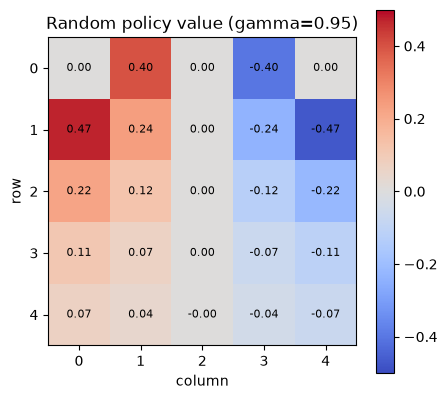

# [79일차] 몬테카를로 방법과 격자 환경의 정책 반복

같은 환경이라도 어떤 행동 규칙을 따르는지에 따라 상태의 가치가 달라진다. **정책 평가(Policy Evaluation)** 는 현재 행동 규칙의 가치를 계산하고, **정책 개선(Policy Improvement)** 은 계산한 가치를 이용해 더 좋은 행동을 선택한다.

이번에는 Home/Bar 환경의 완성된 가치 계산 코드를 확인하고, 실제 경험으로 가치를 추정하는 몬테카를로 방법을 살펴본다. 이어서 5×5 격자의 무작위 정책을 평가하고, 평가와 개선을 반복해 Home으로 향하는 정책을 만드는 과정을 정리한다.

> 마르코프 성질, MP·MRP·MDP, 할인 리턴, 벨만 기대 방정식의 기본 원리는 78일차에서 정리했으므로 중복 설명은 제외한다. Home/Bar 환경은 이번에 추가된 구현과 결과를 중심으로 다룬다.

---

## 1. Home/Bar 환경의 구현 조건

현재 노트북의 과제 설명에는 보상 `+10/-10`, 할인율 `0.9`라고 적혀 있지만, **완성된 코드는 보상 `+1/-1`, 할인율 `1`로 계산한다.** 아래 결과는 실제 코드의 조건을 기준으로 한다.

| 항목 | 구현에서 사용하는 값 |
| --- | --- |
| 상태 | `Home`, `A`, `B`, `C`, `Bar` |
| 종료 상태 | `Home`, `Bar` |
| Home에 도착할 때 보상 | `+1` |
| Bar에 도착할 때 보상 | `-1` |
| 일반 이동 보상 | `0` |
| 할인율 | `1` — 다음 상태 가치에 별도 할인 계수를 곱하지 않음 |

이 환경에서는 학생이 이동 방향을 직접 선택하지 않는다. 주어진 전이 확률에 따라 이동하므로, 행동을 개선하는 MDP가 아니라 **고정된 전이 규칙을 평가하는 MRP**에 해당한다.

```python
import numpy as np

STATES = ["Home", "A", "B", "C", "Bar"]

NEXT = {
    "A": [("Home", 0.7), ("B", 0.3)],
    "B": [("A", 0.5), ("C", 0.5)],
    "C": [("B", 0.5), ("Bar", 0.5)],
}

TERMINAL = {"Home", "Bar"}


def arrival_reward(next_state):
    return (
        1.0 if next_state == "Home"
        else -1.0 if next_state == "Bar"
        else 0.0
    )
```

`NEXT[state]`에는 다음 상태와 그 상태로 이동할 확률이 들어 있다. `arrival_reward()`는 **도착한 상태**를 기준으로 보상을 반환한다.

---

## 2. 상태가치의 반복 갱신

상태가치를 모두 `0`으로 시작한 뒤, 다음 상태의 가치를 이용해 반복 갱신한다.

```python
V = {state: 0.0 for state in STATES}

for iteration in range(1, 101):
    new_V = V.copy()

    for state in ["A", "B", "C"]:
        new_V[state] = sum(
            prob * (arrival_reward(nxt) + V[nxt])
            for nxt, prob in NEXT[state]
        )

    delta = max(abs(new_V[s] - V[s]) for s in STATES)
    V = new_V

    if iteration in [1, 2, 5, 10, 20, 50, 100]:
        print(
            f"{iteration:3d}회: "
            f"A={V['A']:+.4f}, "
            f"B={V['B']:+.4f}, "
            f"C={V['C']:+.4f}"
        )

    if delta < 1e-12:
        break

assert np.allclose(
    [V["A"], V["B"], V["C"]],
    [0.75, 1 / 6, -5 / 12],
    atol=1e-6,
)
```

실행 결과:

```text
  1회: A=+0.7000, B=+0.0000, C=-0.5000
  2회: A=+0.7000, B=+0.1000, C=-0.5000
  5회: A=+0.7420, B=+0.1400, C=-0.4300
 10회: A=+0.7487, B=+0.1650, C=-0.4188
 20회: A=+0.7500, B=+0.1666, C=-0.4167
 50회: A=+0.7500, B=+0.1667, C=-0.4167
```

### `V.copy()`를 사용하는 이유

한 번의 반복에서 모든 상태는 **이전 반복의 가치**를 기준으로 계산해야 한다. `V`를 읽고 `new_V`에 결과를 저장하면 A를 먼저 계산했는지, C를 먼저 계산했는지에 따라 같은 회차의 계산이 섞이지 않는다. 이를 동기식 갱신이라고 한다.

### 수렴 여부 확인하기

`delta`는 한 번 갱신한 뒤 상태가치가 가장 많이 변한 정도다. 이 값이 `1e-12`보다 작아지면 반복을 끝낸다.

`np.allclose()`는 계산 결과가 기대한 값과 허용 오차 범위 안에서 가까운지 확인한다. `assert`는 조건이 거짓이면 `AssertionError`를 발생시킨다. 부동소수점 계산에서는 정확한 `==`보다 이런 비교가 적합하다.

---

## 3. 최종 상태가치 해석

| 상태 | 최종 가치 | 의미 |
| --- | ---: | --- |
| A | `0.7500` | Home으로 바로 갈 확률이 높아 가장 유리함 |
| B | `0.1667` | A와 C 양쪽의 영향을 받으며 약한 양수 가치를 가짐 |
| C | `-0.4167` | Bar로 바로 갈 위험이 있어 음수 가치를 가짐 |
| Home, Bar | `0` | 도착 보상을 받은 이후에는 추가 보상이 없음 |

종료 상태의 가치가 `0`이어도 Home과 Bar의 영향이 사라지는 것은 아니다. **도착 순간의 보상**이 이전 상태의 가치 계산에 반영된다.

```text
V(A) = 0.7 × 1 + 0.3 × V(B)
V(B) = 0.5 × V(A) + 0.5 × V(C)
V(C) = 0.5 × V(B) + 0.5 × (-1)
```

이 식들을 만족하는 값이 `0.75`, `1/6`, `-5/12`다. 따라서 이 환경의 A 가치는 `0.5`가 아니라 **`0.75`**다. 노트북의 몬테카를로 설명에 적힌 `0.5`는 이 전이 규칙과 맞지 않는다.

---

## 4. 몬테카를로 방법

몬테카를로(Monte Carlo) 방법은 무작위 실험을 반복하고, 관측한 결과의 평균으로 기댓값을 추정하는 방법이다.

Home/Bar 환경에서 A부터 출발해 한 번 끝까지 걸어 본다고 하자. Home에 도착하면 `+1`, Bar에 도착하면 `-1`을 기록한다. 이 실험을 여러 번 반복한 평균이 A의 가치 추정값이 된다.

```text
A에서 출발한 5번의 에피소드

종료 위치: Home, Home, Bar, Home, Home
리턴:       +1,   +1,  -1,   +1,   +1

평균 리턴 = (1 + 1 - 1 + 1 + 1) / 5 = 0.6
```

표본이 5개뿐이면 실제 기대 가치와 차이가 날 수 있다. 독립적인 에피소드를 많이 모으면 표본 평균이 실제 기대 가치에 가까워지는 경향이 있다.

```text
가치 추정값 = 관측한 리턴의 합 / 에피소드 수
```

이번 환경은 일반 이동 보상이 `0`이고 할인율이 `1`이다. 따라서 한 에피소드의 리턴은 마지막에 받는 `+1` 또는 `-1`과 같다.

---

## 5. 몬테카를로 에피소드 구현

```python
def random_walk_episode(start, rng):
    state = start

    while state not in TERMINAL:
        options, probs = zip(*NEXT[state])
        state = str(rng.choice(options, p=probs))

    return arrival_reward(state)
```

`zip(*NEXT[state])`는 다음 상태와 확률을 분리한다. A에서 시작하면 다음처럼 나뉜다.

```text
NEXT["A"] = [("Home", 0.7), ("B", 0.3)]

options = ("Home", "B")
probs   = (0.7, 0.3)
```

`rng.choice(options, p=probs)`는 해당 확률에 따라 다음 상태 하나를 뽑는다. `Home` 또는 `Bar`에 도착할 때까지 이동하고, 마지막 보상을 반환한다.

```python
rng = np.random.default_rng(2026)

for start in ["A", "B", "C"]:
    scores = [
        random_walk_episode(start, rng)
        for _ in range(10000)
    ]

    print(
        f"{start}: 몬테카를로 평균={np.mean(scores):+.4f} | "
        f"벨만 계산={V[start]:+.4f}"
    )
```

실행 결과:

```text
A: 몬테카를로 평균=+0.7488 | 벨만 계산=+0.7500
B: 몬테카를로 평균=+0.1860 | 벨만 계산=+0.1667
C: 몬테카를로 평균=-0.4152 | 벨만 계산=-0.4167
```

> 원본 출력 코드는 `V[state]`를 사용해 세 행 모두 C의 가치를 출력한다. 위 코드는 비교 대상을 `V[start]`로 수정한 뒤 재실행한 결과다.

B의 표본 평균은 이론값과 조금 다르지만, 10,000번의 유한한 표본에서 발생할 수 있는 오차다. 시드를 고정하면 재현할 수 있으며, 시드를 바꾸면 평균값도 달라진다.

---

## 6. 전이 모델 계산과 몬테카를로 비교

| 항목 | 전이 모델을 이용한 반복 평가 | 몬테카를로 평가 |
| --- | --- | --- |
| 계산 재료 | 알려진 전이 확률과 보상 | 실행하며 관측한 리턴 |
| 계산 방식 | 가능한 결과를 확률로 가중 평균함 | 여러 에피소드의 리턴을 평균함 |
| 종료까지 실제 실행 | 필요 없음 | 이 예제에서는 필요함 |
| 전이 확률 필요 여부 | 평가 계산에 필요함 | 가치 추정 자체에는 필요 없음 |
| 특징 | 모델 기반 계산 | 경험 기반 추정 |

이번 몬테카를로 코드도 환경을 모의 실행하기 위해 `NEXT`의 전이 확률을 사용한다. 하지만 **가치를 추정하는 단계**는 전이 확률을 직접 계산하지 않고, 에피소드에서 받은 보상의 평균만 사용한다. 실제 환경이 다음 상태와 보상을 제공한다면 추정기는 전이 확률을 몰라도 된다.

벨만 방정식 자체가 특정 모델 기반 알고리즘을 뜻하는 것은 아니다. 여기서는 전이 모델을 알고 그 식으로 모든 결과를 합산하는 방법과, 표본 경험으로 추정하는 방법을 비교한다.

---

## 7. 5×5 격자 환경

다음 실습에서는 에이전트가 행동을 직접 선택할 수 있는 격자 환경으로 확장한다.

```text
         column
         0    1    2    3    4
row 0   Home  .    .    .   Bar
    1     .   .    .    .    .
    2     .   .    .    .    .
    3     .   .    .    .    .
    4     .   .    .    .    .
```

| 항목 | 규칙 |
| --- | --- |
| 상태 | 좌표 `(row, column)`으로 표현하는 25개 칸 |
| 행동 | `up`, `down`, `left`, `right` |
| Home | `(0, 0)`, 도착 시 `+1` |
| Bar | `(0, 4)`, 도착 시 `-1` |
| 일반 이동 | 보상 `0` |
| 격자 밖 이동 | 현재 칸에 머무름 |
| 종료 | Home 또는 Bar 도착 즉시 종료 |
| 할인율 | `0.95` |

```python
SIZE = 5
HOME = (0, 0)
BAR = (0, 4)
GAMMA = 0.95

ACTIONS = {
    "up": (-1, 0),
    "down": (1, 0),
    "left": (0, -1),
    "right": (0, 1),
}

ACTION_NAMES = ["up", "down", "left", "right"]
ARROWS = {"up": "↑", "down": "↓", "left": "←", "right": "→", None: "·"}
```

---

## 8. `grid_step()`으로 이동 처리하기

`grid_step()`은 현재 상태와 행동을 받아 다음 상태, 보상, 종료 여부를 반환한다.

```python
def grid_step(state, action):
    if state in (HOME, BAR):
        return state, 0.0, True

    dr, dc = ACTIONS[action]
    row, col = state

    next_state = (
        min(max(row + dr, 0), SIZE - 1),
        min(max(col + dc, 0), SIZE - 1),
    )

    if next_state == HOME:
        reward = 1.0
    elif next_state == BAR:
        reward = -1.0
    else:
        reward = 0.0

    done = next_state in (HOME, BAR)
    return next_state, reward, done
```

`min(max(...))`는 좌표를 `0`부터 `SIZE - 1` 사이로 제한한다. 이 격자에서 한 칸씩 이동할 때 벽 밖으로 향한 행동은 제자리 이동이 된다.

```python
samples = [
    ((1, 0), "up"),
    ((0, 1), "left"),
    ((0, 3), "right"),
    ((2, 0), "left"),
    ((0, 0), "down"),
]

for state, action in samples:
    nxt, reward, done = grid_step(state, action)
    print(f"{state} + {action:5s} -> {nxt}, 보상={reward:+.0f}, 종료={done}")
```

실행 결과:

```text
(1, 0) + up    -> (0, 0), 보상=+1, 종료=True
(0, 1) + left  -> (0, 0), 보상=+1, 종료=True
(0, 3) + right -> (0, 4), 보상=-1, 종료=True
(2, 0) + left  -> (2, 0), 보상=+0, 종료=False
(0, 0) + down  -> (0, 0), 보상=+0, 종료=True
```

이미 종료된 상태에서 함수를 호출하면 보상은 다시 주지 않는다. 따라서 Home에 도착한 뒤 `+1`을 계속 받는 상황이 생기지 않는다.

---

## 9. 무작위 정책 평가

무작위 정책은 네 행동을 각각 `0.25` 확률로 선택한다. 한 칸의 가치는 네 행동으로 얻는 보상과 다음 가치의 **평균**이다.

```text
한 칸의 가치 = 네 방향의 [즉시 보상 + 할인된 다음 가치] 평균
```

```python
def evaluate_random_policy(gamma=GAMMA, tol=1e-10, max_iter=10000):
    values = np.zeros((SIZE, SIZE))

    for iteration in range(max_iter):
        updated = values.copy()

        for row in range(SIZE):
            for col in range(SIZE):
                state = (row, col)
                if state in (HOME, BAR):
                    continue

                action_values = []
                for action in ACTION_NAMES:
                    nxt, reward, done = grid_step(state, action)
                    future = 0.0 if done else values[nxt]
                    action_values.append(reward + gamma * future)

                updated[state] = np.mean(action_values)

        delta = np.max(np.abs(updated - values))
        values = updated

        if delta < tol:
            return values, iteration + 1

    raise RuntimeError("랜덤 정책 평가가 수렴하지 않음")
```

### 종료 상태의 가치가 0인 이유

`values`는 처음부터 모두 `0`이다. 종료 상태는 `continue`로 갱신을 건너뛰므로 계속 `0`을 유지한다. 일반 칸에서 종료 칸으로 이동할 때는 `future = 0.0`으로 미래 보상을 제외한다.

```text
일반 칸 -> Home: +1 + gamma × 0
Home 이후: 추가 보상 없음
```

보상 `+1`과 종료 상태의 가치 `0`은 서로 다른 의미다.

---

## 10. 무작위 정책의 가치 표와 히트맵

```python
def show_values(values, digits=3):
    print(np.array2string(
        np.round(values, digits),
        formatter={"float_kind": lambda x: f"{x:7.{digits}f}"},
    ))


random_values, random_iters = evaluate_random_policy()
print("gamma=0.95 반복 횟수:", random_iters)
show_values(random_values)
```

실행 결과:

```text
gamma=0.95 반복 횟수: 109
[[  0.000   0.401   0.000  -0.401   0.000]
 [  0.470   0.236   0.000  -0.236  -0.470]
 [  0.219   0.124   0.000  -0.124  -0.219]
 [  0.110   0.065   0.000  -0.065  -0.110]
 [  0.069   0.042  -0.000  -0.042  -0.069]]
```



이미지는 노트북에 저장된 실제 히트맵 출력이다. 붉은색은 양수, 푸른색은 음수 가치를 나타낸다.

- 왼쪽은 Home의 긍정적 보상 영향이 커서 양수다.
- 오른쪽은 Bar의 부정적 보상 영향이 커서 음수다.
- 가운데 열은 좌우 대칭인 환경과 균등 정책에서 두 영향이 상쇄되어 `0`이다.
- 출력의 `-0.000`은 계산 오차에 따른 매우 작은 음수를 반올림한 표기다.

이 표는 **무작위로 이동할 때의 가치**다. 이후 좋은 행동을 골라 이동하면 같은 칸도 더 높은 가치를 가질 수 있다.

---

## 11. 할인율을 0.5로 낮추기

```python
low_values, low_iters = evaluate_random_policy(gamma=0.5)
print("gamma=0.5 반복 횟수:", low_iters)
show_values(low_values)
```

실행 결과:

```text
gamma=0.5 반복 횟수: 25
[[  0.000   0.297   0.000  -0.297   0.000]
 [  0.303   0.077   0.000  -0.077  -0.303]
 [  0.047   0.016   0.000  -0.016  -0.047]
 [  0.007   0.003   0.000  -0.003  -0.007]
 [  0.001   0.001   0.000  -0.001  -0.001]]
```

이번 환경에서는 양수·음수의 위치가 유지되면서 절댓값이 작아진다. 특히 종료 칸에서 멀리 떨어진 상태는 보상을 받기까지 많은 이동이 필요해 더 크게 할인된다.

같은 수렴 기준에서 반복 횟수도 `109회 → 25회`로 줄었다. 작은 할인율은 다음 상태 가치가 현재 계산에 미치는 영향을 줄이므로, 이 실험에서는 더 빠르게 수렴한다.

---

## 12. 정책 개선을 위한 행동별 점수

정책 개선은 현재 가치 표를 이용해 각 칸에서 더 좋은 행동을 고르는 과정이다. 네 행동의 점수를 구한 뒤 최댓값을 고른다.

```python
def action_scores(state, values, gamma=GAMMA):
    scores = []

    for action in ACTION_NAMES:
        nxt, reward, done = grid_step(state, action)
        future = 0.0 if done else values[nxt]
        scores.append(reward + gamma * future)

    return scores
```

이 환경에서는 행동 결과가 결정적이므로 `reward + gamma * future`만으로 각 행동의 기대 가치를 계산할 수 있다.

```python
for action, score in zip(
    ACTION_NAMES,
    action_scores((1, 4), random_values),
):
    print(f"{action:5s} {score:.3f}")
```

실행 결과:

```text
up    -1.000
down  -0.208
left  -0.224
right -0.446
```

`(1, 4)`에서 위로 가면 즉시 Bar에 도착한다. 현재 무작위 정책의 가치로 계산했을 때는 아래쪽 점수 `-0.208`이 가장 높으므로 `down`을 선택한다.

네 점수가 모두 음수여도 가장 큰 값을 고르면 된다. `-0.208`은 `-1.000`보다 좋은 기대 결과다.

---

## 13. 탐욕적 정책 만들기

```python
def greedy_policy_from(values, gamma=GAMMA):
    policy = np.empty((SIZE, SIZE), dtype=object)

    for row in range(SIZE):
        for col in range(SIZE):
            state = (row, col)
            if state in (HOME, BAR):
                policy[state] = None
            else:
                scores = action_scores(state, values, gamma)
                policy[state] = ACTION_NAMES[int(np.argmax(scores))]

    return policy


def show_policy(policy):
    for row in range(SIZE):
        print(" ".join(ARROWS[policy[row, col]] for col in range(SIZE)))


one_step_policy = greedy_policy_from(random_values)
show_policy(one_step_policy)
```

실행 결과:

```text
· ← ← ← ·
↑ ← ← ← ↓
↑ ↑ ← ← ↓
↑ ↑ ← ← ←
↑ ← ← ← ←
```

화살표는 해당 칸에서 선택할 행동이고, `·`는 종료 상태다. 문자열과 `None`을 저장하기 위해 정책 배열에 `dtype=object`를 사용한다.

`np.argmax()`는 가장 큰 값이 여러 개면 처음 등장한 인덱스를 반환한다. 따라서 점수가 정확히 같으면 `up → down → left → right` 순서 중 먼저 있는 행동을 고른다.

한 번의 개선은 **무작위 정책의 가치**를 기준으로 한다. 새 화살표대로 계속 이동할 때의 가치는 다시 계산해야 하므로, 한 번 개선했다고 정책 반복을 끝낸 것은 아니다.

---

## 14. 고정된 정책 평가하기

이제 각 칸에 화살표가 하나씩 정해졌다. 네 행동의 평균을 구하는 대신, 그 화살표가 가리키는 행동 하나만 이용해 가치를 계산한다.

```python
def evaluate_policy(policy, gamma=GAMMA, tol=1e-10, max_iter=10000):
    values = np.zeros((SIZE, SIZE))

    for iteration in range(max_iter):
        updated = values.copy()

        for row in range(SIZE):
            for col in range(SIZE):
                state = (row, col)
                if state in (HOME, BAR):
                    continue

                nxt, reward, done = grid_step(state, policy[state])
                future = 0.0 if done else values[nxt]
                updated[state] = reward + gamma * future

        delta = np.max(np.abs(updated - values))
        values = updated

        if delta < tol:
            return values, iteration + 1

    raise RuntimeError("정책 평가가 수렴되지 않았음")
```

| 평가 대상 | 가치 갱신 방식 |
| --- | --- |
| 균등 무작위 정책 | 네 행동의 점수를 평균함 |
| 결정적 정책 | 정해진 행동 하나의 점수를 사용함 |

---

## 15. 정책 반복 구현

정책 반복(Policy Iteration)은 정책 평가와 정책 개선을 번갈아 수행한다.

```text
초기 정책 설정
      ↓
정책 평가: 현재 화살표를 따르는 가치 계산
      ↓
정책 개선: 가치에 따라 더 좋은 화살표 선택
      ↓
이전 정책과 같은가?
  ├─ 아니오: 새 정책을 다시 평가
  └─ 예: 종료
```

```python
def policies_equal(left, right):
    return all(
        left[r, c] == right[r, c]
        for r in range(SIZE)
        for c in range(SIZE)
    )


def policy_iteration(gamma=GAMMA, max_outer=20):
    policy = np.full((SIZE, SIZE), "right", dtype=object)
    policy[HOME] = None
    policy[BAR] = None

    for outer in range(1, max_outer + 1):
        values, eval_iters = evaluate_policy(policy, gamma=gamma)
        improved = greedy_policy_from(values, gamma=gamma)

        print(f"바깥 {outer}회 | 평가 반복={eval_iters}")
        show_policy(improved)

        if policies_equal(policy, improved):
            return values, improved, outer

        policy = improved

    raise RuntimeError("정책 반복이 끝나지 않음")
```

`evaluate_policy()` 내부 반복은 **현재 정책의 가치가 수렴했는지** 확인한다. `policy_iteration()`의 바깥 반복은 **정책 자체가 바뀌는지** 확인한다. 두 반복은 종료 기준이 다르다.

처음에는 모든 일반 칸에서 `right`를 선택한다. 오른쪽 끝에서 계속 벽을 향하는 정책도 생길 수 있지만, 보상이 유한하고 `gamma=0.95`이므로 그 정책의 가치 평가도 안정적으로 수렴한다.

---

## 16. 정책 반복 결과

```python
pi_values, pi_policy, pi_rounds = policy_iteration()

print("정책 반복 최종 가치")
show_values(pi_values)

print("정책 반복 최종 정책")
show_policy(pi_policy)

print("정책 반복 횟수:", pi_rounds)
```

실행 중 정책 평가 반복 횟수는 다음과 같다. 각 회차에는 개선된 정책도 함께 출력된다.

```text
바깥 1회 | 평가 반복=4
바깥 2회 | 평가 반복=5
바깥 3회 | 평가 반복=7
바깥 4회 | 평가 반복=8
바깥 5회 | 평가 반복=9
바깥 6회 | 평가 반복=9
```

최종 실행 결과:

```text
정책 반복 최종 가치
[[  0.000   1.000   0.950   0.902   0.000]
 [  1.000   0.950   0.902   0.857   0.815]
 [  0.950   0.902   0.857   0.815   0.774]
 [  0.902   0.857   0.815   0.774   0.735]
 [  0.857   0.815   0.774   0.735   0.698]]

정책 반복 최종 정책
· ← ← ← ·
↑ ↑ ↑ ↑ ←
↑ ↑ ↑ ↑ ↑
↑ ↑ ↑ ↑ ↑
↑ ↑ ↑ ↑ ↑

정책 반복 횟수: 6
```

최종 정책은 Bar를 피하면서 Home으로 향한다. 5번째 개선 결과와 6번째 결과가 같아, 6번째 바깥 반복에서 정책이 안정되었다고 판단한다.

### 무작위 정책과 최종 정책 비교

| 상태 | 무작위 정책 가치 | 최종 정책 가치 |
| --- | ---: | ---: |
| `(0, 1)` | `0.401` | `1.000` |
| `(1, 4)` | `-0.470` | `0.815` |
| `(4, 4)` | `-0.069` | `0.698` |

무작위 이동에서는 Bar 근처가 불리하지만, 좋은 행동을 선택할 수 있다면 Bar를 피해 Home에 도착할 수 있다. 따라서 같은 좌표의 가치도 정책 개선 후 양수로 바뀐다.

### 최종 가치가 `gamma`의 거듭제곱인 이유

이번 격자는 이동이 결정적이고 일반 이동 보상이 `0`이다. 최종 정책에서 Home까지 `d`번 이동하면 마지막 이동에서만 `+1`을 받는다.

```text
V(s) = gamma^(d - 1)

한 번 이동해 Home: 1
두 번 이동해 Home: 0.95
세 번 이동해 Home: 0.95² = 0.9025
여덟 번 이동해 Home: 0.95⁷ ≈ 0.6983
```

첫 번째 이동의 보상에는 할인 지수 `0`이 붙으므로, 지수는 `d`가 아니라 `d - 1`이다. 가치 표의 숫자를 이동 거리와 연결하면 결과를 더 쉽게 해석할 수 있다.

---

## 17. 핵심 정리

1. Home/Bar 완성 코드는 보상 `+1/-1`, 할인율 `1`을 사용하며 A, B, C의 가치는 `0.75`, `1/6`, `-5/12`로 수렴한다.
2. 몬테카를로는 종료까지 실행한 에피소드의 리턴을 평균해 가치를 추정한다.
3. 전이 모델로 계산한 기대 가치와 경험으로 추정한 평균은 표본 오차를 고려해 비교해야 한다.
4. 격자의 `grid_step()`은 이동, 경계 처리, 도착 보상, 종료 여부를 한곳에서 처리한다.
5. 무작위 정책 평가는 네 행동을 각각 25%로 선택한 기댓값을 구한다.
6. 종료 상태의 가치 `0`과 종료 칸에 도착할 때 받는 보상은 구분해야 한다.
7. 정책 개선은 현재 가치 표로 행동별 점수를 구하고 가장 큰 행동을 고른다.
8. 정책 반복은 평가와 개선을 번갈아 수행하며, 정책이 바뀌지 않으면 끝난다.
9. 이번 실행에서는 정책 반복이 6회에 끝났고, 모든 일반 칸에서 Bar를 피해 Home으로 이동하는 정책을 얻었다.
