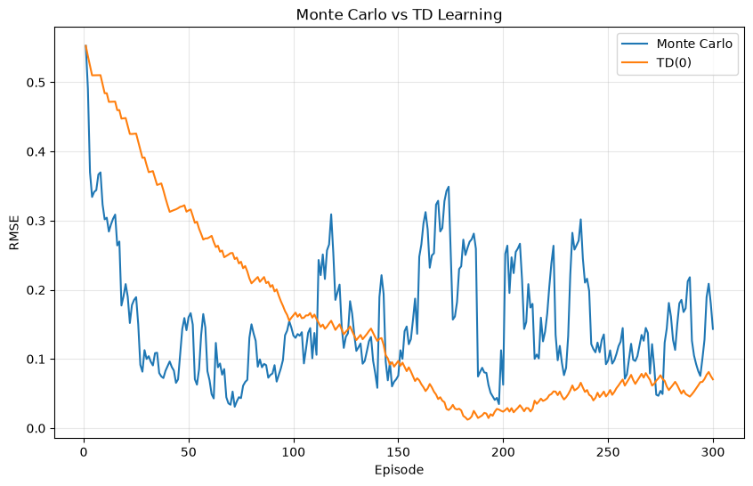
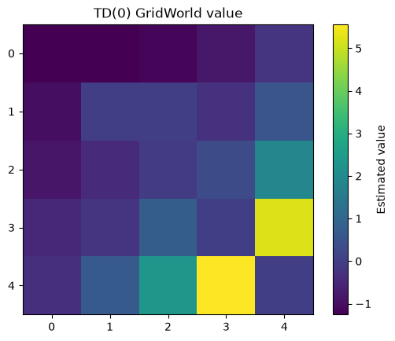
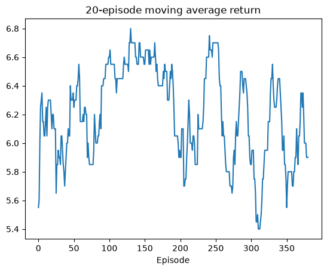

# [80일차] 모델 프리 강화학습과 TD Learning, Q-Learning

모델 프리(Model-Free) 강화학습은 환경의 전이 확률과 보상 규칙을 미리 계산에 넣는 대신, **실제로 얻은 경험으로 가치나 정책을 학습하는 방식**이다.

이번에는 한 번 이동한 직후 상태가치를 수정하는 TD Learning을 살펴본다. 이어서 MC와 TD를 같은 Random Walk 환경에서 비교하고, 장애물 격자에서 상태가치를 학습한다. 마지막으로 상태와 행동을 함께 평가하는 Q-Learning으로 목표까지 이동하는 정책을 만든다.

> 몬테카를로의 기본 개념과 모델을 이용한 정책 평가·정책 반복은 79일차에서 정리했다. 여기서는 새로 추가된 TD 학습과 Q-Learning을 중심으로 다룬다.

---

## 1. 모델 프리 학습에서 사용하는 경험

79일차의 정책 반복은 각 행동의 다음 상태와 보상을 계산할 수 있는 모델을 이용했다. 모델 프리 학습에서는 다음과 같은 전이 경험을 받아 값을 갱신한다.

```text
현재 상태 s
    ↓ 행동 a
다음 상태 s', 보상 r, 종료 여부
    ↓
경험을 이용해 V(s) 또는 Q(s, a) 갱신
```

모델 프리라는 말은 환경 자체의 규칙이 없다는 뜻이 아니다. 이번에도 환경 클래스가 이동과 보상을 계산하지만, **학습기는 전이 확률표를 모두 펼쳐 계산하지 않고 경험한 결과를 사용한다.**

노트북은 NumPy, Matplotlib, PyTorch 등을 불러오고 사용 장치를 선택한다. 저장된 장치 출력은 `mps`다. 다만 이번 실습의 학습 코드는 NumPy 배열을 이용하며, 신경망이나 PyTorch 장치를 실제 학습에 사용하지 않는다.

아래 예제는 다음 두 모듈로 실행할 수 있다.

```python
import numpy as np
import matplotlib.pyplot as plt

SEED = 2026
```

---

## 2. TD Learning이 필요한 이유

몬테카를로는 에피소드가 끝난 뒤 실제 리턴을 계산한다. 하지만 미로나 게임이 길어지면 최종 결과를 얻기까지 오래 기다려야 한다.

**TD(Temporal-Difference) Learning**은 한 번 이동해서 얻은 보상과 다음 상태의 추정 가치를 이용해 현재 상태가치를 바로 수정한다. 여기서 다루는 방식은 한 단계 경험을 사용하는 **TD(0)** 다.

```text
현재 V(A) = 3
A에서 B로 이동하며 보상 1 획득
현재 V(B) = 5
할인율 gamma = 0.9

새 목표 = 1 + 0.9 × 5 = 5.5
목표와 기존 값의 차이 = 5.5 - 3 = 2.5
학습률 alpha = 0.1

새 V(A) = 3 + 0.1 × 2.5 = 3.25
```

한 번의 경험으로 기존 값 `3`을 바로 `5.5`로 바꾸는 대신, 차이의 일부만 반영한다.

---

## 3. TD Target, TD Error, 학습률

```text
TD Target = r + gamma × V(s')
TD Error = TD Target - V(s)
V(s) ← V(s) + alpha × TD Error
```

| 항목 | 의미 | 예제 값 |
| --- | --- | ---: |
| `V(s)` | 현재 상태의 기존 가치 추정값 | 3 |
| `r` | 이동 직후 받은 보상 | 1 |
| `V(s')` | 다음 상태의 기존 가치 추정값 | 5 |
| `gamma` | 미래 가치를 할인하는 비율 | 0.9 |
| `alpha` | 새 경험의 오차를 반영하는 비율 | 0.1 |
| TD Target | 이번 갱신에서 사용하는 목표 | 5.5 |
| TD Error | 목표와 기존 추정값의 차이 | 2.5 |

```python
v_a, v_b = 3.0, 5.0
reward, gamma, alpha = 1.0, 0.9, 0.1

target = reward + gamma * v_b
td_error = target - v_a
new_v_a = v_a + alpha * td_error

print(f"목표={target:.2f}, 오차={td_error:.2f}, 수정된 V(A)={new_v_a:.2f}")
```

실행 결과:

```text
목표=5.50, 오차=2.50, 수정된 V(A)=3.25
```

`gamma`는 미래 보상을 평가하는 기준이고, `alpha`는 현재 추정값을 수정하는 크기다. 두 값의 역할은 다르다.

### 부트스트래핑

목표 `5.5`는 실제 미래 보상을 끝까지 관찰해 얻은 정답이 아니다. 현재 알고 있는 `V(B)=5`라는 추정값으로 만든 목표다. 이렇게 **추정값을 사용해 다른 추정값을 갱신하는 것**을 부트스트래핑(Bootstrapping)이라고 한다.

다음 상태가 종료 상태라면 이후 보상이 없으므로 다음 상태의 가치 대신 `0`을 사용한다.

---

## 4. 몬테카를로와 TD(0) 비교

| 비교 항목 | 몬테카를로 | TD(0) |
| --- | --- | --- |
| 갱신 시점 | 에피소드 종료 후 | 한 번의 전이 직후 |
| 학습 목표 | 실제로 관찰한 리턴 `G` | `r + gamma × V(s')` |
| 부트스트래핑 | 사용하지 않음 | 사용함 |
| 긴 에피소드 | 끝날 때까지 기다림 | 진행 중에도 학습 가능 |
| 주의점 | 에피소드 결과에 따라 목표의 변동이 클 수 있음 | 다음 상태의 추정 오차가 목표에 반영될 수 있음 |

둘 다 표본 경험을 이용하는 모델 프리 가치 학습 방법이다. 어느 방법이 더 좋은지는 환경, 학습률, 경험 수 등에 따라 달라진다.

---

## 5. 7개 상태의 Random Walk

MC와 TD를 같은 경험으로 비교하기 위해 1차원 환경을 사용한다.

```text
종료                                         종료
 0  ↔  1  ↔  2  ↔  3  ↔  4  ↔  5  ↔  6
보상 0              시작 위치                 도착 보상 +1
```

| 항목 | 설정 |
| --- | --- |
| 시작 상태 | 항상 3 |
| 행동 | 왼쪽 또는 오른쪽, 각각 50% |
| 일반 이동 보상 | 0 |
| 0 도착 | 보상 0, 종료 |
| 6 도착 | 보상 +1, 종료 |
| 에피소드 수 | 300 |
| 학습률 | 0.05 |
| 할인율 | 1.0 |
| 가치 초기값 | 모두 0 |

비종료 상태 `s=1,...,5`에서 오른쪽 종료 지점에 먼저 도착할 확률은 `s/6`이다. 보상이 마지막 `+1` 또는 `0`뿐이고 할인율이 `1`이므로, 이 확률이 해당 상태의 참 가치가 된다.

```text
상태:   1       2       3       4       5
참값:  1/6     2/6     3/6     4/6     5/6
```

---

## 6. 에피소드 생성하기

```python
def random_walk_episode(rng):
    state = 3
    transitions = []

    while state not in (0, 6):
        action = rng.choice([-1, 1])
        nxt = state + action
        done = nxt in (0, 6)
        reward = 1.0 if nxt == 6 else 0.0

        transitions.append((state, reward, nxt, done))
        state = nxt

    return transitions
```

각 경험은 `(현재 상태, 보상, 다음 상태, 종료 여부)`로 저장된다. 같은 에피소드 기록을 MC와 TD에 전달하므로, 두 알고리즘은 동일한 이동 경험으로 학습한다.

---

## 7. MC와 TD 학습 구현

```python
def compare_mc_td(episodes=300, alpha=0.05):
    rng = np.random.default_rng(SEED)
    mc = np.zeros(7)
    td = np.zeros(7)
    mc_errors, td_errors = [], []
    truth = np.arange(1, 6) / 6

    for _ in range(episodes):
        path = random_walk_episode(rng)

        # TD(0): 한 단계 보상과 다음 상태 가치로 갱신한다.
        for s, r, nxt, done in path:
            target = r + (0.0 if done else td[nxt])
            td[s] += alpha * (target - td[s])

        # MC: 끝에서부터 리턴을 계산해 방문한 상태를 갱신한다.
        G = 0.0
        for s, r, nxt, done in reversed(path):
            G = r + G
            mc[s] += alpha * (G - mc[s])

        mc_errors.append(np.sqrt(np.mean((mc[1:6] - truth) ** 2)))
        td_errors.append(np.sqrt(np.mean((td[1:6] - truth) ** 2)))

    return mc, td, mc_errors, td_errors
```

이 함수는 할인율 `1`을 식에 그대로 반영하므로 별도로 `gamma`를 곱하지 않는다.

### MC에서 역순으로 계산하는 이유

```text
경로: 3 -> 4 -> 5 -> 6
보상:    0    0    1

역순 계산
5에서의 리턴: 1
4에서의 리턴: 0 + 1 = 1
3에서의 리턴: 0 + 1 = 1
```

`G = r + G`는 뒤에서 구한 리턴에 현재 보상을 더한다. 일반적인 할인율을 사용한다면 `G = r + gamma * G`가 된다.

이 구현은 한 에피소드에서 같은 상태를 여러 번 방문하면 각 방문에 대해 갱신한다. 또한 고정 학습률 `0.05`를 사용하므로, 모든 과거 리턴의 단순 산술평균이 아니라 새 리턴을 일정 비율로 반영하는 추정이다.

### TD 갱신 시점 읽기

비교 함수는 먼저 경로를 생성한 다음, 경로를 시간순으로 읽어 TD 갱신을 수행한다. 코드 실행상으로는 경로 생성 후 처리하지만, **각 갱신 목표에는 최종 리턴을 쓰지 않고 해당 전이의 보상과 다음 상태 추정값만 사용한다.** 노트북 앞쪽의 반복문 구현은 이동 직후 TD 값을 갱신하는 방식으로 작성되어 있으며 결과는 같다.

---

## 8. RMSE와 학습 결과

RMSE(Root Mean Squared Error)는 추정값과 참값의 차이를 제곱해 평균한 뒤 제곱근을 취한 지표다.

```text
RMSE = sqrt(mean((추정 가치 - 참 가치)²))
```

작을수록 참 가치에 가깝다. 예를 들어 RMSE가 `0.02`인 MC와 `0.01`인 TD를 비교하면 **TD의 오차가 더 작다.**

```python
mc_v, td_v, mc_err, td_err = compare_mc_td()
truth = np.arange(1, 6) / 6

print("참값:", np.round(truth, 3))
print("MC  :", np.round(mc_v[1:6], 3))
print("TD  :", np.round(td_v[1:6], 3))
print(f"MC Final RMSE: {mc_err[-1]:.4f}")
print(f"TD Final RMSE: {td_err[-1]:.4f}")
```

실행 결과:

```text
참값: [0.167 0.333 0.5   0.667 0.833]
MC  : [0.181 0.491 0.715 0.828 0.907]
TD  : [0.237 0.412 0.542 0.76  0.891]
MC Final RMSE: 0.1435
TD Final RMSE: 0.0705
```



노트북에 저장된 실제 그래프다. 이번 시드와 학습 조건에서는 300회 종료 시 TD의 전체 RMSE가 더 작았다. TD가 다음 상태의 추정 정보를 재사용하는 점이 학습에 도움이 될 수 있지만, 이 한 번의 결과로 TD가 언제나 더 좋다고 단정할 수는 없다. 개별 상태마다 더 정확한 알고리즘도 다를 수 있다.

그래프 초반에는 MC의 오차가 더 빠르게 줄어드는 구간이 있다. 반면 후반에는 TD가 비교적 작은 오차를 유지한다. 따라서 '처음에 얼마나 빨리 가까워지는가'와 '300회 뒤 어느 쪽이 더 정확한가'를 구분해야 한다. 원본의 MC 우위 설명을 전체 학습 과정에 일반화하지 않고, 실제 그래프와 최종 수치를 함께 해석해야 한다.

### 종료 상태의 참값 표기

원본의 전체 표는 `np.arange(7) / 6`을 참값으로 사용해 상태 6에 `1`을 출력한다. 그러나 이 실습은 **6으로 들어가는 순간 +1을 받고 종료**하므로, 이미 종료된 상태 6에서의 미래 리턴은 `0`이다.

`s/6`을 가치 비교에 사용하는 범위는 비종료 상태 1~5다. 코드의 RMSE도 `values[1:6]`만 사용하므로 이 종료 상태 표기 문제는 RMSE 결과에 영향을 주지 않는다.

---

## 9. 장애물이 있는 GridWorld

다음 실습은 5×5 격자에서 TD(0)로 **무작위 정책의 상태가치**를 추정한다.

```text
S  .  .  .  .
.  #  #  .  .
.  .  .  .  .
.  .  .  #  .
.  .  .  .  G

S: 시작 (0, 0)
G: 목표 (4, 4)
#: 장애물
```

| 항목 | 설정 |
| --- | --- |
| 장애물 | `(1, 1)`, `(1, 2)`, `(3, 3)` |
| 행동 | 상·하·좌·우 무작위 |
| 목표 도착 보상 | +10 |
| 일반 이동·이동 실패 보상 | -0.1 |
| 에피소드 이동 한도 | 100회 |
| 학습 횟수 | 2,000에피소드 |
| 학습률 / 할인율 | 0.08 / 0.95 |

벽이나 격자 밖으로 이동하려 하면 현재 위치에 머무른다. 이동하지 못해도 이동 횟수가 늘고 `-0.1` 보상이 적용된다.

---

## 10. GridWorld 클래스 구현

```python
class GridWorld:
    ACTIONS = [(-1, 0), (1, 0), (0, -1), (0, 1)]

    def __init__(self, size=5, walls=((1, 1), (1, 2), (3, 3)), max_steps=100):
        self.size = size
        self.walls = set(walls)
        self.goal = (size - 1, size - 1)
        self.start = (0, 0)
        self.max_steps = max_steps
        assert self.goal not in self.walls and self.start not in self.walls
        self.reset()

    def reset(self):
        self.pos = self.start
        self.steps = 0
        return self.pos

    def step(self, action):
        dr, dc = self.ACTIONS[action]
        r, c = self.pos
        candidate = (r + dr, c + dc)

        if (
            0 <= candidate[0] < self.size
            and 0 <= candidate[1] < self.size
            and candidate not in self.walls
        ):
            self.pos = candidate

        self.steps += 1
        terminated = self.pos == self.goal
        truncated = self.steps >= self.max_steps and not terminated
        reward = 10.0 if terminated else -0.1

        return self.pos, reward, terminated, truncated
```

`reset()`은 새 에피소드를 시작하고, `step()`은 한 번의 행동 결과를 반환한다.

| 반환값 | 의미 |
| --- | --- |
| `self.pos` | 다음 위치 |
| `reward` | 이번 행동에서 얻은 보상 |
| `terminated` | 목표 도착으로 환경이 종료되었는가 |
| `truncated` | 목표 도착 전에 이동 한도로 실행을 중단했는가 |

---

## 11. TD 학습과 종료 처리

```python
env = GridWorld()
V = np.zeros((env.size, env.size))
alpha, gamma = 0.08, 0.95
rng = np.random.default_rng(SEED)

for episode in range(2000):
    state = env.reset()

    while True:
        action = int(rng.integers(4))
        nxt, reward, terminated, truncated = env.step(action)

        bootstrap = 0.0 if terminated else V[nxt]
        V[state] += alpha * (reward + gamma * bootstrap - V[state])

        state = nxt
        if terminated or truncated:
            break

print("랜덤 정책 아래 추정된 V(s):")
print(np.round(V, 2))
```

실행 결과:

```text
랜덤 정책 아래 추정된 V(s):
[[-1.23 -1.26 -1.16 -0.82 -0.19]
 [-1.02  0.    0.   -0.27  0.56]
 [-0.84 -0.45 -0.06  0.31  1.9 ]
 [-0.5  -0.21  0.74  0.    5.2 ]
 [-0.33  0.69  2.36  5.57  0.  ]]
```

### `terminated`와 `truncated`의 차이

목표에 도착했다면 이후 보상이 없으므로 부트스트래핑 값을 `0`으로 둔다. 이동 한도에 도달했을 때는 실행을 중단하지만, 이 코드는 그 위치에서 이어갈 미래 가치를 그대로 사용한다.

```text
목표 도착: target = 10 + gamma × 0
일반 이동: target = -0.1 + gamma × V(다음 위치)
시간 제한: target 계산에는 다음 가치를 쓰고, 현재 에피소드만 중단
```

이는 100회 제한을 데이터 수집을 위한 중단으로 취급하기 때문이다. 만약 '100회 안에 도착하기' 자체가 문제의 목표라면 남은 시간도 상태에 포함하고 종료 정의를 맞춰야 한다.

---

## 12. 격자 상태가치 히트맵 해석



노트북의 실제 출력 이미지다. 목표 근처는 짧은 시간 안에 `+10`을 받을 가능성이 높아 가치가 크다. 먼 곳에서는 무작위 이동으로 시간을 보내며 `-0.1`이 반복되고, 목표 보상도 할인되므로 가치가 낮아질 수 있다.

장애물 근처에서는 우회하거나 제자리 이동을 할 가능성이 있어 상태가치에 영향을 준다. 다만 이 결과는 유한한 경험으로 추정한 값이며, 모든 칸이 목표까지의 거리만으로 정확하게 정렬되는 것은 아니다.

장애물의 `0`은 학습으로 얻은 중립적 가치가 아니다. 방문할 수 없어 초기값이 남은 것이다. 목표의 `0`은 도착 보상을 받은 뒤의 미래 보상이 없다는 의미다.

또한 행동을 계속 무작위로 선택했으므로, 이 실습이 학습한 것은 **랜덤 정책의 가치**다. 아직 최적 경로를 학습한 것은 아니다.

---

## 13. Q-Learning으로 행동 선택하기

`V(s)`는 상태의 유리함을 평가한다. 다음 상태와 보상을 계산할 모델이 없다면 상태가치만으로는 어느 행동이 더 나은지 직접 비교하기 어렵다.

`Q(s, a)`는 상태와 행동을 함께 평가하므로 각 행동의 점수를 비교할 수 있다.

```text
V(A) = 5
    -> A라는 상태의 가치

Q(A, 왼쪽) = 2
Q(A, 오른쪽) = 8
    -> 오른쪽이 더 좋은 행동이라고 판단 가능
```

Q-Learning은 경험으로 **최적 행동가치 `Q*`**에 가까운 값을 학습하는 것을 목표로 한다.

---

## 14. Q-Learning의 갱신식

```text
목표 = r + gamma × max_a' Q(s', a')
오차 = 목표 - Q(s, a)
Q(s, a) ← Q(s, a) + alpha × 오차
```

다음 상태에서 선택할 수 있는 행동 중 가장 높은 Q값을 목표에 사용한다. 종료 상태라면 다음 상태의 최대 Q값 대신 `0`을 사용한다.

```python
q_old = 0.0
reward, alpha, gamma = 10.0, 0.1, 0.9
max_next_q = 0.0

q_new = q_old + alpha * (reward + gamma * max_next_q - q_old)
print("새 Q(3, 오른쪽):", q_new)
```

실행 결과:

```text
새 Q(3, 오른쪽): 1.0
```

즉시 보상으로 `10`을 얻었지만, 학습률이 `0.1`이므로 첫 갱신에서는 Q가 `1`이 된다.

| 구분 | 이번 TD(0) 상태가치 평가 | Q-Learning |
| --- | --- | --- |
| 학습 대상 | 정해진 정책의 `V(s)` | 최적 행동가치를 목표로 하는 `Q(s, a)` |
| 다음 가치 | 경험한 다음 상태의 `V(s')` | 다음 상태 행동들의 최대 Q값 |
| 활용 | 현재 정책의 상태가치 평가 | Q를 비교해 행동 선택 |

Q-Learning도 TD 오차와 부트스트래핑을 사용하는 **TD 기반 방법**이다. TD와 Q-Learning을 완전히 별개의 알고리즘 계열로 구분하는 것은 부정확하다.

---

## 15. 5개 위치의 Q 테이블

```text
S -- 1 -- 2 -- 3 -- G
0                   4

왼쪽: 행동 0
오른쪽: 행동 1
목표 도착: +10
그 외 행동: -1
```

Q 테이블은 상태 5개와 행동 2개를 저장하므로 Shape이 `(5, 2)`다. 각 에피소드는 0에서 시작하며 최대 30회 이동한다.

행동은 `epsilon=0.2`의 epsilon-greedy 전략으로 선택한다. 탐험할 때는 무작위 행동을, 활용할 때는 현재 최대 Q를 가진 행동을 선택한다.

```text
최대 Q값이 동점이면 해당 행동들 중 무작위 선택
```

모든 Q값이 0인 초기 상태에서 `argmax()`만 사용하면 첫 번째 행동인 왼쪽에 편향될 수 있다. 동점 행동을 무작위로 고르면 이 초기 편향을 줄일 수 있다.

---

## 16. Q-Learning 구현

```python
def train_line_q(episodes=400, epsilon=0.2, alpha=0.3, gamma=0.9):
    rng = np.random.default_rng(SEED)
    Q = np.zeros((5, 2))
    rewards = []

    for ep in range(episodes):
        state = 0
        total = 0

        for step in range(30):
            if rng.random() < epsilon:
                action = int(rng.integers(2))
            else:
                best = np.flatnonzero(Q[state] == Q[state].max())
                action = int(rng.choice(best))

            nxt = int(np.clip(
                state + (-1 if action == 0 else 1), 0, 4
            ))
            done = nxt == 4
            reward = 10 if done else -1
            target = reward + (0.0 if done else gamma * np.max(Q[nxt]))

            Q[state, action] += alpha * (target - Q[state, action])
            total += reward
            state = nxt

            if done:
                break

        rewards.append(total)

    return Q, np.asarray(rewards)
```

`np.flatnonzero()`는 조건이 참인 인덱스를 반환한다. Q값이 `[0, 0]`이라면 후보는 `[0, 1]`이며, `rng.choice()`가 하나를 뽑는다.

`np.clip()`은 다음 위치를 0~4 안으로 제한한다. 왼쪽 끝에서 왼쪽 행동을 선택하면 제자리에 머무르지만, 목표 도착이 아니므로 `-1` 보상을 받는다.

학습 중에는 탐험으로 최선이 아닌 행동을 할 수 있다. 그러나 목표 계산은 다음 상태의 최대 Q값을 사용한다. 행동을 만드는 전략과 목표가 가정하는 행동이 달라질 수 있어 Q-Learning을 **오프폴리시(Off-Policy)** 방법이라고 한다.

---

## 17. 학습 결과와 정책

```python
Q, line_returns = train_line_q()

print("Q 테이블 (왼쪽, 오른쪽):")
print(np.round(Q, 2))
print("학습된 정책:", [
    "←" if a == 0 else "→"
    for a in Q[:4].argmax(axis=1)
])
```

실행 결과:

```text
Q 테이블 (왼쪽, 오른쪽):
[[ 3.12  4.58]
 [ 3.12  6.2 ]
 [ 4.58  8.  ]
 [ 6.2  10.  ]
 [ 0.    0.  ]]
학습된 정책: ['→', '→', '→', '→']
```

모든 비종료 위치에서 오른쪽 Q값이 더 크다. 목표에 도착하는 최단 행동 방향을 학습한 것이다. 종료 위치 4는 행동하지 않으므로 Q가 0으로 유지된다.

오른쪽 행동의 가치는 다음처럼 거꾸로 계산해 확인할 수 있다.

```text
상태 3: 목표에 바로 도착 -> 10
상태 2: -1 + 0.9 × 10 = 8
상태 1: -1 + 0.9 × 8 = 6.2
상태 0: -1 + 0.9 × 6.2 = 4.58
```

목표 보상만 있는 문제가 아니라 일반 이동마다 `-1`이 있으므로, 이전 격자 예제의 `gamma` 거듭제곱만으로는 이 값을 계산할 수 없다.

---

## 18. 20에피소드 이동평균 보상

```python
moving_average = np.convolve(
    line_returns,
    np.ones(20) / 20,
    mode="valid",
)

plt.plot(moving_average)
plt.title("20-episode moving average return")
plt.xlabel("Episode")
plt.show()
```



노트북에 저장된 실제 그래프다. 연속된 20개 에피소드의 보상 합계를 평균 내 단일 에피소드의 변동을 완화한다. `mode="valid"`이므로 20개의 값이 모두 존재하는 구간만 계산해, 400개 보상에서 381개의 평균이 만들어진다.

이 출력 코드는 평균의 배열 인덱스를 가로축으로 사용한다. 첫 점은 1~20번째 에피소드의 평균이며, 실제 종료 에피소드 번호는 20이다.

최단 경로는 일반 이동 3번과 목표 도착 1번이므로 보상 합계가 `-1 -1 -1 +10 = 7`이다. 학습 중에는 탐험이 계속되어 평균 보상이 항상 7이 되지는 않는다.

또한 그래프의 `total`은 **할인하지 않은 보상 합계**다. Q 테이블의 상태 0 오른쪽 값 `4.58`은 할인율 `0.9`를 적용한 미래 보상이므로 두 숫자는 의미가 다르다.

---

## 19. 핵심 정리

1. 모델 프리 학습은 전이 확률표를 직접 계산하는 대신 경험으로 가치를 학습한다.
2. TD(0)는 보상과 다음 상태 추정값으로 목표를 만들고, TD 오차의 일부를 반영한다.
3. 부트스트래핑은 현재 추정값을 사용해 다른 추정값을 갱신하는 방식이다.
4. MC는 에피소드의 리턴을, TD는 한 단계 보상과 다음 가치 추정값을 사용한다.
5. 이번 Random Walk 실험에서 최종 RMSE는 MC `0.1435`, TD `0.0705`였다.
6. 격자 TD 실습은 최적 정책이 아니라 무작위 정책의 상태가치를 학습한다.
7. 목표 도착과 시간 제한 중단을 구분해 다음 가치를 반영한다.
8. Q-Learning은 다음 상태의 최대 Q값을 목표에 사용하며, TD 기반의 오프폴리시 학습 방법이다.
9. 학습된 1차원 정책은 모든 비종료 상태에서 오른쪽을 선택한다.
10. 에피소드 보상 합계, 할인 리턴, 상태가치, 행동가치는 서로 구분해서 해석해야 한다.
