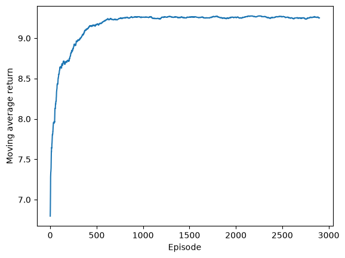
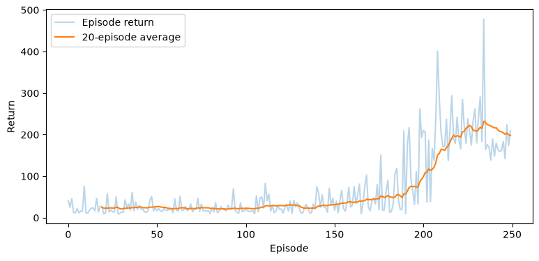

# [81일차] SARSA와 DQN으로 배우는 딥강화학습

표 형태의 Q-Learning은 상태 수가 적을 때 이해하기 쉽다. 하지만 실제 환경처럼 관측값이 연속적이고 상태 조합이 많아지면 모든 상태의 Q값을 표로 저장하기 어렵다. **DQN(Deep Q-Network)** 은 이 문제를 신경망의 함수 근사로 다룬다.

이번에는 80일차 이후 추가된 SARSA로 실제 탐험 행동을 반영하는 학습을 확인한다. 이어서 Q-Table의 한계, 경험 재생, 타깃 신경망, DQN과 Double DQN의 갱신식을 살펴보고 CartPole의 학습·평가 결과를 해석한다.

> 범위는 `3_강화학습_모델프리.ipynb`의 SARSA와 `4_딥강화학습.ipynb`의 Policy Gradient 제목 전까지다. Policy Gradient부터는 82일차에서 이어서 다룬다.

---

## 1. SARSA: 실제로 선택한 다음 행동으로 학습하기

SARSA는 **State → Action → Reward → next State → next Action**에서 이름을 가져왔다. 현재 상태와 행동의 Q값을 갱신할 때, 다음 상태에서 실제로 선택한 행동의 Q값을 사용한다.

```text
목표 = r + gamma × Q(s', a')
Q(s, a) ← Q(s, a) + alpha × [목표 - Q(s, a)]
```

| 구분 | Q-Learning | SARSA |
| --- | --- | --- |
| 다음 행동의 값 | 다음 상태의 최대 Q값 | 실제로 고른 다음 행동의 Q값 |
| 목표 | `r + gamma * max Q(s', a')` | `r + gamma * Q(s', a')` |
| 정책 관계 | 오프폴리시 | 온폴리시 |

예를 들어 보상이 `1`, 할인율이 `0.9`이고 다음 상태의 최대 Q값은 `10`이지만 탐험으로 고른 행동의 Q값은 `2`라면 다음과 같다.

```text
Q-Learning 목표 = 1 + 0.9 × 10 = 10
SARSA 목표      = 1 + 0.9 × 2  = 2.8
```

SARSA는 탐험을 포함한 현재 행동 선택 정책을 평가·개선한다. 절벽 옆처럼 탐험 행동이 위험한 환경에서는 그 위험이 학습된 가치에 반영될 수 있다. 다만 SARSA가 모든 환경에서 더 안전하거나 성능이 높다는 뜻은 아니다.

---

## 2. 격자 환경에서 SARSA 구현

이 실습은 80일차의 `GridWorld` 클래스를 사용한다. 클래스 정의를 먼저 실행해야 한다.

| 항목 | 설정 |
| --- | --- |
| 격자 / 시작 / 목표 | 5×5 / `(0, 0)` / `(4, 4)` |
| 장애물 | `(1, 1)`, `(1, 2)`, `(3, 3)` |
| 목표 / 일반 이동 보상 | `+10` / `-0.1` |
| 에피소드 이동 한도 | 100회 |
| 학습 횟수 | 3,000에피소드 |
| 학습률 / 할인율 | `0.15` / `0.95` |
| Q 테이블 Shape | `[5, 5, 4]` — 행, 열, 행동 |

```python
import numpy as np
import matplotlib.pyplot as plt

SEED = 2026


def train_grid_sarsa(episodes=3000):
    rng = np.random.default_rng(SEED)
    env = GridWorld()
    Q = np.zeros((env.size, env.size, 4))
    history = []

    def choose_action(state, epsilon):
        if rng.random() < epsilon:
            return int(rng.integers(4))

        values = Q[state]
        best = np.flatnonzero(values == values.max())
        return int(rng.choice(best))

    for ep in range(episodes):
        state = env.reset()
        total = 0.0
        epsilon = max(0.05, 0.8 * (0.997 ** ep))
        action = choose_action(state, epsilon)

        while True:
            nxt, reward, terminated, truncated = env.step(action)

            if terminated:
                target = reward
                next_action = None
            else:
                next_action = choose_action(nxt, epsilon)
                target = reward + 0.95 * Q[nxt][next_action]

            Q[state][action] += 0.15 * (target - Q[state][action])
            total += reward

            if terminated or truncated:
                break

            state = nxt
            action = next_action

        history.append(total)

    return Q, np.array(history)
```

### 다음 행동을 다시 뽑지 않는 이유

`next_action`은 갱신 목표에 사용한 행동이다. 다음 반복에서도 이 행동을 실행해야 학습 목표와 실제 행동 정책이 연결된다. 따라서 `action = next_action`으로 이어간다.

종료가 아닌 시간 제한 중단에서는 다음 Q값을 사용한 뒤 에피소드 수집을 끝낸다. 시간 제한을 환경의 목표 종료와 구분하는 처리는 80일차 TD 실습과 같다.

### 탐험률 감소

`epsilon`은 `0.8`에서 시작해 에피소드가 늘수록 감소하고, 최소 `0.05`를 유지한다. 초반에는 넓게 탐험하고 후반에는 학습한 행동을 더 자주 사용한다.

---

## 3. SARSA 결과와 정책 해석

```python
Qsarsa, sarsa_returns = train_grid_sarsa()
arrows = np.array(["↑", "↓", "←", "→"])
env_for_display = GridWorld()

for row in range(5):
    print(" ".join(
        "██" if (row, col) in env_for_display.walls
        else "GO" if (row, col) == env_for_display.goal
        else arrows[np.argmax(Qsarsa[row, col])]
        for col in range(5)
    ))
```

실행 결과:

```text
↓ ← → ↓ ↓
↓ ██ ██ ↓ ↓
→ ↓ ↓ → ↓
→ → ↓ ██ ↓
→ → → → GO
```

시작점에서 화살표를 따르면 장애물을 피해 목표로 이동한다. 출력은 학습 후 `argmax`로 고른 탐욕적 행동이며, 학습 중에는 epsilon-greedy 탐험도 수행했다.



노트북의 실제 출력이다. 연속된 100개 에피소드의 보상을 평균해 변동을 완화했다. 3,000개 보상에 `mode="valid"`를 적용하므로 평균값은 2,901개다. 가로축의 첫 점은 첫 100개 에피소드의 평균에 해당한다.

---

## 4. Q-Table이 커지는 이유

Q-Table은 정답표가 아니라 경험으로 수정하는 행동가치 저장소다. 상태가 세밀해질수록 저장할 값이 급격히 늘어난다.

```python
small = np.zeros((5, 2))
large_count = 100 ** 3 * 4

print("작은 Q-Table:", small.shape, "값 개수:", small.size)
print("센서 3개 × 각 100단계 × 행동 4개:", f"{large_count:,}")
print("float32 저장 용량:", round(large_count * 4 / 1024 ** 2, 2), "MiB")
```

실행 결과:

```text
작은 Q-Table: (5, 2) 값 개수: 10
센서 3개 × 각 100단계 × 행동 4개: 4,000,000
float32 저장 용량: 15.26 MiB
```

문제는 저장 공간뿐만이 아니다. 상태마다 충분한 경험을 모으기도 어렵다. 관측값이 연속적이면 구간을 어떻게 나누느냐에 따라 정보가 손실되거나 조합 수가 더 커진다.

---

## 5. 신경망을 이용한 함수 근사

상태별 값을 모두 저장하는 대신, 입력과 출력의 관계를 신경망이 학습하게 할 수 있다. 노트북은 먼저 `y = x / 6`을 학습하는 간단한 지도학습 예제를 사용한다.

```python
import random
from collections import deque

import torch
from torch import nn, optim
import gymnasium as gym

random.seed(SEED)
np.random.seed(SEED)
torch.manual_seed(SEED)

if torch.cuda.is_available():
    torch.cuda.manual_seed_all(SEED)
    DEVICE = torch.device("cuda")
elif torch.backends.mps.is_available():
    DEVICE = torch.device("mps")
elif hasattr(torch, "xpu") and torch.xpu.is_available():
    DEVICE = torch.device("xpu")
else:
    DEVICE = torch.device("cpu")

x = torch.arange(1, 6, dtype=torch.float32).unsqueeze(1)
y = x / 6.0
model = nn.Linear(1, 1)
optimizer = optim.SGD(model.parameters(), lr=0.01)

for epoch in range(1000):
    prediction = model(x)
    loss = ((prediction - y) ** 2).mean()
    optimizer.zero_grad()
    loss.backward()
    optimizer.step()

print("w, b:", model.weight.item(), model.bias.item())
print("상태 2.5의 예측 가치:", model(torch.tensor([[2.5]])).item())
```

노트북에 저장된 결과:

```text
w, b: 0.16890689730644226 -0.008087950758635998
상태 2.5의 예측 가치: 0.4141792953014374
```

학습 입력은 1~5의 정수였지만, 신경망은 `2.5`도 입력받아 값을 예측한다. 이는 함수 근사를 설명하기 위한 지도학습 예제이며, 아직 DQN 학습은 아니다. 출력 숫자도 실제 환경에서 검증한 상태가치가 아니라 미리 정한 `x/6`을 근사한 값이다.

> 아래 CartPole 예제에는 `gymnasium`이 필요하다. 설치 명령은 `python -m pip install gymnasium`이다. 저장된 노트북의 장치 출력은 `mps`지만 실행 환경과 장치에 따라 학습 결과는 달라질 수 있다.

---

## 6. DQN의 세 가지 구성 요소

| 구성 요소 | 역할 |
| --- | --- |
| Q-Network | 상태를 입력받아 각 이산 행동의 Q값 예측 |
| Replay Buffer | 경험을 저장하고 무작위 미니배치로 재사용 |
| Target Network | 학습 목표의 다음 Q값을 계산하며 주기적으로 갱신 |

```text
관측 상태 -> Online Q-Network -> 행동 선택 -> 환경 실행
                                              ↓
                         경험을 Replay Buffer에 저장
                                              ↓
                                  미니배치 무작위 추출
                                              ↓
Online: 선택 행동의 예측 Q       Target: 다음 상태의 목표 Q
                 └──────── 오차 계산 ────────┘
                              ↓
                     Online 역전파와 갱신
```

신경망으로 Q값을 예측하는 것은 가능하지만, 안정적인 DQN 학습에는 추가 장치가 필요하다. 연속된 경험은 서로 비슷하고, 예측에 사용하는 신경망을 바꾸면 목표를 계산하는 값도 함께 바뀌기 때문이다.

Replay Buffer는 경험 간 상관성을 완화하고, Target Network는 목표 계산용 신경망의 변화 속도를 늦춘다. 타깃 신경망도 실제 정답을 알고 있는 것은 아니며, 현재 학습된 추정값을 제공한다.

---

## 7. CartPole 관측과 행동

CartPole은 막대가 달린 수레를 좌우로 움직여 균형을 유지하는 환경이다. 행동은 이산적이지만 관측값은 연속적이다.

| 관측 인덱스 | 의미 |
| --- | --- |
| 0 | 수레 위치 |
| 1 | 수레 속도 |
| 2 | 막대 각도 |
| 3 | 막대 각속도 |

```python
probe = gym.make("CartPole-v1")
obs, info = probe.reset(seed=SEED)
print("관측:", obs)
print("행동 공간:", probe.action_space)

next_obs, reward, terminated, truncated, info = probe.step(0)
print("한 단계 결과:", reward, terminated, truncated)
probe.close()
```

노트북에 저장된 결과:

```text
관측: [-0.03210652  0.01399132 -0.00327316 -0.01294995]
행동 공간: Discrete(2)
한 단계 결과: 1.0 False False
```

행동 `0`은 왼쪽, `1`은 오른쪽이다. 이 실습의 기본 설정에서는 한 스텝당 보상 `+1`을 받고, 최대 500스텝까지 진행한다. 누적 보상이 크면 그만큼 오래 균형을 유지한 것이다.

`terminated`는 막대가 넘어지는 등 환경의 종료 조건이고, `truncated`는 시간 제한 같은 외부 중단이다. 두 경우 모두 현재 에피소드 실행은 끝낸다.

---

## 8. Replay Buffer 구현과 Tensor Shape

```python
class ReplayBuffer:
    def __init__(self, capacity=30000):
        self.data = deque(maxlen=capacity)

    def add(self, s, a, r, ns, terminated):
        self.data.append((s, a, r, ns, terminated))

    def sample(self, batch_size):
        batch = random.sample(self.data, batch_size)
        s, a, r, ns, d = zip(*batch)
        return (
            torch.as_tensor(np.asarray(s), dtype=torch.float32, device=DEVICE),
            torch.as_tensor(a, dtype=torch.long, device=DEVICE).unsqueeze(1),
            torch.as_tensor(r, dtype=torch.float32, device=DEVICE).unsqueeze(1),
            torch.as_tensor(np.asarray(ns), dtype=torch.float32, device=DEVICE),
            torch.as_tensor(d, dtype=torch.float32, device=DEVICE).unsqueeze(1),
        )

    def __len__(self):
        return len(self.data)
```

`deque(maxlen=30000)`은 저장 한도를 넘으면 가장 오래된 경험부터 제거한다. `random.sample()`은 현재 저장된 경험에서 중복 없이 미니배치를 뽑는다.

| Tensor | `batch_size=64`일 때 Shape | 의미 |
| --- | --- | --- |
| states | `[64, 4]` | 현재 관측 4개 |
| actions | `[64, 1]` | 선택한 행동 번호 |
| rewards | `[64, 1]` | 즉시 보상 |
| next_states | `[64, 4]` | 다음 관측 |
| terminated | `[64, 1]` | 종료면 1, 아니면 0 |

행동 번호를 인덱스로 사용하므로 `torch.long`으로 만든다. 보상·종료 마스크에 `unsqueeze(1)`을 적용해 Q값과 Shape을 맞춘다.

---

## 9. Q-Network 구조

```python
class QNetwork(nn.Module):
    def __init__(self, obs_dim=4, actions=2):
        super().__init__()
        self.net = nn.Sequential(
            nn.Linear(obs_dim, 128),
            nn.ReLU(),
            nn.Linear(128, 128),
            nn.ReLU(),
            nn.Linear(128, actions),
        )

    def forward(self, x):
        return self.net(x)


q_test = QNetwork().to(DEVICE)
print(q_test(torch.zeros((3, 4), device=DEVICE)).shape)
```

실행 결과:

```text
torch.Size([3, 2])
```

관측 4개를 받아 왼쪽과 오른쪽의 Q값 2개를 출력한다. Q값은 확률이 아니라 예상 할인 누적 보상이므로, 마지막 층에 Softmax를 붙이지 않는다.

---

## 10. DQN의 학습 목표

```text
현재 예측 = Online(s)의 선택 행동 Q값
목표 = r + gamma × (1 - terminated) × max Target(s')
```

현재 선택 행동의 예측이 `4`, 보상이 `1`, 다음 최대 Q값이 `6`, 할인율이 `0.9`라면 목표는 `6.4`다. 역전파는 현재 예측을 이 목표에 가까워지도록 Online Network의 가중치를 바꾼다.

종료되었으면 `(1 - terminated)=0`으로 다음 Q값의 영향을 없앤다. 시간 제한으로 잘린 경험은 타깃의 다음 가치를 유지한다. 이 코드는 시간 제한을 샘플 수집의 중단으로 취급한다.

---

## 11. `gather()`와 목표 계산 구현

```python
def dqn_update(online, target, buffer, optimizer,
               batch_size=64, gamma=0.99, double=False):
    states, actions, rewards, next_states, terminated = buffer.sample(batch_size)

    chosen_q = online(states).gather(1, actions)

    with torch.no_grad():
        if double:
            next_actions = online(next_states).argmax(dim=1, keepdim=True)
            next_q = target(next_states).gather(1, next_actions)
        else:
            next_q = target(next_states).max(dim=1, keepdim=True).values

        targets = rewards + gamma * (1 - terminated) * next_q

    loss = nn.functional.smooth_l1_loss(chosen_q, targets)
    optimizer.zero_grad()
    loss.backward()
    nn.utils.clip_grad_norm_(online.parameters(), 10.0)
    optimizer.step()

    return float(loss.item())
```

### `gather(1, actions)`

```text
예측 Q             선택 행동      추출 결과
[2.0, 5.0]            1             5.0
[7.0, 3.0]            0             7.0

[batch, 2] -> [batch, 1]
```

실제로 수행한 행동의 예측만 뽑아 해당 경험의 목표와 비교한다.

### `torch.no_grad()`

이번 갱신에서는 목표를 역전파 대상으로 삼지 않는다. `no_grad()` 안에서 다음 Q값을 계산해 목표 쪽으로 Gradient가 흐르지 않게 한다.

### 손실과 Gradient Clipping

`smooth_l1_loss`는 작은 오차 구간에서는 제곱 오차 형태, 큰 오차 구간에서는 선형 형태로 증가해 큰 오차의 영향을 완화한다. `clip_grad_norm_`은 Online Network 전체 Gradient의 노름이 설정한 한도를 넘으면 크기를 줄인다. 각 Gradient 원소를 단순히 `-10~10`에 고정하는 연산은 아니다.

---

## 12. Double DQN 분기

기본 DQN은 Target Network에서 다음 행동의 선택과 평가를 모두 수행한다. 코드의 `double=True`는 두 역할을 나눈다.

| 방식 | 다음 행동 선택 | 선택 행동의 가치 평가 |
| --- | --- | --- |
| DQN | Target의 최대 Q 행동 | Target |
| Double DQN | Online의 최대 Q 행동 | Target |

```text
기본 DQN: max_a Target(s', a)
Double DQN: Target(s', argmax_a Online(s', a))
```

이 분리는 최대값 선택에 따른 과대평가를 완화하려는 목적이다. 노트북에는 해당 분기가 구현되어 있지만, 저장된 250에피소드 실행은 기본값 `double=False`다. 아래 성능을 Double DQN 결과로 해석하면 안 된다.

---

## 13. CartPole 학습 설정

| 항목 | 값 |
| --- | --- |
| 에피소드 수 / 최대 스텝 | 250 / 500 |
| 옵티마이저 / 학습률 | Adam / `5e-4` |
| 할인율 / 배치 크기 | 0.99 / 64 |
| 버퍼 용량 / 학습 시작 | 30,000 / 경험 1,000개 이상 |
| Online 갱신 | 전체 상호작용 4스텝마다 |
| Target 동기화 | 전체 상호작용 500스텝마다 |
| 탐험률 | `max(0.05, 1 - steps / 12000)` |

`steps`는 에피소드마다 초기화하지 않는 전체 상호작용 횟수다. 탐험률이 0이 되지는 않으며 최소 5% 탐험을 유지한다.

---

## 14. DQN 학습 함수

```python
def train_cartpole(episodes=250, double=False, seed=2026):
    random.seed(seed)
    np.random.seed(seed)
    torch.manual_seed(seed)

    env = gym.make("CartPole-v1")
    env.action_space.seed(seed)
    online = QNetwork().to(DEVICE)
    target = QNetwork().to(DEVICE)
    target.load_state_dict(online.state_dict())
    target.eval()
    optimizer = optim.Adam(online.parameters(), lr=5e-4)
    replay = ReplayBuffer()
    returns, losses = [], []
    steps = 0

    for episode in range(episodes):
        state, _ = env.reset(seed=seed + episode)
        total = 0.0

        for t in range(500):
            epsilon = max(0.05, 1.0 - steps / 12000)
            if random.random() < epsilon:
                action = env.action_space.sample()
            else:
                with torch.no_grad():
                    x = torch.as_tensor(
                        state, dtype=torch.float32, device=DEVICE
                    ).unsqueeze(0)
                    action = int(online(x).argmax(dim=1).item())

            next_state, reward, terminated, truncated, _ = env.step(action)
            replay.add(state, action, reward, next_state, terminated)
            state = next_state
            total += reward
            steps += 1

            if len(replay) >= 1000 and steps % 4 == 0:
                losses.append(dqn_update(
                    online, target, replay, optimizer, double=double
                ))

            if steps % 500 == 0:
                target.load_state_dict(online.state_dict())

            if terminated or truncated:
                break

        returns.append(total)
        if (episode + 1) % 50 == 0:
            print(
                f"{episode + 1:3d}회 | 최근 20회 평균 보상: "
                f"{np.mean(returns[-20:]):.1f}"
            )

    env.close()
    return online, returns, losses
```

처음에는 Target과 Online의 가중치를 같게 복사한다. 이후 역전파는 Online에 수행하고, Target에는 정해진 주기마다 `load_state_dict()`로 가중치를 복사한다.

`target.eval()`만으로 목표 신경망의 Gradient가 자동 차단되는 것은 아니다. 이 코드에서는 `dqn_update()`의 `no_grad()`가 목표 계산의 Gradient를 차단한다.

---

## 15. DQN 학습 결과

```python
trained_q, train_returns, train_losses = train_cartpole(episodes=250)
```

노트북에 저장된 출력:

```text
 50회 | 최근 20회 평균 보상: 26.6
100회 | 최근 20회 평균 보상: 22.5
150회 | 최근 20회 평균 보상: 31.5
200회 | 최근 20회 평균 보상: 93.0
250회 | 최근 20회 평균 보상: 197.8
```



학습 후반에 보상이 커졌지만, 매 에피소드가 일정하게 좋아지는 것은 아니다. 탐험과 신경망 갱신 때문에 변동이 생긴다.

노트북의 `train_lossed`는 반환값을 저장하는 변수명의 오타이며, 위에서는 `train_losses`로 적었다. 저장된 결과는 원본 실행값이다. 장치와 난수 상태가 달라지면 같은 코드도 다른 학습 곡선을 만들 수 있다.

---

## 16. 탐험을 끄고 따로 평가하기

```python
def evaluate_cartpole(model, episodes=10, seed=9000):
    env = gym.make("CartPole-v1")
    scores = []
    model.eval()

    for ep in range(episodes):
        state, _ = env.reset(seed=seed + ep)
        total = 0.0

        while True:
            with torch.no_grad():
                x = torch.as_tensor(
                    state, dtype=torch.float32, device=DEVICE
                ).unsqueeze(0)
                action = int(model(x).argmax(dim=1).item())

            state, reward, terminated, truncated, _ = env.step(action)
            total += reward
            if terminated or truncated:
                break

        scores.append(total)

    env.close()
    return scores


scores = evaluate_cartpole(trained_q)
print("평가 점수:", scores)
print(f"평균={np.mean(scores):.1f}, 표준편차={np.std(scores):.1f}")
```

노트북에 저장된 결과:

```text
평가 점수: [189.0, 178.0, 163.0, 167.0, 188.0,
           178.0, 185.0, 189.0, 184.0, 204.0]
평균=182.5, 표준편차=11.2
```

이 평가에서는 epsilon-greedy 탐험 없이 최대 Q 행동을 고른다. 학습과 다른 시드로 여러 번 실행해 균형 유지 능력을 확인한다.

에피소드 최대 점수는 500이므로, 평균 182.5는 균형 유지 행동을 학습했지만 최고 수준에 도달한 결과는 아니다. 손실이 작아지는지만으로 성공을 판단하지 말고, 실제 평가 보상과 변동을 함께 봐야 한다. 원본의 점수 구간별 설명은 직관적인 참고이며 공식적인 성능 판정 기준은 아니다.

---

## 17. 전체 흐름 비교

| 방법 | 저장·근사 대상 | 목표에 쓰는 다음 값 | 주요 특징 |
| --- | --- | --- | --- |
| 표 기반 Q-Learning | Q 테이블 | 다음 최대 Q | 오프폴리시 |
| SARSA | Q 테이블 | 실제 다음 행동 Q | 온폴리시 |
| DQN | 신경망 Q | Target의 최대 Q | Replay와 Target 사용 |
| Double DQN | 신경망 Q | Online 선택, Target 평가 | 선택과 평가를 분리 |

네 방법 모두 보상과 다음 가치 추정값을 이용하지만, 어느 정책의 행동을 목표로 삼는지와 Q값을 표현하는 방식이 다르다.

---

## 18. 핵심 정리

1. SARSA는 실제로 선택한 다음 행동의 Q값을 이용해 현재 정책을 학습한다.
2. Q-Table은 연속적이고 조합이 많은 상태에서 저장·경험 수집의 부담이 커진다.
3. DQN은 상태에서 행동별 Q값을 예측하는 함수 근사를 사용한다.
4. Replay Buffer는 과거 경험을 섞어 재사용하고, Target Network는 목표 변화 속도를 늦춘다.
5. `gather()`는 경험에서 선택했던 행동의 예측 Q값만 추출한다.
6. Double DQN은 다음 행동의 선택과 가치 평가를 Online과 Target으로 나눈다.
7. 저장된 CartPole 실행은 기본 DQN이며 평가 평균은 182.5점이었다.
8. 학습 손실, 학습 중 보상, 탐험 없는 평가 결과는 구분해서 해석해야 한다.
