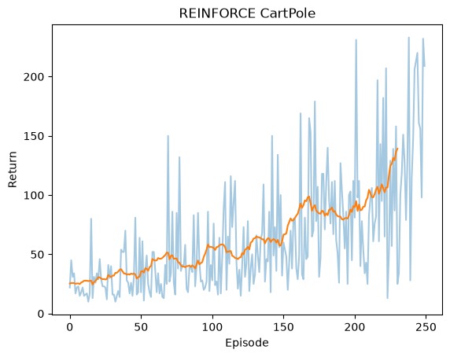

# [82일차] Policy Gradient와 REINFORCE, Actor-Critic

DQN이 행동별 예상 점수인 Q값을 학습했다면, **Policy Gradient**는 상태에서 행동을 선택하는 정책 자체를 신경망으로 학습한다. 이산 행동 환경에서는 신경망의 출력으로 행동 확률분포를 만들고, 경험한 결과를 바탕으로 그 분포를 조정한다.

이번에는 정책 확률의 의미부터 시작해 Categorical 분포, 할인 리턴, 로그확률 손실을 살펴본다. 이어서 CartPole의 REINFORCE 구현과 결과를 확인하고, 정책을 평가하는 Critic과 Advantage가 필요한 이유를 정리한다.

> 범위는 `4_딥강화학습.ipynb`의 Policy Gradient 제목부터 마지막 셀까지다. Actor-Critic은 개념과 Advantage 예제까지 작성되어 있으며, 별도의 Actor-Critic 학습 루프는 아직 없다.

---

## 1. 행동 점수에서 행동 확률로

장애물 앞에서 대기와 점프 중 하나를 고르는 캐릭터를 생각해 보자.

```text
학습 전: 대기 50%, 점프 50%
좋은 결과를 주는 점프 경험을 반복
학습 후의 가상 예: 대기 10%, 점프 90%
```

이 예시는 특정 상황의 행동 확률을 설명한다. 장애물이 멀다면 대기가 유리할 수 있으므로, 모든 상태에서 점프 확률을 높이는 것이 목표는 아니다.

```python
import numpy as np

before = np.array([0.5, 0.5])
after = np.array([0.1, 0.9])

for name, probabilities in [("학습 전", before), ("학습 후(가상)", after)]:
    print(
        f"{name}: 대기 {probabilities[0] * 100:.0f}%, "
        f"점프 {probabilities[1] * 100:.0f}%, "
        f"합계 {probabilities.sum():.1f}"
    )
```

실행 결과:

```text
학습 전: 대기 50%, 점프 50%, 합계 1.0
학습 후(가상): 대기 10%, 점프 90%, 합계 1.0
```

**점프 확률 90%는 점프 성공률 90%가 아니다.** 그 상태에서 정책이 점프를 선택할 확률이라는 뜻이다.

---

## 2. 정책 기호 읽기

| 기호 | 의미 |
| --- | --- |
| `s` | 현재 상태 |
| `a` | 선택할 행동 |
| `pi(a | s)` | 상태 `s`에서 행동 `a`를 고를 확률 |
| `theta` | 신경망의 학습 가능한 가중치 |
| `pi_theta(a | s)` | 가중치 `theta`가 정하는 정책 확률 |

정책 신경망은 현재 관측을 입력받고 행동별 점수를 출력한다. 이 점수로 만든 확률분포에서 행동을 추출하며, 좋은 결과와 연결된 선택이 더 유리해지도록 가중치를 갱신한다.

---

## 3. DQN과 정책 신경망의 차이

| 비교 항목 | DQN | 이번 정책 신경망 |
| --- | --- | --- |
| 출력 의미 | 각 행동의 Q값 | 행동 분포를 만들 Logits |
| 행동 선택 | Q값 비교와 epsilon-greedy 탐험 | 학습한 확률분포에서 샘플링 |
| 학습 목표 | 예측 Q를 TD 목표에 가깝게 조정 | 기대 리턴이 높아지도록 정책 조정 |
| 기본 REINFORCE의 경험 사용 | 해당 없음 | 현재 정책으로 생성한 에피소드 사용 |

```text
DQN: 상태 -> [대기 Q=2, 점프 Q=6] -> Q값 비교
정책: 상태 -> Logits -> [대기 20%, 점프 80%] -> 확률에 따라 행동 추출
```

둘 다 신경망 가중치를 학습한다. 출력 숫자의 의미와 학습 신호가 다르다. 정책 기반 방법도 평가 단계에서는 가장 높은 확률의 행동을 선택할 수 있다.

---

## 4. PolicyNet을 먼저 정의하기

원본 노트북은 `PolicyNet`과 `Categorical` 정의가 REINFORCE 실행 셀 뒤에 있다. 새 커널에서 위에서부터 실행할 수 있도록 문서에서는 필요한 정의를 앞에 배치했다.

```python
import matplotlib.pyplot as plt
import torch
from torch import nn, optim
from torch.distributions import Categorical
import gymnasium as gym

SEED = 2026

if torch.cuda.is_available():
    DEVICE = torch.device("cuda")
elif torch.backends.mps.is_available():
    DEVICE = torch.device("mps")
elif hasattr(torch, "xpu") and torch.xpu.is_available():
    DEVICE = torch.device("xpu")
else:
    DEVICE = torch.device("cpu")


class PolicyNet(nn.Module):
    def __init__(self, obs_dim=4, n_actions=2):
        super().__init__()
        self.net = nn.Sequential(
            nn.Linear(obs_dim, 64),
            nn.Tanh(),
            nn.Linear(64, n_actions),
        )

    def forward(self, x):
        return self.net(x)
```

| 단계 | Shape | 의미 |
| --- | --- | --- |
| 입력 | `[batch, 4]` | CartPole 관측 4개 |
| 은닉층 | `[batch, 64]` | 학습한 상태 특징 |
| 출력 | `[batch, 2]` | 왼쪽·오른쪽 Logits |

마지막 출력은 아직 확률이 아니다. `Categorical(logits=...)`가 이 점수를 정규화해 행동 분포로 사용한다.

---

## 5. Logits와 Categorical

`Categorical`은 0, 1처럼 정해진 개수의 이산 선택지에 대한 확률분포다.

```python
policy_demo = PolicyNet().to(DEVICE)
state_demo = torch.tensor(
    [[0.0, 0.1, 0.02, -0.03]],
    dtype=torch.float32,
    device=DEVICE,
)

logits = policy_demo(state_demo)
dist = Categorical(logits=logits)
action = dist.sample()

print("logits:", logits.detach().cpu().numpy())
print("확률:", dist.probs.detach().cpu().numpy())
print("행동:", action.item(), "log_prob:", dist.log_prob(action).item())
```

원본 노트북에 저장된 한 번의 출력:

```text
logits: [[ 0.04475383 -0.03105244]]
확률: [[0.5189425  0.48105744]]
행동: 1 log_prob: -0.7317684888839722
```

이 숫자는 당시 신경망 가중치와 난수 상태에 따른 예시다. 셀 실행 순서를 바꾸거나 모델을 새로 만들면 달라질 수 있다.

행동 0의 확률이 조금 높아도, 샘플링 결과는 행동 1이 될 수 있다. `sample()`은 최대 확률 행동만 고르는 연산이 아니다.

| 표현 | 의미 |
| --- | --- |
| `logits` | 확률로 정규화하기 전 점수 |
| `dist.probs` | 정규화된 행동 확률 |
| `dist.sample()` | 확률에 따라 행동 하나 선택 |
| `dist.log_prob(action)` | 선택 행동 확률의 자연로그 |

원본에는 `Normal`도 import되어 있지만, 현재 CartPole 실습은 `Categorical`을 사용한다. 정규분포를 이용한 연속 행동 학습은 구현되어 있지 않다.

---

## 6. Policy Gradient 학습 흐름

```text
상태 관측
    ↓
정책 신경망으로 행동 분포 계산
    ↓
행동 샘플링 후 환경 실행
    ↓
선택 행동의 log_prob와 보상 저장
    ↓
에피소드 종료 후 각 시점의 리턴 계산
    ↓
로그확률과 리턴으로 손실 계산
    ↓
역전파와 가중치 갱신
```

이번에 구현된 **REINFORCE**는 에피소드에서 관측한 리턴을 이용하는 몬테카를로 정책 경사 방법이다. 다음 상태의 가치를 별도 신경망으로 추정해 목표에 넣지 않으므로 부트스트래핑을 사용하지 않는다.

---

## 7. 시점별 할인 리턴 계산

보상이 `[1, 1, 1]`이고 할인율이 `0.9`라면 다음과 같다.

```text
마지막 행동 이후: G_2 = 1
그 이전 행동 이후: G_1 = 1 + 0.9 × 1 = 1.9
첫 행동 이후:     G_0 = 1 + 0.9 × 1.9 = 2.71
```

```python
def discounted_returns(rewards, gamma=0.99):
    out = []
    running = 0.0

    for reward in reversed(rewards):
        running = float(reward) + gamma * running
        out.append(running)

    return list(reversed(out))


print("예시:", discounted_returns([1, 1, 1], gamma=0.9))
```

실행 결과:

```text
예시: [2.71, 1.9, 1.0]
```

뒤에서부터 계산한 리턴 목록을 마지막에 다시 뒤집어, 각 시점의 행동과 순서를 맞춘다.

---

## 8. 로그확률을 사용하는 이유

REINFORCE는 선택한 행동 확률의 자연로그와 그 시점 이후의 리턴을 결합한다.

```text
loss = -sum_t [log pi_theta(a_t | s_t) × G_t]
```

위 식은 이번 코드에서 사용하는 기본 손실 형태다. 옵티마이저가 손실을 최소화하므로 앞에 음수를 붙여, 높은 리턴으로 가중된 행동의 로그확률을 높이는 방향으로 학습한다.

확률 자체가 아니라 로그확률을 사용하면 선택 행동의 확률 변화에 대한 Gradient를 구할 수 있다. 손실은 정답 행동 라벨과의 분류 오차가 아니라, **선택 행동의 로그확률에 경험에서 계산한 학습 신호를 곱한 값**이다.

```text
양수 가중치: 선택 행동의 확률을 높이는 방향
음수 가중치: 선택 행동의 확률을 낮추는 방향
```

실제로는 여러 시점과 상태가 신경망 가중치를 공유하므로, 한 번의 업데이트가 각 행동 확률을 독립적으로 정확히 원하는 만큼 바꾸는 것은 아니다.

---

## 9. 리턴 정규화와 Gradient 연결

노트북은 에피소드의 리턴을 평균 0, 표준편차 약 1이 되도록 정규화한다.

```text
정규화 리턴 = (G - 평균 G) / (표준편차 G + 1e-8)
```

이는 에피소드 내에서 가중치의 크기를 조절하는 실용적인 처리다. CartPole의 즉시 보상이 모두 양수여도, 평균보다 작은 리턴의 정규화 값은 음수가 될 수 있다. 따라서 '양수 보상을 받았으니 모든 행동 확률을 무조건 올린다'고 해석하면 안 된다.

정규화된 값은 실제 환경의 리턴과 구분해야 하며, 원래 리턴을 그대로 곱하는 기본 REINFORCE와도 가중치가 달라진다. 이 정규화가 Critic을 학습하는 것은 아니다.

### `log_prob`를 저장할 때 주의할 점

학습에는 `dist.log_prob(action)` Tensor의 계산 그래프가 필요하다. 따라서 학습용 로그확률을 `.item()`으로 숫자로 바꾸거나 `.detach()`해 저장하면 정책 신경망까지 Gradient가 이어지지 않는다.

```text
출력용: detach 또는 item 사용 가능
정책 손실 계산용: Gradient가 연결된 log_prob Tensor 유지
```

---

## 10. REINFORCE 학습 함수

```python
def train_reinforce(episodes=250, seed=2026, gamma=0.99, lr=1e-3):
    torch.manual_seed(seed)
    env = gym.make("CartPole-v1")
    net = PolicyNet().to(DEVICE)
    optimizer = optim.Adam(net.parameters(), lr=lr)
    scores = []

    for ep in range(episodes):
        state, _ = env.reset(seed=seed + ep)
        logps, rewards = [], []

        for t in range(500):
            x = torch.as_tensor(
                state, dtype=torch.float32, device=DEVICE
            ).unsqueeze(0)
            dist = Categorical(logits=net(x))
            action = dist.sample()

            next_state, reward, terminated, truncated, _ = env.step(
                int(action.item())
            )
            logps.append(dist.log_prob(action).squeeze())
            rewards.append(float(reward))
            state = next_state

            if terminated or truncated:
                break

        G = torch.tensor(
            discounted_returns(rewards, gamma),
            dtype=torch.float32,
            device=DEVICE,
        )
        if len(G) > 1:
            G = (G - G.mean()) / (G.std(unbiased=False) + 1e-8)

        loss = -(torch.stack(logps) * G).sum()
        optimizer.zero_grad()
        loss.backward()
        optimizer.step()

        scores.append(sum(rewards))
        if (ep + 1) % 30 == 0:
            print(
                f"REINFORCE {ep + 1}/{episodes} | "
                f"최근 20회 평균 {np.mean(scores[-20:]):.1f}"
            )

    env.close()
    return net, scores
```

### 코드에서 확인할 순서

1. `net(x)`로 현재 상태의 행동 Logits를 계산한다.
2. `Categorical`에서 행동을 뽑아 환경에 전달한다.
3. 해당 행동의 로그확률과 보상을 같은 순서로 저장한다.
4. 에피소드가 끝나면 시점별 할인 리턴을 계산한다.
5. 로그확률과 정규화 리턴을 곱해 손실을 만든다.
6. 에피소드당 한 번 역전파와 옵티마이저 갱신을 수행한다.

`torch.stack(logps)`와 `G`는 모두 길이가 에피소드 길이인 1차원 Tensor다. 같은 인덱스의 행동 로그확률과 리턴이 곱해진다.

실패 종료나 500스텝 제한으로 에피소드 수집이 끝나면, 이번 코드에서는 그때까지 관측한 보상으로 리턴을 계산한다. DQN처럼 제한 이후의 가치를 타깃 신경망으로 추가하지 않는다.

---

## 11. REINFORCE 학습 결과

```python
reinforce_model, reinforce_scores = train_reinforce(episodes=250)

plt.plot(reinforce_scores, alpha=0.4)
if len(reinforce_scores) >= 20:
    plt.plot(np.convolve(
        reinforce_scores, np.ones(20) / 20, mode="valid"
    ))

plt.title("REINFORCE CartPole")
plt.xlabel("Episode")
plt.ylabel("Return")
plt.show()
```

노트북에 저장된 출력:

```text
REINFORCE 30/250  | 최근 20회 평균 27.7
REINFORCE 60/250  | 최근 20회 평균 32.9
REINFORCE 90/250  | 최근 20회 평균 45.9
REINFORCE 120/250 | 최근 20회 평균 56.0
REINFORCE 150/250 | 최근 20회 평균 63.6
REINFORCE 180/250 | 최근 20회 평균 84.3
REINFORCE 210/250 | 최근 20회 평균 81.8
REINFORCE 240/250 | 최근 20회 평균 105.8
```



원본 실행에서는 후반의 평균 보상이 초반보다 높아졌다. 다만 중간 하락과 에피소드별 변동도 나타나므로, 학습이 항상 일정한 속도로 진행된다고 볼 수는 없다.

로그는 30회 간격으로 출력되므로 마지막 로그는 240회다. **105.8은 250회 학습이 끝난 최종 평가 평균이 아니다.** 현재 노트북에는 REINFORCE 모델의 별도 평가 결과가 없다.

그래프의 보상은 할인하지 않은 `sum(rewards)`이고, 손실에 쓰는 `G`는 할인 후 정규화된 가중치다. 두 값은 같은 숫자가 아니다.

20에피소드 이동평균은 배열 인덱스로 그려져 원래 보상 곡선과 가로축이 약간 어긋난다. 첫 평균은 첫 20개 에피소드에 해당한다.

---

## 12. DQN과 REINFORCE의 경험 사용 비교

| 비교 항목 | 이번 DQN 구현 | 이번 REINFORCE 구현 |
| --- | --- | --- |
| 저장 | 여러 에피소드의 Replay Buffer | 현재 에피소드의 `logps`, `rewards` |
| 학습 시점 | 경험이 충분한 뒤 4스텝마다 | 한 에피소드가 끝난 뒤 |
| 목표 계산 | 보상 + Target Network의 다음 Q | 실제 에피소드에서 계산한 리턴 |
| 과거 경험 재사용 | 무작위 미니배치로 사용 | 기본 구현에서는 재사용하지 않음 |
| 부트스트래핑 | 사용함 | 사용하지 않음 |
| 정책 관계 | 오프폴리시 | 현재 정책의 경험으로 학습하는 온폴리시 |

81일차 DQN의 평가 평균과 이번 REINFORCE 학습 로그를 직접 비교해 알고리즘의 우열을 결론 내리면 안 된다. 네트워크 구조, 학습률, 경험 수, 탐험 방식이 다르고, 하나는 별도 평가 점수이며 다른 하나는 학습 중 점수다.

---

## 13. Actor-Critic이 필요한 이유

기본 REINFORCE는 에피소드가 끝난 뒤 결과를 반영한다. 긴 에피소드에서는 갱신까지 기다려야 하고, 같은 상태에서도 이후 행동과 결과에 따라 리턴이 크게 달라질 수 있다.

**Actor-Critic**은 행동을 선택하는 정책과, 그 정책의 현재 상황을 평가하는 가치 추정을 함께 학습한다.

| 구성 요소 | 역할 | 출력 예 |
| --- | --- | --- |
| Actor | 상태에서 행동을 고르는 정책 | 점프 70%, 대기 30% |
| Critic | 현재 상태의 기대 가치를 추정 | `V(s)=5` |

```text
현재 상태
  ├─ Actor -> 행동 선택 -> 환경 실행
  └─ Critic -> 현재 상황의 기대 가치
                       ↓
           결과가 예상보다 좋았는지 비교
                       ↓
            Actor와 Critic의 학습 신호
```

Critic은 실제 정답을 미리 알고 있는 심판이 아니다. 경험으로 학습하는 추정기이므로 예측이 틀릴 수도 있다.

---

## 14. Advantage: 상태의 평균보다 얼마나 좋은 행동인가

```text
A(s, a) = Q(s, a) - V(s)
```

| 항목 | 의미 |
| --- | --- |
| `Q(s, a)` | 상태에서 특정 행동을 먼저 했을 때의 기대 리턴 |
| `V(s)` | 그 상태에서 현재 정책을 따를 때의 평균 기대 리턴 |
| `A(s, a)` | 상태의 평균 수준과 비교한 행동의 유불리 |

현재 상태가치가 `5`일 때 점프의 행동가치가 `8`, 대기의 행동가치가 `3`이라고 하자.

```python
expected = 5.0

for name, action_value in [("점프", 8.0), ("대기", 3.0)]:
    advantage = action_value - expected
    print(
        f"{name}: 행동가치 {action_value:.1f} - 상태가치 {expected:.1f} "
        f"= Advantage {advantage:+.1f}"
    )
```

실행 결과:

```text
점프: 행동가치 8.0 - 상태가치 5.0 = Advantage +3.0
대기: 행동가치 3.0 - 상태가치 5.0 = Advantage -2.0
```

점프는 현재 상태의 평균 기대 수준보다 좋고, 대기는 그보다 낮다. Advantage는 즉시 보상 자체가 아니라 **기대 수준과의 차이**다.

---

## 15. TD 오차로 Advantage 추정하기

한 단계 Actor-Critic에서는 다음과 같은 TD 오차를 Advantage의 추정 신호로 사용할 수 있다.

```text
delta = r + gamma × V(s') - V(s)
```

종료 상태라면 `V(s')` 대신 `0`을 쓴다. 실제 관측 보상과 다음 상태의 추정 가치를 이용해 현재 예상보다 결과가 좋았는지 판단한다.

```text
delta > 0: 예상보다 좋은 결과 -> 선택 행동 확률을 높이는 신호
delta < 0: 예상보다 나쁜 결과 -> 선택 행동 확률을 낮추는 신호
```

정확한 가치 함수와 정책을 기준으로 하면 이 신호의 조건부 기댓값을 Advantage와 연결할 수 있다. 실제 학습에서는 Critic 자체도 추정 중이므로, 한 번의 TD 오차가 정확한 Advantage와 항상 같지는 않다.

Critic은 가치 예측 오차를 줄이도록 학습하고, Actor는 이 차이를 정책 갱신 신호로 사용한다. 다음 가치 추정치를 쓰는 한 단계 방식은 에피소드 종료 전에도 갱신할 수 있다.

> 현재 노트북에는 Actor-Critic 학습 함수나 CartPole 실행 결과가 없다. 뒤쪽의 `PolicyNet`은 행동 Logits만 출력하므로 그 자체가 Critic을 포함한 완성된 Actor-Critic 모델은 아니다.

---

## 16. 세 방법을 연결해서 보기

| 항목 | DQN | REINFORCE | 한 단계 Actor-Critic 개념 |
| --- | --- | --- | --- |
| 학습 대상 | 행동가치 Q | 정책 | 정책과 상태가치 |
| 정책 신호 | Q값 비교 | 에피소드 리턴 | Advantage 추정 신호 |
| 다음 가치 추정 사용 | 사용함 | 사용하지 않음 | 일반적으로 사용함 |
| 이번 자료의 구현 범위 | 학습·평가 완료 | 학습 결과까지 | 개념·Advantage 예제까지 |

세 방법은 서로 다른 출력과 학습 목표를 사용한다. 상태를 신경망에 넣는다는 공통점만으로 같은 학습 방식이라고 볼 수는 없다.

---

## 17. 핵심 정리

1. Policy Gradient는 행동 확률을 정하는 정책 신경망의 가중치를 학습한다.
2. 행동 선택 확률과 행동 성공률은 서로 다른 개념이다.
3. `Categorical(logits=...)`는 행동 점수를 확률분포로 바꾸고 샘플링한다.
4. REINFORCE는 선택 행동의 로그확률과 에피소드 리턴으로 정책 손실을 만든다.
5. 학습용 로그확률은 계산 그래프를 유지해야 하며, 숫자로 바꾸거나 분리해 저장하면 안 된다.
6. 원본은 에피소드 내 리턴을 정규화한 가중치로 사용한다.
7. 저장된 REINFORCE 결과의 240회 최근 평균은 105.8이며, 별도 최종 평가 점수는 아니다.
8. Actor는 행동을 선택하고, Critic은 기대 가치를 평가한다.
9. Advantage는 행동의 가치가 현재 상태의 평균 기대 수준보다 얼마나 높은지 나타낸다.
10. Actor-Critic은 현재 자료에서 개념 설명 단계이며, 학습 구현은 아직 없다.
