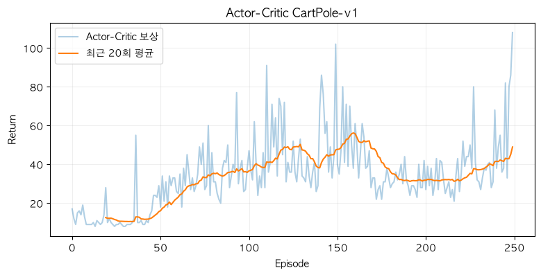
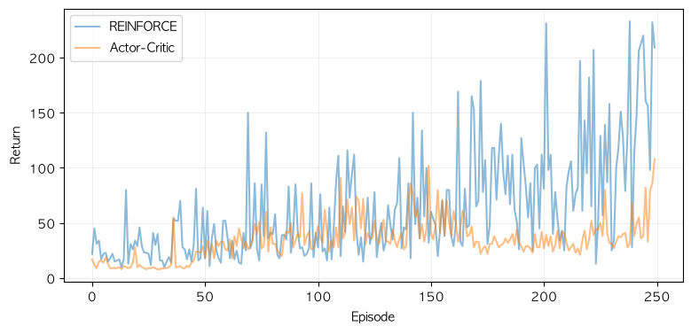

# [83일차] Actor-Critic의 손실함수와 CartPole 학습

Actor-Critic은 행동을 선택하는 정책과 현재 상황의 가치를 함께 학습한다. **Actor는 행동 분포를 만들고, Critic은 기대 리턴을 추정한다.** 행동 후 관측한 보상과 다음 상태가치로 TD 오차를 계산해 두 부분을 갱신한다.

이번에는 82일차에서 개념으로 살펴본 Actor-Critic을 실제 신경망과 학습 코드로 연결한다. 손실함수의 Gradient 경로를 확인하고, CartPole에서 매 스텝 학습한 결과를 REINFORCE와 비교한다.

> 범위는 `4_딥강화학습.ipynb`에서 우주선 착륙 프로젝트를 소개하는 셀 직전까지다. 앞부분의 DQN·REINFORCE 기본 구현과 반복된 정책 분포 예제는 81·82일차에서 다뤘으므로, 새로 추가된 Actor-Critic 구현을 중심으로 정리한다. LunarLander 프로젝트는 84일차에서 이어진다.

---

## 1. 한 단계 Actor-Critic의 학습 흐름

```text
현재 상태 s
    ↓
공통 신경망으로 특징 추출
    ├─ Actor -> 행동 Logits -> 분포에서 행동 선택
    └─ Critic -> 현재 가치 V(s)
                         ↓
                환경 실행: r, s', 종료 여부
                         ↓
                TD 목표와 TD 오차 계산
                         ↓
             Actor 손실 + Critic 손실
                         ↓
                  역전파와 가중치 갱신
```

REINFORCE가 한 에피소드 뒤 실제 리턴을 사용했다면, 이번 구현은 이동 한 번마다 학습한다. 미래의 최종 보상을 아직 몰라도 다음 상태의 추정 가치로 목표를 만들 수 있다.

대신 Critic의 예측이 부정확하면 Actor의 학습 신호에도 오차가 섞인다. 매 스텝 갱신한다는 사실만으로 더 높은 성능이 보장되지는 않는다.

---

## 2. 종료 여부를 반영한 TD 목표

```text
TD 목표 y = r + gamma × (1 - terminated) × V(s')
TD 오차 delta = y - V(s)
```

| 경우 | TD 목표 | 의미 |
| --- | --- | --- |
| 종료 전 | `r + gamma * V(s')` | 이후 보상 추정까지 사용 |
| 환경 종료 | `r` | 종료 이후 미래 보상은 없음 |

노트북의 설명에서 사용한 `done`은 실제 종료를 가리킨다. 학습 코드에서는 시간 제한과 구분하기 위해 `terminated`를 목표 마스크에 사용한다.

```python
def td_error(value, reward, next_value, gamma=0.9, done=False):
    target = reward + gamma * (1 - int(done)) * next_value
    delta = target - value
    return target, delta


cases = [
    ("예상보다 좋음", 4, 1, 6, 0.9, False),
    ("예상보다 나쁨", 5, 2, 4, 0.5, False),
    ("종료 상태", 4, 1, 100, 0.9, True),
]

for name, value, reward, next_value, gamma, done in cases:
    target, delta = td_error(value, reward, next_value, gamma, done)
    print(
        f"{name}: TD 목표={target:.2f}, 현재 예측={value:.2f}, "
        f"δ={delta:+.2f}"
    )
```

실행 결과:

```text
예상보다 좋음: TD 목표=6.40, 현재 예측=4.00, δ=+2.40
예상보다 나쁨: TD 목표=4.00, 현재 예측=5.00, δ=-1.00
종료 상태: TD 목표=1.00, 현재 예측=4.00, δ=-3.00
```

종료 예시에서는 다음 가치가 100이어도 무시한다. 실제 종료 후에는 이어지는 보상이 없기 때문이다. `delta=2.4`는 확률이 2.4% 늘어난다는 의미가 아니라, 목표와 현재 예측의 차이다.

---

## 3. Actor 손실과 Critic 손실

두 손실은 같은 TD 목표를 서로 다른 목적으로 사용한다.

```text
Actor loss  = -log pi(a | s) × stopgrad(delta)
Critic loss = [V(s) - stopgrad(y)]²
전체 loss   = Actor loss + 0.5 × Critic loss
```

| 손실 | 학습 방향 |
| --- | --- |
| Actor | 예상보다 좋은 결과를 낸 선택의 확률을 높이는 신호 사용 |
| Critic | 현재 가치 예측을 TD 목표에 가깝게 조정 |

`stopgrad`는 해당 값을 상수처럼 취급한다는 뜻이다. PyTorch에서는 `.detach()` 또는 `torch.no_grad()`로 Gradient 경로를 제어한다.

### Actor에서 `delta.detach()`가 필요한 이유

Actor는 TD 오차를 행동의 평가 신호로 사용한다. 이 신호를 분리하지 않으면 Actor 손실이 `delta` 안의 현재 가치 예측을 직접 바꾸는 경로로도 전파된다.

```text
분리 후: Actor 손실 -> 선택 행동의 log_prob -> 정책 학습
Critic 손실 -> 현재 V(s) -> 가치 예측 학습
```

공통 특징 추출층은 두 손실의 Gradient를 모두 받는다. 따라서 분리한다는 것은 네트워크 전체를 완전히 독립시킨다는 뜻이 아니라, Actor 손실이 TD 오차 자체를 미분하는 경로를 막는다는 뜻이다.

### TD 목표를 `no_grad()`에서 계산하는 이유

Critic의 이번 목표는 현재 갱신에서 고정된 기준으로 사용한다. 다음 상태가치까지 함께 움직여 오차를 줄이는 대신, 현재 상태가치가 목표를 따라가도록 한다.

---

## 4. 실행 환경 준비

```python
import numpy as np
import matplotlib.pyplot as plt
import torch
from torch import nn, optim
import torch.nn.functional as F
from torch.distributions import Categorical
import gymnasium as gym

if torch.cuda.is_available():
    DEVICE = torch.device("cuda")
elif torch.backends.mps.is_available():
    DEVICE = torch.device("mps")
elif hasattr(torch, "xpu") and torch.xpu.is_available():
    DEVICE = torch.device("xpu")
else:
    DEVICE = torch.device("cpu")
```

이번 CartPole은 관측값 4개와 행동 2개를 사용한다. 설치가 필요하다면 현재 Python 환경에서 `python -m pip install gymnasium`으로 설치한다.

---

## 5. 공통 특징층과 두 출력층

```python
class ActorCriticNet(nn.Module):
    def __init__(self, obs_dim=4, n_actions=2):
        super().__init__()
        self.body = nn.Sequential(
            nn.Linear(obs_dim, 128),
            nn.Tanh(),
        )
        self.actor = nn.Linear(128, n_actions)
        self.critic = nn.Linear(128, 1)

    def forward(self, x):
        features = self.body(x)
        logits = self.actor(features)
        value = self.critic(features).squeeze(-1)
        return logits, value
```

```text
관측 4개 -> 공통 특징 128개
                ├─ Actor: Logits 2개
                └─ Critic: 상태가치 1개
```

```python
state_demo = torch.tensor(
    [[0.0, 0.1, 0.02, -0.03]],
    dtype=torch.float32,
    device=DEVICE,
)
ac_demo = ActorCriticNet().to(DEVICE)
logits, value = ac_demo(state_demo)
print("Actor logits:", logits.shape, "Critic V(s):", value.shape)
```

실행 결과:

```text
Actor logits: torch.Size([1, 2]) Critic V(s): torch.Size([1])
```

Actor 출력은 확률 이전의 점수다. `Categorical(logits=...)`로 행동 분포를 만든다. Critic의 `[batch, 1]` 출력은 `squeeze(-1)`로 `[batch]`가 되어 행동 로그확률과 Shape이 맞는다.

---

## 6. 한 번의 가중치 갱신

```python
ac = ActorCriticNet().to(DEVICE)
optimizer = optim.Adam(ac.parameters(), lr=1e-3)

s = torch.zeros((1, 4), device=DEVICE)
s2 = torch.tensor([[0.02, 0.1, -0.03, 0.02]], device=DEVICE)

logits, value = ac(s)
dist = Categorical(logits=logits)
action = dist.sample()

with torch.no_grad():
    _, next_value = ac(s2)
    td_target = torch.tensor([1.0], device=DEVICE) + 0.99 * next_value

advantage = td_target - value
actor_loss = -(dist.log_prob(action) * advantage.detach()).mean()
critic_loss = F.mse_loss(value, td_target)
loss = actor_loss + 0.5 * critic_loss

optimizer.zero_grad()
loss.backward()
optimizer.step()

print(
    "선택 행동:", action.item(),
    "TD 목표:", td_target.item(),
    "Advantage:", advantage.item(),
    "Loss:", loss.item(),
)
```

노트북에 저장된 한 번의 출력:

```text
선택 행동: 1
TD 목표: 1.2189640998840332
Advantage: 1.0006285905838013
Loss: 1.136040210723877
```

이 예제는 보상 1을 받고 아직 종료되지 않은 상황을 가정한다. 신경망 초기값과 샘플링에 따라 수치가 달라질 수 있다. 여기서 `advantage`는 정확한 행동가치와 상태가치의 차이를 직접 구한 것이 아니라, TD 오차로 만든 추정 신호다.

---

## 7. CartPole 학습 설정

| 항목 | 값 |
| --- | --- |
| 학습 횟수 | 250에피소드 |
| 에피소드 최대 길이 | 500스텝 |
| 할인율 | 0.9 |
| Adam 학습률 | 0.002 |
| Critic 손실 가중치 | 0.5 |
| Gradient 노름 한도 | 1.0 |
| 행동 선택 | Categorical 샘플링 |
| 갱신 시점 | 매 환경 스텝 |

REINFORCE와 달리 에피소드 전체의 `log_probs`, `rewards`를 모아 끝에서 한 번 갱신하지 않는다. 현재 경험으로 매 스텝 손실을 계산하고 바로 가중치를 수정한다.

---

## 8. CartPole Actor-Critic 구현

```python
def train_actor_critic_answer(episodes=250, seed=2026, gamma=0.9, lr=2e-3):
    torch.manual_seed(seed)
    env = gym.make("CartPole-v1")
    model = ActorCriticNet().to(DEVICE)
    optimizer = optim.Adam(model.parameters(), lr=lr)
    scores = []

    for ep in range(episodes):
        state, _ = env.reset(seed=seed + ep)
        score = 0.0

        for t in range(500):
            x = torch.as_tensor(
                state, dtype=torch.float32, device=DEVICE
            ).unsqueeze(0)
            logits, value = model(x)
            dist = Categorical(logits=logits)
            action = dist.sample()
            next_state, reward, terminated, truncated, _ = env.step(
                int(action.item())
            )

            with torch.no_grad():
                nx = torch.as_tensor(
                    next_state, dtype=torch.float32, device=DEVICE
                ).unsqueeze(0)
                _, next_value = model(nx)
                td_target = torch.tensor(
                    [reward], dtype=torch.float32, device=DEVICE
                ) + gamma * (1.0 - float(terminated)) * next_value

            delta = td_target - value
            actor_loss = -(dist.log_prob(action) * delta.detach()).mean()
            critic_loss = F.mse_loss(value, td_target)
            loss = actor_loss + 0.5 * critic_loss

            optimizer.zero_grad()
            loss.backward()
            nn.utils.clip_grad_norm_(model.parameters(), 1.0)
            optimizer.step()

            score += float(reward)
            state = next_state
            if terminated or truncated:
                break

        scores.append(score)
        if (ep + 1) % 30 == 0:
            print(
                f"Actor-Critic {ep + 1} / {episodes} | "
                f"최근 20회 평균 {np.mean(scores[-20:]):.1f}"
            )

    env.close()
    return model, scores
```

목표 계산에서는 `terminated`만 마스크로 사용한다. `truncated`는 이번 실행을 중단하지만 환경의 미래 가치를 없애는 조건으로 쓰지 않는다. Gradient Clipping은 `backward()` 뒤, 실제 가중치 갱신인 `step()` 전에 수행한다.

---

## 9. CartPole 학습 결과

```python
ac_cartpole_model, ac_cartpole_scores = train_actor_critic_answer()
```

노트북에 저장된 출력:

```text
Actor-Critic 30 / 250  | 최근 20회 평균 10.6
Actor-Critic 60 / 250  | 최근 20회 평균 22.3
Actor-Critic 90 / 250  | 최근 20회 평균 35.9
Actor-Critic 120 / 250 | 최근 20회 평균 47.7
Actor-Critic 150 / 250 | 최근 20회 평균 47.5
Actor-Critic 180 / 250 | 최근 20회 평균 37.8
Actor-Critic 210 / 250 | 최근 20회 평균 31.9
Actor-Critic 240 / 250 | 최근 20회 평균 41.5
```



원본 그래프는 에피소드별 보상과 최근 20회 이동평균을 함께 표시한다. 초반보다 보상이 높아졌지만 중간에 다시 낮아지며, 안정적으로 최고 점수에 접근한 결과는 아니다.

노트북의 `AppleGothic` 설정은 한글 그래프를 위한 Mac용 폰트 선택이다. 학습 알고리즘과는 무관하며, 다른 운영체제에서는 설치된 한글 폰트를 사용하면 된다.

---

## 10. REINFORCE와 비교한 실제 결과



노트북에서 두 학습을 모두 250회 수행한 후 마지막 20회 평균을 비교한 결과다.

| 방법 | 마지막 20에피소드 평균 보상 |
| --- | ---: |
| REINFORCE | 139.2 |
| Actor-Critic | 49.0 |

82일차의 REINFORCE 240회 로그 `105.8`과 달리, 위 값은 250회 전체가 끝난 뒤 마지막 20회의 평균이다.

이번 실행에서는 REINFORCE가 더 높은 학습 보상을 얻었다. Actor-Critic이 더 자주 갱신한다고 항상 성능이 더 좋은 것은 아니다. Critic의 추정 오차가 Actor의 학습 신호에 반영되고, 공통 신경망의 정책·가치 학습이 서로 영향을 주기 때문이다.

다만 두 코드는 할인율, 학습률, 신경망 구조와 갱신 횟수 등이 다르다. 이 단일 실행만으로 알고리즘의 일반적인 우열을 결론 내릴 수 없다. 위 수치는 별도 평가 점수가 아니라 **학습 중 행동을 샘플링하며 얻은 보상**이다.

---

## 11. REINFORCE와 Actor-Critic의 학습 신호

| 항목 | 이번 REINFORCE | 이번 Actor-Critic |
| --- | --- | --- |
| 신호 생성 | 종료 후 실제 리턴 계산 | 한 단계 TD 목표와 오차 계산 |
| Critic | 없음 | 현재 상태가치 추정 |
| 부트스트래핑 | 없음 | 다음 상태가치 사용 |
| 갱신 | 에피소드마다 | 스텝마다 |
| 주의점 | 리턴 변동이 클 수 있음 | Critic 오차가 정책 학습에도 영향을 줌 |

Actor-Critic의 장점은 긴 에피소드에서도 중간 경험으로 학습할 수 있다는 점이다. 그러나 실제 성능은 보상 크기, 학습률, 할인율, Critic 정확도 등과 함께 확인해야 한다.

---

## 12. 핵심 정리

1. 한 단계 Actor-Critic은 `보상 + 할인된 다음 가치`로 TD 목표를 만든다.
2. Actor는 TD 오차를 분리한 신호로 사용하고, Critic은 현재 가치를 목표에 가깝게 학습한다.
3. 공통 특징층은 두 손실의 Gradient를 함께 받는다.
4. `no_grad()`는 목표 계산을, `detach()`는 Actor가 사용하는 오차 신호를 분리한다.
5. 실제 가중치 갱신에는 `optimizer.step()`이 필요하다.
6. CartPole 실습은 매 스텝 갱신하며, 마지막 20회 평균 보상은 49.0이었다.
7. 같은 노트북의 REINFORCE는 마지막 20회 평균 139.2였지만, 설정이 다른 단일 학습 결과다.
8. 더 복잡한 알고리즘을 사용했다는 사실보다 실제 보상과 안정성, 평가 결과가 중요하다.
