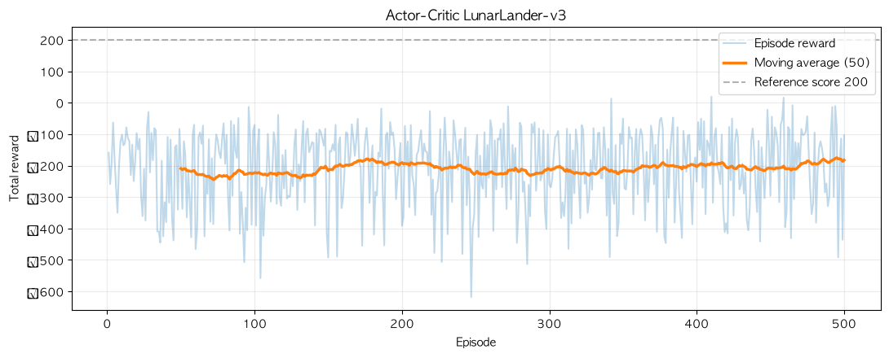
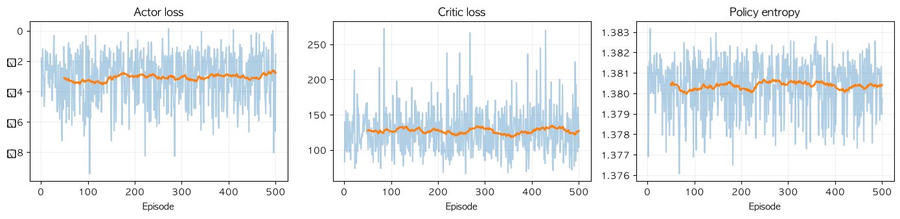
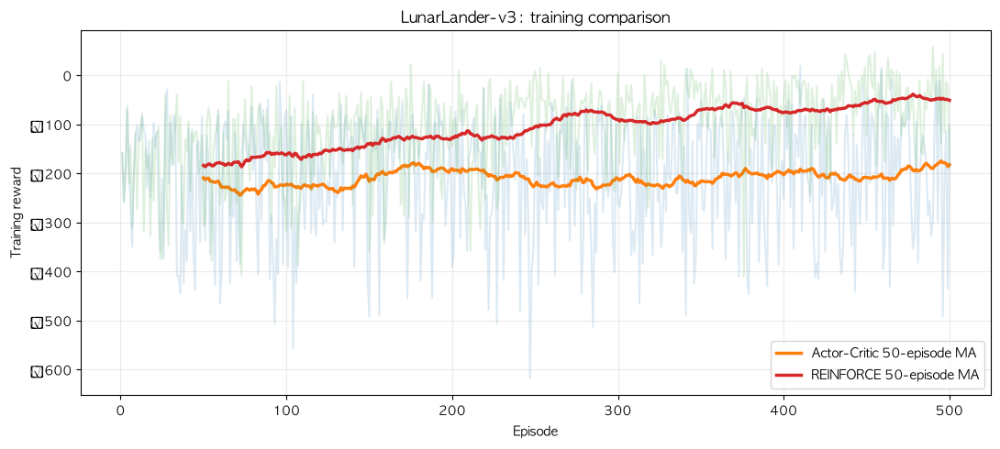

# [84일차] LunarLander 우주선 착륙과 Actor-Critic·REINFORCE 비교

LunarLander는 우주선의 위치와 속도, 자세를 관측하고 엔진을 선택해 착륙을 시도하는 강화학습 환경이다. 이번 실습은 **8개의 관측값으로 4개의 이산 행동을 선택하는 정책**을 학습한다.

이번에는 환경과 보상 구조를 확인하고, Actor-Critic의 학습 기록과 평가 결과를 분석한다. 이어서 같은 환경의 REINFORCE 결과를 비교하고, 학습 중 보상과 평가 점수가 다른 이유를 살펴본다.

> 범위는 “Gymnasium을 이용하여 우주선이 스스로 엔진을 제어하고 안전하게 착륙하도록 학습하는 강화학습 시스템을 개발”이라는 셀부터 노트북 끝까지다.
>
> **원본 Actor-Critic 학습 함수에는 `optimizer.step()`이 빠져 있다.** 따라서 저장된 500에피소드 출력은 가중치 갱신 없이 수집한 결과다. 문서의 Actor-Critic 학습 예제는 이 한 줄을 보완했고, 원본에 저장된 수치는 수정 후 성능과 구분해 표시한다. 원본 노트북 자체는 수정하지 않았다.

---

## 1. 우주선 착륙 프로젝트의 목표

우주선은 처음에 엔진을 언제 사용할지 모른다. 너무 빠르게 하강하면 충돌하고, 좌우 이동과 회전을 제어하지 못하면 착륙 위치를 벗어난다.

```text
현재 위치·속도·자세 관측
          ↓
정책 신경망이 행동 분포 출력
          ↓
엔진 행동 실행 -> 물리 시뮬레이터가 다음 상태 계산
          ↓
보상과 다음 상태로 학습
```

목표는 단순히 오래 떠 있는 것이 아니라, 보상 구조에 맞춰 안정적으로 착륙하는 행동을 학습하는 것이다. 학습 함수가 실행됐다는 사실만으로 착륙 능력을 얻었다고 볼 수는 없다.

---

## 2. 환경과 실행 준비

환경 이름은 `LunarLander-v3`다. `continuous=False`를 지정해 네 가지 엔진 행동 중 하나를 선택한다.

```bash
python -m pip install "gymnasium[box2d]"
```

```python
import random
import time

import numpy as np
import pandas as pd
import matplotlib.pyplot as plt
import torch
from torch import nn
import torch.nn.functional as F
from torch.distributions import Categorical
import gymnasium as gym

if torch.cuda.is_available():
    DEVICE = torch.device("cuda")
elif torch.backends.mps.is_available():
    DEVICE = torch.device("mps")
elif hasattr(torch, "xpu") and torch.xpu.is_available():
    DEVICE = torch.device("xpu")
else:
    DEVICE = torch.device("cpu")


def set_seed(seed=2026):
    random.seed(seed)
    np.random.seed(seed)
    torch.manual_seed(seed)
    if torch.backends.mps.is_available():
        torch.mps.manual_seed(seed)
```

시드는 난수 결과를 재현하기 위한 기준이다. 같은 시드를 사용해도 장치와 라이브러리 버전이 바뀌면 장기 학습 결과까지 완전히 같다고 보장할 수는 없다.

---

## 3. 상태 벡터의 8개 값

| 인덱스 | 의미 |
| --- | --- |
| 0 | 착륙 지점 기준 좌우 위치 |
| 1 | 높이 |
| 2 | 좌우 이동 속도 |
| 3 | 상하 이동 속도 |
| 4 | 우주선 기울기 |
| 5 | 회전 속도 |
| 6 | 왼쪽 착륙 다리의 지면 접촉 여부 |
| 7 | 오른쪽 착륙 다리의 지면 접촉 여부 |

```python
env = gym.make("LunarLander-v3", continuous=False)
state, info = env.reset(seed=2026)
print("상태 shape:", state.shape, "| dtype:", state.dtype)
print("행동 공간:", env.action_space)
print("행동 수:", env.action_space.n)
env.close()
```

실행 결과:

```text
상태 shape: (8,) | dtype: float32
행동 공간: Discrete(4)
행동 수: 4
```

환경은 `(8,)` 배열을 주지만 신경망에는 배치 차원을 추가한 `[1, 8]` Tensor로 전달한다.

---

## 4. 행동과 보상의 의미

| 행동 번호 | 의미 |
| --- | --- |
| 0 | 엔진 사용 안 함 |
| 1 | 왼쪽 보조 엔진 사용 |
| 2 | 주 엔진 사용 |
| 3 | 오른쪽 보조 엔진 사용 |

주 엔진은 주로 하강 속도에, 보조 엔진은 자세와 이동에 영향을 준다. 엔진 이름만으로 우주선이 항상 그 방향으로 이동한다고 단순화하지 말고, 현재 속도와 회전 상태를 함께 고려해야 한다.

LunarLander의 보상은 착륙 성공·실패만으로 결정되지 않는다. 착륙 지점과의 거리, 속도, 기울기, 다리 접촉, 엔진 사용량 등이 반영된다. 원본에서 소개한 종료 보상은 추락 `-100`, 안전한 착륙 `+100`이다.

**종료 보상과 에피소드 전체 보상은 다르다.** 에피소드 점수에는 종료 전까지의 보상도 누적되므로, 마지막 보상 하나만으로 총점을 해석할 수 없다.

---

## 5. LunarLander의 Actor-Critic 구조

```python
class ActorCriticNet(nn.Module):
    def __init__(self, obs_dim=8, n_actions=4, hidden=128):
        super().__init__()
        self.body = nn.Sequential(
            nn.Linear(obs_dim, hidden),
            nn.Tanh(),
            nn.Linear(hidden, hidden),
            nn.Tanh(),
        )
        self.actor = nn.Linear(hidden, n_actions)
        self.critic = nn.Linear(hidden, 1)

    def forward(self, x):
        features = self.body(x)
        logits = self.actor(features)
        value = self.critic(features).squeeze(-1)
        return logits, value


model_test = ActorCriticNet().to(DEVICE)
dummy = torch.randn(3, 8, device=DEVICE)
logits, values = model_test(dummy)
print("입력:", dummy.shape, "logits:", logits.shape, "V(s):", values.shape)
```

실행 결과:

```text
입력: torch.Size([3, 8]) logits: torch.Size([3, 4]) V(s): torch.Size([3])
```

CartPole의 입력 4개·행동 2개에서 입력 8개·행동 4개로 바뀌었고, 공통 특징층도 두 개의 은닉층을 사용한다. 이 문서의 클래스를 83일차 CartPole 클래스와 혼동하지 않아야 한다.

---

## 6. 먼저 무작위 정책을 측정하기

무작위 정책은 학습 전 비교 기준인 Baseline이다.

```python
def run_random_baseline(episodes=20, seed=1000):
    env = gym.make("LunarLander-v3", continuous=False)
    scores = []

    for ep in range(episodes):
        state, _ = env.reset(seed=seed + ep)
        env.action_space.seed(seed + ep)
        score = 0.0

        while True:
            action = env.action_space.sample()
            state, reward, terminated, truncated, _ = env.step(action)
            score += float(reward)
            if terminated or truncated:
                break

        scores.append(score)

    env.close()
    return scores


random_scores = run_random_baseline(episodes=20)
print("랜덤 정책 20회 평균:", round(float(np.mean(random_scores)), 2))
print("최저/최고:", round(min(random_scores), 2), round(max(random_scores), 2))
```

노트북에 저장된 결과:

```text
랜덤 정책 20회 평균: -211.55
최저/최고: -371.2 -76.22
```

이후 알고리즘이 무작위 선택보다 얼마나 개선되었는지, 같은 평가 조건으로 비교할 때 사용한다.

---

## 7. TD 목표와 두 손실

```text
y = r + gamma × (1 - terminated) × V(s')
delta = y - V(s)

Actor loss  = -log pi(a | s) × detach(delta)
Critic loss = MSE(V(s), y)
```

`y`는 `no_grad()`에서 계산하고, Actor는 `delta.detach()`를 평가 신호로 사용한다. 실제 종료에서는 미래 가치를 없애고, 시간 제한 중단에서는 다음 가치를 유지한다.

전체 손실에는 정책 엔트로피 항을 더할 수 있다.

```text
L = Actor loss + beta × Critic loss - eta × Entropy
```

| 항목 | 역할 |
| --- | --- |
| `beta`, 코드의 `critic_coef` | Critic 손실의 상대 가중치 |
| `eta`, 코드의 `entropy_coef` | 엔트로피 보너스 가중치 |
| Entropy | 행동 분포가 얼마나 퍼져 있는지 나타내는 값 |

손실을 최소화할 때 엔트로피를 빼면 높은 엔트로피를 장려하는 방향으로 작용한다. 지나치게 일찍 특정 행동으로 확신하는 현상을 완화하려는 목적이다.

`entropy_coef=0`은 엔트로피 보너스가 없다는 뜻이다. 행동은 여전히 Categorical 분포에서 확률적으로 샘플링한다.

---

## 8. 원본 학습 코드에서 확인한 누락

원본 `train_actor_critc()`는 아래 순서까지만 수행한다.

```text
optimizer.zero_grad()
loss.backward()
clip_grad_norm_(...)
다음 환경 스텝으로 진행
```

**Gradient 계산과 Gradient 크기 제한만으로는 모델 가중치가 바뀌지 않는다.** 실제 가중치 갱신을 수행하는 `optimizer.step()`이 필요하다.

짧은 실행으로 원본 함수의 실행 전후 모든 파라미터가 동일함을 확인했다. 반면 `step()`을 추가한 함수는 파라미터가 바뀌었다. 원본의 출력 손실과 보상이 매번 달라져도, 그것만으로 학습이 이루어졌다고 볼 수 없는 이유다. 상태와 샘플링 결과가 달라지면 고정된 모델에서도 출력은 달라진다.

아래 문서 예제에서는 함수명 오타 `critc`도 `critic`으로 고쳤다. **수정 후 500회 학습 성능을 새로 측정한 결과는 아직 없다.**

---

## 9. 가중치 갱신을 보완한 학습 함수

```python
def train_actor_critic(
    episodes=500, seed=2026, gamma=0.99, lr=3e-4,
    hidden=128, max_steps=1000, critic_coef=0.5,
    entropy_coef=0.0, print_every=50,
):
    set_seed(seed)
    env = gym.make("LunarLander-v3", continuous=False)
    env.action_space.seed(seed)
    model = ActorCriticNet(8, 4, hidden=hidden).to(DEVICE)
    optimizer = torch.optim.Adam(model.parameters(), lr=lr)
    records = []
    start_time = time.time()

    for ep in range(episodes):
        state, _ = env.reset(seed=seed + ep)
        score = 0.0
        ep_actor, ep_critic, ep_entropy = [], [], []

        for t in range(max_steps):
            x = torch.as_tensor(
                state, dtype=torch.float32, device=DEVICE
            ).unsqueeze(0)
            logits, value = model(x)
            dist = Categorical(logits=logits)
            action = dist.sample()
            next_state, reward, terminated, truncated, _ = env.step(
                int(action.item())
            )

            with torch.no_grad():
                nx = torch.as_tensor(
                    next_state, dtype=torch.float32, device=DEVICE
                ).unsqueeze(0)
                _, next_value = model(nx)
                td_target = torch.as_tensor(
                    [reward], dtype=torch.float32, device=DEVICE
                ) + gamma * (1.0 - float(terminated)) * next_value

            delta = td_target - value
            actor_loss = -(dist.log_prob(action) * delta.detach()).mean()
            critic_loss = F.mse_loss(value, td_target)
            entropy = dist.entropy().mean()
            loss = actor_loss + critic_coef * critic_loss - entropy_coef * entropy

            optimizer.zero_grad()
            loss.backward()
            nn.utils.clip_grad_norm_(model.parameters(), max_norm=1.0)
            optimizer.step()  # 원본에서 누락된 실제 가중치 갱신

            score += float(reward)
            state = next_state
            ep_actor.append(float(actor_loss.item()))
            ep_critic.append(float(critic_loss.item()))
            ep_entropy.append(float(entropy.item()))
            if terminated or truncated:
                break

        records.append({
            "episode": ep + 1,
            "reward": score,
            "steps": t + 1,
            "actor_loss": float(np.mean(ep_actor)),
            "critic_loss": float(np.mean(ep_critic)),
            "entropy": float(np.mean(ep_entropy)),
        })

        if print_every and (ep + 1) % print_every == 0:
            recent = np.mean([row["reward"] for row in records[-50:]])
            print(
                f"Actor-Critic {ep + 1:4d}/{episodes} | "
                f"최근 50회 평균 {recent:8.2f} | "
                f"이번 보상 {score:8.2f} | {time.time() - start_time:.0f}s"
            )

    env.close()
    return model, pd.DataFrame(records)
```

원본의 기록 목록을 에피소드별 딕셔너리로 묶어 표현했으며, 보상·스텝 수·평균 Actor 손실·평균 Critic 손실·평균 엔트로피를 같은 열 이름으로 반환한다.

기본 설정은 500에피소드, 할인율 0.99, 학습률 0.0003, 은닉층 128, Critic 가중치 0.5, 엔트로피 계수 0이다.

---

## 10. 원본의 500에피소드 기록

아래는 **`optimizer.step()`이 누락된 원본 실행**에 저장된 값이다. 위의 수정 함수로 얻은 성능이 아니다.

| 시점 | 최근 50회 평균 보상 |
| --- | ---: |
| 50회 | -209.36 |
| 100회 | -222.18 |
| 200회 | -190.39 |
| 300회 | -211.02 |
| 400회 | -203.32 |
| 500회 | -182.53 |

| 요약 항목 | 원본 기록 |
| --- | ---: |
| 전체 평균 보상 | -208.33 |
| 최고 에피소드 보상 | 19.29 |
| 마지막 50회 평균 스텝 | 95.9 |



원본 그래프 일부는 폰트 문제로 음수 기호가 깨져 보인다. 수치는 위 표의 음수 값을 기준으로 읽으면 된다. 새로 그래프를 그릴 때 `plt.rcParams["axes.unicode_minus"] = False`로 설정하면 해당 폰트의 유니코드 음수 기호 문제를 피할 수 있다.

마지막 구간의 평균이 처음보다 높아졌지만, 가중치가 갱신되지 않았으므로 이를 정책 학습의 증거로 볼 수 없다. 환경 초기 상태와 행동 샘플링의 차이도 보상을 바꾼다.

---

## 11. 보상·손실·엔트로피를 함께 읽기



| 기록 | 해석할 때 확인할 점 |
| --- | --- |
| Actor 손실 | TD 오차와 로그확률에 따라 부호와 크기가 달라짐 |
| Critic 손실 | 현재 가치 예측과 TD 목표의 차이 |
| 엔트로피 | 행동 분포가 한쪽으로 치우쳤는지 확인 |
| 보상 | 실제 환경에서 얻은 성과 |

Actor 손실은 반드시 양수일 필요가 없고, 작아졌다는 사실만으로 착륙 능력이 좋아졌다고 할 수도 없다. Critic 손실도 학습 중 바뀌는 상태와 목표에 영향을 받는다.

네 행동이 완전히 균등한 분포의 엔트로피는 `ln(4) ≈ 1.386`이다. 원본 엔트로피는 약 1.38 부근으로 거의 균등한 분포에 가깝다. 이 경우에는 파라미터 갱신 누락도 확인되었으므로, 값의 변화보다 학습 코드 자체의 갱신 여부가 먼저다.

---

## 12. 50에피소드 이동평균

```python
def moving_average(values, window=50):
    values = np.asarray(values, dtype=float)
    if len(values) < window:
        return np.array([]), np.array([])
    x = np.arange(window, len(values) + 1)
    y = np.convolve(values, np.ones(window) / window, mode="valid")
    return x, y
```

첫 번째 평균은 1~50회에 해당하므로 가로축을 50부터 시작한다. 이렇게 하면 원래 에피소드 번호와 이동평균을 맞출 수 있다.

그래프의 200점 선은 점수 비교를 위한 참고선이다. 개별 에피소드가 200점을 넘는 비율을 실제 착륙 성공률과 동일하게 정의해서는 안 된다.

---

## 13. 결정적 평가와 확률적 평가

| 평가 방식 | 행동 선택 | 확인하려는 것 |
| --- | --- | --- |
| 결정적, `greedy=True` | Logits의 최대 행동 | 가장 선호하는 행동을 계속 선택한 성능 |
| 확률적, `greedy=False` | Categorical 샘플링 | 현재 확률 정책 자체의 성능 |

신경망 가중치를 고정해도 행동 선택 방식을 바꾸면 성능이 달라질 수 있다. 특히 확률들이 비슷한 미학습 모델에서 `argmax`는 한 행동을 자주 고르게 만들어, 무작위 행동보다 나쁜 결과를 낼 수도 있다.

---

## 14. 두 모델을 평가하는 함수

Actor-Critic은 `(logits, value)`를 반환하고, 뒤에서 정의할 REINFORCE 정책망은 Logits Tensor만 반환한다. 문서에서는 두 형식을 명시적으로 구분해 Logits를 얻는다.

```python
def evaluate_policy(model, episodes=30, seed=1000, greedy=True, max_steps=1000):
    env = gym.make("LunarLander-v3", continuous=False)
    device = next(model.parameters()).device
    was_training = model.training
    model.eval()
    records = []

    try:
        for ep in range(episodes):
            state, _ = env.reset(seed=seed + ep)
            total_reward = 0.0

            for t in range(max_steps):
                x = torch.as_tensor(
                    state, dtype=torch.float32, device=device
                ).unsqueeze(0)
                with torch.no_grad():
                    output = model(x)
                    logits = output[0] if isinstance(output, tuple) else output
                    if greedy:
                        action = logits.argmax(dim=-1)
                    else:
                        action = Categorical(logits=logits).sample()

                state, reward, terminated, truncated, _ = env.step(
                    int(action.item())
                )
                total_reward += float(reward)
                if terminated or truncated:
                    break

            records.append({
                "episode": ep + 1,
                "reward": total_reward,
                "steps": t + 1,
                "terminated": bool(terminated),
                "truncated": bool(truncated),
                "left_contact_final": float(state[6]),
                "right_contact_final": float(state[7]),
            })
    finally:
        env.close()
        model.train(was_training)

    return pd.DataFrame(records)
```

`eval()`은 학습·평가 모드를 바꾸고, `no_grad()`는 Gradient 추적을 끈다. 두 기능은 다르다. 마지막에는 평가 전에 사용하던 모드를 복원한다.

마지막 상태의 양쪽 다리 접촉을 기록하지만, 접촉 여부만으로 충돌·최종 안정성까지 포함한 성공을 판정할 수는 없다. `terminated=True` 역시 성공과 실패를 함께 포함할 수 있다.

---

## 15. 원본 Actor-Critic 평가 결과

원본 모델을 30회 결정적으로 평가한 저장 결과는 다음과 같다.

| 항목 | 원본 평가 결과 |
| --- | ---: |
| 평균 보상 | -640.18 |
| 보상 표준편차 | 113.09 |
| 평균 스텝 | 94.0 |
| 보상 200 이상 비율 | 0.0 |

이는 가중치 갱신이 누락된 모델의 결과다. 수정된 Actor-Critic의 성능이나 Actor-Critic 알고리즘 자체의 한계로 해석하면 안 된다.

보상 200 이상 비율은 기준 점수를 넘은 빈도다. 변수명을 성공률로 바꾸어 착륙 성공 여부처럼 해석하지 않는 것이 정확하다.

---

## 16. 같은 환경의 REINFORCE 정책망

REINFORCE는 Critic 없이 정책망만 사용한다. 이번 모델은 8개 관측으로 4개 행동 Logits를 출력한다.

```python
class PolicyNet(nn.Module):
    def __init__(self, obs_dim=8, n_actions=4, hidden=128):
        super().__init__()
        self.net = nn.Sequential(
            nn.Linear(obs_dim, hidden),
            nn.Tanh(),
            nn.Linear(hidden, hidden),
            nn.Tanh(),
            nn.Linear(hidden, n_actions),
        )

    def forward(self, x):
        return self.net(x)


def discounted_returns(rewards, gamma):
    out = []
    G = 0.0
    for reward in reversed(rewards):
        G = float(reward) + gamma * G
        out.append(G)
    return list(reversed(out))
```

---

## 17. REINFORCE 학습 함수

```python
def train_reinforce(
    episodes=500, seed=2026, gamma=0.99, lr=3e-4,
    print_every=50, normalize_returns=True, hidden=128,
):
    set_seed(seed)
    env = gym.make("LunarLander-v3", continuous=False)
    env.action_space.seed(seed)
    model = PolicyNet(hidden=hidden).to(DEVICE)
    optimizer = torch.optim.Adam(model.parameters(), lr=lr)
    records = []

    for ep in range(episodes):
        state, _ = env.reset(seed=seed + ep)
        rewards, log_probs = [], []

        for t in range(1000):
            x = torch.as_tensor(
                state, dtype=torch.float32, device=DEVICE
            ).unsqueeze(0)
            dist = Categorical(logits=model(x))
            action = dist.sample()
            next_state, reward, terminated, truncated, _ = env.step(
                int(action.item())
            )
            log_probs.append(dist.log_prob(action).squeeze())
            rewards.append(float(reward))
            state = next_state
            if terminated or truncated:
                break

        returns = torch.as_tensor(
            discounted_returns(rewards, gamma),
            dtype=torch.float32,
            device=DEVICE,
        )
        if normalize_returns and len(returns) > 1:
            returns = (
                (returns - returns.mean())
                / (returns.std(unbiased=False) + 1e-8)
            )

        loss = -(torch.stack(log_probs) * returns).mean()
        optimizer.zero_grad()
        loss.backward()
        nn.utils.clip_grad_norm_(model.parameters(), max_norm=1.0)
        optimizer.step()

        records.append({
            "episode": ep + 1,
            "reward": sum(rewards),
            "steps": len(rewards),
        })
        if print_every and (ep + 1) % print_every == 0:
            recent = np.mean([row["reward"] for row in records[-50:]])
            print(
                f"REINFORCE {ep + 1:4d}/{episodes} | "
                f"최근 50회 평균 {recent:8.2f}"
            )

    env.close()
    return model, pd.DataFrame(records)
```

83일차 Actor-Critic과 달리 에피소드 끝에서 한 번 갱신한다. 이번 LunarLander REINFORCE의 손실은 시간축 `mean()`을 사용한다. 82일차 CartPole 코드의 `sum()`과는 에피소드 길이에 따른 Gradient 스케일이 다르다.

또한 기록하는 보상은 할인하지 않은 합계이고, 손실에 쓰는 리턴은 할인 후 필요에 따라 정규화한 값이다.

---

## 18. REINFORCE의 저장된 학습 결과

| 에피소드 | 최근 50회 평균 보상 |
| --- | ---: |
| 50 | -183.84 |
| 100 | -162.32 |
| 200 | -126.83 |
| 300 | -90.25 |
| 400 | -76.48 |
| 500 | -51.16 |

REINFORCE 원본에는 `optimizer.step()`이 포함되어 있다. 저장된 학습 중 보상은 초반보다 개선되었다. 하지만 평균이 여전히 음수이고, 별도의 결정적 평가 결과도 확인해야 하므로 안전한 착륙을 학습했다고 결론 내릴 단계는 아니다.



이 비교 그림의 Actor-Critic 곡선은 **갱신 누락 원본**이고, REINFORCE 곡선은 실제 파라미터 갱신이 포함된 실행이다. 두 곡선을 알고리즘의 공정한 성능 비교로 사용할 수 없다.

---

## 19. 30회 평가 비교표

노트북 마지막에는 무작위 정책도 30회로 다시 평가해 표를 채운다. 초반 20회 Baseline과는 표본 수가 다르다.

| 방법 | 30회 평가 평균 | 표준편차 | 마지막 50회 학습 중 평균 |
| --- | ---: | ---: | ---: |
| Random | -229.32 | 109.43 | 해당 없음 |
| Actor-Critic 원본: 갱신 누락 | -640.18 | 113.09 | -182.53 |
| REINFORCE | -362.06 | 90.76 | -51.16 |

학습 중에는 행동을 샘플링하고, 두 학습 모델의 평가에서는 `greedy=True`로 최대 Logits 행동을 선택했다. 따라서 학습 중 최근 평균이 높아졌어도 결정적 평가에서는 점수가 낮아질 수 있다.

REINFORCE도 이 결정적 평가에서는 Random보다 낮은 평균을 기록했다. 이를 숨기거나 학습 곡선만으로 성능 향상을 주장해서는 안 된다. `greedy=False`의 확률적 평가도 수행해 실제 학습한 정책 분포의 성능을 확인할 필요가 있다.

표준편차는 pandas의 기본 표본 표준편차와 Random의 `np.std(..., ddof=1)`을 사용해 맞췄다. 표의 평가 평균은 동일한 평가 시드 구간을 사용하지만 행동 선택 방식은 서로 다르다.

---

## 20. 수정 후 다시 실행할 순서

아래는 문서의 **수정된 Actor-Critic 함수**를 사용하는 실행 예제다. 이 코드의 장기 실행 결과는 위에 제시한 원본 수치와 구분해 새로 기록해야 한다.

```python
ac_model, ac_history = train_actor_critic(
    episodes=500, seed=2026, gamma=0.99,
    lr=3e-4, entropy_coef=0.0,
)

re_model, re_history = train_reinforce(
    episodes=500, seed=2026, gamma=0.99,
    lr=3e-4, normalize_returns=True,
)

ac_eval_greedy = evaluate_policy(ac_model, episodes=30, greedy=True)
ac_eval_sample = evaluate_policy(ac_model, episodes=30, greedy=False)
re_eval_greedy = evaluate_policy(re_model, episodes=30, greedy=True)
re_eval_sample = evaluate_policy(re_model, episodes=30, greedy=False)
```

먼저 파라미터 갱신이 실제로 일어나는지 확인하고, 보상과 손실을 기록한 뒤 같은 조건의 평가를 수행한다. 수정 후에는 기존 학습 모델과 기록을 그대로 재사용하지 말고 처음부터 다시 학습해야 한다.

---

## 21. 노트북이 제안한 추가 실험

| 실험 | 비교 값 | 확인할 내용 |
| --- | --- | --- |
| 학습률 | `1e-3`, `3e-4`, `1e-4` | 개선 속도와 변동성 |
| 할인율 | `0.95`, `0.99` | 먼 미래의 착륙 보상 반영 차이 |
| 엔트로피 계수 | `0.0`, `0.01` | 분포의 조기 집중과 탐험 변화 |

학습률이 크면 반드시 나쁘고 작으면 반드시 좋다는 규칙은 없다. 할인율도 높을수록 항상 성능이 좋아지는 것은 아니다. 엔트로피 보너스도 탐험을 장려하는 장치이지 성공을 보장하는 항이 아니다.

이 실험들은 우선 가중치 갱신 누락을 수정한 상태에서 수행해야 한다. 한 번에 한 설정을 바꾸고 여러 시드로 반복하면 코드 오류와 설정 차이, 난수 변동을 더 잘 구분할 수 있다.

---

## 22. 핵심 정리

1. LunarLander는 관측 8개로 엔진 행동 4개를 선택하는 환경이다.
2. 보상은 착륙 여부뿐 아니라 이동 상태, 자세, 접촉, 엔진 사용 등도 반영한다.
3. Actor-Critic은 TD 목표와 오차로 정책·가치를 함께 학습한다.
4. 원본 LunarLander 함수는 `optimizer.step()` 누락으로 가중치를 갱신하지 않는다.
5. 문서의 보완 함수는 실제 갱신을 추가했지만, 수정 후 500회 성능은 새로 측정해야 한다.
6. 원본 그래프와 비교표는 오류가 포함된 실행의 기록으로 해석해야 한다.
7. REINFORCE 학습 중 최근 평균은 -51.16까지 개선되었지만, 결정적 평가 평균은 -362.06이었다.
8. 행동 샘플링 평가와 최대 확률 행동 평가는 서로 다른 정책 성능을 보여준다.
9. 200점 이상 비율, 다리 접촉, 종료 여부를 착륙 성공률과 단순히 동일시하면 안 된다.
10. 알고리즘 비교 전에 파라미터 갱신과 평가 조건을 먼저 확인해야 한다.
