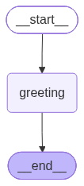
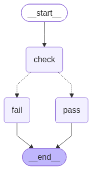
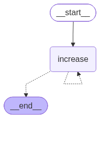
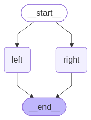

# [89일차] AI Agent와 LangGraph 기초

LLM이 답변을 만드는 것에서 한 걸음 더 나아가, 필요한 도구를 선택하고 결과를 확인하는 AI Agent의 흐름을 살펴본다.

LangGraph의 상태·노드·엣지를 이해한 뒤, 순차 실행부터 분기·반복·병렬 처리, 계산 도구를 사용하는 Agent와 구조화된 출력까지 연결한다.


## 1. AI Agent란?

AI Agent는 목표를 달성하기 위해 현재 상황을 관찰하고, 다음 행동을 결정하며, 행동 결과를 확인하는 시스템이다.

LLM 기반 Agent는 이 과정에서 언어 모델을 의사결정 구성요소로 사용한다. 다만 모든 Agent가 LLM을 사용하는 것은 아니다. 로봇청소기나 게임 AI도 넓은 의미의 Agent에 해당한다.

| 구분 | 핵심 역할 | 예시 |
|---|---|---|
| LLM | 입력을 바탕으로 문장 생성 | 질문을 읽고 설명 작성 |
| 도구 | 실제 작업 실행 | 계산, 날씨 조회, DB 검색 |
| LLM 기반 Agent | 모델과 도구를 실행 흐름으로 연결 | 날씨를 조회한 뒤 우산 필요 여부 안내 |

예를 들어 다음 요청을 생각해 보자.

> 서울에 비가 오면 우산을 챙기라고 알려줘.

```text
사용자 요청
    |
    v
목표 확인: 비가 오는지 알아야 한다.
    |
    v
도구 선택: 날씨 조회 API가 필요하다.
    |
    v
도구 실행: 프로그램이 날씨 정보를 조회한다.
    |
    v
결과 해석: 비가 예상되는지 확인한다.
    |
    v
최종 답변: 우산이 필요한지 안내한다.
```

중요한 차이는 **답변에 필요한 정보를 실제로 확인하는 실행 과정**이 있다는 점이다. 모델이 날씨를 아는 것처럼 문장을 만드는 것과, 날씨 조회 도구를 실행하는 것은 다르다.

### Agent의 구성요소

| 구성요소 | 확인할 질문 |
|---|---|
| 목표 | 무엇을 달성해야 하는가? |
| Model / Policy | 다음 행동을 어떻게 선택하는가? |
| Tools | 어떤 외부 작업을 수행할 수 있는가? |
| State | 현재 질문·결과·진행 단계는 무엇인가? |
| Memory | 이전 대화나 저장된 정보를 어떻게 활용하는가? |
| 평가와 제어 | 결과가 충분한가? 실행 권한과 종료 조건은 무엇인가? |

State는 현재 실행의 데이터를 담고, Memory는 이전 정보를 다시 활용하는 개념에 가깝다. 둘은 연관되지만 상태 딕셔너리를 만들었다고 장기 기억까지 자동으로 구현되는 것은 아니다.

## 2. LangChain과 LangGraph의 역할

| 구분 | 주된 역할 | 예제에서 사용하는 기능 |
|---|---|---|
| LangChain | 모델·메시지·도구 등을 연결하는 구성요소와 Agent 기능 제공 | `ChatOpenAI`, `@tool`, `create_agent` |
| LangGraph | 상태를 가진 작업들의 실행 흐름 구성 | `StateGraph`, 조건 분기, 반복, 병렬 실행 |

단순한 문서 질의응답은 검색 후 답변을 생성하는 순차 흐름으로 구성할 수 있다. 하지만 검색 결과가 부족하면 다시 검색하거나, 계산이 필요하면 도구를 실행하는 흐름에는 분기와 반복이 필요하다.

LangGraph는 이러한 흐름을 그래프로 표현한다. RAG 자체가 반드시 직선형인 것은 아니며, LangGraph도 Agent에만 사용할 수 있는 도구는 아니다.

```text
단순 순차 흐름
START -> 질문 처리 -> 답변 생성 -> END

조건과 반복이 있는 흐름
START -> 질문 처리 -> 모델 판단 -----------------> END
                         |
                         | 도구가 필요하다면
                         v
                      도구 실행
                         |
                         +----------> 모델 판단
```

## 3. 그래프를 구성하는 State, Node, Edge

| 구성요소 | 의미 | 코드에서의 표현 |
|---|---|---|
| State | 작업들이 읽고 갱신하는 데이터 | `TypedDict` 등으로 정의한 상태 스키마 |
| Node | 한 단계의 작업 | 상태를 받아 변경할 값을 반환하는 함수 |
| Edge | 다음 작업으로 이동하는 경로 | `add_edge()`, `add_conditional_edges()` |
| START | 그래프 진입 지점 | 처음 실행할 노드와 연결 |
| END | 그래프 종료 지점 | 실행을 마칠 때 이동 |

노드는 반드시 LLM을 호출할 필요가 없다. 문자열을 만들거나 숫자를 비교하는 일반 Python 함수도 노드가 된다.

```text
상태 입력
{"name": "김사과", "greeting": ""}
                |
                v
       greeting_node 실행
                |
                v
반환한 변경분: {"greeting": "안녕하세요, 김사과님!"}
                |
                v
새 상태
{"name": "김사과", "greeting": "안녕하세요, 김사과님!"}
```

> 노드는 전체 상태를 매번 다시 만들 필요 없이, 갱신할 필드만 반환할 수 있다. 필드를 어떻게 갱신할지는 해당 필드의 Reducer 규칙에 따라 결정된다.

## 4. 상태의 형태를 정의하는 TypedDict

`TypedDict`는 딕셔너리에 어떤 키가 있고, 각 값이 어떤 타입이어야 하는지 표현한다.

```python
from typing import TypedDict


class UserDict(TypedDict):
    id: int
    name: str
    email: str


user: UserDict = {
    "id": 1,
    "name": "김사과",
    "email": "apple@apple.com",
}

print(user)
```

```text
{'id': 1, 'name': '김사과', 'email': 'apple@apple.com'}
```

### 타입 선언이 자동 검증을 의미하지는 않는다

```python
user: UserDict = {
    "id": 2,
    "name": 1000,
    "email": "apple@apple.com",
}

print(user)
```

```text
{'id': 2, 'name': 1000, 'email': 'apple@apple.com'}
```

`name`을 `str`로 선언했지만 실행 중 값을 검사해서 막지는 않는다. 편집기나 정적 타입 검사 도구는 잘못된 타입을 지적할 수 있지만, 일반적인 Python 실행에서 타입 힌트만으로 예외가 발생하지는 않는다.

## 5. 값을 검증하는 Pydantic BaseModel

Pydantic의 `BaseModel`은 모델 객체를 생성하거나 검증 메서드를 호출할 때 입력값을 검증한다.

```python
from pydantic import BaseModel


class UserModel(BaseModel):
    id: int
    name: str
    email: str
```

### 변수에 타입만 적으면 검증되지 않는다

원본의 다음 형태는 모델 객체를 생성한 것이 아니다.

```python
user: UserModel = {
    "id": "3",
    "name": 1000,
    "email": "apple@apple.com",
}

print(type(user).__name__)
print(user)
```

```text
dict
{'id': '3', 'name': 1000, 'email': 'apple@apple.com'}
```

`user`에는 여전히 일반 딕셔너리가 들어 있다. `: UserModel`은 타입 힌트일 뿐이다.

### 실제로 모델을 생성하는 예제

다음은 검증 과정을 확인하기 위해 보완한 예제다. Pydantic 2 기준이다.

```python
user = UserModel(
    id="3",
    name="김사과",
    email="apple@apple.com",
)

print(user.model_dump())
print(type(user.id).__name__)
```

```text
{'id': 3, 'name': '김사과', 'email': 'apple@apple.com'}
int
```

기본 설정에서는 변환 가능한 입력을 변환하기도 한다. 위에서는 문자열 `"3"`이 정수 `3`이 된다.

```python
from pydantic import ValidationError


try:
    UserModel(id=3, name=1000, email="apple@apple.com")
except ValidationError as error:
    print(error.errors()[0]["loc"])
    print(error.errors()[0]["type"])
```

```text
('name',)
string_type
```

| 구분 | TypedDict | BaseModel |
|---|---|---|
| 목적 | 딕셔너리의 타입 구조 설명 | 입력 검증과 모델 객체 구성 |
| 일반적인 사용 형태 | 일반 딕셔너리에 타입 힌트 지정 | `UserModel(...)`로 객체 생성 |
| 실행 중 검증 | 타입 힌트 자체로는 하지 않음 | 모델 생성 시 수행 |
| 타입 변환 | 자동으로 하지 않음 | 설정과 필드 타입에 따라 수행 |

`email: str`는 문자열인지만 검사한다. 이메일 주소 형식까지 검사한다는 뜻은 아니다. [Pydantic 모델 설명](https://docs.pydantic.dev/latest/concepts/models/)

## 6. 첫 번째 StateGraph: 인사말 만들기

```python
from langgraph.graph import StateGraph, START, END


class HelloState(TypedDict):
    name: str
    greeting: str


def greeting_node(state: HelloState):
    return {"greeting": f"안녕하세요, {state['name']}님!"}


hello_builder = StateGraph(HelloState)
hello_builder.add_node("greeting", greeting_node)
hello_builder.add_edge(START, "greeting")
hello_builder.add_edge("greeting", END)

hello_graph = hello_builder.compile()

print(hello_graph.invoke({"name": "김사과", "greeting": ""}))
```

```text
{'name': '김사과', 'greeting': '안녕하세요, 김사과님!'}
```

| 코드 | 역할 |
|---|---|
| `StateGraph(HelloState)` | 사용할 상태의 구조 지정 |
| `add_node("greeting", greeting_node)` | 이름과 실행할 함수를 등록 |
| `add_edge(START, "greeting")` | 첫 작업 지정 |
| `add_edge("greeting", END)` | 작업 후 종료 |
| `compile()` | 실행 가능한 그래프 생성 |
| `invoke(...)` | 초기 상태를 전달하고 실행 |

`add_node()`의 두 번째 인자에는 `greeting_node()`가 아니라 `greeting_node`를 전달한다. 지금 실행하는 것이 아니라, 그래프가 나중에 실행할 함수를 등록하기 때문이다.



위 이미지는 노트북에 저장된 그래프 출력이다.

## 7. Reducer: 상태를 덮어쓸지 누적할지 정하기

리스트 필드가 있다고 해서 노드의 결과가 자동으로 계속 추가되는 것은 아니다.

일반적인 상태 필드는 새 값으로 교체되지만, Reducer를 지정하면 기존 값과 새 값을 결합하는 규칙을 정할 수 있다.

```python
from typing import Annotated
import operator


class HistoryState(TypedDict):
    history: Annotated[list[str], operator.add]


def first_note(state: HistoryState):
    return {"history": ["1단계"]}


def second_note(state: HistoryState):
    return {"history": ["2단계"]}
```

`Annotated`는 타입에 추가 정보를 붙이는 표기다. 여기서는 LangGraph가 `operator.add`를 읽어 `history`를 갱신하는 규칙으로 사용한다.

```text
기존 history     새로 반환한 history     합쳐진 history
[]          +   ["1단계"]           ->  ["1단계"]
["1단계"]   +   ["2단계"]           ->  ["1단계", "2단계"]
```

### 원본의 노드 연결 확인

원본에는 두 노드가 모두 `first_note`에 연결되어 있다.

```python
history_builder.add_node("first", first_note)
history_builder.add_node("second", first_note)
```

따라서 노트북에 저장된 결과는 다음과 같다.

```text
{'history': ['1단계', '1단계']}
```

이는 Reducer 오류가 아니다. 두 번 실행한 함수가 같은 문자열을 반환했기 때문이다.

### 두 번째 노드의 연결을 보완한 코드

```python
history_builder = StateGraph(HistoryState)
history_builder.add_node("first", first_note)
history_builder.add_node("second", second_note)
history_builder.add_edge(START, "first")
history_builder.add_edge("first", "second")
history_builder.add_edge("second", END)

history_graph = history_builder.compile()

print(history_graph.invoke({"history": []}))
```

```text
{'history': ['1단계', '2단계']}
```

Reducer가 있는 필드에는 보통 **이번 노드에서 새로 생긴 값**을 반환한다. 이미 누적된 전체 리스트를 다시 반환하면 기존 내용이 중복해서 합쳐질 수 있다.

## 8. MessagesState: 대화를 상태로 관리하기

모델과 도구를 연결하려면 단순한 문자열뿐 아니라, 누가 어떤 메시지를 보냈는지도 관리해야 한다.

```python
from langgraph.graph import MessagesState
from langchain_core.messages import HumanMessage, AIMessage


messages = {
    "messages": [
        HumanMessage(content="안녕하세요!"),
        AIMessage(content="반갑습니다!"),
    ]
}

print([(message.type, message.content) for message in messages["messages"]])
```

```text
[('human', '안녕하세요!'), ('ai', '반갑습니다!')]
```

| 메시지 클래스 | 의미 |
|---|---|
| `HumanMessage` | 사용자 입력 |
| `AIMessage` | 모델의 응답 또는 도구 호출 요청 |
| `ToolMessage` | 실제 도구 실행 결과 |

`HumanMessage`와 `AIMessage`는 메시지 객체를 만드는 클래스다.

`MessagesState`는 `messages` 필드와 메시지 갱신용 Reducer를 제공한다. 단순 리스트 연결과 달리, 같은 메시지 ID를 가진 항목의 갱신도 처리한다. 다만 이 예제에는 실행 간 대화를 보관하는 체크포인터나 장기 저장소를 설정하지 않았다. [메시지 상태 관리](https://docs.langchain.com/oss/python/langgraph/graph-api#working-with-messages-in-graph-state)

## 9. 조건 분기: 점수에 따라 다른 노드 실행하기

일반 엣지는 항상 같은 노드로 이동한다. 조건부 엣지는 라우팅 함수의 반환값으로 다음 노드를 결정한다.

```python
from typing import Literal


class GradeState(TypedDict):
    score: int
    result: str


def check_grade(state: GradeState):
    return {}


def pass_grade(state: GradeState):
    return {"result": "합격"}


def fail_grade(state: GradeState):
    return {"result": "재시험"}


def grade_route(state: GradeState) -> Literal["pass", "fail"]:
    return "pass" if state["score"] >= 60 else "fail"


grade_builder = StateGraph(GradeState)
grade_builder.add_node("check", check_grade)
grade_builder.add_node("pass", pass_grade)
grade_builder.add_node("fail", fail_grade)
grade_builder.add_edge(START, "check")
grade_builder.add_conditional_edges("check", grade_route)
grade_builder.add_edge("pass", END)
grade_builder.add_edge("fail", END)

grade_graph = grade_builder.compile()
```



### 실행 흐름

```text
START -> check -> grade_route
                     |
                     +-- score >= 60 -> pass -> END
                     |
                     +-- score < 60  -> fail -> END
```

`check_grade()`가 반환하는 `{}`는 상태를 변경하지 않는다는 뜻이다. 그 뒤 `grade_route()`가 현재 점수를 읽고 다음 노드의 이름을 반환한다.

`Literal["pass", "fail"]`은 반환 가능한 값이 두 문자열임을 표현한다. 실제 분기 계산은 함수 안의 `if` 조건이 수행한다.

아래 호출과 결과는 분기를 확인하기 위해 추가한 예제다.

```python
print(grade_graph.invoke({"score": 75, "result": ""}))
print(grade_graph.invoke({"score": 45, "result": ""}))
```

```text
{'score': 75, 'result': '합격'}
{'score': 45, 'result': '재시험'}
```

## 10. 반복: 종료 조건을 만족할 때까지 실행하기

```python
class CountState(TypedDict):
    count: int


def increase_count(state: CountState):
    return {"count": state["count"] + 1}


def count_route(state: CountState) -> Literal["increase", "__end__"]:
    return "increase" if state["count"] < 3 else END


count_builder = StateGraph(CountState)
count_builder.add_node("increase", increase_count)
count_builder.add_edge(START, "increase")
count_builder.add_conditional_edges("increase", count_route)

count_graph = count_builder.compile()

print(count_graph.invoke({"count": 0}, config={"recursion_limit": 10}))
```

```text
{'count': 3}
```

```text
입력 count = 0
    |
    v
increase -> count = 1 -> 3보다 작음 -> increase
    |
    v
increase -> count = 2 -> 3보다 작음 -> increase
    |
    v
increase -> count = 3 -> 3보다 작지 않음 -> END
```



### recursion_limit은 무엇을 제한하는가?

`recursion_limit`은 그래프가 실행할 수 있는 스텝 수를 제한한다. 여기서 스텝은 LangGraph의 실행 단위인 super-step 기준이며, Python 함수의 재귀 호출 깊이나 토큰 수를 의미하지 않는다.

이 예제의 정상 종료 조건은 `count >= 3`이다. `recursion_limit=10`이 반복 횟수를 3으로 만드는 것은 아니다. 종료 조건을 충족하지 못하고 제한에 도달하면 오류가 발생한다. [LangGraph 실행 제한](https://docs.langchain.com/oss/python/langgraph/graph-api#recursion-limit)

## 11. 병렬 분기: 두 작업의 결과 모으기

```python
class MultiState(TypedDict):
    results: Annotated[list[str], operator.add]


def left_task(state: MultiState):
    return {"results": ["왼쪽 작업"]}


def right_task(state: MultiState):
    return {"results": ["오른쪽 작업"]}


multi_builder = StateGraph(MultiState)
multi_builder.add_node("left", left_task)
multi_builder.add_node("right", right_task)
multi_builder.add_edge(START, "left")
multi_builder.add_edge(START, "right")
multi_builder.add_edge("left", END)
multi_builder.add_edge("right", END)

multi_graph = multi_builder.compile()

print(multi_graph.invoke({"results": []}))
```

노트북에 저장된 결과는 다음과 같다.

```text
{'results': ['왼쪽 작업', '오른쪽 작업']}
```



```text
          +-> left  ->+
START ----+           +----> END
          +-> right ->+
```

두 노드는 같은 실행 단계에서 활성화될 수 있는 병렬 가지다. 두 결과가 같은 `results` 필드로 들어오므로 리스트를 합치는 Reducer를 지정했다.

출력 리스트가 왼쪽부터 나온다는 사실만으로 왼쪽 작업이 먼저 완료되었다고 판단할 수는 없다. 결과를 합친 순서와 실제 작업 완료 순서는 구분해야 한다.

## 12. Tool: 모델이 사용할 수 있는 기능 만들기

Tool은 모델이 요청할 수 있도록 이름·설명·입력 구조를 갖춘 실행 기능이다.

```python
from langchain_core.tools import tool


@tool
def add_numbers(a: int, b: int) -> int:
    """두 정수를 더합니다."""
    return a + b


@tool
def multiply_numbers(a: int, b: int) -> int:
    """두 정수를 곱합니다."""
    return a * b


print(add_numbers.invoke({"a": 10, "b": 5}))
print(multiply_numbers.invoke({"a": 3, "b": 4}))
```

```text
15
12
```

| 요소 | 역할 |
|---|---|
| 함수 이름 | 도구 식별 |
| 매개변수 이름과 타입 | 입력 구조 설명 |
| Docstring | 도구가 하는 일 설명 |
| 함수 본문 | 실제 계산 수행 |
| `invoke({...})` | 입력을 전달해 도구 실행 |

여기까지는 LLM 없이 실행할 수 있다. 덧셈과 곱셈 결과를 만드는 것은 모델이 아니라 Python 함수다.

## 13. ChatOpenAI로 모델 연결하기

### 필요한 패키지

Jupyter Notebook에서는 현재 커널 환경에 설치하기 위해 다음과 같이 실행할 수 있다.

```python
%pip install langgraph langchain langchain-openai python-dotenv pydantic
```

`langchain_core`는 관련 패키지의 의존성으로 설치된다. 아래 코드는 위의 그래프·도구 예제를 순서대로 실행한 상태를 전제로 한다.

### 환경 변수 불러오기

원본에서 읽는 키 이름은 `OPEN_API_KEY`다. 아래 예제도 이 이름을 유지한다.

```dotenv
# .env
OPEN_API_KEY=발급받은_API_키
OPENAI_MODEL=gpt-4o-mini
```

```python
import os
from dotenv import load_dotenv
from langchain_openai import ChatOpenAI


load_dotenv()

API_KEY = os.getenv("OPEN_API_KEY")
MODEL_NAME = os.getenv("OPENAI_MODEL", "gpt-4o-mini")

llm = (
    ChatOpenAI(model=MODEL_NAME, api_key=API_KEY, temperature=0)
    if API_KEY
    else None
)

print("모델 객체 생성:", bool(llm))
print("설정한 모델:", MODEL_NAME)
```

키와 모델을 위와 같이 설정한 경우의 출력 형태다.

```text
모델 객체 생성: True
설정한 모델: gpt-4o-mini
```

`True`는 객체가 만들어졌다는 뜻이다. 실제 API 인증·응답까지 성공했다는 뜻은 아니며, 네트워크 요청은 뒤의 `invoke()`에서 이루어진다.

### 원본 코드와 구분할 점

| 항목 | 설명 |
|---|---|
| `OPEN_API_KEY` | 원본에서 정한 사용자 정의 환경 변수 이름 |
| `OPENAI_API_KEY` | 일반적으로 사용하는 이름이며, 원본의 일부 오류 출력에 등장 |
| `OPENAI_MODEL` | 설정값이 있으면 코드의 기본 모델보다 우선 |
| `reasoning_effort` | 모델에 따라 지원 여부와 허용 값이 다름 |

원본의 저장된 모델명은 `gpt-5.6-luna`다. 이는 해당 실행의 출력 기록이며, 이 문서에서 재실행하거나 사용 가능 여부를 검증한 모델명이 아니다.

원본에는 `reasoning_effort="none"`도 있지만, 위의 기본 예제에서는 제외했다. 모든 모델이 같은 추론 옵션을 지원하는 것은 아니므로 선택한 모델의 지원 범위를 확인해야 한다. [OpenAI 추론 모델 가이드](https://developers.openai.com/api/docs/guides/reasoning)

`temperature=0`도 매번 완전히 동일한 응답을 보장하지는 않는다. `.env`와 API 키는 블로그나 Git 저장소에 공개하지 않는다.

## 14. bind_tools(): 도구를 알려주는 것과 실행하는 것의 차이

```python
if llm is not None:
    tool_llm = llm.bind_tools([add_numbers, multiply_numbers])
    request = tool_llm.invoke("3 곱하기 12와 11 더하기 49를 계산해줘")

    for call in request.tool_calls:
        print(call["name"], call["args"])
else:
    print("OPEN_API_KEY 설정이 필요하다.")
```

원본의 `tool_calls`에서 이름과 인자만 꺼내면 다음과 같은 내용이다. 이 부분의 출력 코드는 읽기 쉽게 줄였으며, 실제 호출 순서·ID는 실행마다 달라질 수 있다.

```text
multiply_numbers {'a': 3, 'b': 12}
add_numbers {'a': 11, 'b': 49}
```

이 단계는 **모델이 요청할 도구와 인자를 정한 단계**다. `bind_tools()`만으로 `multiply_numbers()`와 `add_numbers()`가 자동 실행된 것은 아니다.

```text
모델의 역할: multiply_numbers(a=3, b=12)를 호출해 달라고 요청
프로그램의 역할: 실제 함수를 실행하고 36을 반환
모델의 역할: 전달받은 결과를 해석해서 답변 생성
```

도구 호출은 모델이 실행 요청을 만들고, 애플리케이션이 도구를 실행해 결과를 돌려주는 과정이다. [OpenAI 도구 호출 설명](https://developers.openai.com/api/docs/guides/function-calling)

### tool_choice 옵션

| 옵션 | 의미 |
|---|---|
| `auto` | 모델이 도구 호출 여부 결정 |
| `required` | 하나 이상의 도구 호출 요청 요구 |
| `none` | 도구 호출 금지 |

```python
if llm is not None:
    tool_llm = llm.bind_tools(
        [add_numbers, multiply_numbers],
        tool_choice="none",
    )
    request = tool_llm.invoke("3 곱하기 12와 11 더하기 49를 계산해줘")
    print("도구 호출 요청:", request.tool_calls)
```

```text
도구 호출 요청: []
```

빈 리스트는 도구 호출 요청이 없다는 뜻이다. 답변 내용까지 비어 있다는 뜻은 아니다. 또한 `required`는 실제 도구 실행이나 결과의 정확성까지 보장하는 옵션이 아니다.

## 15. ToolNode로 계산 Agent 만들기

이제 모델의 도구 호출 요청을 실제 실행으로 연결한다.

```python
from langgraph.prebuilt import ToolNode, tools_condition


if llm is not None:
    agent_llm = llm.bind_tools([add_numbers, multiply_numbers])

    def agent_step(state: MessagesState):
        response = agent_llm.invoke(state["messages"])
        return {"messages": [response]}

    agent_builder = StateGraph(MessagesState)
    agent_builder.add_node("agent", agent_step)
    agent_builder.add_node(
        "tools",
        ToolNode([add_numbers, multiply_numbers]),
    )

    agent_builder.add_edge(START, "agent")
    agent_builder.add_conditional_edges("agent", tools_condition)
    agent_builder.add_edge("tools", "agent")

    tools_agent_graph = agent_builder.compile()

    result = tools_agent_graph.invoke(
        {"messages": [{"role": "user", "content": "37 곱하기 21은?"}]},
        config={"recursion_limit": 10},
    )

    print(result["messages"][-1].content)
else:
    print("OPEN_API_KEY 설정이 필요하다.")
```

노트북에 저장된 실행 결과다.

```text
777입니다.
```

### 도구 호출을 포함한 전체 흐름

```text
START
  |
  v
agent: 모델이 메시지를 읽고 다음 행동 결정
  |
  v
tools_condition
  |
  +-- 도구 호출 요청 있음 --> tools: 함수 실행
  |                             |
  |                             +--> agent로 돌아감
  |
  +-- 도구 호출 요청 없음 --> END
```

| 코드 | 역할 |
|---|---|
| `agent_step()` | 현재 메시지를 모델에 전달하고 응답 반환 |
| `ToolNode([...])` | 도구 호출 요청에 맞는 함수 실행 |
| `tools_condition` | 마지막 메시지의 도구 호출 여부로 경로 선택 |
| `tools -> agent` | 도구 결과를 받은 모델이 다시 판단하도록 연결 |
| `result["messages"][-1]` | 최종 메시지 선택 |

이 코드에서는 기본 도구 실행 경로 이름인 `"tools"`에 맞춰 노드를 등록했다. 이름을 바꾸면 라우팅 연결도 맞춰야 한다.

### 메시지는 어떻게 쌓이는가?

```text
1. HumanMessage
   "37 곱하기 21은?"

2. AIMessage
   multiply_numbers 도구에 a=37, b=21 전달 요청

3. ToolMessage
   실행 결과: 777

4. AIMessage
   "777입니다."
```

도구 결과가 바로 사용자에게 전달되는 것이 아니라, 모델이 다시 읽고 최종 응답을 만든다. 모델이 추가 도구 호출을 요청하면 같은 루프를 더 진행할 수도 있다.

## 16. create_agent(): Agent 루프를 간단하게 구성하기

앞에서는 `agent`, `tools`, 조건부 엣지를 직접 연결했다. LangChain의 `create_agent()`는 이와 같은 모델·도구 실행 루프를 더 간단하게 구성하는 고수준 기능이다. [LangChain Agent 설명](https://docs.langchain.com/oss/python/langchain/agents)

```python
from langchain.agents import create_agent


if llm is not None:
    ready_agent = create_agent(
        model=llm,
        tools=[add_numbers, multiply_numbers],
        system_prompt="계산에는 반드시 계산 도구를 사용하고 결과만 출력해줘",
    )

    answer = ready_agent.invoke({
        "messages": [{"role": "user", "content": "123과 456을 더해줘"}]
    })

    print(answer["messages"][-1].content)
else:
    print("OPEN_API_KEY 설정이 필요하다.")
```

### 원본의 실행 기록은 성공 결과가 아니다

노트북에는 다음 오류가 순서대로 저장되어 있다.

```text
ModuleNotFoundError: No module named 'langchain'
NameError: name 'create_agent' is not defined
```

첫 오류로 import가 실패해 `create_agent`가 정의되지 않았고, 다음 셀에서 그 이름을 사용해 두 번째 오류가 발생했다.

현재 Notebook 커널에 `langchain`을 설치한 뒤 import 셀과 실행 셀을 다시 실행해야 한다. 앞에서 `langchain_core`나 `langgraph`를 사용했다는 사실만으로 `langchain` 패키지까지 설치되어 있다고 볼 수는 없다.

```python
%pip install langchain
```

정상 실행 시 계산해야 할 값은 `123 + 456 = 579`다. 다만 **이 문서에서 API를 재호출해 확인한 출력은 아니며**, 실제 최종 문구는 달라질 수 있다.

`system_prompt`는 모델에 주는 지시다. “반드시 도구를 사용하라”는 문장을 적는 것만으로 모든 실행에서 도구 사용이 기계적으로 강제되는 것은 아니다. 실제 사용 여부는 메시지 이력의 도구 호출과 결과를 확인해야 한다.

## 17. Structured Output: 응답을 정해진 구조로 받기

일반 응답은 문장 표현이 달라져 프로그램이 필요한 정보를 꺼내기 어려울 수 있다. Structured Output은 응답을 미리 정한 필드 구조로 받는 방식이다.

| 자유로운 응답 | 구조화된 응답 |
|---|---|
| 설명 문장 중심 | 필드와 타입 중심 |
| 사람이 읽기 편함 | 프로그램이 접근하기 편함 |
| 문장에서 정보를 추출해야 함 | `summary.topic`처럼 접근 |

### 반환할 구조 정의

```python
from pydantic import Field


class LessonSummary(BaseModel):
    topic: str = Field(description="학습 주제")
    keywords: list[str] = Field(description="핵심 키워드")
    difficulty: int = Field(ge=1, le=5, description="난이도 1 ~ 5")


if llm is not None:
    structured = llm.with_structured_output(LessonSummary)
    summary = structured.invoke("LangGraph 상태 관리에 대해 요약해줘")
    print(summary)
else:
    summary = LessonSummary(
        topic="LangGraph",
        keywords=["State", "Node", "Edge"],
        difficulty=2,
    )
    print(summary)
```

프롬프트는 원본과 같은 주제이며 표현만 다듬었다. 다음은 원본 노트북에 저장된 응답이다.

```text
topic='LangGraph 상태 관리' keywords=['StateGraph', '상태(State)', '노드(Node)', '엣지(Edge)', '상태 업데이트', 'Reducer', '체크포인트', '메모리', '상태 영속성'] difficulty=3
```

### 각 필드의 의미

| 필드 | 타입과 제약 | 역할 |
|---|---|---|
| `topic` | `str` | 주제 |
| `keywords` | `list[str]` | 핵심 단어 목록 |
| `difficulty` | 1 이상 5 이하의 `int` | 난이도 |

`ge=1`은 1 이상, `le=5`는 5 이하를 뜻한다. `description`은 필드의 의미를 설명하는 정보이며, 그 자체로 모든 내용의 정확성을 검증하는 규칙은 아니다.

위처럼 Pydantic 클래스를 전달하면 결과를 모델 객체로 다룰 수 있다.

```python
# 위에서 받은 summary의 필드에 접근한다.
print(summary.topic)
print(summary.difficulty)
```

저장된 응답과 같은 객체라면 다음과 같이 출력된다.

```text
LangGraph 상태 관리
3
```

API 키가 없어 `else`를 실행한 경우에는 직접 만든 예시 객체가 출력된다. 이 경로는 LLM을 호출하지 않는다.

> 출력 형식이 맞는 것과 내용이 사실인 것은 다르다. 저장된 응답의 키워드에 체크포인트·메모리가 포함되어 있지만, 앞의 예제에 체크포인터나 영속 저장 기능이 구현되어 있다는 뜻은 아니다.

## 18. 예제별로 확인할 수 있는 것

| 예제 | 확인하는 개념 | 결과 또는 상태 |
|---|---|---|
| 인사말 그래프 | 상태 입력과 부분 갱신 | 인사말 생성 |
| 이력 누적 | Reducer와 리스트 결합 | 원본은 `1단계` 두 번, 연결 보완 후 `1단계`, `2단계` |
| 점수 분기 | 조건부 엣지 | 60점 이상 합격, 미만 재시험 |
| 카운터 | 반복과 종료 조건 | 0에서 시작해 3에서 종료 |
| 두 작업 실행 | 병렬 분기와 결과 결합 | 두 작업 결과 수집 |
| 계산 도구 직접 실행 | `@tool`, `invoke()` | 15, 12 |
| 모델의 도구 요청 | `bind_tools()` | 호출할 함수명과 인자 생성 |
| 계산 Agent | `ToolNode`, 도구 실행 루프 | 저장된 최종 응답 `777입니다.` |
| 간단한 Agent | `create_agent()` | 원본은 import 오류로 실행 실패 |
| 구조화된 출력 | Pydantic 스키마 기반 응답 | 주제·키워드·난이도 객체 |

## 19. 핵심 정리

1. Agent는 모델의 응답 생성과 실제 도구 실행, 결과 확인을 연결하는 시스템이다.
2. LangGraph는 State에 데이터를 담고, Node에서 처리하고, Edge로 다음 작업을 결정한다.
3. `TypedDict`는 타입 구조를 설명하며, Pydantic 검증은 모델 객체 생성 등의 과정에서 수행된다.
4. Reducer는 상태 갱신 규칙이다. 리스트 누적과 메시지 관리를 할 때 특히 중요하다.
5. 조건부 엣지로 분기와 반복을 구성하고, 종료 조건과 실행 제한을 구분한다.
6. `bind_tools()`는 모델이 도구를 요청할 수 있게 한다. 실제 함수 실행은 프로그램이나 `ToolNode`가 수행한다.
7. Structured Output은 응답의 구조를 다루는 기능이며, 내용의 사실성까지 보장하지 않는다.
