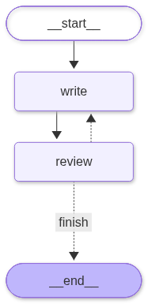

# [90일차] Tavily 검색 Agent와 Reflection, PDF Retriever

## 1. 검색 도구가 필요한 이유

LLM이 학습한 지식만으로는 최신 문서나 현재 상황을 정확히 답하기 어렵다. 검색 도구를 연결하면 외부 자료를 가져와 답변의 근거로 사용할 수 있다.

```text
사용자 질문
    |
    v
모델이 검색 필요 여부 판단
    |
    +-- 검색 불필요 ----------------------> 답변
    |
    +-- 검색 필요 -> 검색 도구 -> 결과 확인 -> 답변
```

검색을 사용한다고 답변이 항상 정확해지는 것은 아니다. 오래된 글이나 질문과 관련 없는 자료가 검색될 수 있고, 모델이 검색 내용을 잘못 해석할 수도 있다.

| 확인할 항목 | 이유 |
|---|---|
| 출처 | 공식 문서인지, 개인의 해석인지 구분 |
| 날짜 | 현재 상황에도 맞는 정보인지 확인 |
| 질문과의 관련성 | 검색어가 들어 있다는 이유만으로 정답 근거가 되지는 않음 |
| 원문 | 검색 결과의 짧은 설명만으로 맥락을 판단하기 어려울 수 있음 |

검색된 페이지에 명령문이 포함되어 있더라도 그것은 외부 자료의 내용이다. 사용자의 요청이나 시스템의 실행 지시와 구분해야 한다.

## 2. 실습 환경과 API 설정

### 필요한 패키지

```python
%pip install python-dotenv tavily-python langchain-tavily langgraph langchain-openai pydantic
%pip install langchain-community pypdf langchain-text-splitters rank-bm25 langchain-chroma
```

| 패키지 | 사용하는 기능 |
|---|---|
| `python-dotenv` | `.env` 파일 읽기 |
| `tavily-python` | `TavilyClient`로 검색 API 직접 사용 |
| `langchain-tavily` | Agent에 연결할 `TavilySearch` 도구 |
| `langgraph` | 검색과 검토 작업의 실행 흐름 구성 |
| `langchain-openai` | 채팅 모델과 임베딩 모델 연결 |
| `pydantic` | 평가 결과의 구조 정의 |
| `langchain-community`, `pypdf` | 원본의 PDF 로더와 BM25 검색기 사용 |
| `langchain-text-splitters` | PDF 텍스트를 청크로 분할 |
| `rank-bm25` | BM25 검색 계산 |
| `langchain-chroma` | Chroma 벡터 저장소 연결 |

### 환경 변수 존재 여부 확인

```python
import os
from dotenv import load_dotenv


load_dotenv()

OPENAI_API_KEY = bool(os.getenv("OPENAI_API_KEY"))
TAVILY_API_KEY = bool(os.getenv("TAVILY_API_KEY"))
OPENAI_MODEL = bool(os.getenv("OPENAI_MODEL"))

print(
    "OPENAI_API_KEY", OPENAI_API_KEY,
    "| TAVILY_API_KEY", TAVILY_API_KEY,
    "| OPENAI_MODEL", OPENAI_MODEL,
)
```

노트북의 저장된 출력은 다음과 같다.

```text
OPENAI_API_KEY True | TAVILY_API_KEY True | OPENAI_MODEL True
```

여기서 세 변수의 값은 실제 키나 모델 이름이 아니라 **설정 여부를 나타내는 bool**이다.

```text
os.getenv("TAVILY_API_KEY")        -> 실제 환경 변수의 문자열 값
bool(os.getenv("TAVILY_API_KEY"))  -> 비어 있지 않으면 True
```

### 채팅 모델 생성

```python
from langchain_openai import ChatOpenAI


MODEL_NAME = os.getenv("OPENAI_MODEL", "gpt-6-luna")


def make_llm():
    if not OPENAI_API_KEY:
        print("KEY ERROR!")
        return None

    return ChatOpenAI(
        model=MODEL_NAME,
        reasoning_effort="none",
        timeout=30,
        max_retries=2,
        temperature=0,
    )


llm = make_llm()
```

| 설정 | 의미 |
|---|---|
| `model` | 사용할 모델 이름 |
| `reasoning_effort` | 추론 관련 설정. 선택한 모델의 지원 여부 확인 필요 |
| `timeout=30` | API 요청의 타임아웃 설정. 전체 그래프 실행 시간을 30초로 제한하는 것은 아님 |
| `max_retries=2` | 재시도 가능한 API 오류에 대한 재시도 설정 |
| `temperature=0` | 생성의 무작위성을 낮추는 설정. 완전한 재현성을 보장하지는 않음 |

## 3. TavilyClient로 웹 검색하기

Tavily는 AI 애플리케이션에서 사용할 검색 API다. 검색 결과를 제목, URL, 본문 일부 등의 필드로 받을 수 있다.

`TavilyClient`를 사용하면 모델의 판단 없이 Python 코드에서 바로 검색을 실행한다. 

```python
from tavily import TavilyClient


if TAVILY_API_KEY:
    tavily_client = TavilyClient(api_key=os.getenv("TAVILY_API_KEY"))

    raw_search = tavily_client.search(
        query="랭그래프는 뭐야?",
        max_results=3,
    )

    print("최상위 키:", list(raw_search.keys()))

    for idx, item in enumerate(raw_search.get("results", []), start=1):
        print("제목:", item.get("title", ""))
        print("주소:", item.get("url", ""))
        print("요약:", str(item.get("content", ""))[:200])
else:
    print("KEY ERROR!!")
```

### 검색 결과의 구조

원본에서 출력된 최상위 키다.

```text
['query', 'follow_up_questions', 'answer', 'images', 'results', 'response_time', 'request_id']
```

| 필드 | 의미 |
|---|---|
| `query` | 검색어 |
| `results` | 검색된 문서 목록 |
| `answer` | 설정과 응답에 따라 제공되는 답변. 값이 없을 수도 있음 |
| `images` | 이미지 결과. 비어 있을 수도 있음 |
| `response_time` | 응답 시간 정보 |
| `request_id` | 요청 식별자 |

각 검색 결과에서 코드가 읽는 필드는 다음과 같다.

```text
raw_search
  └── results
       ├── 첫 번째 결과: title, url, content, ...
       ├── 두 번째 결과: title, url, content, ...
       └── 세 번째 결과: title, url, content, ...
```

### 코드에서 사용하는 표현

| 표현 | 역할 |
|---|---|
| `max_results=3` | 반환할 결과 개수의 상한 설정 |
| `.get("results", [])` | 해당 키가 없으면 빈 리스트 사용 |
| `enumerate(..., start=1)` | 반복할 때 1부터 번호 부여 |
| `item.get("title", "")` | 제목이 없으면 빈 문자열 사용 |
| `[:200]` | 출력할 텍스트를 앞 200자로 제한 |

`content[:200]`은 검색 결과 내용을 잘라 보여주는 것이다. 이 코드가 별도로 요약 모델을 호출한 것은 아니다. 또한 `idx`는 원본에서 번호를 만들지만 실제 출력문에는 사용하지 않는다.

## 4. TavilyClient와 TavilySearch의 차이

| 구분 | TavilyClient | TavilySearch |
|---|---|---|
| import | `from tavily import TavilyClient` | `from langchain_tavily import TavilySearch` |
| 용도 | 검색 API 직접 호출 | LangChain·LangGraph용 검색 도구 |
| 직접 실행 | `.search(query=...)` | `.invoke({"query": ...})` |
| Agent 연결 | 직접 실행 흐름을 작성해야 함 | `bind_tools()`와 `ToolNode`에 연결 |

```python
from langchain_tavily import TavilySearch


search_tool = TavilySearch(max_results=3)

# 검색 도구를 직접 실행할 때 사용하는 형태다.
search_result = search_tool.invoke({"query": "LangGraph 공식 문서"})
```

`TavilySearch(...)`는 도구를 생성하고, 생성된 도구의 실행은 `.invoke(...)`로 요청한다.

## 5. LangGraph에 검색 도구 연결하기

직접 검색할 때는 코드가 항상 검색을 실행한다. Agent에 연결하면 모델이 질문을 읽고 검색이 필요한지 판단할 수 있다.

```python
from langgraph.graph import StateGraph, START, END, MessagesState
from langgraph.prebuilt import ToolNode, tools_condition


if llm is not None and TAVILY_API_KEY:
    search_tool = TavilySearch(max_results=3)
    search_llm = llm.bind_tools([search_tool])

    def search_agent_node(state: MessagesState):
        response = search_llm.invoke(state["messages"])
        return {"messages": [response]}

    search_builder = StateGraph(MessagesState)
    search_builder.add_node("agent", search_agent_node)
    search_builder.add_node("tools", ToolNode([search_tool]))

    search_builder.add_edge(START, "agent")
    search_builder.add_conditional_edges("agent", tools_condition)
    search_builder.add_edge("tools", "agent")

    search_graph = search_builder.compile()

    result = search_graph.invoke(
        {"messages": [{
            "role": "user",
            "content": "LangGraph 최신 공식 문서를 찾아줘",
        }]},
        config={"recursion_limit": 10},
    )

    for message in result["messages"]:
        print(type(message).__name__, str(message.content)[:500])
else:
    print("KEY ERROR!")
```

### 검색 Agent의 실행 과정

```text
START
  |
  v
agent: 모델이 질문과 기존 메시지 확인
  |
  v
tools_condition
  |
  +-- 검색 요청 있음 --> tools: Tavily 검색 실행
  |                         |
  |                         +--> agent: 검색 결과 확인
  |
  +-- 도구 요청 없음 --> END
```

| 구성요소 | 이 예제에서 하는 일 |
|---|---|
| `MessagesState` | 사용자·모델·도구 메시지 관리 |
| `bind_tools([search_tool])` | 모델이 검색 도구의 이름과 입력 구조를 알 수 있게 연결 |
| `search_agent_node()` | 모델 응답을 메시지 상태에 추가 |
| `ToolNode([search_tool])` | 모델이 요청한 검색을 실제 실행 |
| `tools_condition` | 도구 요청이 있으면 `tools`, 없으면 종료 |

### AIMessage의 본문이 비어 있어도 실패는 아니다

모델이 도구 호출을 요청한 응답은 텍스트 대신 `tool_calls`에 필요한 정보가 들어 있을 수 있다.

```python
# 메시지를 더 자세히 확인하는 보완 예제다.
for message in result["messages"]:
    print(type(message).__name__)
    print("본문:", message.content)

    if getattr(message, "tool_calls", None):
        print("도구 호출:", message.tool_calls)
```

본문만 출력한 결과와 실제 도구 요청 여부는 구분해야 한다.

## 6. Reflection과 Reflexion

Reflection은 만든 결과물을 검토하고, 부족한 점을 바탕으로 수정하는 작업이다.

```text
초안 생성 -> 검토 -> 피드백 -> 수정 -> 재검토
```

Reflexion은 실패 원인이나 반성 내용을 기억하고 다음 시도에 활용하는 접근이다. 이름이 비슷하지만, 단순한 재작성 반복과 완전히 같은 의미는 아니다.

| 구분 | Reflection | Reflexion |
|---|---|---|
| 핵심 | 현재 결과물 검토와 수정 | 시도에서 얻은 반성 내용을 다음 시도에 활용 |
| 사용하는 정보 | 초안과 피드백 | 이전 시도의 경험과 반성 기록 |
| 예시 | 설명에 예시를 추가해 다시 작성 | 이전 실패 기록을 읽고 접근 전략 변경 |
| 이 노트북의 범위 | 검토 반복과 피드백 기반 수정 예제 | 개념 설명. 경험 메모리 기반 구현은 없음 |


## 7. 규칙으로 동작하는 초안 검토 그래프

### 상태 정의

```python
from typing import TypedDict, Literal

class ReviewState(TypedDict):
    topic: str
    draft: str
    feedback: str
    approved: bool
    attempts: int
```

| 필드 | 의미 |
|---|---|
| `topic` | 작성할 주제 |
| `draft` | 현재 초안 |
| `feedback` | 검토 결과와 수정 의견 |
| `approved` | 통과 여부 |
| `attempts` | 초안을 작성한 횟수 |

### 작성·검토·분기 함수

```python
def write_draft(state: ReviewState):
    text = f"{state['topic']}은 중요한 개념입니다."

    if state["attempts"] > 0:
        text += " 예시: 사용자의 질문을 검색하고 근거를 붙여 답합니다."

    return {
        "draft": text,
        "attempts": state["attempts"] + 1,
    }


def review_draft(state: ReviewState):
    good = "예시:" in state["draft"]

    return {
        "approved": good,
        "feedback": "통과" if good else "구체적인 예시를 추가하세요",
    }


def review_route(state: ReviewState) -> Literal["write", "finish"]:
    return (
        "finish"
        if state["approved"] or state["attempts"] >= 3
        else "write"
    )
```

원본의 피드백 문자열에 있던 오타만 문서에서 바로잡았다. 함수의 동작은 같다.

| 함수 | 역할 |
|---|---|
| `write_draft()` | 첫 작성은 정의만, 두 번째부터 예시 추가 |
| `review_draft()` | 초안에 `예시:`라는 문자열이 있는지 확인 |
| `review_route()` | 통과했거나 작성 횟수가 3 이상이면 종료 |

이 검토는 내용의 정확성이나 예시의 품질을 평가하지 않는다. `예시:`라는 글자가 있으면 통과하는 단순 규칙이다.

### 그래프 연결

```python
review_builder = StateGraph(ReviewState)
review_builder.add_node("write", write_draft)
review_builder.add_node("review", review_draft)

review_builder.add_edge(START, "write")
review_builder.add_edge("write", "review")
review_builder.add_conditional_edges(
    "review",
    review_route,
    {"write": "write", "finish": END},
)

review_graph = review_builder.compile()
```



노트북에 저장된 그래프 이미지다.

```text
START -> write -> review -- 통과 또는 3회 도달 --> END
           ^        |
           +--------+
          미통과이고 3회 미만
```

### 실행 결과

```python
review_result = review_graph.invoke({
    "topic": "RAG",
    "draft": "",
    "feedback": "",
    "approved": False,
    "attempts": 0,
})

print(review_result)
```

```text
{'topic': 'RAG', 'draft': 'RAG은 중요한 개념입니다. 예시: 사용자의 질문을 검색하고 근거를 붙여 답합니다.', 'feedback': '통과', 'approved': True, 'attempts': 2}
```

| 단계 | 작성 결과 | 횟수 | 검토 |
|---|---|---:|---|
| 첫 작성 | `RAG은 중요한 개념입니다.` | 1 | 예시가 없어 미통과 |
| 두 번째 작성 | 정의 뒤에 예시 추가 | 2 | `예시:`가 있어 통과 |

### 피드백을 생성하는 것과 활용하는 것은 다르다

`review_draft()`는 피드백을 상태에 저장하지만, `write_draft()`는 `feedback`을 읽지 않는다. `attempts > 0`이라는 조건에 따라 정해진 문장을 추가할 뿐이다.


## 8. 반복 그래프에서 종료 조건 확인하기

현재 예제에는 두 가지 종료 조건이 있다.

```python
state["approved"] or state["attempts"] >= 3
```

| 조건 | 목적 |
|---|---|
| `approved` | 요구사항을 만족하면 종료 |
| `attempts >= 3` | 계속 실패해도 작성 횟수 제한 |

최대 횟수에 도달해 종료한 경우에는 `approved=False`일 수 있다. **종료되었다는 사실과 통과했다는 사실은 다르다.**

`recursion_limit`은 이러한 반복을 무한히 실행하지 않도록 제한하는 안전장치다. 

## 9. LLM의 평가 결과를 구조화해서 받기

문자열 포함 여부보다 구체적인 검토가 필요하면 모델에 평가 기준을 전달할 수 있다. 결과는 Pydantic 모델로 정의한다.

```python
from pydantic import BaseModel, Field

class DraftGrade(BaseModel):
    score: int = Field(ge=0, le=5, description="정확성/구체성 기준 0~5점")
    strengths: str = Field(description="잘된 점")
    weaknesses: str = Field(description="부족한 점")
    revision_instruction: str = Field(description="다음 수정 지시")
```

| 필드 | 의미 |
|---|---|
| `score` | 0~5점의 평가 점수 |
| `strengths` | 유지할 장점 |
| `weaknesses` | 부족하거나 잘못된 점 |
| `revision_instruction` | 다음 수정에서 할 일 |

```python
if llm is not None:
    grader = llm.with_structured_output(DraftGrade)
    sample_draft = "RAG는 문서를 찾아 답변을 만드는 방법입니다."

    grade = grader.invoke(
        "다음 설명을 초보자용 교재 기준으로 평가하세요. "
        "정확성, 예시, 주의사항을 확인하세요.\n" + sample_draft
    )

    print(grade.model_dump())
else:
    print("KEY ERROR!")
```

`with_structured_output(DraftGrade)`로 정해진 필드를 가진 결과를 요청하고, `model_dump()`로 Python 딕셔너리 형태로 출력한다.

### 저장된 평가 결과 요약

원본 출력의 긴 설명을 항목별로 줄여 정리했다.

| 항목 | 저장된 결과의 핵심 |
|---|---|
| 점수 | **2점** |
| 장점 | 검색과 답변 생성을 연결하려는 설명 방향은 맞음 |
| 부족한 점 | 검색과 생성의 구분, 예시, 검색 품질에 따른 한계가 부족함 |
| 수정 지시 | 정의를 구체화하고 회사 규정집 예시와 주의사항 추가 |

이 점수는 한 번의 모델 평가 결과다. 객관적으로 고정된 정답 점수나 모델 성능 지표가 아니다. Pydantic도 점수의 범위와 필드 구조를 검사할 뿐, 평가 내용의 타당성까지 보장하지 않는다.

## 10. 피드백을 전달해 초안 수정하기

```python
if llm is not None:
    original = "RAG는 검색을 합니다."
    feedback = "정의와 실제 예시, 한계점을 추가하세요."

    improved = llm.invoke(
        "당신은 AI 교육 교재 편집자입니다. 사실을 지어내지 마세요.\n"
        f"원문: {original}\n피드백: {feedback}\n수정본만 작성하세요."
    )

    print(improved.content)
```

```text
RAG(Retrieval-Augmented Generation)는 외부 문서나 데이터베이스에서 관련 정보를 검색한 뒤, 검색 결과를 참고해 답변을 생성하는 방식입니다. 예를 들어 사내 규정 문서에서 휴가 관련 내용을 검색하고, 그 결과를 바탕으로 직원의 질문에 답할 수 있습니다. 다만 검색된 정보가 부정확하거나 최신이 아닐 수 있으며, 관련 문서를 찾지 못하면 답변의 품질이 떨어질 수 있습니다.
```

| 수정 전 | 수정 후 |
|---|---|
| 검색한다는 설명만 있음 | 검색한 정보를 바탕으로 답변을 생성한다고 설명 |
| 사용 사례 없음 | 사내 휴가 규정 질의응답 사례 추가 |
| 한계 설명 없음 | 정보의 정확성·최신성과 검색 실패 문제 추가 |

이 셀의 `feedback`은 직접 작성한 고정 문자열이다. 앞에서 받은 `grade.revision_instruction`을 자동으로 연결한 코드는 아니다. 또한 두 LLM 예제가 검토 그래프 안에 통합되어 있지는 않다.

## 11. RAG: 검색한 자료를 근거로 답변하기

RAG는 **Retrieval-Augmented Generation**, 즉 검색 증강 생성이다.

| 단계 | 하는 일 | 예시 |
|---|---|---|
| Retrieval | 질문과 관련된 자료 검색 | 규정집에서 휴가 관련 문단 찾기 |
| Augmentation | 검색 자료를 모델 입력에 포함 | 질문과 관련 문단을 함께 전달 |
| Generation | 자료를 참고해 답변 생성 | 휴가 규정을 설명하는 답변 작성 |

```text
사용자 질문
    |
    v
관련 문서 검색
    |
    v
질문 + 검색한 문서 내용을 모델에 전달
    |
    v
근거를 참고한 답변 생성
```

핵심은 외부 문서를 모델의 입력 맥락으로 제공한다는 점이다. 문서를 검색했다고 모델 파라미터가 다시 학습되는 것은 아니다.

또한 RAG가 반드시 벡터 검색만 사용하는 것은 아니다. 뒤의 예제처럼 BM25로 관련 문서를 찾을 수도 있다.

### 기본 RAG와 Agentic RAG

| 구분 | 기본적인 순차 RAG | Agentic RAG |
|---|---|---|
| 검색 시점 | 정해진 순서로 검색 | 상황에 따라 검색 여부 결정 가능 |
| 질문 처리 | 주어진 질문으로 검색 | 질문 재작성이나 여러 단계 검색 가능 |
| 결과가 부족할 때 | 별도 재시도 설계가 없으면 그대로 진행 | 결과를 평가하고 다시 검색하도록 설계 가능 |
| 특징 | 구조가 단순하고 실행 흐름 파악이 쉬움 | 복잡한 질문에 대응할 여지가 있지만 호출·비용·종료 제어가 필요 |

이는 대표적인 구조를 비교한 것이다. 모든 일반 RAG가 단일 경로인 것도, Agentic RAG가 항상 더 정확한 것도 아니다.

### Single-hop과 Multi-hop

| 구분 | 필요한 정보 연결 | 예시 |
|---|---|---|
| Single-hop | 한 자료에서 바로 확인 | 특정 도구의 설치 명령 찾기 |
| Multi-hop | 여러 사실을 순서대로 연결 | 문서에서 제품명을 찾고, 그 제품의 별도 공식 문서에서 기능 확인 |

여러 문서를 한 번에 반환했다고 반드시 Multi-hop 추론이 이루어진 것은 아니다. 앞에서 얻은 정보가 다음 검색이나 추론의 연결 고리가 되는지를 봐야 한다.

## 12. PDF 검색 예제의 전체 구조

이번 PDF 예제는 다음 단계까지 구현되어 있다.

```text
PDF 파일 탐색
    |
    v
페이지별 텍스트 추출
    |
    v
청크 분할 + 출처 메타데이터 추가
    |
    +--> BM25 검색기 ------------------> 관련 청크 출력
    |
    +--> 임베딩 생성 -> Chroma 검색기 --> 관련 청크 출력
```

**검색한 청크를 LLM에 전달해 최종 답변을 만드는 단계는 아직 없다.** 앞의 웹 검색 Agent와 이 PDF 검색기도 별도로 실행된다.

### 주요 용어

| 용어 | 의미 |
|---|---|
| Document | 본문인 `page_content`와 출처 정보인 `metadata`를 담은 객체 |
| Chunk | 긴 문서에서 나눈 작은 텍스트 조각 |
| Overlap | 인접 청크 사이에 겹치도록 남기는 부분 |
| Query | 검색 질문 또는 검색어 |
| Corpus | 검색 대상 문서 전체 |
| Candidate | 검색 결과로 선택된 후보 문서 |
| Embedding | 텍스트를 의미 비교에 사용할 숫자 벡터로 표현한 것 |
| Vector Store | 벡터와 문서 정보를 저장하고 검색하는 저장소 |
| Retriever | 질문을 받아 관련 문서 목록을 반환하는 인터페이스 |

## 13. PDF 파일 찾고 페이지별로 읽기

```python
from pathlib import Path
from langchain_community.document_loaders import PyPDFLoader


pdf_candidates = sorted(Path.cwd().glob("SPRi*.pdf"))

print("현재 폴더:", Path.cwd())
print("발견한 PDF:", [p.name for p in pdf_candidates])

pdf_path = pdf_candidates[0]
pdf_pages = PyPDFLoader(str(pdf_path)).load()

print("읽은 PDF 페이지 수:", len(pdf_pages))
print("첫 페이지의 메타데이터:", pdf_pages[0].metadata)
print("PDF 5페이지 일부:", pdf_pages[4].page_content[:500])
```

### 파일 탐색 코드 설명

| 코드 | 의미 |
|---|---|
| `Path.cwd()` | 현재 작업 폴더 |
| `.glob("SPRi*.pdf")` | 현재 폴더에서 이름이 `SPRi`로 시작하는 PDF 찾기 |
| `sorted(...)` | 파일 경로 목록 정렬 |
| `pdf_candidates[0]` | 정렬된 결과의 첫 파일 선택 |
| `PyPDFLoader(...).load()` | 기본 페이지 모드에서 페이지별 Document 목록 생성 |
| `pdf_pages[4]` | 0부터 시작하므로 PDF의 다섯 번째 페이지 |

현재 작업 폴더는 Notebook 파일 위치와 항상 같다고 보장할 수 없다. 파일을 찾지 못하면 `Path.cwd()` 출력과 실제 PDF 위치부터 확인한다. 후보가 없으면 `[0]`에서 오류가 나며, 여러 파일이 있으면 자동으로 최신 문서를 고르는 것이 아니라 정렬된 첫 파일을 고른다.

### 저장된 결과

```text
발견한 PDF: ['SPRi AI Brief 2026년 10월호(2026-10-09).pdf']
읽은 PDF 페이지 수: 28
```

메타데이터에서 핵심 항목만 추리면 다음과 같다. 원본에는 PDF 생성 프로그램과 생성 시각 등의 정보도 들어 있다.

```python
{
    "source": ".../SPRi AI Brief 2026년 10월호(2026-10-09).pdf",
    "total_pages": 28,
    "page": 0,
    "page_label": "1",
}
```

위 코드는 전체 메타데이터 출력이 아니라 구조를 보여주는 발췌다.

### 텍스트 추출 경고와 깨진 글자

원본에는 `Ignoring wrong pointing object ...`라는 PDF 파서 경고가 여러 번 출력되어 있다. 저장된 실행에서는 경고 뒤에 28페이지가 로드되었지만, 이것만으로 모든 글자가 정확하게 추출되었다고 볼 수는 없다.

실제로 뒤의 첫 청크 출력에는 깨진 문자와 제어문자가 포함되어 있다. 검색 품질은 추출된 텍스트의 품질에도 영향을 받는다. 페이지 수 확인뿐 아니라 본문 일부를 직접 확인하는 이유다.

`PyPDFLoader`의 일반 텍스트 추출을 사용한 것이며, 이 코드에 OCR이나 깨진 글자를 복원하는 처리는 없다.

원본의 import에는 `langchain-community` 관련 `DeprecationWarning`도 저장되어 있다. 여기서는 예제를 따라가기 위해 원래 import 경로를 유지했다. 경고는 당시 로딩 실패를 뜻하지 않지만, 새 환경에서는 설치한 버전의 안내를 확인해야 한다.

## 14. PDF를 청크로 나누기

문서 전체를 한 덩어리로 검색하면 질문과 관련 없는 내용까지 많이 섞일 수 있다. 작은 청크로 나누면 필요한 부분을 골라 가져오기 쉬워진다.

```python
from langchain_text_splitters import RecursiveCharacterTextSplitter


pdf_splitter = RecursiveCharacterTextSplitter(
    chunk_size=600,
    chunk_overlap=100,
)

pdf_chunks = pdf_splitter.split_documents(pdf_pages)

for i, doc in enumerate(pdf_chunks):
    doc.metadata["doc_id"] = f"SPRi-{i:04d}"
    doc.metadata["page_display"] = int(doc.metadata.get("page", 0)) + 1

print("페이지:", len(pdf_pages), "청크:", len(pdf_chunks))
```

```text
페이지: 28 청크: 86
```

### chunk_size와 chunk_overlap

| 설정 | 이 예제의 의미 |
|---|---|
| `chunk_size=600` | 기본 길이 계산인 문자 수 기준으로 청크 크기 제한 |
| `chunk_overlap=100` | 인접 청크 사이에서 최대 100자 정도의 겹침을 목표로 설정 |

`600`은 토큰 수가 아니다. 실제 청크 길이와 겹침은 문단·줄바꿈 등 분할 경계에 따라 달라질 수 있다. 모든 청크가 정확히 600자이거나 정확히 100자씩 겹치는 것은 아니다.

`RecursiveCharacterTextSplitter`는 기본적으로 문단, 줄바꿈, 공백 등의 구분자를 순서대로 고려해 텍스트를 나눈다. 의미를 이해해서 요약하거나 문장의 사실 여부를 판단하는 모델은 아니다. [공식 분할 방식 설명](https://docs.langchain.com/oss/python/integrations/splitters/recursive_text_splitter)

```text
긴 텍스트
|----------------------------|

청크 A
|--------------|
          |--------------|
          청크 B
          ^^^^^
          겹치는 구간
```

| 청크 설정 | 장점 | 주의할 점 |
|---|---|---|
| 작게 분할 | 관련 부분을 좁혀 찾기 쉬움 | 필요한 맥락이 끊길 수 있음 |
| 크게 분할 | 문맥을 더 많이 보존 | 관련 없는 내용이 함께 들어갈 수 있음 |
| 겹침 증가 | 경계에서 내용이 끊기는 문제 완화 | 저장량과 중복 결과 증가 가능 |

원본은 페이지별 Document를 각각 분할한다. 페이지 경계를 넘어 두 페이지의 문장을 하나로 연결하는 별도 처리는 없다.

## 15. 청크 ID와 페이지 정보를 남기는 이유

```python
for doc in pdf_chunks[:2]:
    print(
        "ID:", doc.metadata["doc_id"],
        "PDF_쪽:", doc.metadata["page_display"],
    )
    print(repr(doc.page_content[:200]))
```

저장된 첫 두 청크의 식별 정보다.

```text
ID: SPRi-0000 PDF_쪽: 1
ID: SPRi-0001 PDF_쪽: 2
```

본문 출력에는 첫 페이지의 깨진 문자와 두 번째 페이지의 목차가 포함되어 있다. `repr()`는 줄바꿈이나 제어문자를 드러내 텍스트 상태를 확인하는 데 도움이 된다.

| 메타데이터 | 용도 |
|---|---|
| `source` | 어떤 PDF에서 왔는지 확인 |
| `page` | 로더가 부여한 페이지 인덱스. 예제에서는 0부터 시작 |
| `page_display` | 사람이 PDF 뷰어에서 찾기 편하게 1을 더한 번호 |
| `doc_id` | 개별 청크를 구분하고 검색 결과를 추적 |

`f"SPRi-{i:04d}"`는 번호를 네 자리로 맞춘다.

```text
0  -> SPRi-0000
1  -> SPRi-0001
38 -> SPRi-0038
```

이 ID는 이번 분할 결과를 식별한다. 청크 크기나 원문이 바뀌면 같은 ID가 다른 내용을 가리킬 수 있으므로, 영구적으로 변하지 않는 문서 ID로 생각하면 안 된다.

PDF 뷰어의 페이지와 보고서에 인쇄된 쪽수도 다를 수 있다. 표지와 목차가 포함되어 있기 때문이다.

## 16. BM25로 단어 기반 검색하기

BM25는 질문과 문서에 등장하는 단어를 바탕으로 관련도를 계산하는 검색 방식이다. 단어의 등장 빈도, 문서 전체에서의 희소성, 문서 길이 등을 고려한다.

고유명사나 제품명처럼 정확한 단어를 찾고 싶을 때 유용하다. 이 예제에서는 임베딩 API를 호출하지 않고 로컬에서 검색한다.

### 검색에 사용할 토큰 만들기

```python
import re
from langchain_community.retrievers import BM25Retriever


def simple_tokens(text: str):
    return re.findall(r"[가-힣A-Za-z0-9]+", text.lower())
```

| 코드 | 역할 |
|---|---|
| `text.lower()` | 영문을 소문자로 변환 |
| `[가-힣A-Za-z0-9]+` | 한글 음절·영문·숫자가 연속된 부분 선택 |
| `re.findall(...)` | 찾은 문자열들을 리스트로 반환 |

다음은 전처리를 확인하기 위한 보완 예제다.

```python
print(simple_tokens("Muse 개인용 AI 에이전트 기능!"))
```

```text
['muse', '개인용', 'ai', '에이전트', '기능']
```

형태소 분석을 수행하는 함수는 아니다. 따라서 `기능`, `기능을`, `기능은`은 서로 다른 토큰으로 남는다. 한글 자모나 정규식 범위 밖의 문자는 이 토큰화에서 제외될 수 있다.

### BM25 검색기 구성과 실행

```python
pdf_bm25 = BM25Retriever.from_documents(
    pdf_chunks,
    preprocess_func=simple_tokens,
)

pdf_bm25.k = 4
pdf_hits = pdf_bm25.invoke("Muse 개인용 AI 에이전트 기능")

for rank, doc in enumerate(pdf_hits, start=1):
    print(
        f"{rank}위 | PDF {doc.metadata['page_display']}쪽 "
        f"| {doc.metadata['doc_id']}"
    )
    print(doc.page_content[:200].replace("\n", " "))
```

| 코드 | 의미 |
|---|---|
| `from_documents(pdf_chunks, ...)` | 청크를 검색 대상으로 등록 |
| `preprocess_func=simple_tokens` | 문서와 질문의 단어 처리 방식 지정 |
| `k=4` | 반환할 검색 결과 수 설정 |
| `.invoke(질문)` | 질문에 관련된 Document 목록 반환 |
| `.replace("\n", " ")` | 결과를 한 줄로 보기 쉽게 출력 |

### 노트북에 저장된 검색 순위

아래는 보고서 내용의 사실 검증이 아니라, 해당 실행의 검색 위치와 내용을 요약한 것이다.

| 순위 | PDF 뷰어 페이지 | 청크 ID | 출력 내용의 구분 |
|---:|---:|---|---|
| 1 | 13 | `SPRi-0038` | Muse와 앱·서비스 연동 관련 문단 |
| 2 | 2 | `SPRi-0001` | 보고서 목차 |
| 3 | 13 | `SPRi-0040` | Muse와 개인용 에이전트 관련 문단 |
| 4 | 14 | `SPRi-0042` | 스마트폰의 AI 에이전트 관련 문단 |

검색어와 직접 관련된 본문뿐 아니라 목차와 주변 주제도 반환되었다. **Top-4는 정답 네 개가 아니라 관련도 기준 후보 네 개**다.

이 출력에는 BM25 점수나 정답 라벨이 없다. 숫자 순위만으로 답변에 충분한 근거인지 판정할 수는 없다.

## 17. 임베딩과 Chroma로 의미 기반 검색하기

벡터 검색은 질문과 문서를 숫자 벡터로 바꾸고, 그 벡터의 유사도를 이용해 관련 문서를 찾는다.

예를 들어 문서에는 `이메일과 캘린더`가 있고 질문에는 `메일과 일정 관리`가 있을 수 있다. 표현이 정확히 같지 않아도 관련 문서를 찾을 가능성이 있다. 다만 유사하게 보이는 엉뚱한 자료도 가져올 수 있다.

### 임베딩 모델과 벡터 저장소의 역할

| 구성요소 | 역할 |
|---|---|
| `OpenAIEmbeddings` | 문서와 질문을 비교 가능한 숫자 벡터로 변환 |
| `Chroma` | 벡터·본문·메타데이터 저장과 검색 |
| `as_retriever()` | 저장소를 질문 입력 → Document 목록 반환 방식으로 사용 |

임베딩은 답변 문장을 생성하는 작업이 아니라 텍스트를 숫자로 표현하는 작업이다. 여기서는 `text-embedding-3-small`을 사용한다. 

### 구현 코드

```python
from langchain_openai import OpenAIEmbeddings
from langchain_chroma import Chroma


if OPENAI_API_KEY:
    pdf_embedding_model = OpenAIEmbeddings(
        model="text-embedding-3-small",
    )

    pdf_vectorstore = Chroma.from_documents(
        documents=pdf_chunks,
        embedding=pdf_embedding_model,
        collection_name="spri_ai_brief_202610",
    )

    pdf_vector_retriever = pdf_vectorstore.as_retriever(
        search_kwargs={"k": 4},
    )

    pdf_vector_hits = pdf_vector_retriever.invoke(
        "개인 비서가 이메일과 일정 관리를 돕는다는 내용"
    )

    for doc in pdf_vector_hits:
        print(
            f"PDF {doc.metadata['page_display']}쪽 "
            f"| {doc.page_content[:120]}"
        )
else:
    print("KEY ERROR!")
```

### 문서 등록과 질문 검색은 다른 단계다

```text
문서 등록
86개 청크 -> 문서 임베딩 생성 -> Chroma에 저장

질문 검색
질문 -> 질문 임베딩 생성 -> 저장된 벡터와 비교 -> 청크 반환
```

`Chroma.from_documents()`는 문서를 저장하기 위해 임베딩을 만들고, 검색 시에는 질문의 임베딩이 필요하다. 따라서 Chroma를 로컬에서 사용하더라도 **이 예제의 임베딩 생성은 OpenAI API를 사용한다.** 외부 전송과 API 비용을 고려해야 한다.

`collection_name`은 저장소 안의 데이터 묶음 이름이다. 파일 경로나 파일명이 아니다. 이 코드에는 `persist_directory`와 같은 명시적인 디스크 영속 저장 설정이 없다.

### 저장된 검색 결과

원본은 청크 ID 없이 페이지와 본문 일부를 출력했다. 순서와 내용의 구분만 정리하면 다음과 같다.

| 순서 | PDF 뷰어 페이지 | 출력 내용의 구분 |
|---:|---:|---|
| 1 | 14 | 앱·개인정보·기기 기능 접근과 운영체제 통합 관련 문단 |
| 2 | 13 | 개인용 AI 에이전트 소개 문단 |
| 3 | 13 | 개인용 에이전트 시장 관련 문단 |
| 4 | 8 | 모델 탈취 대응 관련 문단 |

마지막 결과처럼 질문과 직접 관련이 약해 보이는 문단도 포함되어 있다. 벡터 유사도가 높다는 사실과 답변에 필요한 근거라는 판단은 동일하지 않다.

## 18. BM25와 벡터 검색 비교하기

| 구분 | BM25 | 벡터 검색 |
|---|---|---|
| 비교 기준 | 토큰의 일치와 등장 통계 | 임베딩 벡터의 유사도 |
| 유용한 경우 | 제품명·약어·정확한 키워드 검색 | 다른 표현으로 묻는 의미 중심 질문 |
| 전처리 영향 | 단어 분리 방식의 영향이 큼 | 원문 품질과 임베딩 모델의 영향 |
| 이 예제의 외부 API | 검색 계산 자체에는 없음 | 문서·질문의 OpenAI 임베딩에 사용 |
| 공통 한계 | 관련 없는 후보가 반환될 수 있음 | 관련 없는 후보가 반환될 수 있음 |
| 반환 형태 | Document 목록 | Document 목록 |

### 결과를 읽을 때 확인할 점

1. 질문에 직접 답하는 본문인가, 단순히 키워드가 있는 목차인가?
2. 같은 페이지의 비슷한 청크가 중복해서 반환되었는가?
3. 깨진 글자나 머리말·꼬리말이 검색에 섞였는가?
4. 페이지 정보로 원문을 확인할 수 있는가?
5. 가져온 내용만으로 답할 수 있는가, 추가 자료가 필요한가?


## 20. 핵심 정리

1. `TavilyClient`는 검색 API를 직접 호출하고, `TavilySearch`는 Agent에 연결할 수 있는 검색 도구다.
2. 도구 호출 요청은 모델이 만들고, 실제 검색은 프로그램의 도구 실행 단계에서 수행한다.
3. 검토 루프는 평가 기준, 수정 정보 전달, 상태 갱신, 종료 조건을 각각 확인해야 한다.
4. 현재 규칙 기반 예제는 작성 횟수에 따라 예시를 붙인다. 자유로운 피드백을 읽고 수정하는 구현과는 다르다.
5. RAG는 검색·증강·생성의 결합이다. 이번 PDF 코드는 그중 문서 준비와 검색까지 구현했다.
6. PDF는 본문 추출 상태를 확인한 뒤 청크로 나누고, 출처와 페이지 정보를 보존해야 한다.
7. BM25와 벡터 검색 모두 관련 문서의 후보를 반환한다. Top-K 결과가 정답 근거라는 보장은 없다.
