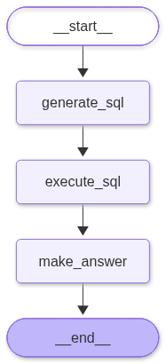

# [93일차] Text-to-SQL과 LangGraph, FastAPI·Gradio 연동

## 1. Text-to-SQL: 질문을 SQL로 바꾸기

사용자가 자연어로 질문하면 모델이 조회에 필요한 SQL을 작성하는 방식을 Text-to-SQL이라고 한다.

```text
질문 + DB 스키마 → 모델이 SQL 작성 → SQLite에서 조회 → 조회 결과를 문장으로 정리
```

테이블 구조를 참고해 쿼리를 작성하고, 실제 DB에서 반환한 **행과 값**을 답변의 근거로 사용한다. 이 과정에 PDF 검색이나 벡터 검색이 필요한 것은 아니다.

### 모델에 전달하는 테이블

질문은 “2009년에 고객 담당 직원별 매출 합계 상위 3명을 알려줘”다.

| 테이블 | 필요한 정보 |
|---|---|
| `Invoice` | `CustomerId`로 고객 연결, `InvoiceDate`로 날짜 제한, `Total`을 합산 |
| `Customer` | `SupportRepId`로 고객을 담당하는 직원 확인 |
| `Employee` | `EmployeeId`로 담당 직원 연결, 이름과 성 조회 |

```text
Invoice.CustomerId → Customer.CustomerId
Customer.SupportRepId → Employee.EmployeeId
```

전표가 직원에게 직접 연결된 구조가 아니다. **전표의 고객을 먼저 찾고, 그 고객의 담당 직원에게 전표 금액을 합산**한다. 이 예제에서 말하는 직원별 매출은 그 기준으로 계산한 값이다.

## 2. 프롬프트에 스키마와 조건 넣기

```python
import os
import re

from dotenv import load_dotenv
from langchain_openai import ChatOpenAI
from langchain_core.messages import HumanMessage

load_dotenv(".env")
MODEL = os.getenv("OPENAI_MODEL", "gpt-5.6-luna")
llm = ChatOpenAI(model=MODEL, temperature=0)

schema = db.get_table_info(["Invoice", "Customer", "Employee"])
question = "2009년에 고객 담당 직원별 매출 합계 상위 3명을 알려줘"

prompt = f"""
SQLite SELECT 쿼리 하나만 작성하세요. 코드블록 없이 SQL만 출력하세요.
스키마:
{schema}
질문: {question}
조건: Invoice.Total의 합계를 사용하고 InvoiceDate는 2009년으로 제한합니다.
고객의 SupportRepId를 담당 직원으로 정의합니다. 결과는 최대 3행.
INSERT/UPDATE/DELETE/DROP 등 데이터 변경문은 절대 금지합니다.
"""

raw_sql = llm.invoke([HumanMessage(content=prompt)]).content
print(raw_sql)
```

`llm.invoke()`는 SQL을 **만드는 단계**다. 이 시점에는 DB를 조회하지 않았다.

 `raw_sql`을 SQLite에 전달하는 실행 단계가 따로 필요하다.

### 노트북에 저장된 생성 SQL

```sql
SELECT e."EmployeeId", e."FirstName", e."LastName",
       SUM(i."Total") AS "TotalSales"
FROM "Invoice" AS i
JOIN "Customer" AS c ON i."CustomerId" = c."CustomerId"
JOIN "Employee" AS e ON c."SupportRepId" = e."EmployeeId"
WHERE i."InvoiceDate" >= '2009-01-01'
  AND i."InvoiceDate" < '2010-01-01'
GROUP BY e."EmployeeId", e."FirstName", e."LastName"
ORDER BY "TotalSales" DESC
LIMIT 3;
```

1. 두 번의 JOIN으로 각 전표가 어느 담당 직원에게 연결되는지 찾는다.
2. `2009-01-01`은 포함하고 `2010-01-01`은 제외한다. 날짜에 시간이 붙어 있어도 2009년 마지막 날을 범위에 넣을 수 있다.
3. 직원별로 전표의 `Total`을 더한다.
4. 합계가 큰 순서로 정렬하고 세 행만 반환한다.

## 3. 생성된 SQL 실행과 결과 확인

 `read_only_query()`는 모델이 만든 문자열을 간단히 검사한 뒤 SQLite에서 실행한다. 

`conn`은 SQLite 연결, `pd`는 pandas다.

```python
def read_only_query(sql: str, max_rows=20):
    sql = re.sub(
        r"^```(?:sql)?\s*|\s*```$",
        "",
        sql.strip(),
        flags=re.I,
    ).strip()

    if not re.match(r"^(SELECT|WITH)\b", sql, flags=re.I):
        raise ValueError("SELECT 또는 WITH 형태의 단일 쿼리만 허용합니다.")

    if re.search(
        r"\b(INSERT|UPDATE|DELETE|DROP|ALTER|CREATE|ATTACH|DETACH|PRAGMA|REPLACE|VACUUM)\b",
        sql,
        flags=re.I,
    ):
        raise ValueError("허용되지 않는 SQL 키워드가 있습니다.")

    cur = conn.execute(sql)
    columns = [d[0] for d in cur.description]
    return pd.DataFrame(cur.fetchmany(max_rows), columns=columns)


try:
    display(read_only_query(raw_sql))
except Exception as exc:
    print(type(exc).__name__, str(exc))
```

| 처리 | 이유 |
|---|---|
| 앞뒤 코드 블록 표시 제거 | 모델이 SQL을 Markdown으로 감싸더라도 실행할 문자열을 얻기 위해 |
| 시작 키워드·금지 키워드 검사 | 의도하지 않은 형태의 입력을 기본적으로 걸러내기 위해 |
| `conn.execute(sql)` | 검사한 SQL을 SQLite에서 실행 |
| `cur.description` | 조회 결과의 컬럼 이름 확인 |
| `fetchmany(max_rows)` | 한 번에 가져올 결과 행 수 제한 |

`LIMIT 3`은 SQL이 반환할 행을 제한하고, `fetchmany(max_rows)`는 Python이 커서에서 가져올 행 수를 제한한다. 

### 저장된 조회 결과

| EmployeeId | FirstName | LastName | TotalSales |
|---:|---|---|---:|
| 5 | Steve | Johnson | 164.34 |
| 4 | Margaret | Park | 161.37 |
| 3 | Jane | Peacock | 123.75 |

## 4. SQLDatabaseToolkit이 제공하는 도구

```python
from langchain_community.agent_toolkits import SQLDatabaseToolkit

toolkit = SQLDatabaseToolkit(db=db, llm=llm)
for tool in toolkit.get_tools():
    print(tool.name, ":", tool.description[:100])
```

| 출력된 도구 이름 | 역할 |
|---|---|
| `sql_db_query` | SQL 실행과 결과 확인 |
| `sql_db_schema` | 지정한 테이블의 구조와 샘플 행 확인 |
| `sql_db_list_tables` | 사용 가능한 테이블 목록 확인 |
| `sql_db_query_checker` | 모델을 이용해 쿼리를 실행 전에 점검 |


## 5. LangGraph로 SQL 질의응답 연결

같은 처리 순서를 여러 질문에 적용할 수 있도록 SQL 생성, 실행, 답변을 각각 노드로 나눈다.

```text
START → generate_sql → execute_sql → make_answer → END
```



### 상태와 노드

```python
from typing import TypedDict


class SQLState(TypedDict, total=False):
    question: str
    sql: str
    result: str
    answer: str
    error: str


def generate_sql(state: SQLState):
    p = f"""다음 SQLite 스키마만 사용해 SELECT SQL 하나를 만드세요.
    코드블록 없이 SQL만 출력하고 LIMIT 10을 포함하세요.
    스키마: {schema}
    질문: {state['question']}"""
    return {"sql": llm.invoke(p).content}


def execute_sql(state: SQLState):
    try:
        df = read_only_query(state["sql"], max_rows=10)
        return {
            "result": df.to_json(orient="records", force_ascii=False),
            "error": "",
        }
    except Exception as e:
        return {"result": "", "error": str(e)}


def make_answer(state: SQLState):
    if state.get("error"):
        return {"answer": "쿼리 실행 실패: " + state["error"]}

    msg = (
        f"질문: {state['question']}\n"
        f"조회 결과: {state['result']}\n"
        "조회 결과에 근거하여 한국어로 답하세요."
    )
    return {"answer": llm.invoke(msg).content}
```

| 노드 | 읽는 값 | 추가하는 값 |
|---|---|---|
| `generate_sql` | `question` | 생성한 `sql` |
| `execute_sql` | `sql` | `result`, `error` |
| `make_answer` | `question`, `result`, `error` | `answer` |

`total=False`이므로 타입 선언에서 모든 키를 처음부터 요구하지 않는다. 실행할 때는 `question`만 넣고 각 노드에서 필요한 값을 채운다.

`orient="records"`는 DataFrame의 각 행을 객체 하나로 표현해 JSON 배열 문자열을 만든다. `force_ascii=False`를 사용하면 한글을 유니코드 이스케이프로 바꾸지 않고 읽기 쉬운 형태로 남길 수 있다.

### 노드 연결과 실행

```python
from langgraph.graph import StateGraph, START, END

builder = StateGraph(SQLState)
builder.add_node("generate_sql", generate_sql)
builder.add_node("execute_sql", execute_sql)
builder.add_node("make_answer", make_answer)

builder.add_edge(START, "generate_sql")
builder.add_edge("generate_sql", "execute_sql")
builder.add_edge("execute_sql", "make_answer")
builder.add_edge("make_answer", END)

sql_graph = builder.compile()

result = sql_graph.invoke({
    "question": "2009년 고객 담당 직원별 매출 합계 1위는 누구인가요?",
})

print("생성 SQL:", result["sql"])
print("조회 결과:", result["result"])
print("최종 답변:", result["answer"])
```

**저장된 최종 답변:** 2009년 고객 담당 직원별 매출 합계 1위는 Steve Johnson으로, 총 164.34의 매출을 기록했다.

실행 오류가 나면 `execute_sql()`이 `error`를 저장하고, `make_answer()`가 모델을 다시 호출하지 않고 오류 문구를 반환한다. 

## 6. 회의 도우미: FastAPI와 Gradio의 역할

이 예제는 SQL 그래프를 웹에 연결한 것이 아니다. 회의 정보와 회의록을 입력받는 별도 실습이다.

```text
브라우저의 Gradio 화면 (:9999)
    → Gradio 콜백이 HTTP POST 요청
    → FastAPI (:8000)가 입력 처리
    → {"result": "..."} 응답
    → Gradio가 결과를 Markdown으로 표시
```

| 파일 | 맡은 역할 | 현재 상태 |
|---|---|---|
| `4_fastapi.py` | 회의 생성과 요약 API | 두 라우트가 작성되어 있으나 시작을 막는 오류가 있음 |
| `4_gradio.py` | 두 탭의 입력 UI와 API 호출 | 회의 생성·요약 탭과 버튼 콜백 작성 |
| `4_graph.py` | 회의 도우미의 LangGraph 구성 예정 | 노드 구상 주석과 `node1()`만 있음 |

## 7. FastAPI의 요청과 응답

```python
from fastapi import FastAPI
from pydantic import BaseModel

app = FastAPI(title="회의 관리 API")


class MeetingRequest(BaseModel):
    title: str
    people: str


class SummaryRequest(BaseModel):
    text: str


@app.post("/meeting")
def create_meeting(request: MeetingRequest):
    return {"result": make_meeting(request.title, request.people)}


@app.post("/summarize")
def summarize_meeting(request: SummaryRequest):
    return {"result": summarize(request.text)}
```

| 경로 | 요청 JSON 예시 | 서버가 하는 일 |
|---|---|---|
| `POST /meeting` | `{"title": "주간 회의", "people": "김사과, 이메론"}` | 제목과 참가자 문자열을 Markdown으로 정리 |
| `POST /summarize` | `{"text": "김사과: 목표 공유\n이메론: API 완료 예정"}` | 빈 줄을 제외해 줄 수를 세고, 첫 줄을 최대 50자로 표시 |

### 회의 생성

참가자는 쉼표를 기준으로 나누고, 각 이름의 공백과 빈 항목을 제거한다. 제목이 비어 있으면 안내 문구를 반환한다. **회의 정보를 화면에 표시하는 예제**로, DB에 회의를 저장하는 기능은 없다.

기본 입력으로 원본 처리 함수를 실행한 결과다.

```text
### 회의 생성됨
- 제목: 주간 회의
- 참가자: 김사과,이메론
```

### 간단 요약

회의록에 빈 줄이 아닌 줄이 몇 개 있는지 센다. 사람이 한 번 말한 내용을 분석하는 것이 아니라 줄바꿈을 기준으로 처리한다.

```text
발화 2줄 / 앞부분: 김사과: 목표 공유
```

이 결과는 LLM 요약이 아니라 **줄 수와 첫 줄을 보여주는 문자열 처리**다.

## 8. Gradio 버튼에서 API 호출하기

```python
API_URL = "http://127.0.0.1:8000"


def make_meeting(title: str, people: str) -> str:
    try:
        response = requests.post(
            f"{API_URL}/meeting",
            json={"title": title, "people": people},
        )
        response.raise_for_status()
        return response.json()["result"]
    except (requests.RequestException, ValueError, KeyError) as e:
        return f"서버 통신 오류 {e}"
```

Gradio 쪽의 `make_meeting()`은 서버에 요청을 보내는 함수다. 같은 이름의 FastAPI 쪽 함수는 받은 문자열을 실제로 처리한다. 이름이 같지만 다른 파일에서 각자 다른 일을 한다.

```python
# 첫 번째 탭의 버튼 연결
btn1.click(
    fn=make_meeting,
    inputs=[title, people],
    outputs=out1,
)

# 두 번째 탭의 버튼 연결
btn2.click(
    fn=summarize,
    inputs=[raw],
    outputs=out2,
)
```

| 인자 | 의미 |
|---|---|
| `fn` | 버튼을 눌렀을 때 실행할 함수 |
| `inputs` | 함수에 넘길 입력 컴포넌트. 지정한 순서대로 인자가 전달됨 |
| `outputs` | 함수가 반환한 값을 표시할 컴포넌트 |

회의 생성 버튼을 누르면 제목과 참가자가 콜백에 들어가고, 콜백이 서버 응답의 `result`를 반환하면 `out1`에서 Markdown으로 표시한다. 요약 버튼도 같은 흐름을 따른다.

## 9. 현재 파일에서 실행 전에 확인할 점

| 위치 | 원본 상태 | 필요한 조치 |
|---|---|---|
| `4_fastapi.py` 마지막 줄 | `uvicorn 4_fastapi:app --reload --port 8000`가 Python 코드로 들어가 있음 | 파일에서 해당 줄을 빼고, 실행할 때 터미널에서 사용 |
| `4_fastapi.py` 상단 | `graph_module.graph`에 접근하지만 `4_graph.py`에 `graph`가 없음 | 두 API만 실습할 때는 미완성 그래프 import·참조를 제외 |
| `4_gradio.py`의 `summarize()` | `response.raise_for_status`로 메서드를 참조만 함 | `response.raise_for_status()`로 호출 |

### 두 탭만 실습하는 실행 순서

아래 명령은 표의 문제를 수정한 뒤, 파일이 있는 폴더에서 실행하는 예시다. 원본 파일에는 적용하지 않았다.

```bash
# 첫 번째 터미널
python -m uvicorn "4_fastapi:app" --reload --port 8000
```

```bash
# 두 번째 터미널
python 4_gradio.py
```

FastAPI는 `http://127.0.0.1:8000`에서 요청을 받고, Gradio 화면은 `http://127.0.0.1:9999`에서 열린다. `4_fastapi:app`은 `4_fastapi.py`의 `app` 객체를 의미한다.

## 핵심 정리

- Text-to-SQL은 모델의 쿼리 생성, DB 실행, 결과 설명을 서로 다른 단계로 다룬다.
- SQL 그래프는 상태에 생성 SQL과 조회 결과를 저장하고, 실행 오류가 있으면 안내 문구를 반환한다.
- 회의 도우미에서 Gradio는 입력과 출력 화면을, FastAPI는 JSON 요청 처리와 응답을 맡는다.
- SQL 그래프는 실행 결과가 저장되어 있다. 회의 도우미의 전체 그래프와 세 번째 탭은 아직 구현되지 않았다.
