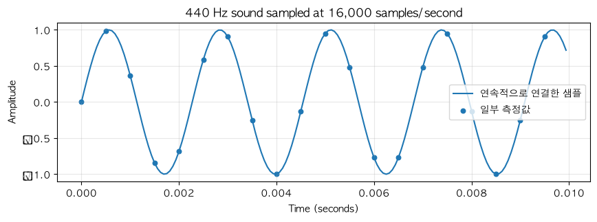

# [95일차] 회의 조회 API와 Qwen3-ASR 음성 인식

저장된 회의를 목록과 ID로 조회하고, Gradio에 결과를 표시한다. 음성 실습에서는 파형을 숫자로 표현하고, WAV 파일을 읽어 Qwen3-ASR에 전달한다. 회의 앱에서는 음성 입력 UI까지 구성하고, 전사 자체는 노트북에서 별도로 다룬다.

## 1. SQLite에서 저장된 회의 조회하기

### 목록 조회: 필요한 컬럼만 선택

```python
from typing import Any


def list_meetings(limit: int = 20) -> list[dict[str, Any]]:
    with get_connection() as conn:
        rows = conn.execute(
            """
            select id, title, people, summary, created_at
            from meetings
            order by id desc
            limit ?
            """,
            (limit,),
        ).fetchall()

    return [dict(row) for row in rows]
```

`ORDER BY id DESC`는 ID가 큰 행부터 정렬한다. 자동 증가 ID를 사용하므로 이 예제에서는 나중에 저장한 회의부터 볼 수 있다. `LIMIT ?`에는 가져올 행 수를 바인딩하며, `(limit,)`은 값 하나를 담은 튜플이다.

### 단건 조회: 회의 ID로 한 행 찾기

```python
def get_meeting(meeting_id: int) -> list[dict[str, Any]] | None:
    with get_connection() as conn:
        row = conn.execute(
            "select * from meetings where id = ?",
            (meeting_id,),
        ).fetchone()

    return [dict(row)] if row else None
```

`fetchone()`은 결과에서 한 행을 가져오고, 없으면 `None`을 반환한다. 여기서는 한 건을 조회하더라도 딕셔너리를 리스트로 감싼다. 목록과 상세에 같은 Markdown 포맷 함수를 쓰기 때문이다. 따라서 상세 응답의 `item`도 **객체 하나가 아니라 원소 하나인 배열**이다.

## 2. FastAPI 목록·상세 조회

```python
from fastapi import HTTPException
from db import list_meetings, format_meetings_markdown, get_meeting


@app.get("/meetings")
def meetings_list(limit: int = 20):
    rows = list_meetings(limit=limit)
    return {
        "items": rows,
        "markdown": format_meetings_markdown(rows),
        "result": format_meetings_markdown(rows),
    }


@app.get("/meetings/{meeting_id}")
def meetings_detail(meeting_id: int):
    row = get_meeting(meeting_id)
    if row is None:
        raise HTTPException(status_code=404, detail=f"회의 #{meeting_id} 없음")

    detail = format_meetings_markdown(row)
    return {"item": row, "markdown": detail, "result": detail}
```

| 요청 | 처리 | JSON 데이터 |
|---|---|---|
| `GET /meetings` | 기본 최대 20건 조회 | `items`에 목록 |
| `GET /meetings?limit=1` | ID 내림차순으로 첫 한 건 조회 | `items`에 최대 한 행 |
| `GET /meetings/1` | 경로의 `1`을 회의 ID로 사용 | `item`에 해당 행을 담은 배열 |
| 존재하지 않는 정수 ID | `HTTPException` 발생 | HTTP `404`와 `detail` |
| `GET /meetings/abc` | 정수 경로 매개변수 검증 실패 | HTTP `422` |

`limit`은 쿼리 매개변수이고 `meeting_id`는 경로 매개변수다. `limit: int`는 정수 여부를 검증하지만 별도의 최솟값이나 최댓값은 지정하지 않는다. 없는 회의는 빈 성공 응답으로 돌려주지 않고 `404`로 구분한다. 

예를 들어 ID 999가 없다면 다음 응답이 돌아온다.

```json
{"detail": "회의 #999 없음"}
```

### JSON에 원문이 있는데 화면에는 왜 안 보이는가?

```python
def format_meetings_markdown(rows: list[dict[str, Any]]) -> str:
    if not rows:
        return "저장된 회의가 없습니다."

    lines = ["### 저장된 회의 목록", ""]
    for row in rows:
        lines.append(
            f"- #{row['id']} {row['title']}"
            f"({row['people'] or '참가자 없음'}) - {row['created_at']}"
        )
        lines.append(f" -요약: {row['summary']}")
    return "\n".join(lines)
```

상세 SQL은 `SELECT *`를 사용하므로 응답의 `item[0]`에는 `notes`, `actions`, `result`도 들어 있다. 그러나 화면용 `markdown`은 위 함수에서 따로 만들기 때문에 **제목·참가자·저장 시각·요약만 표시**한다. 상세 화면의 제목도 같은 함수가 정한 `저장된 회의 목록`이다. 원문을 보여주려면 상세 응답의 Markdown을 만드는 부분에서 해당 필드를 사용해야 한다.

`markdown`과 `result`에는 같은 문자열이 들어 있다. 목록 라우트는 포맷 함수를 두 번 호출하지만, 상세 라우트는 `detail`에 한 번 담아 두 키에 재사용한다.

## 3. Gradio에서 저장된 회의 보기

### 공통 호출 함수의 GET 분기

```python
def call_api(path: str, payload: dict | None = None, method: str = "POST") -> str:
    try:
        url = f"{API_URL}{path}"
        if method == "GET":
            response = requests.get(url, timeout=10)
        else:
            response = requests.post(url, json=payload, timeout=10)

        response.raise_for_status()
        data = response.json()

        if "markdown" in data:
            return data["markdown"]
        if "result" in data:
            text = data["result"]
            meeting_id = data.get("meeting_id") or 0
            if meeting_id:
                text += f"\n\n_(응답 meeting_id={meeting_id})_"
            return text
        return str(data)
    except (requests.RequestException, ValueError, KeyError) as e:
        return f"서버 통신 오류: {e}"
```

조회 요청에는 JSON 본문을 보내지 않는다. 응답을 받으면 `markdown`을 먼저 사용하고, 그 키가 없을 때 `result`를 읽는다. `meeting_id`를 덧붙이는 분기는 최상위 JSON에 ID가 있을 때만 실행된다. 현재 `/pipeline`은 `result`만 반환하며, 저장 ID는 이미 그 문자열 안에 있다.

서버가 `404`를 보내면 `raise_for_status()`에서 예외가 발생한다. 화면에는 공통 오류 문구가 표시되며, 서버의 `detail`을 별도로 꺼내 보여주는 코드는 없다.

### 목록과 상세 버튼 연결

```python
def show_meetings() -> str:
    return call_api("/meetings", method="GET")


def show_meeting_detail(meeting_id: float | int) -> str:
    try:
        mid = int(meeting_id)
    except (TypeError, ValueError):
        return "조회할 회의 id를 숫자로 입력하세요."

    if mid <= 0:
        return "1 이상의 회의 id를 입력하세요."

    return call_api(f"/meetings/{mid}", method="GET")


with gr.Tab("4. 저장된 회의"):
    gr.Markdown("저장된 결과를 조회합니다.")
    btn4 = gr.Button("목록 새로고침")
    out4 = gr.Markdown()
    btn4.click(show_meetings, outputs=out4)

    mid = gr.Number(label="회의 id", value=1, precision=0)
    btn5 = gr.Button("상세 조회")
    out5 = gr.Markdown()
    btn5.click(show_meeting_detail, inputs=mid, outputs=out5)
```

이 코드는 기존 `gr.Blocks()` 내부에서 탭을 구성하는 부분이다. 목록 버튼은 입력값 없이 `out4`를 갱신하고, 상세 버튼은 숫자 입력란의 값을 콜백에 넘긴 뒤 `out5`를 갱신한다. 회의를 저장했다고 목록이 자동으로 새로고침되지는 않는다.

임시 DB에 주간 회의, 개발 회의 순서로 저장해 확인한 결과다.

| 확인한 요청 | 결과 |
|---|---|
| 저장 전 `GET /meetings` | 빈 배열과 `저장된 회의가 없습니다.` |
| `GET /meetings?limit=1` | 나중에 저장한 개발 회의 한 건 |
| `GET /meetings/1` | 주간 회의의 전체 행. 화면용 Markdown에는 요약만 포함 |
| `GET /meetings/999` | HTTP `404` |

## 4. ASR과 샘플링

ASR(Automatic Speech Recognition)은 사람이 말한 음성을 인식해 텍스트로 바꾸는 기술이다. 음성을 텍스트로 변환하는 작업을 STT(Speech-to-Text)라고도 한다. 이번 예제에서 사용하는 모델은 Qwen3-ASR이다.

마이크가 기록한 소리는 일정한 시간 간격으로 측정한 값의 배열로 다룰 수 있다. 음수는 파형의 반대 방향을 나타내며, 값의 크기를 비교할 때는 절댓값을 사용한다.

```python
import numpy as np

data = np.array(
    [0.0, 0.4, 0.8, 0.4, 0.0, -0.4, -0.8, -0.4],
    dtype=np.float32,
)
print("측정 횟수:", len(data))
print("가장 큰 절대값:", np.max(np.abs(data)))
```

```text
측정 횟수: 8
가장 큰 절대값: 0.8
```

| 개념 | 1초를 기준으로 무엇을 세는가? | 예시 |
|---|---|---|
| 소리의 주파수 | 파형이 반복되는 횟수 | `440 Hz`는 초당 440번 진동 |
| 샘플링 레이트 | 신호를 측정하는 횟수 | `16 kHz`는 채널당 초당 16,000개 샘플 |

같은 Hz 단위를 쓰더라도 뜻은 다르다. `16 kHz`로 4초간 녹음하면 **채널당 64,000개**를 측정한다. 이때 모노 배열은 보통 `(64000,)`, 스테레오 배열은 `(64000, 2)` 형태다. 일부 라이브러리는 모노도 `(64000, 1)`로 반환한다.

### 440 Hz 파형 그리기

```python
import matplotlib.pyplot as plt

sample_rate = 16000
duration = 0.01
t = np.arange(int(sample_rate * duration)) / sample_rate
frequency = 440
wave = np.sin(2 * np.pi * frequency * t)

plt.figure(figsize=(10, 3))
plt.plot(t, wave, label="연속적으로 연결한 샘플")
plt.scatter(t[::8], wave[::8], s=22, label="일부 측정값")
plt.xlabel("Time (seconds)")
plt.ylabel("Amplitude")
plt.title("440 Hz sound sampled at 16,000 samples/second")
plt.legend()
plt.grid(alpha=0.3)
plt.show()
```



0.01초 동안 샘플 160개를 만든다. 선은 샘플을 이어 그린 것이고, 점은 그중 8개 간격으로 골라 표시한 것이다. `t[::8]`은 시각화를 위한 선택이지, 원래 샘플링 레이트를 변경하는 연산은 아니다. 그림은 노트북에 저장된 출력이다.

## 5. WAV 파일 쓰고 읽기

```python
import soundfile as sf

sr = 16000
t = np.arange(sr) / sr
tone = (0.2 * np.sin(2 * np.pi * 440 * t)).astype(np.float32)

sf.write("practice_440hz.wav", tone, sr)
loaded, loaded_sr = sf.read("practice_440hz.wav")

print("저장된 샘플링 레이트:", loaded_sr)
print("샘플 개수:", len(loaded))
print("녹음 길이:", len(loaded) / loaded_sr, "초")
```

```text
저장된 샘플링 레이트: 16000
샘플 개수: 16000
녹음 길이: 1.0 초
```

`0.2`는 진폭, `440`은 주파수다. `sf.write()`는 배열과 샘플링 레이트를 파일로 쓰고, `sf.read()`는 두 값을 다시 반환한다. 오디오 길이는 `샘플 프레임 수 / 샘플링 레이트`로 계산한다.

배열의 `float32`와 WAV에 저장되는 인코딩은 별개다. `subtype`을 지정하지 않은 이 예제의 WAV는 실제로 `PCM_16`으로 저장됐다. [SoundFile의 WAV 기본 subtype](https://python-soundfile.readthedocs.io/en/latest/#soundfile.default_subtype)

`practice_440hz.wav`는 음성이 아닌 테스트용 사인파다. 전사 예제의 `sample.wav`에는 사람이 말한 음성이 필요하다.

## 6. Qwen3-ASR 모델 불러오기

노트북은 `qwen-asr` 패키지의 `Qwen3ASRModel`을 사용한다.

```bash
python -m pip install qwen-asr
```

```python
import torch
from qwen_asr import Qwen3ASRModel

if torch.cuda.is_available():
    DEVICE = torch.device("cuda")
elif torch.xpu.is_available():
    DEVICE = torch.device("xpu")
else:
    DEVICE = torch.device("cpu")

print(DEVICE)

model_name = "Qwen/Qwen3-ASR-1.7B"
dtype = torch.bfloat16 if torch.cuda.is_bf16_supported() else torch.float16

model = Qwen3ASRModel.from_pretrained(
    model_name,
    max_inference_batch_size=1,
    dtype=dtype,
    device_map=DEVICE,
    max_new_tokens=256,
)
```

| 설정 | 하는 일 |
|---|---|
| `Qwen/Qwen3-ASR-1.7B` | 사용할 체크포인트 지정. `1.7B`는 약 17억 개의 매개변수를 뜻함 |
| `device_map` | 모델을 배치할 장치 지정 |
| `dtype` | 모델의 수치 정밀도 설정 |
| `max_inference_batch_size=1` | 한 추론 배치에 넣을 입력을 최대 한 개로 제한 |
| `max_new_tokens=256` | 모델이 생성할 새 출력 토큰 수 제한. 글자 수나 오디오 길이와는 다름 |

원본에서 Apple의 MPS 분기는 주석 처리되어 있으며, 저장된 장치 출력은 `cpu`다. dtype 선택은 CUDA의 BF16 지원 여부를 기준으로 하므로 CPU 경로에서도 원본은 `float16`을 선택한다. 이 설정이 모든 장치의 전사에 적합하다는 의미는 아니다.

노트북에는 체크포인트 2개를 불러온 진행 기록이 남아 있다. **모델 로딩 완료와 음성 인식 성공은 별개**다. [Qwen3-ASR 공식 사용 예제](https://github.com/QwenLM/Qwen3-ASR)

## 7. 음성 파일을 읽어 한국어로 전사하기

아래는 마지막 셀을 바탕으로, 출력문의 쉼표 누락과 `result`/`results` 변수명 불일치만 바로잡은 예제다.

```python
from pathlib import Path

if Path("sample.wav").exists():
    with sf.SoundFile("sample.wav") as f:
        sr = f.samplerate
        audio = f.read(frames=sr * 5, dtype="float32")

    if audio.ndim == 2:
        audio = audio.mean(axis=1)

    print("샘플링 레이트:", sr)
    print("음성 길이:", len(audio) / sr, "초")

    results = model.transcribe(
        audio=(audio, sr),
        language="Korean",
    )
    print("인식 결과:", results[0].text)
else:
    print("sample.wav를 준비한 후 다시 실행하세요.")
```

### 앞부분만 읽고 모노로 변환

1. `f.samplerate`로 파일의 실제 샘플링 레이트를 확인한다. 앞에서 만든 테스트 WAV의 `16000`을 그대로 가정하지 않는다.
2. `frames=sr * 5`는 파일의 처음부터 **최대 5초** 분량을 읽는다. 파일이 더 짧으면 실제로 읽은 만큼만 처리한다.
3. 다채널 배열은 `(프레임 수, 채널 수)` 형태다. `mean(axis=1)`은 각 프레임에서 채널 값을 평균 내 모노 배열로 바꾼다.

```python
stereo = np.array([[0.1, 0.3], [-0.2, 0.4]], dtype=np.float32)
mono = stereo.mean(axis=1)

print(stereo.shape, "->", mono.shape)
print(mono)
```

```text
(2, 2) -> (2,)
[0.2 0.1]
```

채널을 평균 내도 샘플링 레이트와 프레임 수는 유지된다. 모델에는 `(audio, sr)`를 전달해 음성 배열의 시간 간격을 함께 알려준다. `language="Korean"`은 한국어로 인식하도록 지정하는 값이지, 다른 언어를 한국어로 번역하라는 뜻이 아니다.

### 인식 결과를 읽는 위치

`transcribe()`의 반환값은 입력별 결과 목록이다. 음성을 하나 넣었으므로 `results[0].text`로 첫 번째 전사 텍스트를 읽는다. 원본 출력문은 쉼표가 없어 셀을 파싱할 때 문법 오류가 난다. 쉼표만 추가하면 결과를 저장한 이름인 `results`와도 맞춰야 한다. 노트북에는 이 셀의 실행 결과가 저장되어 있지 않아 전사 문장을 예시 출력으로 싣지 않았다.

## 8. 음성 회의 탭의 구현 범위

다섯 번째 탭은 ASR 상태 버튼과 음성 입력을 제공한다. 다음은 `gr.Blocks()` 내부의 탭 구성에서 핵심만 발췌한 코드다.

```python
def show_asr_status() -> str:
    return call_api("/asr/status", method="GET")


with gr.Tab("5. 음성 회의"):
    btn_status = gr.Button("ASR 상태 보기")
    out_status = gr.Markdown()
    btn_status.click(show_asr_status, outputs=out_status)

    audio = gr.Audio(
        label="마이크 녹음 또는 파일",
        sources=["microphone", "upload"],
        type="filepath",
    )
```

`sources`는 마이크와 파일 업로드를 모두 허용한다. `type="filepath"`는 이 컴포넌트를 콜백의 입력으로 연결할 때 오디오 배열 대신 파일 경로를 받도록 지정한다. 오디오 입력을 전사 함수에 넘기는 콜백은 아직 없다.

상태 버튼은 `GET /asr/status`를 요청하지만, 확인한 `4_fastapi.py`에는 해당 라우트가 없어 `404`가 반환된다. 탭에서 안내하는 `녹음 또는 업로드 → 전처리 → 전사 → 회의 파이프라인 → DB 저장`은 목표 흐름이고, 노트북의 `model.transcribe()`는 별도로 실행하는 예제다.
